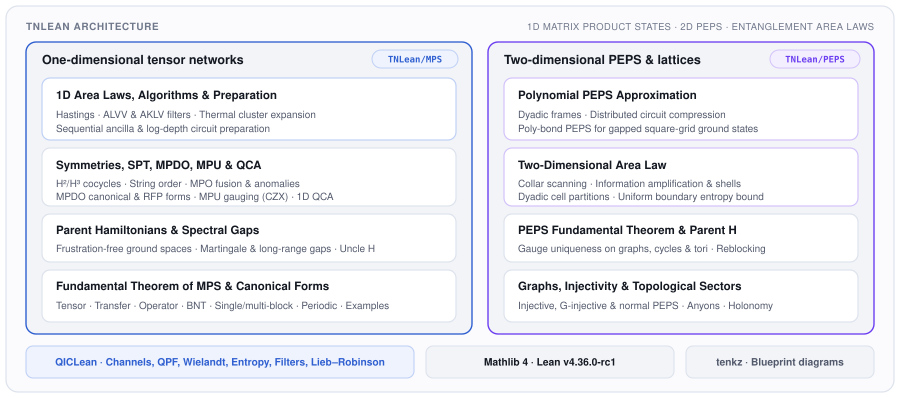

<div align="center">
  <a href="https://sirui-lu.com/TNLean/">
    <picture>
      <source media="(prefers-color-scheme: dark)" srcset="docs/logo-dark.svg" />
      <source media="(prefers-color-scheme: light)" srcset="docs/logo.svg" />
      
    </picture>
  </a>

  <p><b>Tensor-network theory and many-body area laws, formalized in Lean 4.</b></p>

  <p>
    <a href="https://github.com/LionSR/TNLean/actions/workflows/pr-ci.yml"></a>
    <a href="https://github.com/LionSR/TNLean/actions/workflows/blueprint.yml"></a>
    
    
    
    
    
    
    <a href="LICENSE"></a>
  </p>

  <p>
    <a href="https://sirui-lu.com/TNLean/blueprint/">Blueprint (web)</a> ·
    <a href="https://sirui-lu.com/TNLean/blueprint.pdf">Full PDF</a> ·
    <a href="https://sirui-lu.com/TNLean/blueprint-ch01-12.pdf">FT-MPS PDF</a> ·
    <a href="https://sirui-lu.com/TNLean/docs/">API docs</a> ·
    <a href="https://sirui-lu.com/TNLean/paper-gaps/">Paper-gap notes</a> ·
    <a href="docs/getting_started.md">Getting started</a> ·
    <a href="https://github.com/LionSR/QICLean">QICLean</a>
  </p>
</div>

<p align="center">
  <picture>
    <source media="(prefers-color-scheme: dark)" srcset="docs/assets/overview-dark.svg" />
    <source media="(prefers-color-scheme: light)" srcset="docs/assets/overview-light.svg" />
    
  </picture>
</p>

**TNLean** is a [Lean 4](https://lean-lang.org/) library built on [Mathlib](https://github.com/leanprover-community/mathlib4) (Lean `v4.36.0-rc1`) and the companion quantum-information library [QICLean](https://github.com/LionSR/QICLean). It formalizes the mathematical theory of one- and two-dimensional tensor networks: matrix product states (MPS) and their canonical forms and gauge structure, parent Hamiltonians and spectral gaps, symmetries and topological phases, matrix-product density operators (MPDO) and unitaries (MPU/QCA), quantum circuit state preparation, projected entangled pair states (PEPS), and entanglement area laws with tensor-network approximations in 1D and 2D. Blueprint tensor diagrams are rendered by [tenkz](https://github.com/LionSR/tenkz), pinned in [`tenkz.toml`](tenkz.toml).

The mathematics is written up in the [blueprint](https://sirui-lu.com/TNLean/blueprint/) ([full PDF](https://sirui-lu.com/TNLean/blueprint.pdf), [FT-MPS release PDF](https://sirui-lu.com/TNLean/blueprint-ch01-12.pdf)), which states each definition and theorem in mathematical prose and links it to its Lean proof. The generated [API documentation](https://sirui-lu.com/TNLean/docs/) covers every declaration in the source, and discrepancies against cited papers are documented under [`docs/paper-gaps/`](https://sirui-lu.com/TNLean/paper-gaps/). Every result is verified by Lean down to its axioms; the `sorries` and `axioms` badges above track the live counts.

The agent-driven formalization workflow is described in S. Lu, E. Tjoa, J. I. Cirac, *Multi-agent Autoformalization of Tensor Network Theory* ([arXiv:2607.07857](https://arxiv.org/abs/2607.07857)). Most of the formalization was carried out by agents running on [TeXRA](https://texra.ai), whose `lean-env-action` also sets up the Lean and blueprint toolchain in `.github/workflows/`. The entire library loads as a single import:

```lean
import TNLean
```

## What is formalized

### Fundamental theorem of MPS and quantum Wielandt bounds

An MPS assigns a matrix `A i` to each local basis state, with matrix products giving the state's coefficients on a chain (`MPSTensor d D`). TNLean proves the fundamental theorem of MPS across its single-block, canonical-form, periodic, and fixed-length algebraic forms:

- **Single-block injective case** (`TNLean/MPS/Tensor/Gauge/FundamentalTheorem.lean`, plus finite-length and up-to-phase variants):

```lean
theorem MPSTensor.fundamentalTheorem_singleBlock {A B : MPSTensor d D}
    (hA : Kraus.IsInjective A) (hAB : SameMPV A B) : GaugeEquiv A B
```

- **General multi-block and canonical-form case:** decomposition of arbitrary MPS tensors into normal blocks, bases of normal tensors (BNT), uniqueness of canonical form, and the multi-block equal and proportional theorems (`fundamentalTheorem_equal_canonicalForm`, `fundamentalTheorem_proportional_canonicalForm`), together with periodic-sector and fixed-length algebraic theorems.
- **Sharp quantum Wielandt spanning bounds** (`TNLean/MPS/Tensor/Words/WordSpan.lean`, consuming QICLean's channel-generic Wielandt theory):

```lean
theorem MPSTensor.cumulativeSpan_eq_top_of_isNormal_sharp [NeZero D]
    (A : MPSTensor d D) (hN : Kraus.IsNormal A) :
    Kraus.cumulativeSpan A (D ^ 2 - Module.finrank ℂ (Kraus.wordSpan A 1) + 1) = ⊤
```

### Parent Hamiltonians, spectral gaps, and correlations

- **Ground spaces and uniqueness:** parent interactions and Hamiltonians, the intersection property, frustration-freeness, unique ground states for injective and normal tensors, block ground spaces, and half-chain / uncle Hamiltonians.
- **Spectral gaps and stability:** martingale spectral-gap bounds, commuting and long-range gaps (including periodic chains and primitive sectors), smooth isometric and physical deformations, and exponential correlation decay.

### Symmetries, SPT phases, MPDO, MPU, and QCA

- **Group symmetries and SPT phases:** on-site and virtual symmetries of MPS, induced projective representations and `H²` cocycle invariants, continuous gapped paths, and string order parameters.
- **MPO symmetries and non-invertible fusion:** MPO algebras, boundary theories, fusion of non-invertible symmetry operators, anomalies, and condensation defects.
- **MPDO and renormalization fixed points:** mixed-state MPS canonical forms, Gibbs and zero-correlation-length structure, and renormalization fixed points.
- **MPU and 1D QCA:** canonical forms and fundamental theorem of matrix-product unitaries, circuit realizations, CZX gauging and `H³` / L-symbol classification, and finite-propagation 1D quantum cellular automata.

### Projected entangled pair states (PEPS)

- **Graphs, injectivity, and topological sectors:** finite graphs, cycles, tori, walks and holonomy, injective, `G`-injective, semi-regular, and normal PEPS, together with anyon and flux sectors.
- **PEPS fundamental theorem and parent Hamiltonians:** gauge uniqueness for injective and normal PEPS on connected graphs, cycles, and tori, and parent Hamiltonians with regional reblocking.

### 1D and 2D area laws, tensor-network approximation, and preparation

- **Two-dimensional area law and polynomial PEPS approximation:** a uniform entanglement area law for gapped local Hamiltonians on finite domains of `ℤ × ℤ` (`TNLean.PEPS.AreaLaw.uniformAreaLaw`, via collar scanning, information amplification, and dyadic cell partitions) and polynomial-bond-dimension PEPS approximation of gapped ground states on the `L × L` square grid (`TNLean.PEPS.Approximation.polynomialPEPSApproximation`, via dyadic frames and distributed circuit compression). See [`docs/openai-math-provenance.md`](docs/openai-math-provenance.md) for manuscript provenance and Apache-2.0 attribution.
- **One-dimensional area laws and gapped-chain algorithms:** global-gap 1D area laws (`chainAreaLaw`, `domainAreaLaw`), Hastings' approximate ground-state projector factorization, Hastings' 1D area law and thermal-state cluster expansion, entropy scaling for MPS approximation, and ALVV / AKLV polynomial-filter constructions and frustration-free improving families.
- **Quantum state preparation:** sequential ancilla generation and log-depth circuit preparation of normal, inhomogeneous, and non-normal MPS (`TNLean/MPS/Preparation`).

### Worked examples

Concrete verified models under `TNLean/MPS/Examples` and `TNLean/PEPS/Examples`, including AKLT, GHZ, cluster, Ising, Kramers–Wannier, Fibonacci, Majumdar–Ghosh, PVBS, CZX, WeakHopf, `Z2 × Z2`, `Z3`, and two-dimensional torus and PEPS models.

## Organization of the source

TNLean is organized into acyclic layers enforced by `scripts/check_import_layers.py` (see [`docs/library_layers.md`](docs/library_layers.md) and [`docs/import_structure.md`](docs/import_structure.md)). `TNLean.lean` and directory aggregators are generated; legacy code in `TNLean/Archive/` is excluded.

| Path | Contents |
| --- | --- |
| `TNLean/Network` | Contractions of tensors whose links carry their own virtual alphabets, on directed multigraphs and on finite sets of parties, and the sampled distributed contraction; imported by both MPS and PEPS. |
| `TNLean/MPS/Tensor`, `.../Transfer`, `.../Operator` | `MPSTensor`, words, `mpv`, gauges, blocking, transfer maps, Wielandt bounds, overlaps, correlations, and `MPOTensor` operators. |
| `TNLean/MPS/CanonicalForm`, `.../FundamentalTheorem` | Canonical forms, bases of normal tensors (BNT), single/multi-block, periodic, compression, and fixed-length fundamental theorems. |
| `TNLean/MPS/ParentHamiltonian` | Parent interactions, ground spaces, boundary maps, martingale and long-range spectral gaps, deformations, and uncle Hamiltonians. |
| `TNLean/MPS/Symmetry` | On-site and virtual symmetries, `H²` cocycles, continuous gapped paths, string order, and MPO symmetry algebras. |
| `TNLean/MPS/MPDO`, `.../RFP`, `.../MPU`, `TNLean/QCA` | Matrix-product density operators, renormalization fixed points, matrix-product unitaries, CZX gauging (`H³`), and 1D QCA. |
| `TNLean/MPS/Preparation`, `.../AreaLaw` | Sequential and log-depth MPS preparation; 1D area laws (Hastings, ALVV, AKLV), thermal cluster expansions, and gapped-chain algorithms. |
| `TNLean/MPS/Examples` | Worked 1D models (AKLT, GHZ, cluster, Ising, CZX, Fibonacci, Kramers–Wannier, Majumdar–Ghosh, PVBS, WeakHopf, `Z2 × Z2`, `Z3`). |
| `TNLean/PEPS/Graph`, `.../Tensor`, `.../Injectivity` | Graphs, tori, holonomy, PEPS contractions, injective, `G`-injective, semi-regular, and normal tensors, and anyon/flux sectors. |
| `TNLean/PEPS/FundamentalTheorem`, `.../ParentHamiltonian` | PEPS gauge uniqueness on connected graphs, cycles, and tori; PEPS parent Hamiltonians and reblocking. |
| `TNLean/PEPS/AreaLaw`, `.../Approximation`, `.../Examples` | Two-dimensional area law on `ℤ × ℤ`, polynomial-bond-dimension PEPS approximation, and 2D models. |
| `TNLean/Network`, `TNLean/Algebra` | Contractions of tensor networks whose links carry their own alphabets (on multigraphs and on parties), the distributed operator contraction and its sampled approximation built on the QICLean party calculus, and shared base utilities (generic non-tensor modules migrate to QICLean). |
| `blueprint/`, `docs/` | Mathematical companion text, layer architecture, conventions, and paper-gap notes (`docs/paper-gaps/`). |

After adding, moving, or removing a production `.lean` file, regenerate and verify import aggregators:

```bash
python3 scripts/generate_import_aggregators.py
python3 scripts/generate_import_aggregators.py --check
```

## Building, blueprint, and documentation

### Building the library

The Lean version is pinned in [`lean-toolchain`](lean-toolchain); Mathlib, QICLean, and other dependencies are pinned in [`lakefile.toml`](lakefile.toml) and [`lake-manifest.json`](lake-manifest.json).

```bash
# Download prebuilt Mathlib artifacts before building.
lake exe cache get

# Build the default library target (TNLean).
lake build

# Verify a single module with package Lean options and Mathlib standard linters.
lake build TNLean.MPS.Tensor.Gauge.FundamentalTheorem

# Fast elaboration only (does not apply package Lean options).
lake env lean TNLean/MPS/Tensor/Gauge/FundamentalTheorem.lean
```

### Building the blueprint locally

The blueprint builds with `leanblueprint` on top of a compiled `TNLean` library:

```bash
lake build TNLean
python3 scripts/fetch_tenkz.py
cd blueprint
leanblueprint checkdecls
leanblueprint web   # or: leanblueprint pdf / leanblueprint all
```

The standalone FT-MPS volume is built by `scripts/build_blueprint_ch01_12.sh` and published automatically alongside the full blueprint.

### Guides and conventions

| Document | Covers |
| --- | --- |
| [`docs/getting_started.md`](docs/getting_started.md) | Setup, source tour, and making a first contribution |
| [`docs/library_layers.md`](docs/library_layers.md) · [`docs/import_structure.md`](docs/import_structure.md) | Acyclic layer map, import rules, and Archive policy |
| [`docs/CONTRIBUTING.md`](docs/CONTRIBUTING.md) · [`docs/project_conventions.md`](docs/project_conventions.md) | Contributor workflow, proof standards, and local addenda |
| [`docs/openai-math-provenance.md`](docs/openai-math-provenance.md) | Provenance and Apache-2.0 attribution for 2D area-law / PEPS modules |
| [`AGENTS.md`](AGENTS.md) · [`CLAUDE.md`](CLAUDE.md) | Agent conventions, cache rules, and CI workflows |

## References

- D. Pérez-García, F. Verstraete, M. M. Wolf, J. I. Cirac, *Matrix Product State Representations*, [arXiv:quant-ph/0608197](https://arxiv.org/abs/quant-ph/0608197), Quantum Inf. Comput. **7** (2007).
- M. B. Hastings, *An area law for one-dimensional quantum systems*, [arXiv:0705.2024](https://arxiv.org/abs/0705.2024), J. Stat. Mech. P08024 (2007).
- D. Pérez-García, M. M. Wolf, M. Sanz, F. Verstraete, J. I. Cirac, *String Order and Symmetries in Quantum Spin Lattices*, [arXiv:0802.0447](https://arxiv.org/abs/0802.0447), Phys. Rev. Lett. **100**, 167202 (2008).
- M. Sanz, D. Pérez-García, M. M. Wolf, J. I. Cirac, *A quantum version of Wielandt's inequality*, [arXiv:0909.5347](https://arxiv.org/abs/0909.5347), IEEE Trans. Inf. Theory **56**(9), 4668–4673 (2010).
- N. Schuch, I. Cirac, D. Pérez-García, *PEPS as ground states: Degeneracy and topology*, [arXiv:1001.3807](https://arxiv.org/abs/1001.3807), Ann. Phys. **325**, 2153–2192 (2010).
- M. M. Wolf, *Quantum Channels & Operations: Guided Tour* (2012).
- I. Arad, A. Kitaev, Z. Landau, U. Vazirani, *An area law and sub-exponential algorithm for 1D systems*, [arXiv:1301.1162](https://arxiv.org/abs/1301.1162) (2013).
- C. Fernández-González, N. Schuch, M. M. Wolf, J. I. Cirac, D. Pérez-García, *Frustration free gapless Hamiltonians for Matrix Product States*, [arXiv:1210.6613](https://arxiv.org/abs/1210.6613), Commun. Math. Phys. **333**, 299–333 (2015).
- J. I. Cirac, D. Pérez-García, N. Schuch, F. Verstraete, *Matrix Product Density Operators: Renormalization Fixed Points and Boundary Theories*, [arXiv:1606.00608](https://arxiv.org/abs/1606.00608), Ann. Phys. **378**, 100–149 (2017).
- J. I. Cirac, D. Pérez-García, N. Schuch, F. Verstraete, *Matrix Product Unitaries: Structure, Symmetries, and Topological Invariants*, [arXiv:1703.09188](https://arxiv.org/abs/1703.09188), J. Stat. Mech. 083105 (2017).
- G. De las Cuevas, J. I. Cirac, N. Schuch, D. Pérez-García, *Irreducible forms of Matrix Product States: Theory and Applications*, [arXiv:1708.00029](https://arxiv.org/abs/1708.00029), J. Math. Phys. **58**, 121901 (2017).
- I. Arad, Z. Landau, U. Vazirani, T. Vidick, *Rigorous RG algorithms and area laws for low energy eigenstates in 1D*, [arXiv:1602.08828](https://arxiv.org/abs/1602.08828), Commun. Math. Phys. **356**, 65–105 (2017).
- A. Molnár, J. Garre-Rubio, D. Pérez-García, N. Schuch, J. I. Cirac, *Normal projected entangled pair states generating the same state*, [arXiv:1804.04964](https://arxiv.org/abs/1804.04964), New J. Phys. **20**, 113017 (2018).
- J. I. Cirac, J. Garre-Rubio, D. Pérez-García, *Mathematical open problems in projected entangled pair states*, [arXiv:1903.09439](https://arxiv.org/abs/1903.09439), Rev. Mat. Complut. **32**, 579–599 (2019).
- J. I. Cirac, D. Pérez-García, N. Schuch, F. Verstraete, *Matrix Product States and Projected Entangled Pair States*, [arXiv:2011.12127](https://arxiv.org/abs/2011.12127), Rev. Mod. Phys. **93**, 045003 (2021).
- D. Malz, G. Styliaris, Z.-Y. Wei, J. I. Cirac, *Preparation of Matrix Product States with Log-Depth Quantum Circuits*, [arXiv:2307.01696](https://arxiv.org/abs/2307.01696), Phys. Rev. Lett. **132**, 040404 (2024).
- OpenAI Math, *Two-dimensional area law* and *Polynomial PEPS approximation* manuscripts in [`openai/math`](https://github.com/openai/math) (September 2026; see [`docs/openai-math-provenance.md`](docs/openai-math-provenance.md)).
- S. Lu, E. Tjoa, J. I. Cirac, *Multi-agent Autoformalization of Tensor Network Theory*, [arXiv:2607.07857](https://arxiv.org/abs/2607.07857) (2026).
- [Mathlib4](https://github.com/leanprover-community/mathlib4), the Lean 4 mathematics library.

## License

The Lean source, the blueprint, and the other original content of this repository are released under the Apache License 2.0 (see [`LICENSE`](LICENSE)). Adapted definitions from `openai/math` carry Apache-2.0 notices per [`docs/openai-math-provenance.md`](docs/openai-math-provenance.md) and [`LICENSES/openai-math-Apache-2.0.txt`](LICENSES/openai-math-Apache-2.0.txt). The `Papers/` directory contains the arXiv sources of third-party papers that remain under their authors' copyright and are **not** covered by the repository license (see [`Papers/NOTICE.md`](Papers/NOTICE.md)).
