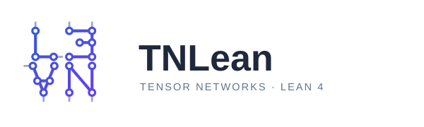

<p align="center">
  
</p>

<p align="center">
  <b>Tensor-network theory, formalized in Lean 4.</b>
</p>

[](https://github.com/LionSR/TNLean/actions/workflows/pr-ci.yml)
[](https://github.com/LionSR/TNLean/actions/workflows/blueprint.yml)


<p align="center">
  <a href="https://sirui-lu.com/TNLean/blueprint/">Blueprint</a> ·
  <a href="https://sirui-lu.com/TNLean/docs/">Documentation</a> ·
  <a href="https://sirui-lu.com/TNLean/paper-gaps/">Paper-gap notes</a>
</p>

TNLean is a [Lean 4](https://lean-lang.org/) library, built on
[Mathlib](https://github.com/leanprover-community/mathlib4), that formalizes
the mathematics of tensor networks: matrix product states (MPS), projected
entangled pair states (PEPS), and the theorems about them. The
quantum-information theory it rests on lives in the companion library
[QICLean](https://github.com/LionSR/QICLean).

## Highlights

- **The area law in two dimensions.** On every finite domain of the square
  lattice, the unique ground state of a gapped finite-range Hamiltonian has
  entanglement entropy across any cut at most a constant times the number of
  edges crossing it.
- **Gapped ground states are PEPS.** On the `L × L` square grid, such a
  ground state lies within distance `1/L` of a PEPS of bond dimension
  polynomial in `L`.
- **The fundamental theorem of matrix product states**: two tensors generate
  the same states at every system size exactly when a gauge transformation
  relates them.
- **Gapped chains**: Hastings' area law, approximation by MPS of polynomial
  bond dimension, and the analysis behind the polynomial-time ground-state
  algorithm.
- **Scale.** About 1.2 million lines of Lean here and 400,000 in QICLean.

The mathematics is written up in the
[blueprint](https://sirui-lu.com/TNLean/blueprint/)
([PDF](https://sirui-lu.com/TNLean/blueprint.pdf),
[FT-MPS volume](https://sirui-lu.com/TNLean/blueprint-ch01-12.pdf)), which
states each result in ordinary mathematical language and links it to its Lean
proof. The agent-driven workflow behind the library is described in S. Lu,
E. Tjoa, J. I. Cirac, *Multi-agent Autoformalization of Tensor Network
Theory*, [arXiv:2607.07857](https://arxiv.org/abs/2607.07857); most of the
formalization was carried out by agents running on [TeXRA](https://texra.ai).

## Main theorems

The two-dimensional area law, with the constant `C` chosen before the domain
`Λ`, the Hamiltonian, the state, and the region `A`:

```lean
theorem TNLean.PEPS.AreaLaw.uniformAreaLaw :
    ∀ q : ℕ, 1 ≤ q → ∀ R : ℕ, ∀ J Δ : ℝ, 0 < J → 0 < Δ →
      ∃ C : ℝ, 0 ≤ C ∧
        ∀ Λ : Finset (ℤ × ℤ), ∀ h : PlaneInteraction Λ q R,
          (∀ X, (h.term X).IsHermitian) → (∀ X, ‖h.term X‖ ≤ J) →
          ∀ E₀ : ℝ, ∀ Ω : StateSpace Λ q,
            ‖Ω‖ = 1 → IsGapped h.hamiltonian E₀ Δ →
            groundSpace h.hamiltonian E₀ = Submodule.span ℂ {Ω} →
              ∀ A : Finset (Site Λ),
                regionalEntropy Λ q Ω A ≤ C * (edgeBoundary Λ A).card
```

(The source names this proposition `UniformAreaLaw`; it is unfolded here.)
The PEPS approximation is
`TNLean.PEPS.Approximation.polynomialPEPSApproximation`. Both follow the
OpenAI preprints of September 2026 listed in the references.

The fundamental theorem for an injective tensor:

```lean
theorem MPSTensor.fundamentalTheorem_singleBlock {A B : MPSTensor d D}
    (hA : IsInjective A) (hAB : SameMPV A B) : GaugeEquiv A B
```

The general case, for canonical forms built from a basis of normal tensors,
is `MPSTensor.fundamentalTheorem_equal_canonicalForm`.

## Organization of the source

`import TNLean` loads the whole library (Lean 4 / Mathlib `v4.36.0-rc1`).
`TNLean.lean` and the directory aggregators are generated; see
[`docs/import_structure.md`](docs/import_structure.md).

| Path | Contents |
|---|---|
| `TNLean/Algebra` | Tensor-network-facing algebra not owned by QICLean: matrix and finite-sum lemmas, cocycle cohomology, and exact-ring certificates for the worked examples. |
| `TNLean/Circuit` | Local quantum circuits on qudit chains: supported operators, layers and light cones, measurements, teleportation, and circuits of channels. |
| `TNLean/Lattice` | Finite lattice domains, local Hamiltonians, Gaussian spectral filters, and regional entropy, shared by the one- and two-dimensional area laws. |
| `TNLean/Spectral` | Transfer-operator spectral gaps, overlap matrices, and correlation-decay estimates for MPS. |
| `TNLean/MPS/Defs.lean`, `TNLean/MPS/Core`, `TNLean/MPS/Chain`, `TNLean/MPS/Overlap` | Matrix product states: tensors, words, blocking, transfer maps, and overlap matrices. |
| `TNLean/MPS/FundamentalTheorem`, `.../BNT`, `.../CanonicalForm`, `.../Periodic`, `.../Structure`, `.../Irreducible` | The fundamental theorem in its single-block, multi-block, canonical-form, and periodic versions. |
| `TNLean/MPS/Symmetry` | On-site and virtual symmetry, cohomology of cocycles, string order, symmetry-protected phases, and matrix-product-operator symmetries. |
| `TNLean/MPS/ParentHamiltonian` | Parent Hamiltonians, their ground spaces, uniqueness of the ground state, and spectral gaps. |
| `TNLean/MPS/MPDO`, `TNLean/MPS/RFP` | Matrix-product operators and density operators, and renormalization fixed points. |
| `TNLean/MPS/MPU`, `TNLean/QCA` | Matrix-product unitaries and quantum cellular automata. |
| `TNLean/MPS/Preparation` | Sequential generation and log-depth preparation of MPS, with depth lower bounds. |
| `TNLean/MPS/AreaLaw` | The one-dimensional area law and MPS approximation for gapped chains, Hastings' proof, entropy scaling, and the ground-state algorithms. |
| `TNLean/MPS/Examples` | Worked examples: AKLT, GHZ, cluster, Majumdar-Ghosh, the Kitaev chain, and symmetry operators such as CZX, Kramers-Wannier, Fibonacci, and Ising. |
| `TNLean/Wielandt` | The quantum Wielandt inequality and primitivity for MPS tensors. |
| `TNLean/PEPS` | Projected entangled pair states: the fundamental theorem, $G$-injectivity, regions and parent Hamiltonians, the two-dimensional area law (`PEPS/AreaLaw`), and approximation of gapped ground states (`PEPS/Approximation`). |
| `TNLean/PiAlgebra` | Algebraic variants of the fundamental theorem. |
| `TNLean/Tactic`, `TNLean/MPS/Tactic` | Project tactics and simp sets. |
| `blueprint/`, `docs/` | The mathematical companion text, conventions, and notes on gaps from the sources. |

## Status

This is a research formalization in progress. The `sorries` and `axioms`
badges above count unfinished proofs and assumed results, the blueprint marks
each theorem as formalized or not, and the
[paper-gap notes](https://sirui-lu.com/TNLean/paper-gaps/) record where a
formal statement differs from its cited source.

## Building

```bash
# Fetch pre-built Mathlib first; otherwise Mathlib compiles from source.
lake exe cache get
lake build
```

See [`docs/getting_started.md`](docs/getting_started.md) for the full guide,
including the blueprint build and the conventions for contributors.

## License

The Lean source, the blueprint, and the other original content of this
repository are released under the Apache License 2.0 (see
[`LICENSE`](LICENSE)). The `Papers/` directory contains the arXiv sources of
the papers being formalized; these are third-party works that remain under
their authors' copyright and are **not** covered by the repository license.
See [`Papers/NOTICE.md`](Papers/NOTICE.md).

## References

The formalization draws principally on the following sources.

- D. Pérez-García, F. Verstraete, M. M. Wolf, J. I. Cirac,
  *Matrix Product State Representations*,
  [arXiv:quant-ph/0608197](https://arxiv.org/abs/quant-ph/0608197),
  Quantum Inf. Comput. **7** (2007).
- M. Sanz, D. Pérez-García, M. M. Wolf, J. I. Cirac,
  *A quantum version of Wielandt's inequality*,
  [arXiv:0909.5347](https://arxiv.org/abs/0909.5347),
  IEEE Trans. Inf. Theory **56**(9), 4668--4673 (2010).
- J. I. Cirac, D. Pérez-García, N. Schuch, F. Verstraete,
  *Matrix Product Density Operators: Renormalization Fixed Points and Boundary Theories*,
  [arXiv:1606.00608](https://arxiv.org/abs/1606.00608),
  Ann. Phys. **378**, 100--149 (2017).
- G. De las Cuevas, J. I. Cirac, N. Schuch, D. Pérez-García,
  *Irreducible forms of Matrix Product States: Theory and Applications*,
  [arXiv:1708.00029](https://arxiv.org/abs/1708.00029),
  J. Math. Phys. **58**, 121901 (2017).
- J. I. Cirac, D. Pérez-García, N. Schuch, F. Verstraete,
  *Matrix Product States and Projected Entangled Pair States*,
  [arXiv:2011.12127](https://arxiv.org/abs/2011.12127),
  Rev. Mod. Phys. **93**, 045003 (2021).
- A. Molnár, J. Garre-Rubio, D. Pérez-García, N. Schuch, J. I. Cirac,
  *Normal projected entangled pair states generating the same state*,
  [arXiv:1804.04964](https://arxiv.org/abs/1804.04964),
  New J. Phys. **20**, 113017 (2018).
- D. Pérez-García, M. M. Wolf, M. Sanz, F. Verstraete, J. I. Cirac,
  *String Order and Symmetries in Quantum Spin Lattices*,
  [arXiv:0802.0447](https://arxiv.org/abs/0802.0447),
  Phys. Rev. Lett. **100**, 167202 (2008).
- C. Fernández-González, N. Schuch, M. M. Wolf, J. I. Cirac, D. Pérez-García,
  *Frustration free gapless Hamiltonians for Matrix Product States*,
  [arXiv:1210.6613](https://arxiv.org/abs/1210.6613),
  Commun. Math. Phys. **333**, 299--333 (2015).
- N. Schuch, I. Cirac, D. Pérez-García,
  *PEPS as ground states: Degeneracy and topology*,
  [arXiv:1001.3807](https://arxiv.org/abs/1001.3807),
  Ann. Phys. **325**, 2153--2192 (2010).
- J. I. Cirac, J. Garre-Rubio, D. Pérez-García,
  *Mathematical open problems in projected entangled pair states*,
  [arXiv:1903.09439](https://arxiv.org/abs/1903.09439),
  Rev. Mat. Complut. **32**, 579--599 (2019).
- C. Schön, E. Solano, F. Verstraete, J. I. Cirac, M. M. Wolf,
  *Sequential Generation of Entangled Multiqubit States*,
  [arXiv:quant-ph/0501096](https://arxiv.org/abs/quant-ph/0501096),
  Phys. Rev. Lett. **95**, 110503 (2005).
- D. Malz, G. Styliaris, Z.-Y. Wei, J. I. Cirac,
  *Preparation of Matrix Product States with Log-Depth Quantum Circuits*,
  [arXiv:2307.01696](https://arxiv.org/abs/2307.01696),
  Phys. Rev. Lett. **132**, 040404 (2024).
- M. B. Hastings,
  *An area law for one-dimensional quantum systems*,
  [arXiv:0705.2024](https://arxiv.org/abs/0705.2024),
  J. Stat. Mech. **2007**, P08024 (2007).
- I. Arad, A. Kitaev, Z. Landau, U. Vazirani,
  *An area law and sub-exponential algorithm for 1D systems*,
  [arXiv:1301.1162](https://arxiv.org/abs/1301.1162) (2013).
- Z. Landau, U. Vazirani, T. Vidick,
  *A polynomial-time algorithm for the ground state of 1D gapped local Hamiltonians*,
  [arXiv:1307.5143](https://arxiv.org/abs/1307.5143) (2013).
- I. Arad, Z. Landau, U. Vazirani, T. Vidick,
  *Rigorous RG algorithms and area laws for low energy eigenstates in 1D*,
  [arXiv:1602.08828](https://arxiv.org/abs/1602.08828) (2017).
- OpenAI, *A two-dimensional area law from a global spectral gap* and
  *Polynomial PEPS approximation of gapped square-grid ground states*,
  preprints in [openai/math](https://github.com/openai/math) (September 2026).
- M. M. Wolf, *Quantum Channels & Operations: Guided Tour* (2012).
- [Mathlib4](https://github.com/leanprover-community/mathlib4), the Lean 4
  mathematics library.
