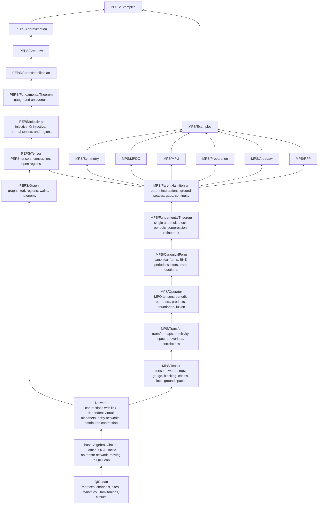

# Library layers of TNLean

Status: applied by commit `3203f27710`. The module map was computed on commit
`e8f8dd3202` and applied by a one-off script; the map and the script were
removed once the map was applied, and both remain in the history of that
commit. The layers and the allowed imports are now enforced by
`scripts/check_import_layers.py` (`LAYERS`, `ALLOWED` and `UPWARD_IMPORTS`).

This document carries out follow-ons F1 and F2, and the layering part of F4, of
`many_body_circuit_architecture.md`, for the whole of TNLean. It applies the
principles of that document:

- a layer is defined by the objects its statements mention;
- imports point downward, and two directories at the same height do not import
  each other;
- a directory name states objects;
- a directory holds at most about forty modules at one level;
- a module of one lemma is merged into the module that defines its object;
- what mentions no tensor network belongs to QICLean.

Work already under way is taken as given and not redesigned here:

- `TNLean/Circuit` and the top level of `TNLean/Lattice` have moved to QICLean;
- the generic modules of `TNLean/Algebra` and the finite-ring dynamics of
  `MPS/Preparation` are moving there;
- the party calculus (`Lattice/PartyCircuit`, `Compression`, `Sheet`) is
  tracked in issue #10958;
- the 44 modules of `Lattice/Compression` that contract a network of tensors
  have moved to the new lowest tensor-network layer `TNLean/Network` (see "The
  layers").

## Summary

| | Before | After the map |
|---|---:|---:|
| Modules with declarations | 5,311 | 4,768 |
| Directories with more than 40 modules at one level | 20 (in the tensor-network directories) | 0 (4 remain in `Algebra`, `Lattice/Compression`, `Lattice/PartyCircuit`, `QCA`, all bound for QICLean) |
| Pairs of directories importing each other (depth of `check_import_layers.py`) | 54 | 11 |
| Imports pointing outside the allowed layers | not defined | 52, all recorded with the declarations to move |

- **Moves:** 3,457 modules change path without merging. Every directory below
  `TNLean/MPS` and `TNLean/PEPS` is replaced by a layer directory.
- **Merges:** 542 modules of one or two declarations are merged into 413
  modules.
- **Flagged for QICLean:** 767 modules of the tensor-network directories
  mention no tensor network and have a second use, so they belong to QICLean.
  The per-kind counts are in "QICLean-bound content".
- **Proof-specific:** 974 further modules mention no tensor network but
  are one theorem's own argument. They stay beside that theorem.

All 11 remaining pairs, and all 52 recorded imports, come either from
modules that hold declarations of two layers or from imports that the importer
does not use. They disappear when the declarations listed under
"Declaration-level work" move. Eight of the pairs are among the PEPS layers up
to `PEPS/ParentHamiltonian`, where modules were placed by their statements
rather than by their imports. Two come from unused imports
(`PEPS/Approximation`–`PEPS/AreaLaw`, `PEPS/Examples`–`PEPS/Graph`). One is in
MPS (`MPS/FundamentalTheorem`–`MPS/ParentHamiltonian`, one gauge lemma).

## Method

Each module was classified by its statements, not by its name:

- A script read the signature of every declaration and resolved the constants
  it names to their defining modules.
- It marked a declaration as mentioning a tensor network when the statement
  names any of: an MPS, MPO or PEPS tensor; a transfer map of a tensor; a bond
  dimension; or a definition that does.
- The import graph was read from source as `scripts/check_import_layers.py`
  reads it, with comments removed and aggregators expanded.

The assignment then went in three steps.

1. **Directory layers.** Every module was given the layer of its directory.
2. **Module-level repairs.** Each import pointing sideways or upward was
   repaired in one of two ways, whichever moved fewer modules:
   - the imported module moved down, with what it needs, to the highest layer
     both sides may import;
   - the importing module moved up.

   A module moved down was then placed in the lowest layer that its imports
   and statements allow.
3. **Division by object.** Each large directory was read module by module to
   divide it by object, choose the merges, and flag what belongs to QICLean.

The combined map was checked by the check mode of the application script until
the only violations left were those listed here as declaration-level work.

## The layers

| Layer | Objects of its statements | May import |
|---|---|---|
| `base` | no tensor network: matrices on finite index types, sites and regions, Hamiltonians, party circuits, quasi-local algebras | QICLean, Mathlib |
| `Network` | contractions of tensors whose links carry their own finite virtual alphabets: edge-dependent networks on directed multigraphs and their cuts (`DependentBond`), party networks (`Party`), the distributed operator contraction with its labels and sample indices (`DistributedContraction`), the factor at one party from its incident labels (`IncidentFactor`), the sampled approximation and its uniform bounds (`SampledApproximation`) | base |
| `MPS/Tensor` | `MPSTensor`, words and their traces, `mpv`, gauges, physical reshapes and blocking, chains of site-dependent tensors, direct sums, reductions, the local ground spaces `G_L(A)` and parent interaction | `Network`, base |
| `MPS/Transfer` | the transfer map as a linear map: fixed points, primitivity and normality, quantum Wielandt bounds, spectra and gaps, overlaps, correlations, irreducibility | `MPS/Tensor` |
| `MPS/Operator` | `MPOTensor` and its periodic operators, products and action on MPS, boundaries, fusion and zippers, simple density-operator tensors, MPUs as operators | `MPS/Transfer` and below |
| `MPS/CanonicalForm` | canonical forms and their existence, bases of normal tensors, block separation, periodic tensors and their cyclic sectors, trace-quotient algebras, open-boundary canonical forms, canonical forms of simple MPOs and MPUs | `MPS/Operator` and below |
| `MPS/FundamentalTheorem` | equality of MPV families implies gauge equivalence: single block, sectors, arbitrary tensors, compression, operator products and groups, periodic tensors, refinement, fixed length | `MPS/CanonicalForm` and below |
| `MPS/ParentHamiltonian` | parent interactions and Hamiltonians, block ground spaces, boundary maps, gaps, continuity, deformations, uncle Hamiltonians | `MPS/FundamentalTheorem` and below |
| `MPS/Symmetry`, `MPS/MPDO`, `MPS/MPU`, `MPS/Preparation`, `MPS/AreaLaw`, `MPS/RFP` | each its own objects; none imports another | `MPS/ParentHamiltonian` and below |
| `MPS/Examples` | named models | everything in `MPS` |
| `PEPS/Graph` | finite graphs, tori, cycles, cells and plaquettes, regions and their boundaries, walks and holonomy of group labels; no tensor | `Network`, base |
| `PEPS/Tensor` | PEPS tensors on a graph, contraction, open regions, blocked regions | `PEPS/Graph`, the MPS chain up to `MPS/ParentHamiltonian` |
| `PEPS/Injectivity` | injective, G-injective, semi-regular and normal tensors, injectivity of regions, flux and charge sectors | `PEPS/Tensor` and below |
| `PEPS/FundamentalTheorem/Injective/FundamentalTheorem` | gauge equivalence and uniqueness on connected graphs, cycles, tori; normal tensors | `PEPS/Injectivity` and below |
| `PEPS/ParentHamiltonian` | parent Hamiltonians of injective, G-injective, semi-regular tensors, regions and reblocking | `PEPS/FundamentalTheorem/Injective/FundamentalTheorem` and below |
| `PEPS/AreaLaw` | the area law for gapped ground states of the square grid (no tensor network) | `PEPS/ParentHamiltonian` and below |
| `PEPS/Approximation` | the polynomial PEPS approximation of gapped square-grid ground states | `PEPS/AreaLaw` and below |
| `PEPS/Examples` | named two-dimensional models | everything in `PEPS` and `MPS/Examples` |

MPS never imports PEPS. The four modules that did (`MPS/AreaLaw/SnakeGrid*`, `MPS/Symmetry/OnSite/GInjective`) are moved:

- the snake-grid modules state square-grid results and go to `PEPS/AreaLaw`;
- the predicate `IsGInjective` of `Algebra/GInjective` mentions only a linear map
  and a representation, so it goes to `base` (`Algebra/GInjective`) and is
  flagged for QICLean.

## The order inside MPS

The chain `Tensor` < `Transfer` < `Operator` < `CanonicalForm` <
`FundamentalTheorem` < `ParentHamiltonian` was tested against the import graph.

`Operator` sits below `CanonicalForm`, not among the consumers. `MPOTensor` is
defined beside `mpv`, and the canonical-form, fundamental-theorem,
parent-Hamiltonian, symmetry and MPU layers all state results about MPO tensors.

The six consumer directories import nothing from one another after the map.
Their crossing imports were:

| Crossing import | Repair |
|---|---|
| `Symmetry` → `MPDO` (41) | the MPO basics went down to `MPS/Operator` |
| `MPU` → `MPDO` (47) | the MPO basics went down to `MPS/Operator` |
| `Symmetry` → `ParentHamiltonian` (46) | allowed: the parent-Hamiltonian layer is below the consumers |
| `Symmetry` → `Preparation` (15) | blocked polar decompositions, window correlators and second-order overlaps went to the chain |
| `MPU` → `Symmetry` (10) | the operator-group modules (associators, anomalies, domain walls) went to `MPS/FundamentalTheorem/OperatorGroup` |
| `MPDO` ↔ `RFP` | the shared modules went to the chain |
| `MPU` → `QCA` | allowed: `QCA` is in `base` |

`Periodic` was a consumer in the starting order, but the canonical-form and
fundamental-theorem directories imported it (22 and 11 modules). By its
statements it is canonical-form material, and it is divided between
`CanonicalForm/Periodic` (the periodic decomposition, cyclic sectors, blocking,
overlaps) and `FundamentalTheorem/{Periodic, Refinement}` (the fundamental
theorem for periodic tensors and the refinement theorem, Theorem 4.1 of the
source).

The subdirectories after the map, with their module counts after merging (the
objects of each are described in Part II):

- **`MPS/Tensor`** (147): `(top)` 13, `Chain` 11, `CutGram` 10, `DirectSum` 14, `Gauge` 8, `GroundSpace` 23, `HalfChain` 4, `OpenMPS` 9, `Physical` 12, `Reduction` 5, `VaryingBond` 20, `Words` 18
- **`MPS/Transfer`** (49): `(top)` 4, `Correlation` 7, `Irreducible` 12, `Primitivity` 12, `RenormalizationFixedPoint` 4, `Spectrum` 10
- **`MPS/Operator`** (130): `(top)` 7, `Boundary` 17, `DensityOperator` 7, `Fusion` 16, `Interaction` 3, `Periodic` 12, `PhysicalSector` 39, `Product` 8, `Simple` 12, `Unitary` 9
- **`MPS/CanonicalForm`** (195): `(top)` 8, `BNT` 10, `BNTPresentation` 14, `BlockSeparation` 13, `Correlation` 10, `FixedPointApproximation` 5, `NormalBlocks` 16, `OpenBoundary` 8, `PairWordSpan` 3, `Periodic` 8, `Periodic.Blocking` 8, `Periodic.CyclicSectors` 22, `Periodic.Overlap` 21, `RenormalizationFixedPoint` 5, `SimpleMPO` 22, `SimpleMPU` 10, `TraceQuotient` 8, `VerticalForm` 4
- **`MPS/FundamentalTheorem`** (143): `(top)` 3, `Arbitrary` 19, `Compression` 26, `FixedLength` 11, `OperatorGroup` 13, `OperatorProduct` 5, `Periodic` 10, `PhysicalSupport` 5, `Reduction` 1, `Refinement` 19, `SectorBNT` 5, `Sectors` 11, `WordModule` 9, `Zipper` 6
- **`MPS/ParentHamiltonian`** (326): `(top)` 5, `BlockGroundSpace` 20, `BlockGroundSpace.BoundaryMatrix` 15, `BlockGroundSpace.Sector` 14, `Blocking` 9, `BoundaryMap` 21, `BulkObservable` 13, `Commuting` 8, `Commuting.SectorGraph` 9, `Continuity` 12, `Deformation` 10, `Gap` 10, `Gap.Comparison` 9, `Gap.Filtration` 14, `Gap.Spectator` 7, `Interaction` 17, `LocalExpectation` 12, `OpenBoundary` 11, `ParentInteraction` 16, `Periodic` 9, `ProjectorDefect` 15, `ProjectorDefect.DimensionConstant` 6, `ProjectorDefect.Residual` 13, `QuasiLocalState` 13, `Stationary` 8, `Uncle` 30
- **`MPS/Symmetry`** (235): `ContinuousFamily` 24, `FixedPoint` 21, `GappedPath` 17, `GroundPath` 9, `MPOSymmetry.Anomaly` 4, `MPOSymmetry.Fusion` 13, `MPOSymmetry.MixedPath.Endpoint` 14, `MPOSymmetry.MixedPath.Gap` 24, `MPOSymmetry.MixedPath.Joint` 23, `MPOSymmetry.MixedPath.MPO` 22, `MPOSymmetry.ParentHamiltonian` 5, `OnSite` 13, `PeriodicRay` 7, `Projective` 5, `SPTClassification` 18, `StringOrder` 16
- **`MPS/MPDO`** (186): `(top)` 1, `AmbientSectorMaps` 8, `BNTSectors` 10, `CZX` 18, `Coefficients` 9, `CommutingForm` 6, `CyclicActiveSector` 15, `Entropy` 10, `Fusion` 21, `MPOAction` 12, `PhysicalSector` 21, `Purification` 8, `RFP` 7, `SectorMaps` 14, `TopologicalForm` 7, `Vertical` 19
- **`MPS/MPU`** (272): `CanonicalForm` 16, `Circuit` 3, `Circuit.Bounds` 7, `Circuit.CutMetrics` 12, `Circuit.Gates` 8, `Circuit.Interval` 18, `Circuit.Merging` 12, `Circuit.Registers` 12, `DomainWall` 10, `Equivalence` 8, `Index` 18, `QuasiLocal` 23, `Representation` 19, `Representation.GroupCocycleMPO` 5, `Simple` 27, `StandardForm` 30, `Symmetry.Conjugation` 3, `Symmetry.Phases` 16, `Symmetry.TimeReversal` 19, `Symmetry.Transposition` 6
- **`MPS/Preparation`** (127): `(top)` 1, `BlockSum` 32, `Circuit` 20, `Correlations` 7, `Inhomogeneous` 18, `Measurement` 5, `Normal` 16, `Polar` 11, `SectorEncoder` 4, `Sequential` 5, `Tree` 8
- **`MPS/AreaLaw`** (538): `Approximation` 2, `Chain` 23, `ChebyshevAGSP` 38, `ChebyshevAGSP.FrustrationFree` 7, `ChebyshevAGSP.SchmidtRank` 4, `Entropy` 13, `EntropyScaling` 19, `GroundStateAlgorithm` 11, `GroundStateAlgorithm.ApproximateProjector` 8, `GroundStateAlgorithm.BoundarySDP` 19, `GroundStateAlgorithm.BoundaryState` 15, `GroundStateAlgorithm.GaussianFilter` 17, `GroundStateAlgorithm.QueryProgram` 11, `GroundStateAlgorithm.RationalTensor` 34, `GroundStateAlgorithm.ViableVector` 8, `LocalSolution` 25, `LowEnergyAlgorithm` 1, `LowEnergyAlgorithm.DegenerateGround` 34, `LowEnergyAlgorithm.EnergyEstimate` 12, `LowEnergyAlgorithm.FrustrationFree` 15, `LowEnergyAlgorithm.ImprovingFamily` 23, `LowEnergyAlgorithm.IntervalTree` 17, `LowEnergyAlgorithm.IntervalTrimming` 14, `LowEnergyAlgorithm.LowDensity` 23, `LowEnergyAlgorithm.MPO` 19, `LowEnergyAlgorithm.RegionalFactors` 6, `LowEnergyAlgorithm.SoftTruncation` 15, `LowEnergyAlgorithm.Truncation` 14, `ProjectorFactorization` 32, `ProjectorFactorization.SchmidtTail` 11, `Spectral` 14, `SweepPreparation` 22, `ViableSet` 12
- **`MPS/RFP`** (19): `(top)` 19
- **`MPS/Examples`** (309): `(top)` 8, `AKLT` 14, `BinaryCycle` 5, `BondTwoSingleton` 4, `CZX` 17, `CZY` 4, `Cluster` 7, `ControlledZ` 2, `CorrelatedFlip` 5, `Dimer` 27, `Fibonacci` 20, `GHZ` 4, `GHZCluster` 3, `IdentityPlusZString` 7, `Ising` 20, `KramersWannier` 8, `MPDOCounterexamples` 9, `MPUPhases` 4, `MajumdarGhosh` 6, `MultiBlock` 22, `NonCartesianSectors` 9, `PVBS` 18, `Rings` 4, `Shift` 24, `SpanningSectors` 4, `Spin` 3, `WeakHopf` 2, `Weyl` 13, `Wielandt` 5, `Z2Z2` 13, `Z3` 18

## The order inside PEPS

The PEPS layers are ordered `Graph` < `Tensor` < `Injectivity` <
`FundamentalTheorem` < `ParentHamiltonian` < `AreaLaw` < `Approximation`. Every
import respects this order once the declaration moves listed below are made.

The top level of `PEPS` (546 modules) and its six small subdirectories are
divided among the first four layers by their statements:

| Layer | Modules after merging |
|---|---:|
| `Graph` (no tensor network) | 65 |
| `Tensor` | 45 |
| `Injectivity` | 288 |
| `FundamentalTheorem` | 140 |
| moved to `ParentHamiltonian` and `Examples` | 23 |

Of the 349 modules of the top level that mention no tensor network by the
statement scan, 236 are tensor-network modules after all. They carry
G-injective hypotheses on a tensor, or definitions built from a contraction,
that the scan does not see. The others are graph, geometry and matrix
material: 111 are flagged for QICLean, and 4 stay as auxiliaries of one
theorem.

Placing these modules by their imports instead of their statements would have
pushed the whole torus and graph geometry, and the G-injective theory, into the
fundamental-theorem layer. The statement placement leaves 48 imports pointing
upward between the four layers. Each of them comes from one to six
declarations that sit in the wrong module (for example `IncidentEdge` in
`Tensor/Network/Defs`, the region boundary predicates in
`Tensor/Region/RegionBlock`, `torusRightEdge` in
`Tensor/Torus/TorusTranslationInvariant`). They are listed under
"Declaration-level work". After those moves every PEPS import points downward.

- **`PEPS/Graph`** (65): `Cell` 17, `Holonomy` 18, `Plaquette` 7, `Region` 7, `Torus` 9, `Walk` 7
- **`PEPS/Tensor`** (45): `Cycle` 3, `GraphState` 15, `Network` 7, `Region` 8, `SquareLattice` 4, `Torus` 8
- **`PEPS/Injectivity`** (288): `Boundary` 13, `Charge` 31, `Closure` 10, `CutSpace` 25, `Entropy` 13, `Flux` 32, `FluxString` 15, `GInjective` 16, `Multiplicity` 30, `Normal` 12, `Region` 15, `Regular` 29, `SemiRegular` 12, `TorusCharge` 9, `TorusSector` 26
- **`PEPS/FundamentalTheorem/Injective/FundamentalTheorem`** (140): `ConnectedGraph` 3, `Cycle` 10, `Injective` 20, `Normal` 17, `Normal.CoarseThreeSite` 10, `Normal.RegionInsertion` 23, `Torus` 23, `Torus.Window` 34
- **`PEPS/ParentHamiltonian`** (144): `Cycle` 3, `GInjective` 11, `Injective` 16, `Placement` 5, `Reblocking` 10, `Region` 14, `Regular` 24, `SemiRegular` 28, `ThreeBlock` 6, `Torus` 27
- **`PEPS/AreaLaw`** (478): `(top)` 19, `BirthRegions.BirthTemplates` 14, `BirthRegions.Fans` 27, `BirthRegions.FinalRegions` 15, `BirthRegions.InitialRegions` 17, `BirthRegions.Layers` 22, `BirthRegions.RepairStages` 19, `BirthRegions.Stars` 11, `Collar` 9, `Collar.Scales` 20, `CollarEntropy.BoxExponent` 19, `CollarEntropy.ChargePoints` 26, `CollarEntropy.CollarInformation` 13, `CollarEntropy.NormComparisons` 21, `Operators.ChannelWords` 20, `Operators.Constraints` 10, `Operators.FrustrationFree` 4, `Operators.Interactions` 9, `Operators.RestoringOperator` 10, `Polygons.SafeRectangles` 8, `Polygons.Squares` 14, `Polygons.Templates` 26, `RegionalStates.RegionalFilters` 16, `RegionalStates.Regions` 15, `Scanner.Histories` 34, `Scanner.Rounds` 35, `Scanner.Statuses` 25
- **`PEPS/Approximation`** (199): `(top)` 9, `Cells` 12, `DoubledHamiltonian` 5, `DyadicHierarchy` 4, `Exact` 4, `FrameChanges` 22, `Frames` 18, `GroundState` 7, `Guides` 29, `Information` 17, `NestedPatches` 8, `PartyCircuit` 28, `PatchRewrite` 7, `Protocol` 23, `Routing` 6
- **`PEPS/Examples`** (36): `(top)` 5, `CZX` 12, `Cluster` 3, `QuantumDouble` 7, `ToricCode` 9

## Below the tensor networks

| Directory | Modules | Fate |
|---|---:|---|
| `Algebra` | 255 (+1) | Kept as it is. Its generic modules are moving to QICLean (step 3A). The map adds `Algebra/GInjective` (G-injective linear maps) for the same move. Of its modules, 5 name a tensor in a statement, by the scan: `BlockTriangularWord`, `CyclicInsertion`, `FiniteGroupCommutant`, `TensorProductContraction`, `TensorProductRegrouping`. Step 3A decides whether they stay. |
| `Circuit` | 22 | Kept; being emptied into QICLean. |
| `Lattice` | 360 | Kept. The party calculus (`PartyCircuit` 69, `Compression` 254, `Sheet` 20) is #10958. The 44 modules of `Compression` that contract a network of tensors have since moved to `Network`, leaving 210 in `Compression`. The ten root modules are QICLean-bound Hamiltonian, entropy and region material (`FiniteDomain`, `MarginalTails`, `RegionEntropyInequalities`, `RegionalReset`, `RegionalResetEntropy`, `RegionalSwapSupport`, `ReplicaSwap`, `PhysicalBufferCoordinates`, `SiteRelabelEntropy`, `StateSpace`). The map adds the four lattice modules of the two-dimensional area law that the chain area law imports: `BufferedRectangles`, `GraphInteractionBudget`, `GraphInteractionDiamondCounting`, and `InitialBuffer` renamed `BufferedRectangleEntropy`. |
| `QCA` | 58 | Kept, except `MargolusTensorLocalRule` (it mentions an MPU and moves to `MPS/MPU/QuasiLocal`). The other 57 mention no tensor network and are QICLean-bound: 31 about sites and quasi-local algebras, 17 about automorphisms and cellular automata, 5 about matrix algebras, 4 about Margolus gates. The 57 are divided into seven subdirectories by object (Part II, "`MPS/MPU` and `QCA`"). |
| `Tactic` | 2 | Kept. |

## Small directories

| Old directory | Modules | Fate (destination, modules) |
|---|---:|---|
| `Spectral` | 13 | `MPS/Transfer/Spectrum` 8, `MPS/CanonicalForm/Correlation` 3, `MPS/Preparation/Correlations` 2 |
| `Wielandt` | 20 | `MPS/Transfer/Primitivity` 15, `MPS/Tensor/Words` 5 |
| `PiAlgebra` | 2 | `MPS/CanonicalForm` 1, `MPS/Tensor` 1 |
| `MPS/SharedInfra` | 14 | `MPS/Tensor/DirectSum` 7, `MPS/Tensor/Gauge` 3, `MPS/Transfer/Spectrum` 1, `MPS/Transfer/Irreducible` 1, `MPS/Preparation/Correlations` 1, `MPS/Transfer` 1 |
| `MPS/Structure` | 18 | `MPS/CanonicalForm/TraceQuotient` 11, `MPS/Tensor/DirectSum` 2, `MPS/CanonicalForm` 1, `MPS/Symmetry/ContinuousFamily` 1, `MPS/Symmetry/PeriodicRay` 1, `MPS/Tensor/Words` 1, `MPS/Transfer/Primitivity` 1 |
| `MPS/Irreducible` | 6 | `MPS/Transfer/Irreducible` 6 |
| `MPS/Overlap` | 7 | `MPS/Transfer/Spectrum` 3, `MPS/Tensor` 2, `MPS/CanonicalForm/NormalBlocks` 1, `MPS/CanonicalForm/Periodic/Overlap` 1 |
| `MPS/Chain` | 20 | `MPS/Tensor/Chain` 11, `MPS/Tensor/Words` 5, `MPS/Tensor/VaryingBond` 4 |
| `MPS/Core` | 51 | `MPS/Tensor/Words` 15, `MPS/Tensor/Physical` 8, `MPS/Tensor/Reduction` 6, `MPS/Tensor` 5, `MPS/Transfer/Correlation` 4, `MPS/Tensor/DirectSum` 3, `MPS/Transfer/Irreducible` 3, `MPS/Transfer` 3, `MPS/CanonicalForm/NormalBlocks` 1, `MPS/Operator` 1, `MPS/FundamentalTheorem/Reduction` 1, `MPS/Tensor/Gauge` 1 |
| `MPS/BNT` | 6 | `MPS/CanonicalForm/BNT` 3, `MPS/CanonicalForm/BNTPresentation` 2, `MPS/CanonicalForm/BlockSeparation` 1 |
| `MPS/Periodic` | 77 | `MPS/FundamentalTheorem/Refinement` 20, `MPS/CanonicalForm/Periodic/Overlap` 18, `MPS/CanonicalForm/Periodic/CyclicSectors` 11, `MPS/FundamentalTheorem/Periodic` 10, `MPS/CanonicalForm/Periodic/Blocking` 8, `MPS/CanonicalForm/Periodic` 6, `MPS/Transfer/Irreducible` 3, `MPS/Tensor` 1 |
| `MPS/Tactic` | 1 | `MPS/Tensor` 1 |
| `PEPS/EdgeMiddlePhysical` | 2 | `PEPS/FundamentalTheorem/Injective` 2 |
| `PEPS/FundamentalTheorem/Injective/TwoInjectiveComparison` | 2 | `PEPS/FundamentalTheorem/Injective` 2 |
| `PEPS/VertexComplement` | 2 | `PEPS/Tensor/Region` 1, `PEPS/Injectivity/Region` 1 |
| `PEPS/TorusWindowPeeling` | 7 | `PEPS/FundamentalTheorem/Torus/Window` 7 |
| `PEPS/RegionBlock` | 48 | `PEPS/FundamentalTheorem/Normal/RegionInsertion` 24, `PEPS/FundamentalTheorem/Normal/CoarseThreeSite` 10, `PEPS/Injectivity/Region` 10, `PEPS/Tensor/Region` 2, `PEPS/FundamentalTheorem/Torus/Window` 2 |
| `PEPS/FundamentalTheorem/Injective/FundamentalTheorem` | 6 | `PEPS/FundamentalTheorem/Injective` 6 |
| `MPS/Tensor/Defs`, `MPS/Tensor/OpenBoundary` (files) | 2 | `MPS/Tensor` |
| `Archive` | 4 | Not in the map (outside the production build); see the questions. |

The top-level directories `Spectral`, `Wielandt` and `PiAlgebra` disappear. So
do the MPS directories `Core`, `Chain`, `SharedInfra`, `Overlap`,
`Irreducible`, `Structure`, `BNT`, `Periodic` and `Tactic`, and the PEPS
directories `RegionBlock`, `EdgeMiddlePhysical`, `TorusWindowPeeling`,
`TwoInjectiveComparison` and `VertexComplement`. `SharedInfra` was named for a
technique and has no generic part beyond two matrix lemmas
(`unitaryGL` and `coisometryExtendGL`).

## Directories named for a source or a proof stage

A directory named for a source or a proof stage splits two ways:

- the generic part, named for its objects, and often bound for QICLean;
- the part that is one theorem's own argument. Its statements are about that
  proof's own constructions, with no second use, so it may stay in a
  directory named for the theorem.

| Old directory | Generic part (objects) | The theorem's own argument |
|---|---|---|
| `MPS/AreaLaw/Hastings` | `Chain` (`ThreeWaySplitting`, `PartCommutators`), `Spectral` (`SpectralCutoff`, used by four theorems) | `MPS/AreaLaw/ProjectorFactorization` and `ProjectorFactorization/SchmidtTail` (the area law by approximate projector factorization) |
| `MPS/AreaLaw/AKLV` | `Spectral` (gaps, tails, truncations) | `MPS/AreaLaw/ChebyshevAGSP` with `SchmidtRank` and `FrustrationFree` (the area law from the Chebyshev approximate ground-state projector) |
| `MPS/AreaLaw/ALVV` and 210 top-level modules | — (all single-use) | `MPS/AreaLaw/LowEnergyAlgorithm` (the algorithm for low-energy subspaces, with degenerate and frustration-free chains) |
| `MPS/AreaLaw/ViableSet`, `ViableSet/BoundarySDP`, `ViableSet/SizeTrimming`, `Algorithm`, `Huang` | `MPS/AreaLaw/ViableSet` (the object interface of viable sets, used by three theorems) | `MPS/AreaLaw/GroundStateAlgorithm` with `ApproximateProjector`, `BoundaryState`, `BoundarySDP`, `RationalTensor`, `ViableVector`, `GaussianFilter` (from `Huang`) and `QueryProgram` (from `Algorithm`, in the CSLib query model) |
| `MPS/AreaLaw/LocalSolution` | `Spectral` (hierarchies of supersites and energies) | `MPS/AreaLaw/LocalSolution` (the name states what is proved) |
| top-level `Protocol*`, `Band*`, `Copy*` | `MPS/AreaLaw/{Chain, Entropy, Approximation}` | `MPS/AreaLaw/SweepPreparation`, `MPS/AreaLaw/EntropyScaling` |
| `MPS/ParentHamiltonian/Martingale` | `Gap/Spectator` (fibre operators) | `Gap/Filtration` (nested open-chain ground projections and conditions C1–C3), `Gap/Comparison` (finite-size window criteria); the gap theorems in `Gap` |
| `MPS/ParentHamiltonian/FNW*` | — | `ProjectorDefect/DimensionConstant` (the counterexample to the printed coefficient) |
| `MPS/MPDO/BiCFDerivation`, `CPSV*` | `MPDO/{SectorMaps, BNTSectors, Coefficients}`; `PairHomogenization` to `MPS/CanonicalForm/PairWordSpan` | `MPDO/PhysicalSector`, `CyclicActiveSector` (the structure theorem of simple density operators, Appendix C of arXiv:1606.00608) |
| `MPS/Symmetry/MPOSymmetry` (mixed path) | `MPOSymmetry/{Fusion, Anomaly}` | `MPOSymmetry/MixedPath/{Endpoint, Gap, Joint, MPO}` (the classification of paths of MPO-symmetric gapped Hamiltonians) |
| `MPS/Symmetry` (SPT) | `Symmetry/{OnSite, Projective, StringOrder}` | `Symmetry/SPTClassification` |
| `PEPS/AreaLaw/Scan`, `Geometry`, `Amplification` | `PEPS/AreaLaw/{Squares, Templates, Regions, Interactions, Constraints, ChannelWords, RegionalFilters, FrustrationFree}`, 147 modules, QICLean-bound | `PEPS/AreaLaw/{Collar, Scales, Histories, Statuses, Rounds, NormComparisons, ChargePoints, CollarInformation, BoxExponent, SafeRectangles, Layers, Fans, InitialRegions, RepairStages, Stars, BirthTemplates, FinalRegions, RestoringOperator}` and the top level (the theorems) |
| `PEPS/RegionBlock` (numbered stages `CoarseThreeSite4..11`, `Recovery2..9`) | `PEPS/Injectivity/Region`, `PEPS/Tensor/Region` | `PEPS/FundamentalTheorem/Normal/{RegionInsertion, CoarseThreeSite}` (the fundamental theorem for normal PEPS), the stage modules renamed for their content |
| `PEPS/TorusWindowPeeling` | — | `PEPS/FundamentalTheorem/Torus/Window` |
| `PEPS/Approximation` | `Frames`, `FrameChanges`, `PartyCircuit`, `Routing`, `PatchRewrite` (with the party calculus of #10958), `Information`, `DoubledHamiltonian` | `Guides`, `Cells`, `NestedPatches`, `DyadicHierarchy`, `Protocol`, `GroundState`, `Exact` (the polynomial PEPS approximation) |
| `Wielandt` | `MPS/Tensor/Words/WordSpan` (span growth) | `MPS/Transfer/Primitivity` (the inequality is a statement about primitivity indices; no separate theorem directory) |

Theorem directories keep their theorem's name, never a source's:
`GroundStateAlgorithm`, `LowEnergyAlgorithm`, `ChebyshevAGSP`,
`SPTClassification`, `MixedPath`, `Refinement`, and the top level of
`PEPS/AreaLaw`.

## Examples

All examples are organized by model, one directory per model or small family
of models. The MPS examples go under `MPS/Examples`:

- the 31 examples of matrix product unitaries, from `MPS/MPU/Examples`;
- the worked density-operator examples that sat in `MPS/MPDO` (twisted and
  rescaling-stable dimers, correlated flips, binary cycles, non-Cartesian
  sectors, ...), together with the counterexamples to density-operator
  statements in `MPS/Examples/MPDOCounterexamples`.

No library module imports an example after the map.

| Directory | Modules | Model, and the theorems it instantiates |
|---|---:|---|
| `MPS/Examples/AKLT/AKLT` | 14 | AKLT chain: injectivity and normality, parent Hamiltonian (two-site, polynomial form, spin-2 projector), open-boundary fourfold degeneracy and singlet/triplet sectors, correlation length, on-site `SO(3)` and `ℤ₂ × ℤ₂` symmetry with nontrivial cohomology class, string order (virtual and physical), time reversal and reflection; with the cluster state: degenerate entanglement spectrum and periodic symmetry overlaps |
| `MPS/Examples/Cluster/Cluster` | 7 | Cluster state: tensor from controlled-`Z`, stabilizer parent Hamiltonian, `ℤ₂ × ℤ₂` SPT fixed point, physical string order, ground state of the source tensor; zero correlation length of GHZ and cluster states (renormalization fixed points) |
| `MPS/Examples/GHZ/GHZ` | 4 | GHZ state (qubit and `d`-level): non-injective normal form with `d` blocks, `G`-injective fixed-point tensor, parent-Hamiltonian ground space |
| `MPS/Examples/GHZCluster/GHZCluster` | 3 | `ℤ₄ × ℤ₂` GHZ–cluster tensor: physical action, L-symbols, failure of the blocked comparison |
| `MPS/Examples/PVBS/PVBS` | 18 | Product vacua with boundary states and the W state (its one-particle case): open and periodic ground spaces, parent interaction, exact and uniform gaps, critical gaplessness, localization; W state with open and periodic boundary, isometric blocking, canonical-form length bounds |
| `MPS/Examples/MajumdarGhosh/MajumdarGhosh` | 6 | Majumdar–Ghosh chain: dimer coverings, Hamiltonian, ground space of the parent Hamiltonian, total spin |
| `MPS/Examples/Spin` | 3 | Spin operators and the exchange interaction (no tensor network; QICLean-bound) |
| `MPS/Examples/MultiBlock` | 22 | Worked examples and sharpness counterexamples of the fundamental theorem for multi-block and arbitrary tensors: reductions, flags, one-block thresholds, multiplicity, Jordan extensions, periodic irreducible non-normal tensor |
| `MPS/Examples/Wielandt` | 5 | Cyclic quantum Wielandt example (index `D(D-1)`, obstruction, spanning length) and the three-Pauli channel (primitivity index versus matrix-span index) |
| `MPS/Examples/Weyl` | 13 | Fifth-root Weyl tensor: parent interaction with an exceptional short-volume ground line, charges, boundary windows and their intersections |
| `MPS/Examples/Ising` | 20 | Ising anyon chain: three topological-symmetry MPOs, fusion algebra `σ × σ = 1 + ψ`, string-net G-symbols, weighted twist, Frobenius–Perron dimensions, exact letter identities over `ℤ[√2]` |
| `MPS/Examples/Fibonacci` | 20 | Fibonacci fusion `τ ⊗ τ = 1 ⊕ τ`: MPO algebra, action on normal states, anomaly (no single normal invariant state), NIM-representations, L-symbol equals F-symbol, golden chain, string-net F- and G-symbols |
| `MPS/Examples/Z3` | 18 | `ℤ₃` MPO symmetries: anomalous representation `{1, U, U†}` (fusion and inverse-fusion blocks, condensation defect, anomaly class, domain-wall phase) and the non-anomalous clock symmetry (trivial class) |
| `MPS/Examples/Z2Z2` | 13 | `ℤ₂ × ℤ₂` symmetries: anomalous condensation with the mixed three-cocycle (split and non-split blocks, blocked anomaly) and the Klein-four spin-chain symmetry and its anomaly |
| `MPS/Examples/CZX` | 17 | CZX matrix product unitary (decorated and undecorated): fusion tensors, anomaly class from L-symbols, domain walls with semionic exchange, no invariant normal state, CZX plus identity; the `ℤ₂` group-cocycle operator as a symmetry of spin-chain Hamiltonians |
| `MPS/Examples/CZY` | 4 | CZY operator of the Levin–Gu edge: reduced tensor, fusion maps, stacked square as non-split compression |
| `MPS/Examples/KramersWannier` | 8 | Kramers–Wannier duality: fusion `D² = 2^L(1+η)T`, action on product and GHZ states, MPO bimodule, circuit, sectors |
| `MPS/Examples/Shift` | 24 | Shift matrix product unitaries and the physical swap: index at every blocking, source factors and ranks, standard forms, strict and stabilized equivalence, symmetry transport by the swap, conjugation and time-reversal phases |
| `MPS/Examples/MPUPhases` | 4 | Example gates of the classification of symmetric MPUs: conjugation phases and time-reversal classes |
| `MPS/Examples/ControlledZ` | 2 | Next-nearest-neighbour controlled-`Z` MPU and the gauging of its non-on-site `ℤ₂` symmetry |
| `MPS/Examples/Dimer` | 27 | Quantum dimer: the rescaling-stable Bell-bond tensor (strong `ZZ`, weak `XX` symmetry), the twisted and graded dimer (MPDO symmetries and renormalization fixed points, fusion rule) |
| `MPS/Examples/WeakHopf` | 2 | Weak Hopf algebras of a Bell pair and of a finite set (MPO algebras of fixed points) |
| `MPS/Examples/Rings` | 4 | Exact rings `ℤ[√2]`, golden integers, Eisenstein integers used to decide letter identities (no tensor network; QICLean-bound) |
| `MPS/Examples` (top level) | 8 | single models: product states, even-parity tensor, Kitaev chain, identity plus `Z`-string MPDO, one-label fixed point, odd-ring unitary, hard-truncation cutoff, scalar-phase string order, periodic full-ring phase |
| `PEPS/Examples/CZX/CZX` | 12 | CZX PEPS: on-site and boundary symmetry, boundary anomaly, open regions and rectangles |
| `PEPS/Examples/QuantumDouble/QuantumDouble` | 7 | Quantum double models: primal and dual tensors, bond averaging, local and plaquette parent terms, renormalization |
| `PEPS/Examples/ToricCode` | 9 | Toric code: virtual parity, four torus sectors |
| `PEPS/Examples/Cluster/Cluster` | 3 | Two-dimensional and honeycomb cluster states, stabilizers of graph-state circuits |
| `PEPS/Examples` (top level) | 5 | AKLT, GHZ, RVB, classical Gibbs weights as PEPS |
| `MPS/Examples/BinaryCycle` | 5 | binary cycle MPDO (Example 4.11 of arXiv:1606.00608): ambient sectors, binary support, entropy, spectrum, zero correlation length of the source |
| `MPS/Examples/BondTwoSingleton` | 4 | bond-two singleton model: Gram boundary, physical gauge, length-dependent renormalization fixed point |
| `MPS/Examples/CorrelatedFlip` | 5 | correlated flip MPDO (Example 4.10): flip weights, entropy and its arithmetic, operator, spectrum |
| `MPS/Examples/IdentityPlusZString` | 7 | the MPDO `I^{⊗N} + σ_z^{⊗N}` (Example 4.12): strong and weak Pauli symmetries, four-cycle entropy and obstruction, normalized renormalization fixed point |
| `MPS/Examples/NonCartesianSectors` | 9 | active sectors that are not Cartesian products: candidates, obstructions, rigidity, blocking-channel and neighbouring-trace counterexamples |
| `MPS/Examples/SpanningSectors` | 4 | the four-sector spanning example: inverse-map tensors, area law, renormalization fixed point, counterexample |
| `MPS/Examples/MPDOCounterexamples` | 9 | counterexamples to statements about density operators: algebra fusion, absorption, commuting bond traces, Kato deformation, positive extension and minimal realization, repeated copies, thermodynamic limit, vertical coefficients |

The rows for `Dimer` and `Fibonacci` include the density-operator examples moved from `MPS/MPDO` (the twisted and rescaling-stable dimers, the Fibonacci boundary and periodic ranks). Generic modules inside Examples: `Spin` (3, hamiltonian) and `Rings` (4, matrix)
mention no tensor network and are flagged for QICLean. The four
single-sector Ising letter identities (one decided identity each) are kept apart
on purpose: merging them would put four large decided computations in one module.

## Pairs of directories that import each other

Before the map, 54 pairs. For each pair, the imports against the order that the
map establishes, with the constants they use, and the module moves that remove
them:

| Pair | Imports against the order, with the constants used | Removed by |
|---|---|---|
| `MPS <-> MPS/Overlap` | `MPS.OpenBoundary` → `MPS.Overlap.Basic` (no constant named) | `OpenBoundary` → MPS/Tensor |
| `MPS/BNT <-> MPS/CanonicalForm` | `MPS.BNT.Bridge` → `MPS.CanonicalForm.NormalTensorGauge` (isNormal) | `Bridge` → MPS/CanonicalForm |
| `MPS/BNT <-> MPS/FundamentalTheorem` | `MPS.BNT.Construction` → `MPS.FundamentalTheorem.Proportional` (exists_ge_not_forall_mpv_eq_mul_of_not_gaugePhaseEquiv_of_irreducible_TP); `MPS.BNT.PermutationRigidityPrimitive` → `MPS.FundamentalTheorem.Proportional` (no constant named) | `Proportional` → MPS/Transfer |
| `MPS/BNT <-> MPS/MPDO` | `MPS.BNT.DirectSumSelectors` → `MPS.MPDO.BiCFDerivation.DirectSumUniqueness` (groundSpace_inf_eq_bot_of_exists_not_forall_mpv_eq_mul_of_dim_ge, groundSpace_inf_eq_bot_of_exists_not_forall_mpv_eq_mul_of_dim_ge_succ); `MPS.BNT.DirectSumSelectors` → `MPS.MPDO.BiCFDerivation.Selectors` (hasPairBlockSeparatingWords_of_forall_pairTraceSeparatingAt, wordTupleSpanTop_mul_pred_of_forall_pairTraceSeparatingAt, wordTupleSpanTop_of_common_blockInjective_of_pairBlockSeparatingWords) | `DirectSumSelectors` → MPS/CanonicalForm |
| `MPS/CanonicalForm <-> MPS/Core` | `MPS.Core.BlockingInfrastructure` → `MPS.CanonicalForm.BlockingViaAdjoint` (exists_blockTensor_isPrimitive_of_TP_of_isIrreducibleFamily); `MPS.Core.CommonNormalBlocking` → `MPS.CanonicalForm.NormalTensorGauge` (exists_tpGauge, isNormal); `MPS.Core.CommonNormalBlocking` → `MPS.CanonicalForm.SectorComparison.NormalityChain` (isNBlkInjective_pow_four_of_isNormal_leftCanonical) | `BlockingInfrastructure` → MPS/Transfer; `CommonNormalBlocking` → MPS/CanonicalForm |
| `MPS/CanonicalForm <-> MPS/FundamentalTheorem` | `MPS.CanonicalForm.TranslationInvariantUniqueness` → `MPS.FundamentalTheorem.UnitaryGauge` (exists_unitaryConj_of_gaugePhase_data_of_leftCanonical_irreducible) | `UnitaryGauge` → MPS/Transfer |
| `MPS/CanonicalForm <-> MPS/Irreducible` | `MPS.Irreducible.FormII` → `MPS.CanonicalForm.Reduction` (no constant named) | `Reduction` → MPS/Tensor |
| `MPS/CanonicalForm <-> MPS/MPU` | `MPS.CanonicalForm.QuadraticCanonicalOBCWindow` → `MPS.MPU.PeriodicOperatorCutRank` (cutCoefficientRank_mpv_le) | `PeriodicOperatorCutRank` → MPS/Operator |
| `MPS/CanonicalForm <-> MPS/Overlap` | `MPS.Overlap.NormalTensorDichotomy` → `MPS.CanonicalForm.NormalTensorGauge` (exists_tpGauge, selfOverlap_tendsto_one, norm_eq_one_of_gaugePhase_cast_of_isNormalTensor) | `NormalTensorDichotomy` → MPS/CanonicalForm |
| `MPS/CanonicalForm <-> MPS/Periodic` | `MPS.CanonicalForm.PrimeLengthNormalBlocks` → `MPS.Periodic.PeriodBound` (period_le_bondDim); `MPS.CanonicalForm.PrimeLengthNormalBlocks` → `MPS.Periodic.ScaledNormalization` (exists_leftCanonical_periodic_scale_of_irreducible); `MPS.CanonicalForm.PrimeLengthNormalBlocks` → `MPS.Periodic.StateVectorDecomposition` (pgvwc07_stateVector_eq_zero_of_not_dvd); `MPS.CanonicalForm.SectorComparison.CyclicSectorDecomposition` → `MPS.Periodic.SectorIrreducibility.HLift` (isIrreducibleOnCorner_of_cyclic_decomp_mps, cyclic_projection_mul_left, cyclic_projection_mul_right) | `CyclicSectorDecomposition` → MPS/CanonicalForm; `PrimeLengthNormalBlocks` → MPS/CanonicalForm |
| `MPS/CanonicalForm <-> MPS/Preparation` | `MPS.CanonicalForm.InjectivePeriodicCuts` → `MPS.Preparation.CutCoefficientRank` (cutCoefficientRank_eq_cutRank); `MPS.CanonicalForm.PeriodicCutBasisCoordinates` → `MPS.Preparation.MinimalCutRepresentation` (no constant named); `MPS.CanonicalForm.QuadraticCanonicalOBCWindow` → `MPS.Preparation.OBCCanonicalPhysicalRanks` (bondDim_eq_cutCoefficientRank_of_canonical, coeff_ne_zero_of_faithful_density, withBondBound); `MPS.CanonicalForm.QuadraticPrescribedOBCWindow` → `MPS.Preparation.OBCMinimalPrefixBasis` (physicalPrefixBasis, toMatrix_cutSlice_physicalPrefixBasis) | `CutCoefficientRank` → MPS/Tensor; `MinimalCutRepresentation` → MPS/Tensor; `OBCCanonicalPhysicalRanks` → MPS/CanonicalForm; `OBCMinimalPrefixBasis` → MPS/CanonicalForm |
| `MPS/CanonicalForm <-> MPS/SharedInfra` | `MPS.SharedInfra.Scaling` → `MPS.CanonicalForm.Reduction` (isIrreducibleFamily_smul) | `Reduction` → MPS/Tensor |
| `MPS/CanonicalForm <-> PiAlgebra` | `PiAlgebra.CanonicalFormSepAux` → `MPS.CanonicalForm.Reduction` (no constant named) | `Reduction` → MPS/Tensor |
| `MPS/Chain <-> MPS/Core` | `MPS.Chain.BlockTensor` → `MPS.Core.Blocking` (blockTensor); `MPS.Chain.BlockedChainFT` → `MPS.Core.Blocking` (blockTensor); `MPS.Chain.VaryingBondOBC` → `MPS.Core.CyclicTrace` (evalWord_ofFn_eq_prod, trace_evalWord_eq_sum_cyclic) | `BlockTensor` → MPS/Tensor; `BlockedChainFT` → MPS/Tensor; `VaryingBondOBC` → MPS/Tensor |
| `MPS/Chain <-> MPS/FundamentalTheorem` | `MPS.Chain.FundamentalTheorem` → `MPS.FundamentalTheorem.Basic` (fundamentalTheorem_singleBlock) | `FundamentalTheorem` → MPS/Tensor |
| `MPS/Chain <-> MPS/Structure` | `MPS.Chain.AlgebraIsomorphism` → `MPS.Structure.LinearExtension` (linearExtension_exists_unique, linearExtension_mul) | `AlgebraIsomorphism` → MPS/Tensor |
| `MPS/Core <-> MPS/FundamentalTheorem` | `MPS.Core.BlockingInfrastructure` → `MPS.FundamentalTheorem.Multi` (no constant named) | `Multi` → MPS/Tensor |
| `MPS/Core <-> MPS/MPDO` | `MPS.Core.ReductionComposition` → `MPS.MPDO.OperatorProduct` (mulTensor, mulTensor_apply, mulTensorAssocEquiv); `MPS.Core.ReductionResidualComposition` → `MPS.MPDO.ActionTensorReduction` (no constant named) | `ActionTensorReduction` → MPS/Operator; `ReductionComposition` → MPS/Operator |
| `MPS/Core <-> MPS/ParentHamiltonian` | `MPS.Core.IsometricBondCompression` → `MPS.ParentHamiltonian.Defs` (no constant named) | `IsometricBondCompression` → MPS/Tensor |
| `MPS/Core <-> Spectral` | `MPS.Core.Correlations` → `Spectral.TransferOperatorGapInjective` (no constant named) | `Correlations` → MPS/Transfer |
| `MPS/Examples <-> MPS/MPU` | `MPS.MPU.Examples.CZXNormalizationAudit` → `MPS.Examples.GHZ` (pauliX) | `CZXNormalizationAudit` → MPS/Examples |
| `MPS/FundamentalTheorem <-> MPS/MPDO` | `MPS.FundamentalTheorem.Arbitrary.Corollaries.WeightedSums` → `MPS.MPDO.OperatorProduct` (trace_evalWord_smul); `MPS.FundamentalTheorem.Reduction.CompressionPeriodic` → `MPS.MPDO.ActionTensor` (actTensor, mpo_mulVec_mpv); `MPS.FundamentalTheorem.Reduction.IntegralRankOneAction` → `MPS.MPDO.ActionTensor` (actTensor, mpo_mulVec_mpv); `MPS.FundamentalTheorem.Reduction.MPOProduct` → `MPS.MPDO.ActionTensor` (actTensor, mpo_mulVec_mpv); and 2 more | `ActionTensor` → MPS/Operator; `OperatorProduct` → MPS/Operator |
| `MPS/FundamentalTheorem <-> MPS/MPU` | `MPS.FundamentalTheorem.Reduction.MPOProduct` → `MPS.MPU.GroupRepresentation` (GroupFamily, IsRepresentation, sameMPV₂Pos_mulTensor) | `GroupRepresentation` → MPS/CanonicalForm |
| `MPS/FundamentalTheorem <-> MPS/ParentHamiltonian` | `MPS.FundamentalTheorem.InjectivePhase` → `MPS.ParentHamiltonian.Nonvanishing` (mpv_ne_zero_of_isNBlkInjective); `MPS.FundamentalTheorem.SectorBNT.PowerSumCoefficients` → `MPS.ParentHamiltonian.PrimitiveGaugeExistence` (exists_hasComplementaryFixedPointGap_gauge_of_isNormal) | `Nonvanishing` → MPS/Tensor; recorded declaration-level work |
| `MPS/FundamentalTheorem <-> MPS/Periodic` | `MPS.Periodic.Applications` → `MPS.FundamentalTheorem.Basic` (no constant named); `MPS.Periodic.EqualCase` → `MPS.FundamentalTheorem.SectorBNT.WeightEquiv` (matched_sector_weight_pow_equiv_of_period_multiple); `MPS.Periodic.EqualCaseGlobal.Basic` → `MPS.FundamentalTheorem.Multi` (no constant named); `MPS.Periodic.NormalizedSelfOverlap` → `MPS.FundamentalTheorem.SectorBNT.Basic` (IsBNTCanonicalForm); and 5 more | `Basic` → MPS/Tensor; `EqualCase` → MPS/FundamentalTheorem; `Multi` → MPS/Tensor; `SectorWeightComparison` → MPS/Tensor … |
| `MPS/FundamentalTheorem <-> MPS/Preparation` | `MPS.FundamentalTheorem.Arbitrary.ArbitraryTensor` → `MPS.Preparation.MinimalCutRepresentationPadding` (zeroPad_mul) | `MinimalCutRepresentationPadding` → MPS/Tensor |
| `MPS/FundamentalTheorem <-> MPS/Structure` | `MPS.Structure.InvariantSubspaceDecomp.Basic` → `MPS.FundamentalTheorem.Multi` (no constant named) | `Basic` → MPS/Tensor |
| `MPS/FundamentalTheorem <-> MPS/Symmetry` | `MPS.FundamentalTheorem.Reduction.GaugeWordModule` → `MPS.Symmetry.MPOSymmetry.ZipperUniqueness` (IsGaugeRelated); `MPS.FundamentalTheorem.Reduction.SplitUniqueness` → `MPS.Symmetry.MPOSymmetry.ZipperUniqueness` (IsGaugeRelated); `MPS.FundamentalTheorem.Reduction.UniquenessBlocks` → `MPS.Symmetry.MPOSymmetry.ZipperUniqueness` (IsGaugeRelated) | `ZipperUniqueness` → MPS/Operator |
| `MPS/MPDO <-> MPS/MPU` | `MPS.MPDO.CZXFusionTensors` → `MPS.MPU.Identity` (identityMPUTensor); `MPS.MPDO.CZXMovementCoordinates` → `MPS.MPU.StaircaseGates` (sourceWL, sourceWR); `MPS.MPDO.CZXSourceFactors` → `MPS.MPU.SourceFactors` (sourceWeight, SourceFactors); `MPS.MPDO.CZXTensor` → `MPS.MPU.Basic` (IsMPU) | `Basic` → MPS/Operator; `Identity` → MPS/Operator; `SourceFactors` → MPS/Operator; `StaircaseGates` → MPS/Operator |
| `MPS/MPDO <-> MPS/ParentHamiltonian` | `MPS.MPDO.BiCFDerivation.DirectSumGroundSpace` → `MPS.ParentHamiltonian.IntersectionProperty` (groundSpace_finrank_eq_of_isNBlkInjective); `MPS.MPDO.BiCFDerivation.DirectSumUniqueness` → `MPS.ParentHamiltonian.UniqueGroundState` (chainGroundSpace_eq_mpvSubmodule_normal); `MPS.MPDO.BoundaryClosedness` → `MPS.ParentHamiltonian.GroundSpace` (NSiteSpace, groundSpaceMap, groundSpace); `MPS.MPDO.BoundaryCut` → `MPS.ParentHamiltonian.Basic` (rotate_ofFn_replaceWindow); and 5 more | `Basic` → MPS/Tensor; `CyclicWindowIndex` → MPS/Tensor; `CyclicWindow` → MPS/Tensor; `Defs` → MPS/Tensor … |
| `MPS/MPDO <-> MPS/RFP` | `MPS.RFP.BeigiSectorGraph` → `MPS.MPDO.CommutingBondEtaCyclicTransport` (no constant named); `MPS.RFP.GaugeBlockingCounterexample` → `MPS.MPDO.PhysicalBlocking` (blockTensor); `MPS.RFP.GaugeBlockingCounterexample` → `MPS.MPDO.PureAreaLaw` (doubledTensor, doubledTensor_posSemidef); `MPS.RFP.PhysicalObservableRealization` → `MPS.MPDO.BiCFDerivation.BNTDirectSum` (exists_basis_wordTupleSpanTop_le_three_totalDim_pow_five); and 1 more | `BNTDirectSum` → MPS/CanonicalForm; `CommutingBondEtaCyclicTransport` → MPS/FundamentalTheorem; `PhysicalBlocking` → MPS/Operator; `PureAreaLaw` → MPS/Operator … |
| `MPS/MPDO <-> MPS/Symmetry` | `MPS.MPDO.BoundaryMultiplicity` → `MPS.Symmetry.MPOSymmetry.NIMRep` (sum_fusion_mul_eq_sum_mul_of_isMPOSymmetricFamily); `MPS.MPDO.BoundaryZipperUniqueness` → `MPS.Symmetry.MPOSymmetry.ZipperUniqueness` (IsGaugeRelated, ZipperDecomposition, exists_unique_multiplicityGauge); `MPS.MPDO.CZXPermutedBlocks` → `MPS.Symmetry.MPOSymmetry.AssociatorCohomology` (anomalyClass, isTrivialGaugeClass_omega_iff); `MPS.MPDO.CZXPermutedBlocks` → `MPS.Symmetry.MPOSymmetry.AssociatorOrderTwo` (orderTwoGen, orderTwoGen_pow_two, orderTwoBondDim); and 1 more | `AssociatorCohomology` → MPS/FundamentalTheorem; `AssociatorOrderTwo` → MPS/FundamentalTheorem; `BoundaryMultiplicity` → MPS/FundamentalTheorem; `PermutedBlocks` → MPS/FundamentalTheorem … |
| `MPS/MPU <-> MPS/Preparation` | `MPS.Preparation.MinimalCutRepresentationFactorization` → `MPS.MPU.AffineFactorizationRank` (spans_eq_top_of_rank_mul_eq_card) | `MinimalCutRepresentationFactorization` → MPS/Tensor |
| `MPS/MPU <-> MPS/Symmetry` | `MPS.Symmetry.MPOSymmetry.DomainWallDetector` → `MPS.MPU.TruncationCommutator` (groupCommutator, star_dotProduct_groupCommutator_mulVec); `MPS.Symmetry.MPOSymmetry.PBCGroupProjector` → `MPS.MPU.GroupCocycleMPO.FusionTensors` (pairLabel, fusionV, fusionW) | `PBCGroupProjector` → MPS/MPU; `TruncationCommutator` → MPS/Tensor |
| `MPS/MPU <-> QCA` | `QCA.MargolusTensorLocalRule` → `MPS.MPU.StandardFormFromGates` (standardFormTensorOfGates, standardFormTensorOfGatesData, isMPU_standardFormTensorOfGates); `QCA.MargolusTensorLocalRule` → `MPS.MPU.TwoSiteStandardFormOpenWord` (twoLinkOutputObservable, twoLinkOutputObservable_eq_sum_kronecker) | `MargolusTensorLocalRule` → MPS/MPU |
| `MPS/Overlap <-> MPS/Symmetry` | `MPS.Overlap.PeriodicRayUnitOverlap` → `MPS.Symmetry.PeriodicMPSNormLowerBound` (abs_norm_mpvState_sq_sub_one_le_of_transfer_spectrum) | `PeriodicRayUnitOverlap` → MPS/CanonicalForm |
| `MPS/Overlap <-> Spectral` | `Spectral.MPVOverlapTrace` → `MPS.Overlap.Basic` (mpvOverlap) | `Basic` → MPS/Tensor |
| `MPS/ParentHamiltonian <-> MPS/Preparation` | `MPS.Preparation.DepthLogBound` → `MPS.ParentHamiltonian.PrimitiveGaugeExistence` (exists_hasComplementaryFixedPointGap_gauge_of_isNormal); `MPS.Preparation.GHZSectorParent` → `MPS.ParentHamiltonian.ChainGroundSpace` (mpv_eq_groundSpaceMap_one, chainGroundSpace, chainGroundSpace_eq_of_groundSpace_eq); `MPS.Preparation.GHZSectorParent` → `MPS.ParentHamiltonian.Defs` (groundSpaceES, parentInteraction, parentRingInteraction); `MPS.Preparation.SectorEncoderGroundspace` → `MPS.ParentHamiltonian.CanonicalBoundedRangeGroundSpace` (ker_parentHamiltonian_eq_of_three_bondDim_pow_five_le) | `CanonicalBoundedRangeGroundSpace` → MPS/ParentHamiltonian; `ChainGroundSpace` → MPS/Tensor; `Defs` → MPS/Tensor; `PrimitiveGaugeExistence` → MPS/ParentHamiltonian |
| `MPS/ParentHamiltonian <-> MPS/RFP` | `MPS.ParentHamiltonian.SuppliedIsometryInsertion` → `MPS.RFP.ZeroCorrelationLength` (no constant named) | `ZeroCorrelationLength` → MPS/CanonicalForm |
| `MPS/ParentHamiltonian <-> MPS/Symmetry` | `MPS.ParentHamiltonian.BondOneFinitePrefixGroundStates` → `MPS.Symmetry.GaugeUniqueness` (exists_apply_ne_zero_of_isNormal); `MPS.ParentHamiltonian.InjectiveIsometricDeformationSymmetry` → `MPS.Symmetry.EntanglementSpectrum` (exists_unitary_gauge_of_symmetry); `MPS.ParentHamiltonian.InteractionMatrixRepresentation` → `MPS.Symmetry.GappedInteractionPath` (no constant named); `MPS.ParentHamiltonian.IsometricDeformationSymmetry` → `MPS.Symmetry.ParentHamiltonianSymmetry` (groundSpaceES_invariant_of_gauge_covariance, placeAlong_ringWindow_commute_onSiteTensorPow); and 2 more | `EntanglementSpectrum` → MPS/Transfer; `GappedInteractionPath` → MPS/Operator; `GaugeUniqueness` → MPS/Tensor; `IsometricDeformationSymmetry` → MPS/ParentHamiltonian … |
| `MPS/Periodic <-> MPS/SharedInfra` | `MPS.SharedInfra.Scaling` → `MPS.Periodic.Defs` (IsPeriodic, symm) | `Scaling` → MPS/Transfer |
| `MPS/Preparation <-> MPS/SharedInfra` | `MPS.Preparation.NonNormalCanonicalForm` → `MPS.SharedInfra.SectorDecomposition` (coeff, SectorDecomposition, copies) | `SectorDecomposition` → MPS/Tensor |
| `MPS/Preparation <-> MPS/Symmetry` | `MPS.Preparation.FiniteRingLiebRobinson` → `MPS.Symmetry.GappedInteractionPath` (no constant named) | `FiniteRingLiebRobinson` → MPS/Operator |
| `MPS/Preparation <-> Spectral` | `Spectral.PhysicalCorrelationBinomial` → `MPS.Preparation.DecayingCorrelations` (physicalConnectedCorrelator); `Spectral.PhysicalCorrelationDecay` → `MPS.Preparation.DecayingCorrelations` (physicalConnectedCorrelator); `Spectral.PhysicalCorrelationGauge` → `MPS.Preparation.NormalGauge` (exists_normalGauge) | `NormalGauge` → MPS/FundamentalTheorem; `PhysicalCorrelationBinomial` → MPS/CanonicalForm; `PhysicalCorrelationDecay` → MPS/CanonicalForm |
| `MPS/SharedInfra <-> Spectral` | `Spectral.PhysicalCorrelationGauge` → `MPS.SharedInfra.PhysicalObservableGauge` (physicalLeftRightConnectedCorrelator, physicalLeftRightConnectedCorrelator_eq_of_gauge, physicalLeftRightConnectedCorrelator_one) | `PhysicalCorrelationGauge` → MPS/Preparation |
| `MPS/Structure <-> MPS/Symmetry` | `MPS.Symmetry.FiniteRingReconstruction` → `MPS.Structure.FiniteRingTraceAlgebra` (linearExtension_exists_unique_of_twoSite_trace_eq, linearExtension_mul_of_two_three_trace_eq, bondDimension_eq_of_twoSite_trace_eq) | `FiniteRingTraceAlgebra` → MPS/CanonicalForm |
| `PEPS <-> PEPS/EdgeMiddlePhysical` | `PEPS.EdgeGaugeFamily` → `PEPS.EdgeMiddlePhysical.KernelDescent` (edgeBlockedThreeSiteInjective); `PEPS.InsertionAlgebra` → `PEPS.EdgeMiddlePhysical.Basic` (EdgeBlockedThreeSiteInjective); `PEPS.InsertionRealization` → `PEPS.EdgeMiddlePhysical.Basic` (EdgeMiddlePhysicalConfig, edgeMiddlePhysicalConfigOf, edgeOpenMiddleWeight_eq_on) | `EdgeGaugeFamily` → PEPS/FundamentalTheorem; `InsertionAlgebra` → PEPS/FundamentalTheorem; `InsertionRealization` → PEPS/FundamentalTheorem |
| `PEPS <-> PEPS/FundamentalTheorem` | `PEPS.FundamentalTheorem` → `PEPS.FundamentalTheorem.LocalGaugeExtraction` (piProductKernel_mul, edgeGaugeAtInv, edgeGaugeAtInv_mul); `PEPS.GaugeConsistencyConnectivityCounterexample` → `PEPS.FundamentalTheorem.GaugeAction` (gaugeVertex, GaugeEquiv); `PEPS.GraphBondContraction` → `PEPS.FundamentalTheorem.GaugeAction` (no constant named); `PEPS.TorusNativeEdgeKernels` → `PEPS.FundamentalTheorem.IndependentLegContraction` (independentLegKernel_edge_eq_of_endpoints, independentLegEdgeCoefficient) | `FundamentalTheorem` → PEPS/FundamentalTheorem; `GaugeConsistencyConnectivityCounterexample` → PEPS/FundamentalTheorem; `TorusNativeEdgeKernels` → PEPS/FundamentalTheorem; recorded declaration-level work |
| `PEPS <-> PEPS/ParentHamiltonian` | `PEPS.GInjectivePhysicalMap` → `PEPS.ParentHamiltonian.RegionPhysicalDeformation` (physicalDeform); `PEPS.GraphAveragingGInjective` → `PEPS.ParentHamiltonian.GraphCanonicalBondCoordinates` (numberedGraphDressedAveragingTensor); `PEPS.GraphBondFamilyRegionBlocks` → `PEPS.ParentHamiltonian.GraphBondPhysicalCoordinates` (graphBondConfigEquiv); `PEPS.GraphBondRegionBlocks` → `PEPS.ParentHamiltonian.RegionOperatorBlocks` (regionOperatorBlock); and 8 more | `GraphAveragingGInjective` → PEPS/ParentHamiltonian; `GraphBondFamilyRegionBlocks` → PEPS/ParentHamiltonian; `GraphBondRegionBlocks` → PEPS/ParentHamiltonian; `GraphDependentCutCoordinates` → PEPS/Tensor … |
| `PEPS <-> PEPS/RegionBlock` | `PEPS.RegionBlock.Algebra` → `PEPS.EdgeGaugeExtraction` (edgeGaugeFromInsertionAlgebraIsomorphism); `PEPS.RegionBlock.CoarseThreeSite5` → `PEPS.ConfigurationCalculus` (mergeVirtualConfig, mergeVirtualConfig_of_pos, mergeVirtualConfig_of_neg); `PEPS.RegionBlock.CoarseThreeSite9` → `PEPS.ConfigurationCalculus` (regionMerge, regionMerge_of_incident, regionMerge_of_not_incident); `PEPS.RegionBlock.InsertResidual` → `PEPS.NormalFundamentalTheorem` (no constant named); and 12 more | `Algebra` → PEPS/FundamentalTheorem; `ConfigurationCalculus` → PEPS/Tensor; `InsertResidual` → PEPS/FundamentalTheorem; `Insertion` → PEPS/FundamentalTheorem … |
| `PEPS <-> PEPS/TorusWindowPeeling` | `PEPS.TorusWindowBondTransport` → `PEPS.TorusWindowPeeling.WindowIndependence` (bondInserted_windowIndependent); `PEPS.TorusWindowCrossTensorEndOperation` → `PEPS.TorusWindowPeeling.EndPhysicalOperation` (existsUnique_virtualOperation_of_horizontalStaircaseEndPhysicalOperations); `PEPS.TorusWindowVirtualOperationFamily` → `PEPS.TorusWindowPeeling.SingleBond` (isRegionBoundaryEdge_staircaseWindow_zero_referenceEdge, isRegionBoundaryEdge_staircaseWindow_last_referenceEdge); `PEPS.TorusWindowWitness` → `PEPS.TorusWindowPeeling.BondInsertedRegion` (no constant named) | `TorusWindowBondTransport` → PEPS/FundamentalTheorem; `TorusWindowCrossTensorEndOperation` → PEPS/FundamentalTheorem; `TorusWindowVirtualOperationFamily` → PEPS/FundamentalTheorem; `TorusWindowWitness` → PEPS/FundamentalTheorem |
| `PEPS/Approximation <-> PEPS/AreaLaw` | `PEPS.AreaLaw.Amplification.SupportedPolarCorrection` → `PEPS.Approximation.SheetSplitting` (no constant named); `PEPS.AreaLaw.RectangularSpecialization` → `PEPS.Approximation.SquareAreaLawSpecialization` (finiteProductEntropy_relabel, SquareEntropyAreaLaw, squareEntropyAreaLaw); `PEPS.AreaLaw.SquareAreaLawExplicitConstant` → `PEPS.Approximation.RangeSquareGroundState` (IsRangeSquareGroundState, isRangeSquareGroundState, mono) | recorded declaration-level work |
| `PEPS/RegionBlock <-> PEPS/TorusWindowPeeling` | `PEPS.RegionBlock.InteriorBondInsertion` → `PEPS.TorusWindowPeeling.WindowIndependence` (deformedRegionStateAssembled_bondInserted_eq_smul_edgeInsertedCoeff) | `InteriorBondInsertion` → PEPS/FundamentalTheorem |
| `PEPS/RegionBlock <-> PEPS/VertexComplement` | `PEPS.VertexComplement.Injective` → `PEPS.RegionBlock.KernelDescent` (regionBlockedTensorInjective_of_isVertexInjective) | `Injective` → PEPS/Injectivity |

After the map, 10 pairs remain, all from modules mixing two layers (next
section):

- `MPS/FundamentalTheorem <-> MPS/ParentHamiltonian`: `MPS.FundamentalTheorem.SectorBNT.PowerSumCoefficients` → `MPS.ParentHamiltonian.Gap.Comparison.PrimitiveGaugeExistence`; `MPS.ParentHamiltonian.BlockGroundSpace.BlockDiagonalNormalization` → `MPS.FundamentalTheorem.SectorBNT.PowerSumCoefficients`
- `PEPS/Approximation <-> PEPS/AreaLaw`: `PEPS.Approximation.Cells.CellChambers` → `PEPS.AreaLaw.Polygons.Templates.TemplateRows`; `PEPS.AreaLaw.Operators.RestoringOperator.GoodRealizationUnitary` → `PEPS.Approximation.SheetSplitting`
- `PEPS/Examples <-> PEPS/Graph`: `PEPS.Examples.CZX.CZXOnSiteSymmetry` → `PEPS.Graph.Region.OnSiteOperator`; `PEPS.Graph.Torus.KitaevPeriodicTiling` → `PEPS.Examples.ToricCode.KitaevCheckerboardBlocking`
- `PEPS/FundamentalTheorem <-> PEPS/Graph`: `PEPS.FundamentalTheorem.Cycle.CycleBlockingData` → `PEPS.Graph.Region.CycleArcRegion`; `PEPS.Graph.Holonomy.RegularBoundaryRoute` → `PEPS.FundamentalTheorem.Normal.RegionInsertion.Insertion`
- `PEPS/FundamentalTheorem <-> PEPS/Injectivity`: `PEPS.FundamentalTheorem.Cycle.CycleMPSChainOverlapWindow` → `PEPS.Injectivity.Region.CycleMPSChainArc`; `PEPS.Injectivity.Charge.RegularTwistedStateNonzero` → `PEPS.FundamentalTheorem.Normal.NormalComparisonScalar`
- `PEPS/FundamentalTheorem <-> PEPS/Tensor`: `PEPS.FundamentalTheorem.Cycle.CycleMPSChainOverlapInsertion` → `PEPS.Tensor.Cycle.CycleMPSWordTransport`; `PEPS.Tensor.GraphState.GraphBondContraction` → `PEPS.FundamentalTheorem.Injective.GaugeAction`
- `PEPS/Graph <-> PEPS/Injectivity`: `PEPS.Graph.Cell.TorusPlaquetteRealization` → `PEPS.Injectivity.Flux.TorusPlaquetteFluxMeasurement`; `PEPS.Injectivity.CutSpace.DependentTorusCutSpaces` → `PEPS.Graph.Torus.TorusLabelledBondGeometry`
- `PEPS/Graph <-> PEPS/Tensor`: `PEPS.Graph.Holonomy.RegularRegionConnectivity` → `PEPS.Tensor.GraphState.RegularOpenRegion`; `PEPS.Tensor.Cycle.CycleMPSTensor` → `PEPS.Graph.Region.CycleArcRegion`
- `PEPS/Injectivity <-> PEPS/ParentHamiltonian`: `PEPS.Injectivity.Regular.GInjectivePhysicalMap` → `PEPS.ParentHamiltonian.Region.RegionPhysicalDeformation`; `PEPS.ParentHamiltonian.Cycle.CycleGroundSpace` → `PEPS.Injectivity.Region.CycleMPSInjectivity`
- `PEPS/Injectivity <-> PEPS/Tensor`: `PEPS.Injectivity.Boundary.BoundaryIsometry` → `PEPS.Tensor.GraphState.RegularBoundaryState`; `PEPS.Tensor.GraphState.RegularClosedGauge` → `PEPS.Injectivity.Regular.RegularRegionGaugeContraction`

## Declaration-level work

### Imports that remain

Each of these 49 imports points outside the allowed layers after the map. The
map records them, and `--check` fails on any other violation and on a recorded
one that no longer occurs. Each is removed in one of two ways:

- moving the named declarations to a module of the importer's layer;
- dropping an import the importer does not use.

| Importer | Imported | Declarations used, or remedy |
|---|---|---|
| `MPS.FundamentalTheorem.SectorBNT.PowerSumCoefficients` | `MPS.ParentHamiltonian.Gap.Comparison.PrimitiveGaugeExistence` | uses exists_hasComplementaryFixedPointGap_gauge_of_isNormal |
| `PEPS.AreaLaw.Operators.RestoringOperator.GoodRealizationUnitary` | `PEPS.Approximation.SheetSplitting` | no declaration of the target is named: drop the import or import the lower module it relies on |
| `PEPS.Graph.Cell.TorusPlaquetteRealization` | `PEPS.Injectivity.Flux.TorusPlaquetteFluxMeasurement` | uses torusPlaquetteWalk, torusPlaquetteRegion |
| `PEPS.Graph.Cell.TorusSimplyConnectedComplement` | `PEPS.Injectivity.Normal.NormalPairBlocking` | uses nonempty_regionBoundaryEdge_of_connected |
| `PEPS.Graph.Holonomy.RegularBoundaryRoute` | `PEPS.FundamentalTheorem.Normal.RegionInsertion.Insertion` | uses regionBoundaryEdgeComplEquiv |
| `PEPS.Graph.Holonomy.RegularInternalGaugeTransport` | `PEPS.Injectivity.Flux.RegularTwoCycleGlobalFluxMove` | uses regularRegionBondExtension |
| `PEPS.Graph.Holonomy.RegularRegionConnectivity` | `PEPS.Tensor.GraphState.RegularOpenRegion` | no declaration of the target is named: drop the import or import the lower module it relies on |
| `PEPS.Graph.Holonomy.RegularRegionCoordinates` | `PEPS.Tensor.GraphState.RegularRegionCycleRank` | uses orderedEdgeEquivEdgeSet |
| `PEPS.Graph.Holonomy.RegularRegionCounting` | `PEPS.Tensor.GraphState.RegularOpenRegion` | no declaration of the target is named: drop the import or import the lower module it relies on |
| `PEPS.Graph.Holonomy.RegularRegionTreeGauge` | `PEPS.Tensor.GraphState.RegularTwistedRegion` | uses regularTwistedLabels |
| `PEPS.Graph.Holonomy.RegularTorusBondCounting` | `PEPS.Injectivity.Closure.RegularTorusGramExpansion` | uses torusPermutationSiteLabels |
| `PEPS.Graph.Holonomy.RegularTorusCompatibility` | `PEPS.Injectivity.Closure.TorusGClosure` | uses torusHorizontalClosure, torusVerticalClosure |
| `PEPS.Graph.Holonomy.RegularTwistedRegionConnectivity` | `PEPS.Tensor.GraphState.RegularTwistedRegion` | uses regularTwistedLabels, IsTwistedRegionLabelCompatible |
| `PEPS.Graph.Holonomy.RegularWalkHolonomy` | `PEPS.Tensor.GraphState.RegularClosedGauge` | uses regularVertexGaugeOperators |
| `PEPS.Graph.Holonomy.TorusDirectedBondUpdate` | `PEPS.Tensor.Torus.TorusTranslationInvariant` | uses torusRightEdge_injective, torusUpEdge_injective, torusRightEdge_ne_torusUpEdge |
| `PEPS.Graph.Holonomy.TorusParallelSection` | `PEPS.Tensor.Torus.TorusSiteTensor` | uses torusVertex_apply_eq_apply_zero_of_shift |
| `PEPS.Graph.Holonomy.TorusRegionLiftGauge` | `PEPS.Injectivity.TorusSector.RegularTorusCut` | uses torusClosureEdgeAssignment, torusClosureEdgeAssignment_right, torusClosureEdgeAssignment_up, torusRightEdge_head_of_wrap, torusUpEdge_head_of_wrap |
| `PEPS.Graph.Plaquette.TorusJointFluxGeometry` | `PEPS.Injectivity.Flux.TorusTranslatedFluxMove` | uses up_lt_iff, horizontal_ne_vertical |
| `PEPS.Graph.Plaquette.TorusSweptPatchEndpointGeometry` | `PEPS.Injectivity.Flux.TorusPlaquetteFluxMeasurement` | uses torusPlaquetteWalk |
| `PEPS.Graph.Plaquette.TranslatedTwoPlaquetteGeometry` | `PEPS.FundamentalTheorem.Torus.Window.WindowComplement` | uses torusArcRectangle, mem_torusArcRectangle |
| `PEPS.Graph.Plaquette.TranslatedTwoPlaquetteGeometry` | `PEPS.Tensor.Region.RegionTransport` | uses mem_Region_map |
| `PEPS.Graph.Plaquette.TwoPlaquetteGeometry` | `PEPS.Tensor.GraphState.RegularRegionCycleRank` | uses orderedEdgeEquivEdgeSet, inducedRegionEdgeEquiv |
| `PEPS.Graph.Plaquette.TwoPlaquetteGeometry` | `PEPS.Tensor.Network.IsoTransport` | uses equiv |
| `PEPS.Graph.Plaquette.VerticalTwoPlaquetteGeometry` | `PEPS.FundamentalTheorem.Torus.TorusCoordinateSwap` | uses torusCoordinateSwap |
| `PEPS.Graph.Region.EdgeMapSubgraph` | `PEPS.Tensor.Network.IsoTransport` | uses map_endpoints |
| `PEPS.Graph.Region.EdgeScalarSolve` | `PEPS.Tensor.Network.Defs` | uses IncidentEdge, symm |
| `PEPS.Graph.Region.SquareLatticeEdgeCount` | `PEPS.Injectivity.Normal.NormalBlocking` | no declaration of the target is named: drop the import or import the lower module it relies on |
| `PEPS.Graph.Torus.KitaevPeriodicTiling` | `PEPS.Examples.ToricCode.KitaevCheckerboardBlocking` | no declaration of the target is named: drop the import or import the lower module it relies on |
| `PEPS.Graph.Torus.TorusLabelledBondGeometry` | `PEPS.Injectivity.TorusSector.TorusBondClosureSeamMovement` | uses torusBondClosureLabelsAt, exists_torusBondGauge_eq_closureAt |
| `PEPS.Graph.Torus.TorusLabelledBondGeometry` | `PEPS.Injectivity.TorusSector.TorusBondFlatConnection` | uses torusBondGauge, IsTorusBondFlat, torusBondClosureLabels, exists_torusBondGauge_eq_closure |
| `PEPS.Graph.Torus.TorusLatticeGraph` | `PEPS.Tensor.Network.Defs` | uses symm |
| `PEPS.Graph.Torus.TorusRectangleBoundaryCard` | `PEPS.Tensor.Torus.TorusSiteTensor` | uses torusEdgeEquiv |
| `PEPS.Graph.Torus.TorusRectangleConnectivity` | `PEPS.Tensor.Region.RegionBlock` | uses IsRegionBoundaryEdge, IsRegionIncidentEdge |
| `PEPS.Graph.Torus.TorusRectangleConnectivity` | `PEPS.Tensor.Torus.TorusTranslationInvariant` | uses torusRightEdge, torusUpEdge |
| `PEPS.Graph.Torus.TorusSingletonRegion` | `PEPS.Injectivity.Entropy.RegularTorusEntropy` | no declaration of the target is named: drop the import or import the lower module it relies on |
| `PEPS.Graph.Walk.TorusWalkWinding` | `PEPS.Injectivity.TorusSector.RegularTorusCut` | uses torusClosureEdgeAssignment, torusRightEdge_head_of_wrap, torusUpEdge_head_of_wrap |
| `PEPS.Injectivity.Charge.RegularTwistedStateNonzero` | `PEPS.FundamentalTheorem.Normal.NormalComparisonScalar` | uses regionBlockedWeight_univ |
| `PEPS.Injectivity.Multiplicity.GraphOpenAveragingBondState` | `PEPS.FundamentalTheorem.Normal.RegionInsertion.GaugeInjectivity` | uses prod_region_incident_eq_prod_edge |
| `PEPS.Injectivity.Region.DisjointUnionSetup` | `PEPS.FundamentalTheorem.Normal.RegionInsertion.CoefficientTransfer` | no declaration of the target is named: drop the import or import the lower module it relies on |
| `PEPS.Injectivity.Region.ReindexInjectivity` | `PEPS.FundamentalTheorem.Normal.RegionInsertion.Insertion` | uses regionBlockedWeight_reindexTensor |
| `PEPS.Injectivity.Regular.GInjectivePhysicalMap` | `PEPS.ParentHamiltonian.Region.RegionPhysicalDeformation` | uses physicalDeform |
| `PEPS.Tensor.GraphState.GraphBondContraction` | `PEPS.FundamentalTheorem.Injective.GaugeAction` | no declaration of the target is named: drop the import or import the lower module it relies on |
| `PEPS.Tensor.GraphState.RegularClosedGauge` | `PEPS.Injectivity.Regular.RegularRegionGaugeContraction` | no declaration of the target is named: drop the import or import the lower module it relies on |
| `PEPS.Tensor.GraphState.RegularRegionGram` | `PEPS.Injectivity.Regular.RegularSiteGram` | uses regularLegProjector_fin, regularLegProjector_apply |
| `PEPS.Tensor.Region.OpenRegionContraction` | `PEPS.FundamentalTheorem.Normal.RegionInsertion.BlockRangeCoincidence` | uses sum_regionBlockedWeight_mul_complement |
| `PEPS.Tensor.Region.OpenRegionContraction` | `PEPS.Injectivity.Normal.NormalBlocking` | uses squareLatticeContiguousRectangle |
| `PEPS.Tensor.SquareLattice.Basic` | `PEPS.Injectivity.Normal.NormalBlocking` | no declaration of the target is named: drop the import or import the lower module it relies on |
| `PEPS.Tensor.SquareLattice.SquareGridSource` | `PEPS.Injectivity.Normal.NormalBlocking` | no declaration of the target is named: drop the import or import the lower module it relies on |
| `QCA.LocalAlgebra.Blocking` | `MPS.Tensor.Physical.Blocking` | no declaration of the target is named: drop the import or import the lower module it relies on |

Remedies by host module (the declarations to move and where):

- **`PEPS/Tensor/Network/Defs`:**
  - `IncidentEdge` and its `Fintype` instance go to `Graph/Region`.
  - `IsVertexInjective` and `Tensor.IsInjective` go to `Injectivity/Region`.
- **`PEPS/Tensor/Network/IsoTransport`:**
  - The edge maps `Edge.map`, `Edge.map_endpoints`, `Edge.equiv` and
    `IncidentEdge.equiv` go to QICLean beside `ManyBody.Edge`, or to
    `Graph/Region`.
  - The transport of injectivity goes to `Injectivity/Region`.
- **`PEPS/Tensor/Region/RegionBlock`:**
  - `IsRegionBoundaryEdge`, `IsRegionIncidentEdge` and
    `isRegionBoundaryEdge_touches` go to `Graph/Region`.
  - `RegionBlockedTensorInjective` goes to `Injectivity/Region`.
- **`PEPS/Tensor/Torus/TorusTranslationInvariant`:** `torusRightEdge`,
  `torusUpEdge` and their lemmas go to `Graph/Torus`.
- **`TorusSiteTensor`:** `torusEdgeEquiv` and the shift lemma go to
  `Graph/Torus`.
- **`RegularClosedGauge`:** `regularVertexGaugeOperators` goes to
  `Graph/Holonomy`.
- **`RegularTwistedRegion`:** the twisted labels go to `Graph/Holonomy`.
- **`RegularRegionCycleRank`:** `inducedRegionEdgeEquiv` and
  `orderedEdgeEquivEdgeSet` go to `Graph/Region`.
- **`RegularTorusGramExpansion`, `TorusGClosure`, `RegularTorusCut`,
  `TorusBondFlatConnection`, `TorusBondClosureSeamMovement`:** the label maps,
  closures and flat connections of bond labels go to `Graph/Holonomy`.
- **`TorusPlaquetteFluxMeasurement`, `TorusTranslatedFluxMove`:** the plaquette
  region and walk go to `Graph/Plaquette`.
- **`NormalBlocking`, `NormalPairBlocking`, `Insertion`, `GaugeInjectivity`,
  `WindowComplement`, `TorusCoordinateSwap`:** the region and torus geometry
  each contains goes to `Graph`.
- **`RegionFibers`, `BlockRangeCoincidence`, `NormalComparisonScalar`,
  `Insertion`:** the blocked-weight identities go to `Tensor/Region`.
- **`RegularSiteGram`:** `regularLegProjector` goes to `Tensor/GraphState`.
- **`RegionPhysicalDeformation`:** `physicalDeform` and its two lemmas go to
  `Tensor/Region`.
- **`MPS/ParentHamiltonian/Gap/Comparison/PrimitiveGaugeExistence`:**
  `exists_hasComplementaryFixedPointGap_gauge_of_isNormal` goes to
  `MPS/CanonicalForm`, removing the last MPS pair.
- **`QCA/LocalAlgebra/Blocking`:** the import of `MPS/Tensor/Physical/Blocking` is replaced by
  `QICLean.Kraus.Blocking`, since only `Kraus.blockPhysDim` and
  `Kraus.decodeBlockEquiv` are used. `MPSTensor.blockedConfigEquiv` and
  `ofFn_blockedConfigEquiv` mention no tensor and go to QICLean's
  `Kraus/Blocking`.

Imports that name no declaration of the target, and should be dropped or
replaced by the lower module actually used:

- `GoodRealizationUnitary` → `SheetSplitting`
- `KitaevPeriodicTiling` → `KitaevCheckerboardBlocking`
- `SquareLatticeEdgeCount` → `NormalBlocking`
- `SquareGridSource` → `NormalBlocking`
- `Basic` → `NormalBlocking`
- `GraphBondContraction` → `GaugeAction` (import `Blocking`)
- `RegularClosedGauge` → `RegularRegionGaugeContraction` (import
  `RegularRegionTreeGauge`)
- `TorusLatticeGraph` → `Defs`

One pair of sibling directories inside a layer also imports each other:
`MPS/AreaLaw/Chain` and `MPS/AreaLaw/Entropy`. Three domain-geometry modules
import `ComponentReduction` without using it; dropping those imports removes
the pair.

### Modules that mix two layers

Part II lists, area by area, the modules whose statements belong to two layers.
For each it gives the declarations responsible and the proposed split. The
recurring cases are:

- generic matrix, analysis or site lemmas stated beside tensor statements, such
  as:
  - the block-row coisometry lemmas of `MPDO/Vertical/VerticalCoisometry`;
  - the entrywise derivatives of `BoundaryActionLMatrixPath`;
  - the `physicalIdMatrix` lemmas of `PhysicalAncillaLeftMul`;
  - 36 of the 38 declarations of `ParentHamiltonian`'s `CyclicWindow`, which
    are about sites;
- one lemma of a higher layer that forces a module up, such as:
  - `sameMPV₂Pos_blockTensor` in `Transfer/Irreducible/BlockingInfrastructure`;
  - `mpv_comp_finRotate_pow` in `Operator/DensityOperator/PureAreaLaw`;
  - the rank lemma of `MPU/AffineFactorizationRank`, which pulls the ten
    `CutGram` modules into `MPS/Tensor`;
- definitions stated beside the proof that combines them, as in
  `PEPS/AreaLaw/BoundaryTheorem`.

These modules are placed by their imports in the map, which is mechanical. The
split is a later change of declarations.

One merge chosen for the map would close an import cycle together with the
other merges of its directory, so `PEPS/AreaLaw/BirthRegions/RepairStages/RepairTerminalPrefixSites`
stays a module of its own. The four single-identity Ising letter-sector modules
are also left apart, since each is one large decided computation.

## Single-lemma modules merged

542 modules are merged into 413 modules. A part is merged into the module that defines the object its statement is about, normally a module it imports in the same new directory, and only where no import cycle results. Most parts have one declaration; some have two, merged by judgement when the second is a direct corollary of the first. Module docstrings are combined.

The full list, as target ← parts in the order of concatenation (the first part
usually defines the object):

- `MPS.AreaLaw.Chain.Counting` ← `MPS.AreaLaw.Counting`, `MPS.AreaLaw.InteractionBudget`
- `MPS.AreaLaw.Chain.DoubledHamiltonian` ← `MPS.AreaLaw.DoubledHamiltonian`, `MPS.AreaLaw.SwappedDoubledHamiltonian`
- `MPS.AreaLaw.Chain.EntropyInequalities` ← `MPS.AreaLaw.EntropyInequalities`, `MPS.AreaLaw.BoundaryCounting`
- `MPS.AreaLaw.Chain.Hamiltonian` ← `MPS.AreaLaw.Hamiltonian`, `MPS.AreaLaw.RangeOneCut`
- `MPS.AreaLaw.Chain.RangeOneSupport` ← `MPS.AreaLaw.RangeOneSupport`, `MPS.AreaLaw.OverlapEnergy`
- `MPS.AreaLaw.Chain.TwoCutEdgeSupports` ← `MPS.AreaLaw.TwoCutEdgeSupports`, `MPS.AreaLaw.TwoCutOperatorForms`, `MPS.AreaLaw.TwoWindowOperatorForms`
- `MPS.AreaLaw.ChebyshevAGSP.ChangingTargetStep` ← `MPS.AreaLaw.AKLV.ChangingTargetStep`, `MPS.AreaLaw.AKLV.ChangingTargets`
- `MPS.AreaLaw.ChebyshevAGSP.ClippedFilter` ← `MPS.AreaLaw.AKLV.ClippedFilter`, `MPS.AreaLaw.AKLV.FavorableFilter`
- `MPS.AreaLaw.ChebyshevAGSP.OptimizedTailParameters` ← `MPS.AreaLaw.AKLV.OptimizedTailParameters`, `MPS.AreaLaw.AKLV.AccuracyWindow`
- `MPS.AreaLaw.ChebyshevAGSP.SchmidtRank.PolynomialRank` ← `MPS.AreaLaw.AKLV.PolynomialRank`, `MPS.AreaLaw.AKLV.ChebyshevFilter`
- `MPS.AreaLaw.ChebyshevAGSP.SchmidtRank.WindowFrequencyRank` ← `MPS.AreaLaw.AKLV.WindowFrequencyRank`, `MPS.AreaLaw.AKLV.CutTransport`, `MPS.AreaLaw.AKLV.FullFrequencyRank`, `MPS.AreaLaw.AKLV.LowFrequencyPower`, `MPS.AreaLaw.AKLV.ShortWindow`, `MPS.AreaLaw.AKLV.WidthPolynomial`
- `MPS.AreaLaw.ChebyshevAGSP.SequenceEntropyParameters` ← `MPS.AreaLaw.AKLV.SequenceEntropyParameters`, `MPS.AreaLaw.AKLV.SequenceEntropy`
- `MPS.AreaLaw.Entropy.IntervalNeighborhoodEntropy` ← `MPS.AreaLaw.IntervalNeighborhoodEntropy`, `MPS.AreaLaw.DomainIntervalNeighborhoodEntropy`
- `MPS.AreaLaw.GroundStateAlgorithm.ApproximateProjector.SampledCutDecomposition` ← `MPS.AreaLaw.ViableSet.SampledCutDecomposition`, `MPS.AreaLaw.ViableSet.SampledErrorReduction`
- `MPS.AreaLaw.GroundStateAlgorithm.BoundaryState.Gluing` ← `MPS.AreaLaw.ViableSet.Gluing`, `MPS.AreaLaw.ViableSet.GluingBounds`, `MPS.AreaLaw.ViableSet.GluingSupport`, `MPS.AreaLaw.ViableSet.TrimmedWitness`
- `MPS.AreaLaw.GroundStateAlgorithm.GaussianFilter.GridLocalization` ← `MPS.AreaLaw.Huang.GridLocalization`, `MPS.AreaLaw.Huang.PositiveChainHamiltonian`
- `MPS.AreaLaw.GroundStateAlgorithm.OrthonormalRounding` ← `MPS.AreaLaw.ViableSet.OrthonormalRounding`, `MPS.AreaLaw.ViableSet.RationalOrthonormalFamily`
- `MPS.AreaLaw.GroundStateAlgorithm.RationalTensor.CommonDenominator` ← `MPS.AreaLaw.ViableSet.BoundarySDP.CommonDenominator`, `MPS.AreaLaw.ViableSet.BoundarySDP.RationalLocalEnergyInputBounds`
- `MPS.AreaLaw.GroundStateAlgorithm.RationalTensor.WeightedTransferBinaryBounds` ← `MPS.AreaLaw.ViableSet.BoundarySDP.WeightedTransferBinaryBounds`, `MPS.AreaLaw.ViableSet.BoundarySDP.LocalEnergyBinaryBounds`
- `MPS.AreaLaw.GroundStateAlgorithm.RationalTensor.WeightedTransferBounds` ← `MPS.AreaLaw.ViableSet.BoundarySDP.WeightedTransferBounds`, `MPS.AreaLaw.ViableSet.BoundarySDP.WeightedOverlapBounds`
- `MPS.AreaLaw.GroundStateAlgorithm.SuccessiveConstruction` ← `MPS.AreaLaw.ViableSet.SuccessiveConstruction`, `MPS.AreaLaw.ViableSet.SuccessiveApproximation`, `MPS.AreaLaw.ViableSet.SuccessiveAccuracy`
- `MPS.AreaLaw.LowEnergyAlgorithm.DegenerateGround.IndependentPhysicalDGPower` ← `MPS.AreaLaw.IndependentPhysicalDGPower`, `MPS.AreaLaw.IndependentPhysicalDGViability`
- `MPS.AreaLaw.LowEnergyAlgorithm.DegenerateGround.PhysicalDGFilterTrimming` ← `MPS.AreaLaw.PhysicalDGFilterTrimming`, `MPS.AreaLaw.PhysicalDGFilterIteration`, `MPS.AreaLaw.PhysicalDGAutomaticRefinement`, `MPS.AreaLaw.PhysicalSameRootPolynomialRefinement`
- `MPS.AreaLaw.LowEnergyAlgorithm.DegenerateGround.PhysicalDGInterleavedIteration` ← `MPS.AreaLaw.PhysicalDGInterleavedIteration`, `MPS.AreaLaw.PhysicalDGCanonicalParentFailure`, `MPS.AreaLaw.PhysicalDGCanonicalSamplingData`, `MPS.AreaLaw.PhysicalDGCanonicalJointProbability`
- `MPS.AreaLaw.LowEnergyAlgorithm.DegenerateGround.PhysicalDGInterleavedTree` ← `MPS.AreaLaw.PhysicalDGInterleavedTree`, `MPS.AreaLaw.PhysicalDGInterleavedApproximation`
- `MPS.AreaLaw.LowEnergyAlgorithm.DegenerateGround.PhysicalDGSampledNode` ← `MPS.AreaLaw.PhysicalDGSampledNode`, `MPS.AreaLaw.ALVV.DGConstantNodeEvent`, `MPS.AreaLaw.ALVV.DGCanonicalNodeEvent`, `MPS.AreaLaw.ALVV.DGConstantNodeParent`
- `MPS.AreaLaw.LowEnergyAlgorithm.DegenerateGround.PhysicalDGTreeParameters` ← `MPS.AreaLaw.PhysicalDGTreeParameters`, `MPS.AreaLaw.PhysicalDGTreeApproximation`, `MPS.AreaLaw.PhysicalDGTreeMPS`
- `MPS.AreaLaw.LowEnergyAlgorithm.DegenerateGround.PhysicalDGViability` ← `MPS.AreaLaw.PhysicalDGViability`, `MPS.AreaLaw.PhysicalDGApproximation`, `MPS.AreaLaw.PhysicalDGSharpApproximation`
- `MPS.AreaLaw.LowEnergyAlgorithm.EnergyEstimate.BalancedRegionalEnergy` ← `MPS.AreaLaw.ALVV.BalancedRegionalEnergy`, `MPS.AreaLaw.ALVV.PhysicalDGRootEnergyAssignment`, `MPS.AreaLaw.ALVV.CalibratedRootEnergy`
- `MPS.AreaLaw.LowEnergyAlgorithm.EnergyEstimate.PhysicalSoftResampling` ← `MPS.AreaLaw.ALVV.PhysicalSoftResampling`, `MPS.AreaLaw.ALVV.PhysicalSoftTreeRefinement`
- `MPS.AreaLaw.LowEnergyAlgorithm.EnergyEstimate.SoftParentEnergy` ← `MPS.AreaLaw.ALVV.SoftParentEnergy`, `MPS.AreaLaw.ALVV.SoftTerminalEnergyEstimate`, `MPS.AreaLaw.ALVV.SoftTerminalEnergyCalibration`, `MPS.AreaLaw.ALVV.SoftWordEnergyEstimate`
- `MPS.AreaLaw.LowEnergyAlgorithm.EnergyEstimate.SoftWordNodeEnergy` ← `MPS.AreaLaw.ALVV.SoftWordNodeEnergy`, `MPS.AreaLaw.ALVV.PhysicalDGTreeEnergyUpdates`, `MPS.AreaLaw.ALVV.RegionalChildEnergyCenter`
- `MPS.AreaLaw.LowEnergyAlgorithm.FrustrationFree.PhysicalDetectability` ← `MPS.AreaLaw.PhysicalDetectability`, `MPS.AreaLaw.PhysicalDetectabilityGap`
- `MPS.AreaLaw.LowEnergyAlgorithm.FrustrationFree.PhysicalFrustrationFreeTruncation` ← `MPS.AreaLaw.PhysicalFrustrationFreeTruncation`, `MPS.AreaLaw.PhysicalParityProductSupport`
- `MPS.AreaLaw.LowEnergyAlgorithm.ImprovingFamily.ActualClippedPolynomialFamily` ← `MPS.AreaLaw.ActualClippedPolynomialFamily`, `MPS.AreaLaw.ChebyshevNestedViability`
- `MPS.AreaLaw.LowEnergyAlgorithm.ImprovingFamily.IndependentLowDensityBufferedTargets` ← `MPS.AreaLaw.IndependentLowDensityBufferedTargets`, `MPS.AreaLaw.LowDensityBufferedTargets`
- `MPS.AreaLaw.LowEnergyAlgorithm.ImprovingFamily.LowEnergyFilterParameters` ← `MPS.AreaLaw.LowEnergyFilterParameters`, `MPS.AreaLaw.LowEnergySourceScale`
- `MPS.AreaLaw.LowEnergyAlgorithm.ImprovingFamily.UniformPhysicalSoftImprovingFamily` ← `MPS.AreaLaw.ALVV.UniformPhysicalSoftImprovingFamily`, `MPS.AreaLaw.ALVV.UniformPhysicalSoftFilterFamily`
- `MPS.AreaLaw.LowEnergyAlgorithm.IntervalTree.BalancedIntervalFailure` ← `MPS.AreaLaw.BalancedIntervalFailure`, `MPS.AreaLaw.BalancedIntervalJointFailure`, `MPS.AreaLaw.BalancedIntervalHistoryFailure`, `MPS.AreaLaw.BalancedIntervalHistoryProbability`
- `MPS.AreaLaw.LowEnergyAlgorithm.IntervalTree.BalancedIntervalTree` ← `MPS.AreaLaw.BalancedIntervalTree`, `MPS.AreaLaw.BalancedIntervalMergeList`, `MPS.AreaLaw.BalancedIntervalMergeBounds`, `MPS.AreaLaw.BalancedIntervalMergeClosure`, `MPS.AreaLaw.IndependentIntervalOperation`, `MPS.AreaLaw.IndependentIntervalTree`, `MPS.AreaLaw.IntervalMergeChoice`
- `MPS.AreaLaw.LowEnergyAlgorithm.IntervalTree.CanonicalIntervalRawHistory` ← `MPS.AreaLaw.CanonicalIntervalRawHistory`, `MPS.AreaLaw.CanonicalIntervalRawProbability`, `MPS.AreaLaw.CanonicalIntervalRawTreeProbability`, `MPS.AreaLaw.CanonicalIntervalResamplingGood`, `MPS.AreaLaw.CanonicalIntervalResamplingSelection`
- `MPS.AreaLaw.LowEnergyAlgorithm.IntervalTree.CanonicalIntervalResampling` ← `MPS.AreaLaw.CanonicalIntervalResampling`, `MPS.AreaLaw.CanonicalIntervalResamplingProfile`
- `MPS.AreaLaw.LowEnergyAlgorithm.IntervalTree.CanonicalIntervalSamplingTree` ← `MPS.AreaLaw.CanonicalIntervalSamplingTree`, `MPS.AreaLaw.CanonicalIntervalTreeSuccessEvent`
- `MPS.AreaLaw.LowEnergyAlgorithm.IntervalTree.IndependentIntervalProbability` ← `MPS.AreaLaw.IndependentIntervalProbability`, `MPS.AreaLaw.CanonicalIntervalGuardedProbability`
- `MPS.AreaLaw.LowEnergyAlgorithm.IntervalTree.IndependentIntervalSections` ← `MPS.AreaLaw.IndependentIntervalSections`, `MPS.AreaLaw.CanonicalIntervalSamplingSections`
- `MPS.AreaLaw.LowEnergyAlgorithm.IntervalTree.IntervalSamplingChoices` ← `MPS.AreaLaw.IntervalSamplingChoices`, `MPS.AreaLaw.CanonicalIntervalSamplingOperation`, `MPS.AreaLaw.CanonicalIntervalSamplingTreeProfile`
- `MPS.AreaLaw.LowEnergyAlgorithm.IntervalTrimming.AdjacentIntervalMerge` ← `MPS.AreaLaw.AdjacentIntervalMerge`, `MPS.AreaLaw.AdjacentIntervalMergeMeasurable`
- `MPS.AreaLaw.LowEnergyAlgorithm.IntervalTrimming.CanonicalSampledIntervalInterleaved` ← `MPS.AreaLaw.CanonicalSampledIntervalInterleaved`, `MPS.AreaLaw.CanonicalSampledIntervalBounds`
- `MPS.AreaLaw.LowEnergyAlgorithm.IntervalTrimming.FullIntervalViability` ← `MPS.AreaLaw.FullIntervalViability`, `MPS.AreaLaw.FullIntervalTrimmingMPS`
- `MPS.AreaLaw.LowEnergyAlgorithm.IntervalTrimming.IntervalCollectiveTrimming` ← `MPS.AreaLaw.IntervalCollectiveTrimming`, `MPS.AreaLaw.CanonicalHalfSampledIntervalParent`, `MPS.AreaLaw.CanonicalHalfSampledIntervalImage`, `MPS.AreaLaw.IntervalReferenceTrimming`
- `MPS.AreaLaw.LowEnergyAlgorithm.IntervalTrimming.IntervalGenerators` ← `MPS.AreaLaw.IntervalGenerators`, `MPS.AreaLaw.CanonicalHalfSampledIntervalProfile`, `MPS.AreaLaw.IntervalFullSpaceProfile`
- `MPS.AreaLaw.LowEnergyAlgorithm.LowDensity.DyadicLongIntervalLowDensityFamily` ← `MPS.AreaLaw.DyadicLongIntervalLowDensityFamily`, `MPS.AreaLaw.DyadicIntervalLowDensityFamily`, `MPS.AreaLaw.IntervalLowDensityFamily`, `MPS.AreaLaw.LowDensityAccurateViability`, `MPS.AreaLaw.LowDensityMinimumDimension`
- `MPS.AreaLaw.LowEnergyAlgorithm.LowDensity.LowDensityEntropy` ← `MPS.AreaLaw.DGEntropyParameters`, `MPS.AreaLaw.LowDensityEntropy`, `MPS.AreaLaw.LowDensityEntropyBound`
- `MPS.AreaLaw.LowEnergyAlgorithm.LowDensity.PhysicalLDTreeNode` ← `MPS.AreaLaw.PhysicalLDTreeNode`, `MPS.AreaLaw.PhysicalLDTree`, `MPS.AreaLaw.PhysicalLDSampledTree`
- `MPS.AreaLaw.LowEnergyAlgorithm.LowDensity.PhysicalLDTreeRefinement` ← `MPS.AreaLaw.PhysicalLDTreeRefinement`, `MPS.AreaLaw.LowDensityTreeAlgorithm`
- `MPS.AreaLaw.LowEnergyAlgorithm.LowDensity.RegionalLowDensityFamily` ← `MPS.AreaLaw.LowDensityFilterParameters`, `MPS.AreaLaw.DyadicRegionalLowDensityFamily`, `MPS.AreaLaw.DyadicRegionalLowDensitySingleStep`, `MPS.AreaLaw.DyadicRegionalLowDensityWordFamily`, `MPS.AreaLaw.RegionalLowDensityFamily`
- `MPS.AreaLaw.LowEnergyAlgorithm.LowDensity.SharpApproximationParameters` ← `MPS.AreaLaw.SharpApproximationParameters`, `MPS.AreaLaw.SharpLowDensityParameters`
- `MPS.AreaLaw.LowEnergyAlgorithm.LowDensity.SharpRegionalLowDensityFamily` ← `MPS.AreaLaw.SharpRegionalScalarBudgets`, `MPS.AreaLaw.SharpRegionalLowDensityFamily`, `MPS.AreaLaw.PhysicalLowDensityApproximation`, `MPS.AreaLaw.PhysicalLowDensitySharpApproximation`
- `MPS.AreaLaw.LowEnergyAlgorithm.MPO.IntervalMPOTransfer` ← `MPS.AreaLaw.IntervalMPOTransfer`, `MPS.AreaLaw.CommonCollarMPOFamily`
- `MPS.AreaLaw.LowEnergyAlgorithm.MPO.OperatorMPOFromCutRank` ← `MPS.AreaLaw.OperatorMPOFromCutRank`, `MPS.AreaLaw.ClusterTruncationMPO`, `MPS.AreaLaw.LocalSumMPO`, `MPS.AreaLaw.ShiftedHeatMPO`, `MPS.AreaLaw.SoftTruncationMPO`
- `MPS.AreaLaw.LowEnergyAlgorithm.MPO.PhysicalIntervalTransport` ← `MPS.AreaLaw.PhysicalIntervalTransport`, `MPS.AreaLaw.NativeIntervalMPOApproximation`
- `MPS.AreaLaw.LowEnergyAlgorithm.MPO.RetainedCoreFamilies` ← `MPS.AreaLaw.RetainedCoreFamilies`, `MPS.AreaLaw.RetainedCoreTracePresentation`
- `MPS.AreaLaw.LowEnergyAlgorithm.MPO.SoftTruncationMPOAccuracy` ← `MPS.AreaLaw.SoftTruncationMPOAccuracy`, `MPS.AreaLaw.SoftTruncatedHamiltonianMPO`, `MPS.AreaLaw.RegionalSoftTruncationMPO`, `MPS.AreaLaw.SelectedRegionalSoftMPO`
- `MPS.AreaLaw.LowEnergyAlgorithm.SoftTruncation.PhysicalScaledSoftTruncationResidual` ← `MPS.AreaLaw.PhysicalScaledSoftTruncationResidual`, `MPS.AreaLaw.PhysicalScaledSoftTruncationReverse`, `MPS.AreaLaw.PhysicalScaledSoftTruncationResiduals`, `MPS.AreaLaw.PhysicalScaledSoftTruncationCloseness`, `MPS.AreaLaw.PhysicalSoftTruncationResiduals`
- `MPS.AreaLaw.LowEnergyAlgorithm.SoftTruncation.SoftFamilyResiduals` ← `MPS.AreaLaw.ALVV.SoftFamilyResiduals`, `MPS.AreaLaw.ALVV.FiveRegionSoftResiduals`, `MPS.AreaLaw.ALVV.FiveRegionSoftClusters`, `MPS.AreaLaw.ALVV.FiveRegionSoftRepresentation`
- `MPS.AreaLaw.LowEnergyAlgorithm.Truncation.HardTruncationResidual` ← `MPS.AreaLaw.ALVV.HardTruncationResidual`, `MPS.AreaLaw.RegionalGroundEnergy`
- `MPS.AreaLaw.LowEnergyAlgorithm.Truncation.IndependentFiveRegionResidual` ← `MPS.AreaLaw.IndependentFiveRegionResidual`, `MPS.AreaLaw.IndependentFiveRegionCluster`
- `MPS.AreaLaw.ProjectorFactorization.ChainLocalizedParts` ← `MPS.AreaLaw.Hastings.ChainLocalizedParts`, `MPS.AreaLaw.Hastings.BoundaryFactorization`
- `MPS.AreaLaw.ProjectorFactorization.ProjectorFactorization` ← `MPS.AreaLaw.Hastings.ProjectorFactorization`, `MPS.AreaLaw.Hastings.ProjectorFactorizationScaling`
- `MPS.AreaLaw.ProjectorFactorization.RelativeEntropyGain` ← `MPS.AreaLaw.Hastings.RelativeEntropyGain`, `MPS.AreaLaw.Hastings.RelentAssembly`, `MPS.AreaLaw.Hastings.RelentFromBootstrap`, `MPS.AreaLaw.Hastings.RelentGapped`
- `MPS.AreaLaw.ProjectorFactorization.SchmidtTail.ChainBootstrap` ← `MPS.AreaLaw.Hastings.ChainBootstrap`, `MPS.AreaLaw.Hastings.BootstrapLemma`
- `MPS.AreaLaw.ProjectorFactorization.SchmidtTail.SchmidtRankBootstrap` ← `MPS.AreaLaw.Hastings.SchmidtRankBootstrap`, `MPS.AreaLaw.Hastings.SchmidtRankRenyiBootstrap`
- `MPS.AreaLaw.Spectral.CodimensionOneGap` ← `MPS.AreaLaw.AKLV.CodimensionOneGap`, `MPS.AreaLaw.AKLV.ResidualPhase`
- `MPS.AreaLaw.SweepPreparation.ChainStageIncidence` ← `MPS.AreaLaw.ChainStageIncidence`, `MPS.AreaLaw.ProtocolStageArity`
- `MPS.AreaLaw.SweepPreparation.ProtocolCutCoordinates` ← `MPS.AreaLaw.ProtocolCutCoordinates`, `MPS.AreaLaw.ProtocolPolynomialMPS`
- `MPS.AreaLaw.SweepPreparation.ProtocolSweepFrames` ← `MPS.AreaLaw.ProtocolSweepFrames`, `MPS.AreaLaw.ProtocolStageInformation`
- `MPS.AreaLaw.SweepPreparation.ProtocolSweepLocalCircuits` ← `MPS.AreaLaw.ProtocolSweepLocalCircuits`, `MPS.AreaLaw.ProtocolStagePhysicalCircuits`
- `MPS.AreaLaw.SweepPreparation.ProtocolSweepPlacement` ← `MPS.AreaLaw.ProtocolSweepPlacement`, `MPS.AreaLaw.SharpChainCompression`
- `MPS.AreaLaw.ViableSet.PrefixColumn` ← `MPS.AreaLaw.ViableSet.PrefixColumn`, `MPS.AreaLaw.ViableSet.PrefixExtraction`
- `MPS.CanonicalForm.BNTPresentation.Characterization` ← `MPS.CanonicalForm.BNTCharacterization`, `MPS.CanonicalForm.BNTExistence`
- `MPS.CanonicalForm.BlockSeparation.TraceSeparation` ← `MPS.MPDO.BiCFDerivation.Core`, `MPS.MPDO.BiCFDerivation.Blocking`
- `MPS.CanonicalForm.Correlation.DecayingCorrelations` ← `MPS.Preparation.DecayingCorrelations`, `MPS.Preparation.TransferSpectrumFromCorrelations`
- `MPS.CanonicalForm.Definitions` ← `MPS.CanonicalForm.Definitions`, `MPS.CanonicalForm.SingleBlock`
- `MPS.CanonicalForm.HalfChainCanonicalSpectrum` ← `MPS.ParentHamiltonian.HalfChainCanonicalSpectrum`, `MPS.ParentHamiltonian.HalfChainSourceSpectrum`
- `MPS.CanonicalForm.NormalBlocks.NormalTensorGauge` ← `MPS.CanonicalForm.NormalTensorGauge`, `MPS.Core.CommonNormalBlocking`
- `MPS.CanonicalForm.NormalBlocks.TPGauge` ← `MPS.CanonicalForm.NormalReduction.TPGauge`, `MPS.CanonicalForm.SectorComparison.TPPrimitiveReduction`
- `MPS.CanonicalForm.OpenBoundary.OBCCanonicalConfigurations` ← `MPS.Preparation.OBCCanonicalConfigurations`, `MPS.Preparation.PhysicalCutGramRecurrences`
- `MPS.CanonicalForm.OpenBoundary.OBCCanonicalCutBases` ← `MPS.Preparation.OBCCanonicalCutBases`, `MPS.Preparation.OBCCanonicalBasisFamily`
- `MPS.CanonicalForm.OpenBoundary.OBCPrefixFactors` ← `MPS.Preparation.OBCPrefixFactors`, `MPS.Preparation.OBCRectangularCutMaps`
- `MPS.CanonicalForm.Periodic.CyclicSectors.Compression` ← `MPS.CanonicalForm.CyclicSectors.Compression`, `MPS.CanonicalForm.CyclicSectors.CompressionPositive`
- `MPS.CanonicalForm.Periodic.CyclicSectors.PeriodicSectorDecomposition` ← `MPS.Periodic.Overlap.SelfOverlapSetup`, `MPS.Periodic.PeriodBound`
- `MPS.CanonicalForm.TraceQuotient.FramedLeftIdealRealization` ← `MPS.Structure.FramedLeftIdealRealization`, `MPS.Structure.ContinuousFramedLeftIdealAction`
- `MPS.CanonicalForm.TraceQuotient.TraceQuotientLetterCoordinates` ← `MPS.Structure.TraceQuotientLetterCoordinates`, `MPS.Structure.ContinuousTraceQuotientLetters`, `MPS.Structure.NormalizedTraceQuotientLetters`
- `MPS.Examples.CZX.CZXAnomalyClass` ← `MPS.Examples.CZX.CZXAnomalyClass`, `MPS.Examples.CZX.CZXNoInvariant`
- `MPS.Examples.Dimer.RescalingStableExplicitVerticalBNT` ← `MPS.MPDO.RescalingStableExplicitVerticalBNT`, `MPS.MPDO.RescalingStableLengthDependentRFPCapstone`
- `MPS.Examples.Fibonacci.FibonacciNIMRepDecomposition` ← `MPS.Examples.Fibonacci.FibonacciNIMRepDecomposition`, `MPS.Examples.Fibonacci.FibonacciSymmetricFamilyDecomposition`
- `MPS.Examples.IdentityPlusZString.NormalizedSummary` ← `MPS.MPDO.CPSVExample412NormalizedGSNNCH`, `MPS.MPDO.CPSVExample412NormalizedSummary`
- `MPS.Examples.Rings.GoldenRing` ← `MPS.Examples.Rings.GoldenRing`, `MPS.Examples.Rings.GoldenCompression`
- `MPS.Examples.Weyl.CyclicPhases` ← `MPS.Examples.ShortMomentum.CyclicPhases`, `MPS.Examples.ShortMomentum.OverlapChargeCoefficients`
- `MPS.Examples.Weyl.WeylSpans` ← `MPS.Examples.ShortMomentum.WeylSpans`, `MPS.Examples.ShortMomentum.LongIntersection`
- `MPS.Examples.Wielandt.CyclicMatrix` ← `MPS.Examples.CyclicWielandt.Matrix`, `MPS.Examples.CyclicWielandt.WordNormalForm`
- `MPS.FundamentalTheorem.Arbitrary.Basic` ← `MPS.FundamentalTheorem.Arbitrary.Basic`, `MPS.FundamentalTheorem.Arbitrary.Corollaries.PowerForm`
- `MPS.FundamentalTheorem.Arbitrary.BlockPermutation` ← `MPS.FundamentalTheorem.Arbitrary.Corollaries.BlockPermutation`, `MPS.FundamentalTheorem.Arbitrary.Corollaries.BlockSumGauge`
- `MPS.FundamentalTheorem.Arbitrary.GaugeScalars` ← `MPS.FundamentalTheorem.Arbitrary.Corollaries.GaugeScalars`, `MPS.FundamentalTheorem.Arbitrary.Corollaries.NormalBlocks`
- `MPS.FundamentalTheorem.Compression.IrreducibleTensor` ← `MPS.FundamentalTheorem.Reduction.IrreducibleTensor`, `MPS.FundamentalTheorem.Arbitrary.Corollaries.Schur`
- `MPS.FundamentalTheorem.Compression.MultiBlock` ← `MPS.FundamentalTheorem.Reduction.MultiBlock`, `MPS.FundamentalTheorem.Reduction.SingleBlock`
- `MPS.FundamentalTheorem.Compression.UniquenessBlocks` ← `MPS.FundamentalTheorem.Reduction.UniquenessBlocks`, `MPS.FundamentalTheorem.Arbitrary.WordModuleGauge`
- `MPS.FundamentalTheorem.PhysicalSupport.PhysicalSupportProductTransport` ← `MPS.MPDO.PhysicalSupportProductTransport`, `MPS.MPDO.CommutingBondEtaCyclicTransport`
- `MPS.FundamentalTheorem.ProductAlgebra` ← `MPS.FundamentalTheorem.ProductAlgebra`, `MPS.FundamentalTheorem.PositiveLinearExtension`
- `MPS.FundamentalTheorem.Refinement.RefinableOfDivisible` ← `MPS.Periodic.Symmetry.Theorem41Reverse`, `MPS.Periodic.Symmetry.RefinementFromInjectiveTransfer`
- `MPS.FundamentalTheorem.Sectors.ProportionalMatchCore` ← `MPS.FundamentalTheorem.SectorBNT.ProportionalMatch.Core`, `MPS.FundamentalTheorem.SectorBNT.ExactMatch`
- `MPS.FundamentalTheorem.Zipper.BoundaryActionCrossTransport` ← `MPS.MPDO.BoundaryActionCrossTransport`, `MPS.MPDO.BoundaryActionCrossFusionEntries`
- `MPS.FundamentalTheorem.Zipper.CompleteZipperFusionBlocked` ← `MPS.MPDO.CompleteZipperFusionBlocked`, `MPS.MPDO.InjectiveBlockWordSpan`
- `MPS.MPDO.AmbientSectorMaps.BNTAlgebraTensorClauseCorner` ← `MPS.MPDO.BNTAlgebraTensorClauseCorner`, `MPS.MPDO.BNTAlgebraTensorClauseIdentityPhysicalSpan`
- `MPS.MPDO.AmbientSectorMaps.BNTAlgebraTensorClauseSpectrum` ← `MPS.MPDO.BNTAlgebraTensorClauseSpectrum`, `MPS.MPDO.BNTAlgebraTensorClauseConditionalUnitary`
- `MPS.MPDO.BNTSectors.BNTChannelComposition` ← `MPS.MPDO.CommonWeightAbsorbedBNTSupport`, `MPS.MPDO.BNTChannelComposition`
- `MPS.MPDO.BNTSectors.BNTPhysicalSectorGSNNCH` ← `MPS.MPDO.PhysicalSectorActiveBond`, `MPS.MPDO.BNTPhysicalSectorGSNNCH`
- `MPS.MPDO.CZX.CZXCompletion` ← `MPS.MPDO.CZXCompletion`, `MPS.MPDO.CZXUnmodifiedFusion`
- `MPS.MPDO.CZX.CZXTensor` ← `MPS.MPDO.CZXTensor`, `MPS.MPDO.CZXTensorInjectivity`
- `MPS.MPDO.Coefficients.LengthIndependentCoefficients` ← `MPS.MPDO.LengthIndependentCoefficients`, `MPS.MPDO.FiniteLengthIndependentCoefficients`
- `MPS.MPDO.CommutingForm.FixedBondProductEtaTensor` ← `MPS.MPDO.FixedBondProductEtaTensor`, `MPS.MPDO.FixedBondPositivePhysicalSectorRepresentative`
- `MPS.MPDO.CommutingForm.FixedBondProductTensor` ← `MPS.MPDO.FixedBondProductTensor`, `MPS.MPDO.PhysicalSectorNormalProductRepresentative`
- `MPS.MPDO.MPOAction.BoundaryActionLMatrixPath` ← `MPS.MPDO.BoundaryActionLMatrixPath`, `MPS.MPDO.BoundaryActionLMatrixPathExistence`
- `MPS.MPDO.MPOAction.MixedPentagon` ← `MPS.MPDO.TriangularActionLIdentification`, `MPS.MPDO.TriangularMixedPentagon`, `MPS.MPDO.BoundarySourceMixedPentagon`
- `MPS.MPDO.MPOAction.TriangularPhysicalPadding` ← `MPS.MPDO.TriangularPhysicalPadding`, `MPS.MPDO.TriangularPaddingDecomposition`
- `MPS.MPDO.PhysicalSector.ActiveSectorTraceMatrixZCL` ← `MPS.MPDO.ActiveSectorTraceMatrixZCL`, `MPS.MPDO.InverseMapActiveSectorZCL`
- `MPS.MPDO.PhysicalSector.PhysicalSectorActiveNeighboring` ← `MPS.MPDO.PhysicalSectorActiveNeighboring`, `MPS.MPDO.PhysicalIsometricEmbeddingNeighboringTrace`
- `MPS.MPDO.PhysicalSector.PhysicalSectorVirtualTransport` ← `MPS.MPDO.PhysicalSectorVirtualTransport`, `MPS.MPDO.PhysicalSectorVirtualCompression`
- `MPS.MPDO.RFP.RFPViaTSGlobal` ← `MPS.MPDO.RFPViaTSGlobal`, `MPS.MPDO.RFPViaTSPositivity`
- `MPS.MPDO.SectorMaps.VerticalSectorCompletePositivity` ← `MPS.MPDO.VerticalSectorFixedGenerators`, `MPS.MPDO.VerticalSectorTracePreservation`, `MPS.MPDO.VerticalSectorCompletePositivity`
- `MPS.MPDO.SectorMaps.VerticalSectorIdentity` ← `MPS.MPDO.VerticalSectorInvertibility`, `MPS.MPDO.VerticalSectorIdentity`, `MPS.MPDO.VerticalSectorRelabeling`
- `MPS.MPDO.SectorMaps.VerticalSectorRetractions` ← `MPS.MPDO.VerticalSectorRetractions`, `MPS.MPDO.VerticalSectorFixedPointProductSpan`
- `MPS.MPDO.TopologicalForm.TopologicalPhysicalGibbs` ← `MPS.MPDO.TopologicalPhysicalGibbs`, `MPS.MPDO.CPSVTopologicalPhysicalGibbs`
- `MPS.MPDO.Vertical.CPSVOriginalSpaceLemmaL` ← `MPS.MPDO.CPSVOriginalSpaceLemmaL`, `MPS.MPDO.CPSVFigureEight`
- `MPS.MPDO.Vertical.CPSVPeriodicExclusion` ← `MPS.MPDO.CPSVPeriodicExclusion`, `MPS.MPDO.CPSVVerticalBNT`
- `MPS.MPDO.Vertical.GroupedSectorGram` ← `MPS.MPDO.GroupedReferenceCorner`, `MPS.MPDO.GroupedSectorGram`, `MPS.MPDO.GroupedGramNormalization`
- `MPS.MPDO.Vertical.NormalizedGroupedSectorMaps` ← `MPS.MPDO.NormalizedGroupedSectorMaps`, `MPS.MPDO.NormalizedGroupedSectors`
- `MPS.MPDO.Vertical.VerticalBNT` ← `MPS.MPDO.SectorCompressionSeparation`, `MPS.MPDO.VerticalBNT`
- `MPS.MPDO.Vertical.VerticalCanonicalForm` ← `MPS.MPDO.VerticalCanonicalFormConstruction`, `MPS.MPDO.VerticalBNTGrouping`, `MPS.MPDO.VerticalCanonicalForm`, `MPS.MPDO.TwoSiteVerticalCanonicalForm`, `MPS.MPDO.CPSVVerticalCanonicalForm`
- `MPS.MPDO.Vertical.VerticalReduction` ← `MPS.MPDO.VerticalReduction`, `MPS.MPDO.VerticalSpectral`
- `MPS.MPU.CanonicalForm.KetLeftMulCanonicalForm` ← `MPS.MPU.KetLeftMul`, `MPS.MPU.KetLeftMulCanonicalForm`
- `MPS.MPU.CanonicalForm.MPUCanonicalForm` ← `MPS.MPU.MPUCanonicalForm`, `MPS.MPU.CanonicalFormOfCanonicalFormII`
- `MPS.MPU.CanonicalForm.PositiveCanonicalGauge` ← `MPS.MPU.PositiveCanonicalGauge`, `MPS.MPU.CanonicalFormGauge`
- `MPS.MPU.CanonicalForm.ReducedCanonicalRepresentative` ← `MPS.MPU.ReducedCanonicalRepresentative`, `MPS.MPU.InjectiveCanonicalRepresentative`
- `MPS.MPU.CanonicalForm.ReducedRepresentative` ← `MPS.MPU.ReducedRepresentative`, `MPS.MPU.NormalizedCompression`
- `MPS.MPU.CanonicalForm.VirtualSandwich` ← `MPS.MPU.VirtualSandwich`, `MPS.MPU.WordSandwich`
- `MPS.MPU.CanonicalForm.VirtualUnitaryGauge` ← `MPS.MPU.VirtualUnitaryGauge`, `MPS.MPU.EvenFamilyVirtualGauge`
- `MPS.MPU.Circuit.Bounds.UniformCircuitResourceBounds` ← `MPS.MPU.UniformCircuitResourceBounds`, `MPS.MPU.UniformMergingResourceBounds`
- `MPS.MPU.Circuit.ExactBoundedCutRankCircuit` ← `MPS.MPU.ExactBoundedCutRankCircuit`, `MPS.MPU.ApproximateBoundedCutRankCircuit`
- `MPS.MPU.Circuit.Gates.FiniteAlphabetRows` ← `MPS.MPU.FiniteAlphabetRows`, `MPS.MPU.PhaseSelectorRows`
- `MPS.MPU.Circuit.Interval.IntervalInputRegrouping` ← `MPS.MPU.IntervalInputRegrouping`, `MPS.MPU.IntervalParentColumns`
- `MPS.MPU.Circuit.Interval.IntervalJointSuffixFactorization` ← `MPS.MPU.IntervalJoiningPacketEncoding`, `MPS.MPU.IntervalJointSuffixFactorization`, `MPS.MPU.InitializedEncodingCoordinates`
- `MPS.MPU.Circuit.Interval.JoiningSpectatorColumns` ← `MPS.MPU.JoiningSpectatorColumns`, `MPS.MPU.JoiningResetColumns`
- `MPS.MPU.Circuit.Interval.MinimalIntervalCircuit` ← `MPS.MPU.MinimalIntervalCircuit`, `MPS.MPU.MinimalIntervalRecursion`
- `MPS.MPU.Circuit.Registers.JoiningRegisterCoordinates` ← `MPS.MPU.JoiningRegisterCoordinates`, `MPS.MPU.JoiningPacketSupport`
- `MPS.MPU.DomainWall.FiniteGroupDetectorDomainWall` ← `MPS.MPU.FiniteGroupDetectorDomainWall`, `MPS.MPU.FiniteGroupDetectorLocalComparison`
- `MPS.MPU.Index.RepresentativeIndex` ← `MPS.MPU.RepresentativeIndex`, `MPS.MPU.RepresentativeIndexOperations`
- `MPS.MPU.QuasiLocal.CyclicConjugation` ← `MPS.MPU.CyclicConjugation`, `MPS.MPU.CyclicFinitePropagation`
- `MPS.MPU.QuasiLocal.FiniteWindowSupport` ← `MPS.MPU.FiniteWindowSupport`, `MPS.MPU.TwoSiteMiddleOutput`
- `MPS.MPU.QuasiLocal.QuasiLocalAction` ← `MPS.MPU.QuasiLocalAction`, `MPS.MPU.QuasiLocalActionChoice`
- `MPS.MPU.Representation.GroupIndex` ← `MPS.MPU.GroupIndex`, `MPS.MPU.FiniteGroupSourceRanks`
- `MPS.MPU.Representation.InverseCompatibleCutComparison` ← `MPS.MPU.InverseCompatibleCutComparison`, `MPS.MPU.InverseCompatibleGateIdentity`, `MPS.MPU.InverseCompatiblePhysicalRanks`
- `MPS.MPU.Representation.InverseCompatibleSourceFactors` ← `MPS.MPU.InverseCompatibleSourceFactors`, `MPS.MPU.InverseCompatibleSourceTransport`, `MPS.MPU.InverseCompatibleMovement`
- `MPS.MPU.Representation.InverseCompatibleSourceProperties` ← `MPS.MPU.InverseCompatibleSourceProperties`, `MPS.MPU.InverseCompatibleFamilyProperties`
- `MPS.MPU.Simple.SourceDecompositionUniqueness` ← `MPS.MPU.SourceDecompositionUniqueness`, `MPS.MPU.NormalizedSourceDecompositionUniqueness`
- `MPS.MPU.Simple.SourceUCompleteNetwork` ← `MPS.MPU.SourceUCompleteNetwork`, `MPS.MPU.SourceURetainedInterior`
- `MPS.MPU.Simple.TruncatedSymmetryGrowth` ← `MPS.MPU.TruncatedSymmetryGrowth`, `MPS.MPU.TruncatedSymmetryUnitarity`
- `MPS.MPU.Symmetry.Phases.ConjugationCaseEquivalence` ← `MPS.MPU.ConjugationCaseEquivalence`, `MPS.MPU.ConjugationMPSPhase`
- `MPS.MPU.Symmetry.Phases.StandardFormSymmetryCriteria` ← `MPS.MPU.StandardFormSymmetryCriteria`, `MPS.MPU.StandardFormTimeReversalSign`
- `MPS.Operator.Boundary.Boundary` ← `MPS.MPDO.Boundary`, `MPS.MPDO.BoundaryAdjointClosed`
- `MPS.Operator.Boundary.BoundaryBiorthogonal` ← `MPS.MPDO.BoundaryBiorthogonal`, `MPS.MPDO.BoundaryRestriction`
- `MPS.Operator.Boundary.BoundaryBlockFusion` ← `MPS.MPDO.BoundaryBlockFusion`, `MPS.MPDO.BoundaryBlockAction`
- `MPS.Operator.Defs` ← `MPS.MPDO.Defs`, `MPS.MPDO.IdentityTensor`
- `MPS.Operator.Fusion.CompleteZipperFusionInverse` ← `MPS.MPDO.CompleteZipperFusionInverse`, `MPS.MPDO.CompleteZipperFusionInverseTrace`
- `MPS.Operator.Fusion.CompleteZipperFusionMixedOrientation` ← `MPS.MPDO.CompleteZipperFusionMixedOrientation`, `MPS.MPDO.CompleteZipperFusionMixedEntries`
- `MPS.Operator.Interaction.FiniteRingLiebRobinson` ← `MPS.Preparation.FiniteRingLiebRobinson`, `MPS.Preparation.FiniteRingGaussianFilter`
- `MPS.Operator.PhysicalSector.PhysicalSectorBondTwoSite` ← `MPS.MPDO.PhysicalSectorBondTwoSite`, `MPS.MPDO.PhysicalSectorBondPairwise`
- `MPS.Operator.PhysicalSector.PhysicalSectorCoarseGrainingAction` ← `MPS.MPDO.PhysicalSectorCoarseGrainingAction`, `MPS.MPDO.PhysicalSectorCoarseGrainingIdentity`
- `MPS.Operator.PhysicalSector.PhysicalSectorProductTransport` ← `MPS.MPDO.PhysicalSectorProductTransport`, `MPS.MPDO.PhysicalSectorEtaLocalStructure`
- `MPS.Operator.PhysicalSector.PhysicalSectorRefinementAction` ← `MPS.MPDO.PhysicalSectorRefinementAction`, `MPS.MPDO.PhysicalSectorRefinementIdentity`
- `MPS.Operator.Product.PhysicalBlocking` ← `MPS.MPDO.PhysicalBlocking`, `MPS.MPDO.PhysicalBlockingResiduals`
- `MPS.ParentHamiltonian.BlockGroundSpace.BlockDiagonalNormalization` ← `MPS.ParentHamiltonian.NormalBlockPrimitiveGauges`, `MPS.ParentHamiltonian.BlockDiagonalNormalization`, `MPS.ParentHamiltonian.NormalBlockC1Normalization`
- `MPS.ParentHamiltonian.BlockGroundSpace.BlockGroundSpaceAtInjectivityLength` ← `MPS.ParentHamiltonian.CyclicBoundaryIntertwining`, `MPS.ParentHamiltonian.BlockPeriodicClosure`, `MPS.ParentHamiltonian.BlockGroundSpaceAtInjectivityLength`
- `MPS.ParentHamiltonian.BlockGroundSpace.BlockOpenGroundSpace` ← `MPS.ParentHamiltonian.BlockOpenGroundSpace`, `MPS.ParentHamiltonian.PrimitiveBlockOpenGroundSpace`, `MPS.ParentHamiltonian.PrimitiveBlockSharpOpenGroundSpace`
- `MPS.ParentHamiltonian.BlockGroundSpace.BoundaryMatrix.BNTBlockDiagonalChain` ← `MPS.ParentHamiltonian.BNTBlockDiagonalChain`, `MPS.ParentHamiltonian.BNTBlockDiagonalChainBoundary`
- `MPS.ParentHamiltonian.BlockGroundSpace.BoundaryMatrix.BlockIntersectionProperty` ← `MPS.ParentHamiltonian.BlockIntersectionProperty`, `MPS.ParentHamiltonian.PGVWCCDEIdentities`
- `MPS.ParentHamiltonian.BlockGroundSpace.Sector.PeriodicGroundSpaceIndependence` ← `MPS.ParentHamiltonian.SectorBoundedLifts`, `MPS.ParentHamiltonian.PeriodicGroundSpaceIndependence`
- `MPS.ParentHamiltonian.BlockGroundSpace.Sector.PeriodicPrimitiveGroundSpace` ← `MPS.ParentHamiltonian.PeriodicPrimitiveGroundSpace`, `MPS.ParentHamiltonian.CyclicPrimitiveSectorDecomposition`
- `MPS.ParentHamiltonian.BlockGroundSpace.Sector.PoweredCyclicPrimitiveResolution` ← `MPS.ParentHamiltonian.PoweredCyclicPrimitiveResolution`, `MPS.ParentHamiltonian.PeriodicFamilyPrimitiveResolution`
- `MPS.ParentHamiltonian.BlockGroundSpace.Sector.ResidualBoundaryGram` ← `MPS.ParentHamiltonian.ResidualBoundaryGram`, `MPS.ParentHamiltonian.PeriodicInverseProjectionSum`
- `MPS.ParentHamiltonian.BlockGroundSpace.Sector.ResidualBoundaryOverlap` ← `MPS.ParentHamiltonian.ResidualBoundaryOverlap`, `MPS.ParentHamiltonian.PeriodicResidualProjectionSum`
- `MPS.ParentHamiltonian.Blocking.BlockedInteractionWindow` ← `MPS.ParentHamiltonian.BlockedInteractionWindow`, `MPS.ParentHamiltonian.BlockedLocalObservable`
- `MPS.ParentHamiltonian.Blocking.BlockedQuasiLocalGap` ← `MPS.ParentHamiltonian.BlockedQuasiLocalGap`, `MPS.ParentHamiltonian.BlockedPrimitiveQuasiLocalGap`
- `MPS.ParentHamiltonian.Blocking.ResidueCoverGapCriterion` ← `MPS.ParentHamiltonian.Martingale.ResidueCoverGapCriterion`, `MPS.ParentHamiltonian.Martingale.AlignedResidueCoverGapLimit`, `MPS.ParentHamiltonian.Martingale.ResidueCoverGapLimit`
- `MPS.ParentHamiltonian.BoundaryMap.SpectatorBoundaryGram` ← `MPS.ParentHamiltonian.SpectatorBoundaryGram`, `MPS.ParentHamiltonian.SpectatorBoundaryCoordinates`
- `MPS.ParentHamiltonian.BulkObservable.BoundaryObservableCompression` ← `MPS.ParentHamiltonian.BoundaryObservableCompression`, `MPS.ParentHamiltonian.BlockBoundaryObservableCompression`
- `MPS.ParentHamiltonian.Commuting.SectorGraph.BeigiEventuallyConstantSectorGraph` ← `MPS.RFP.BeigiGroundSpaceDimension`, `MPS.RFP.BeigiEventuallyConstantSectorGraph`
- `MPS.ParentHamiltonian.Continuity.CompactParentGap` ← `MPS.ParentHamiltonian.OpenGapContinuity`, `MPS.ParentHamiltonian.KnabeGapNeighborhood`, `MPS.ParentHamiltonian.CompactParentGap`
- `MPS.ParentHamiltonian.Continuity.OpenGapContinuity` ← `MPS.ParentHamiltonian.Martingale.CompactOpenIntervalGap`, `MPS.ParentHamiltonian.Martingale.OpenGapContinuity`
- `MPS.ParentHamiltonian.Gap.Comparison.FiniteRangeKnabeGap` ← `MPS.ParentHamiltonian.Martingale.FiniteRangeKnabeGap`, `MPS.ParentHamiltonian.Martingale.PeriodicGapFromDivisibleOpen`
- `MPS.ParentHamiltonian.Gap.Comparison.PeriodicRangeComparison` ← `MPS.ParentHamiltonian.Martingale.PeriodicRangeComparison`, `MPS.ParentHamiltonian.Martingale.FixedRangeGapTransfer`
- `MPS.ParentHamiltonian.Gap.Filtration.GroupedOpenGap` ← `MPS.ParentHamiltonian.Martingale.GroupedOpenGap`, `MPS.ParentHamiltonian.Martingale.GroupedSpectatorNorm`, `MPS.ParentHamiltonian.Martingale.GroupedProjectorEstimate`
- `MPS.ParentHamiltonian.Gap.PrimitiveBlockGapThreshold` ← `MPS.ParentHamiltonian.Martingale.PrimitiveBlockGapThreshold`, `MPS.ParentHamiltonian.Martingale.BlockGapAtSimultaneousInjectivity`, `MPS.ParentHamiltonian.Martingale.PrimitiveBlockGapAtC1Range`, `MPS.ParentHamiltonian.Martingale.PrimitiveBlockUniformGap`
- `MPS.ParentHamiltonian.Gap.PrimitiveBlockOpenGapAllLengths` ← `MPS.ParentHamiltonian.Martingale.PrimitiveBlockOpenGapAllLengths`, `MPS.ParentHamiltonian.Martingale.BlockOpenGapAllLengths`, `MPS.ParentHamiltonian.Martingale.NormalBlockOpenGap`
- `MPS.ParentHamiltonian.Interaction.ArbitraryInteractionBlockDegeneracy` ← `MPS.ParentHamiltonian.CyclicBlockState`, `MPS.ParentHamiltonian.ArbitraryInteractionBlockDegeneracy`, `MPS.ParentHamiltonian.CanonicalArbitraryInteractionDegeneracy`
- `MPS.ParentHamiltonian.Interaction.OpenInteraction` ← `MPS.ParentHamiltonian.CanonicalParentInteractionExistence`
- `MPS.ParentHamiltonian.Interaction.ParentInteractionGap` ← `MPS.ParentHamiltonian.Martingale.ParentInteractionGap`, `MPS.ParentHamiltonian.Martingale.CanonicalGapAtBoundedRange`
- `MPS.ParentHamiltonian.Interaction.PhysicalSectorProjectorTransport` ← `MPS.ParentHamiltonian.PhysicalSectorProjectorTransport`, `MPS.ParentHamiltonian.PhysicalSectorKernelDecomposition`
- `MPS.ParentHamiltonian.Interaction.PrimeLengthBondDimensionDichotomy` ← `MPS.ParentHamiltonian.PrimeLengthBondDimensionDichotomy`, `MPS.ParentHamiltonian.FinitePrefixUniformBond`
- `MPS.ParentHamiltonian.LocalExpectation.LocalDensitySupport` ← `MPS.ParentHamiltonian.LocalDensitySupport`, `MPS.ParentHamiltonian.FaithfulLocalStateSupport`
- `MPS.ParentHamiltonian.LocalExpectation.SuppliedIsometryInsertion` ← `MPS.ParentHamiltonian.SuppliedIsometryInsertion`, `MPS.ParentHamiltonian.SourceOrderedInsertion`
- `MPS.ParentHamiltonian.OpenBoundary.PhysicalAlphabetEmbedding` ← `MPS.ParentHamiltonian.PhysicalAlphabetEmbedding`, `MPS.ParentHamiltonian.PhysicalAlphabetLocalTerms`
- `MPS.ParentHamiltonian.ParentInteraction.FiniteIntervalGapComparison` ← `MPS.ParentHamiltonian.Martingale.FiniteIntervalGapComparison`, `MPS.ParentHamiltonian.ParentInteractionComparison`
- `MPS.ParentHamiltonian.ParentInteraction.OpenHamiltonian` ← `MPS.ParentHamiltonian.Martingale.OpenHamiltonian`, `MPS.ParentHamiltonian.OpenKernelOfIntersection`
- `MPS.ParentHamiltonian.ParentInteraction.Reduction` ← `MPS.ParentHamiltonian.Martingale.Reduction`, `MPS.ParentHamiltonian.Martingale.Gap`
- `MPS.ParentHamiltonian.ParentInteraction.Transport` ← `MPS.ParentHamiltonian.Martingale.Transport`, `MPS.ParentHamiltonian.NonzeroInteraction`
- `MPS.ParentHamiltonian.Periodic.PeriodicBlockFamilyGroundStates` ← `MPS.ParentHamiltonian.PeriodicBlockFamilyGroundStates`, `MPS.ParentHamiltonian.PeriodicQuasiLocalGroundStates`
- `MPS.ParentHamiltonian.Periodic.PeriodicBlockFamilyOpenParentGap` ← `MPS.ParentHamiltonian.PeriodicBlockFamilyOpenParentGap`, `MPS.ParentHamiltonian.PeriodicBlockFamilyInteractionGap`
- `MPS.ParentHamiltonian.Periodic.PeriodicBlockFamilyQuasiLocalGap` ← `MPS.ParentHamiltonian.PeriodicBlockFamilyQuasiLocalGap`, `MPS.ParentHamiltonian.PeriodicQuasiLocalGroundStateGap`
- `MPS.ParentHamiltonian.Periodic.PeriodicOpenParentGap` ← `MPS.ParentHamiltonian.PeriodicOpenParentGap`, `MPS.ParentHamiltonian.PeriodicParentGap`, `MPS.ParentHamiltonian.PeriodicParentInteractionGap`
- `MPS.ParentHamiltonian.ProjectorDefect.BlockIntervalDefectDecay` ← `MPS.ParentHamiltonian.BlockIntervalProjectors`, `MPS.ParentHamiltonian.BlockIntervalDefectDecay`, `MPS.ParentHamiltonian.PrimitiveBlockIntervalDefectDecay`, `MPS.ParentHamiltonian.BlockDiagonalProjectorDecay`
- `MPS.ParentHamiltonian.ProjectorDefect.DimensionConstant.Counterexample` ← `MPS.ParentHamiltonian.FNWDimensionConstant.CoefficientComparison`, `MPS.ParentHamiltonian.FNWDimensionConstant.Counterexample`
- `MPS.ParentHamiltonian.ProjectorDefect.DimensionConstant.MarkovChannel` ← `MPS.ParentHamiltonian.FNWDimensionConstant.MarkovChannel`, `MPS.ParentHamiltonian.FNWDimensionConstant.MarkovSpectrum`
- `MPS.ParentHamiltonian.ProjectorDefect.DimensionConstant.MatrixUnitPaths` ← `MPS.ParentHamiltonian.FNWDimensionConstant.MatrixUnitPaths`, `MPS.ParentHamiltonian.FNWDimensionConstant.MatrixUnitNormalization`, `MPS.ParentHamiltonian.FNWDimensionConstant.PathGroundSpace`, `MPS.ParentHamiltonian.FNWDimensionConstant.PathVectorNorm`
- `MPS.ParentHamiltonian.ProjectorDefect.DimensionConstant.ProjectorWitness` ← `MPS.ParentHamiltonian.FNWDimensionConstant.MarkedBoundaryVectors`, `MPS.ParentHamiltonian.FNWDimensionConstant.ProjectionWitnessBound`, `MPS.ParentHamiltonian.FNWDimensionConstant.ProjectorWitness`
- `MPS.ParentHamiltonian.ProjectorDefect.FNWTransferEigenvalueRate` ← `MPS.ParentHamiltonian.FNWTransferEigenvalueRate`, `MPS.ParentHamiltonian.FNWEventualPrefactor`
- `MPS.ParentHamiltonian.ProjectorDefect.Residual.ResidualWindowJointProjectionDecay` ← `MPS.ParentHamiltonian.ResidualWindowJointProjectionDecay`, `MPS.ParentHamiltonian.ResidualCoverProjectionDefect`
- `MPS.ParentHamiltonian.ProjectorDefect.Residual.ResidualWindowMixedGramDecay` ← `MPS.ParentHamiltonian.ResidualWindowVirtualNorm`, `MPS.ParentHamiltonian.ResidualWindowMixedGramDecay`
- `MPS.ParentHamiltonian.QuasiLocalState.MultiblockQuasiLocalGroundStates` ← `MPS.ParentHamiltonian.MultiblockQuasiLocalGroundStates`, `MPS.ParentHamiltonian.NormalizedQuasiLocalGroundStates`, `MPS.ParentHamiltonian.PrimitiveGroundStateInteractionExistence`
- `MPS.ParentHamiltonian.QuasiLocalState.PrimitiveQuasiLocalUniqueness` ← `MPS.ParentHamiltonian.PrimitiveQuasiLocalUniqueness`, `MPS.ParentHamiltonian.PrimitiveQuasiLocalPurity`
- `MPS.ParentHamiltonian.QuasiLocalState.QuasiLocalCommutatorLocality` ← `MPS.ParentHamiltonian.QuasiLocalWindowCoordinates`, `MPS.ParentHamiltonian.QuasiLocalCommutatorLocality`
- `MPS.ParentHamiltonian.QuasiLocalState.QuasiLocalMultiblockGap` ← `MPS.ParentHamiltonian.QuasiLocalPrimitiveGap`, `MPS.ParentHamiltonian.QuasiLocalMultiblockGap`, `MPS.ParentHamiltonian.QuasiLocalMultiblockLimitGap`
- `MPS.ParentHamiltonian.QuasiLocalState.QuasiLocalOpenInteractionExpectation` ← `MPS.ParentHamiltonian.QuasiLocalOpenInteractionExpectation`, `MPS.ParentHamiltonian.LocalParentExpectationFromOpenKernel`
- `MPS.ParentHamiltonian.QuasiLocalState.QuasiLocalParentGroundStateFace` ← `MPS.ParentHamiltonian.QuasiLocalParentGroundStateFace`, `MPS.ParentHamiltonian.CanonicalParentGroundState`
- `MPS.ParentHamiltonian.Stationary.FaithfulParentFiniteGap` ← `MPS.ParentHamiltonian.FaithfulQuasiLocalGap`, `MPS.ParentHamiltonian.FaithfulParentFiniteGap`, `MPS.ParentHamiltonian.FaithfulGivenInteractionGap`
- `MPS.ParentHamiltonian.Stationary.StationaryParentFiniteGap` ← `MPS.ParentHamiltonian.StationaryParentFiniteGap`, `MPS.ParentHamiltonian.StationaryParentInteractionGap`, `MPS.ParentHamiltonian.SuppliedIsometryParentGap`
- `MPS.ParentHamiltonian.Stationary.StationarySupportCompression` ← `MPS.ParentHamiltonian.StationarySupportCompression`, `MPS.ParentHamiltonian.StationaryLocalStateSupport`
- `MPS.ParentHamiltonian.Uncle.UncleVariationalEigenvalue` ← `MPS.ParentHamiltonian.UncleVariationalEigenvalue`, `MPS.ParentHamiltonian.UncleTrialGroundProjection`, `MPS.ParentHamiltonian.UncleVariationalAsymptotics`
- `MPS.ParentHamiltonian.UncleNormGrowth` ← `MPS.ParentHamiltonian.UncleNormGrowth`, `MPS.ParentHamiltonian.UncleGroundGram`
- `MPS.ParentHamiltonian.WeightedCanonicalSectors` ← `MPS.ParentHamiltonian.WeightedCanonicalPhysicalLimit`, `MPS.ParentHamiltonian.WeightedCanonicalSectors`, `MPS.ParentHamiltonian.HalfChainGeneralCanonicalSpectrum`
- `MPS.Preparation.BlockSum.RepeatedBlockSum` ← `MPS.Preparation.RepeatedBlockSum`, `MPS.Preparation.RepeatedBlockError`
- `MPS.Preparation.Circuit.UnequalRegisterTreeState` ← `MPS.Preparation.UnequalRegisterTreeState`, `MPS.Preparation.IsometryTreePreparation`
- `MPS.Preparation.Inhomogeneous.CornerReferenceOverlap` ← `MPS.Preparation.CornerReferenceOverlap`, `MPS.Preparation.RectangularTransferEstimate`
- `MPS.Preparation.Inhomogeneous.ExplicitPreparationScale` ← `MPS.Preparation.ExplicitPreparationScale`, `MPS.Preparation.OrderedMixingScale`
- `MPS.Preparation.Inhomogeneous.InhomogeneousApproximationError` ← `MPS.Preparation.InhomogeneousApproximationError`, `MPS.Preparation.OrderedMixingPairRate`
- `MPS.Preparation.Inhomogeneous.InhomogeneousDoeblin` ← `MPS.Preparation.InhomogeneousDoeblin`, `MPS.Preparation.InhomogeneousChoiResidual`, `MPS.Preparation.InhomogeneousPositivePartRate`
- `MPS.Preparation.Inhomogeneous.InhomogeneousSequence` ← `MPS.Preparation.InhomogeneousSequence`, `MPS.Preparation.InhomogeneousExactPreparation`
- `MPS.Preparation.Inhomogeneous.RectangularIntervalBlocks` ← `MPS.Preparation.RectangularIntervalBlocks`, `MPS.Preparation.RectangularWindowMixing`
- `MPS.Preparation.Inhomogeneous.RectangularPreparation` ← `MPS.Preparation.RectangularPreparation`, `MPS.Preparation.RectangularWindowPreparation`
- `MPS.Preparation.Inhomogeneous.VaryingBondBlocks` ← `MPS.Preparation.VaryingBondBlocks`, `MPS.Preparation.PaddedBondState`
- `MPS.Preparation.Inhomogeneous.WindowMixing` ← `MPS.Preparation.WindowMixing`, `MPS.Preparation.WindowMixingPreparation`
- `MPS.Preparation.Measurement.CoherentBlockTreePreparation` ← `MPS.Preparation.CoherentBlockTreePreparation`, `MPS.Preparation.SupportedLogLogPreparation`
- `MPS.Preparation.Measurement.OverlappingLogLogPreparation` ← `MPS.Preparation.OverlappingLogLogPreparation`, `MPS.Preparation.ArbitraryTensorAfterBlocking`
- `MPS.Preparation.Measurement.OverlappingMeasurementPreparation` ← `MPS.Preparation.OverlappingMeasurementPreparation`, `MPS.Preparation.QCccClassification`
- `MPS.Preparation.Normal.BlockApproximationError` ← `MPS.Preparation.OrderedBlockOverlap`, `MPS.Preparation.BlockApproximationError`
- `MPS.Preparation.Normal.DepthLogBound` ← `MPS.Preparation.DepthLogBound`, `MPS.Preparation.AllLengthPrescribedSlope`
- `MPS.Preparation.Normal.DepthLowerBound` ← `MPS.Preparation.DepthLowerBound`, `MPS.Preparation.DepthLowerBoundNormal`
- `MPS.Preparation.Normal.ZeroSubleadingPreparation` ← `MPS.Preparation.ZeroSubleadingSpectrum`, `MPS.Preparation.ZeroSubleadingPreparation`
- `MPS.Preparation.SectorEncoder.SectorEncoder` ← `MPS.Preparation.SectorEncoder`, `MPS.Preparation.SectorEncoderCompilation`, `MPS.Preparation.SectorEncoderGroundspace`
- `MPS.Preparation.SectorEncoder.SectorEncoderRates` ← `MPS.Preparation.SectorEncoderRates`, `MPS.Preparation.SectorEncoderPreparation`
- `MPS.Preparation.Tree.PolarMerge` ← `MPS.Preparation.PolarMerge`, `MPS.Preparation.PolarIsometryTree`
- `MPS.RFP.AppendixBChainCommutation` ← `MPS.RFP.AppendixBChainCommutation`, `MPS.RFP.NNCPHGroundSpace`
- `MPS.RFP.CPSVCanonicalForm` ← `MPS.RFP.NormalIsometryCharacterization`, `MPS.RFP.CPSVCanonicalForm`
- `MPS.RFP.FlowLimit` ← `MPS.RFP.Convergence`, `MPS.RFP.FlowLimit`
- `MPS.RFP.NNCPHMultiSector` ← `MPS.RFP.NNCPHMultiSector`, `MPS.RFP.NNCPHGroundSpacesMultiSector`
- `MPS.Symmetry.ContinuousFamily.ContinuousCanonicalNormalization` ← `MPS.Symmetry.ContinuousCanonicalNormalization`, `MPS.Structure.ContinuousMinimalCanonicalRealization`
- `MPS.Symmetry.ContinuousFamily.LocalInvariantCompression` ← `MPS.Symmetry.LocalInvariantCompression`, `MPS.Symmetry.SupportedDensityPhaseInvariance`
- `MPS.Symmetry.ContinuousFamily.StationarySupportedDensityPhaseInvariance` ← `MPS.Symmetry.StationarySupportedDensityPhaseInvariance`, `MPS.Symmetry.SupportedCompressionIrreducible`, `MPS.Symmetry.UnitalSupportedPathInvariance`
- `MPS.Symmetry.FixedPoint.BondProductPhysicalParentHamiltonian` ← `MPS.Symmetry.BondProductPhysicalParentHamiltonian`, `MPS.Symmetry.BondProductPhysicalSymmetry`
- `MPS.Symmetry.FixedPoint.BondRegrouping` ← `MPS.Symmetry.BondRegrouping`, `MPS.Symmetry.BondRegroupingLocality`
- `MPS.Symmetry.GappedPath.CanonicalInjectiveGappedPath` ← `MPS.Symmetry.CanonicalInjectiveGappedPath`, `MPS.Symmetry.CanonicalInjectiveGroundPath`
- `MPS.Symmetry.GappedPath.PhysicalInteractionGap` ← `MPS.Symmetry.PhysicalInteractionGap`, `MPS.Symmetry.IsometricParentInteraction`
- `MPS.Symmetry.GappedPath.PolarDeformation` ← `MPS.Symmetry.PolarDeformation`, `MPS.Symmetry.PolarDeformationGap`, `MPS.Symmetry.PolarGappedInteractionPath`
- `MPS.Symmetry.GroundPath.ExactGroundPathGaussianFilter` ← `MPS.Symmetry.ExactGroundPathGaussianFilter`, `MPS.Symmetry.ExactGroundPathGaussianCorrelation`, `MPS.Symmetry.ExactGroundPathClustering`, `MPS.Symmetry.ExactGroundPathFrequencySeparation`
- `MPS.Symmetry.GroundPath.ExactGroundPathTransferClass` ← `MPS.Symmetry.ExactGroundPathTransferClass`, `MPS.Symmetry.ExactGroundPathPhysicalClass`, `MPS.Symmetry.ExactGroundPathEndpointClass`
- `MPS.Symmetry.MPOSymmetry.MixedPath.Endpoint.MixedEndpointBoundaryFactors` ← `MPS.Symmetry.MPOSymmetry.MixedEndpointBoundaryFactors`, `MPS.Symmetry.MPOSymmetry.MixedEndpointBoundaryCoordinates`
- `MPS.Symmetry.MPOSymmetry.MixedPath.Endpoint.MixedEndpointSectors` ← `MPS.Symmetry.MPOSymmetry.MixedEndpointSectors`, `MPS.Symmetry.MPOSymmetry.MixedEndpointCornerSupport`
- `MPS.Symmetry.MPOSymmetry.MixedPath.Gap.MixedEndpointActiveHamiltonian` ← `MPS.Symmetry.MPOSymmetry.MixedEndpointActiveHamiltonian`, `MPS.Symmetry.MPOSymmetry.MixedEndpointActiveGapTransfer`
- `MPS.Symmetry.MPOSymmetry.MixedPath.MPO.MixedEndpointAdjoint` ← `MPS.Symmetry.MPOSymmetry.MixedEndpointAdjoint`, `MPS.Symmetry.MPOSymmetry.MixedEndpointAdjointCommutation`
- `MPS.Symmetry.MPOSymmetry.ParentHamiltonian.BoundaryParentHamiltonian` ← `MPS.Symmetry.BoundaryParentHamiltonian`, `MPS.Symmetry.BlockBoundaryParentHamiltonian`, `MPS.Symmetry.DualRepresentationParentHamiltonian`, `MPS.Symmetry.NormalBlockBoundaryParentHamiltonian`
- `MPS.Symmetry.OnSite.OnSiteSymmetry` ← `MPS.Symmetry.Character`, `MPS.Symmetry.OnSiteSymmetry`
- `MPS.Symmetry.OnSite.VirtualRepresentation` ← `MPS.Symmetry.VirtualRepresentation`, `MPS.Symmetry.CocycleCoboundary`
- `MPS.Symmetry.Projective.ProjectiveDirectSum` ← `MPS.Symmetry.ProjectiveDirectSum`, `MPS.Symmetry.ProjectiveDirectSumInclusions`
- `MPS.Symmetry.Projective.ProjectivePathInvariance` ← `MPS.Symmetry.ProjectivePathInvariance`, `MPS.Symmetry.InvertibleProjectivePathInvariance`
- `MPS.Symmetry.SPTClassification.FixedPointGappedPathWitness` ← `MPS.Symmetry.FixedPointGappedPathWitness`, `MPS.Symmetry.NormalizedBondLocalSymmetry`
- `MPS.Symmetry.StringOrder.PeriodicFullRingString` ← `MPS.Symmetry.PeriodicFullRingString`, `MPS.Symmetry.PeriodicStringBounds`
- `MPS.Symmetry.StringOrder.PhysicalStringAsymptotics` ← `MPS.Symmetry.PhysicalStringAsymptotics`, `MPS.Symmetry.PhysicalStringBounds`
- `MPS.Tensor.BondReindex` ← `MPS.Core.BondReindex`, `MPS.Overlap.CastLemmas`
- `MPS.Tensor.Defs` ← `MPS.Defs`, `MPS.Core.CanonicalNormalization`, `MPS.Core.PhysicalDimension`
- `MPS.Tensor.DirectSum.InvariantSubspaceDecomp` ← `MPS.Core.ProjectionTriangularTrace`, `MPS.Structure.InvariantSubspaceDecomp.Basic`, `MPS.Structure.InvariantSubspaceDecomp`
- `MPS.Tensor.GroundSpace.BoundaryClosingStripping` ← `MPS.ParentHamiltonian.BoundaryClosingStripping`, `MPS.ParentHamiltonian.BoundaryClosingAuxiliary`
- `MPS.Tensor.OpenMPS.NormalizedSequentialApproximation` ← `MPS.AreaLaw.NormalizedSequentialApproximation`, `MPS.AreaLaw.DesignatedCutTruncation`
- `MPS.Tensor.OpenMPS.OpenMPSCutRank` ← `MPS.AreaLaw.OpenMPSCutRank`, `MPS.AreaLaw.FixedConfigurationExtension`, `MPS.AreaLaw.OpenMPSOperatorAction`, `MPS.AreaLaw.OpenMPSSpan`
- `MPS.Tensor.OpenMPS.ProductReplacement` ← `MPS.AreaLaw.ProductReplacement`, `MPS.AreaLaw.ProductCutIteration`
- `MPS.Tensor.Reduction.ReductionResidual` ← `MPS.Core.ReductionResidual.Basic`, `MPS.Core.ReductionResidual`
- `MPS.Tensor.VaryingBond.VaryingBondOBC` ← `MPS.Chain.VaryingBondOBC`, `MPS.Preparation.MinimalCutRepresentationPadding`
- `MPS.Tensor.Words.Basic` ← `MPS.Core.MultiBlockWord`, `MPS.Core.RepeatedWord`, `MPS.Core.WordFactor`, `MPS.Core.WordGrading`
- `MPS.Tensor.Words.CyclicTraceForcedBond` ← `MPS.Core.CyclicTraceForcedBond`, `MPS.Core.BondOneVector`
- `MPS.Tensor.Words.WordSpan` ← `Wielandt.SpanGrowth.CumulativeSpan`, `Wielandt.SpanGrowth.EigenvectorSpreading`, `Wielandt.SpanGrowth.VectorToMatrixSpan`, `Wielandt.SpanGrowth.CumulativeToWordSpan`, `Wielandt.SpanGrowth.NonzeroTraceProduct`
- `MPS.Transfer.Irreducible.DiagonalFixedPoint` ← `MPS.Irreducible.FormII`, `MPS.Irreducible.Adjoint`, `MPS.SharedInfra.KrausAdjointSetup`
- `MPS.Transfer.Irreducible.PerronGauge` ← `MPS.Irreducible.PerronGauge`, `MPS.Irreducible.ScalarFixedPoint`
- `MPS.Transfer.Primitivity.Bounds` ← `Wielandt.Inequality.Bounds`, `Wielandt.Inequality.EigenvectorSpreading`
- `MPS.Transfer.Primitivity.RectangularSpan` ← `Wielandt.RectangularSpan.Basic`, `Wielandt.RankOne.ExtractionFull`, `Wielandt.RectangularSpan.Growth`, `Wielandt.RectangularSpan.Universality`
- `MPS.Transfer.Spectrum.MPVOverlapTrace` ← `Spectral.MPVOverlapTrace`, `Spectral.MPVOverlapDecayRect`
- `MPS.Transfer.Spectrum.PrimitiveOverlap` ← `Spectral.PrimitiveOverlap`, `MPS.Overlap.PeripheralToTransferMapGap`
- `MPS.Transfer.Spectrum.TransferOperatorGapInjective` ← `Spectral.TransferOperatorGapInjective`, `Spectral.CrossCorrelation`
- `PEPS.Approximation.DoubledHamiltonian.SwappedPlaneInteraction` ← `PEPS.Approximation.SwappedPlaneInteraction`, `PEPS.Approximation.SwappedDoubledEdgeBoundary`
- `PEPS.Approximation.DoubledHamiltonian.SwappedSquareHamiltonian` ← `PEPS.Approximation.SheetSwapBoundaryExpansion`, `PEPS.Approximation.SheetSwapDoubledTermNorm`, `PEPS.Approximation.SwappedSquareHamiltonianBoundary`, `PEPS.Approximation.SwappedSquareHamiltonianInteraction`
- `PEPS.Approximation.DyadicHierarchy.DyadicRouting` ← `PEPS.Approximation.DyadicRouting`, `PEPS.Approximation.DistributedRoutingDegree`
- `PEPS.Approximation.Exact.ExactSquareRepresentation` ← `PEPS.Approximation.ExactSquareRepresentation`, `PEPS.Approximation.ExactSmallSizeApproximation`
- `PEPS.Approximation.FrameChanges.DyadicDirectRepaintingStep` ← `PEPS.Approximation.DyadicDirectRepaintingStep`, `PEPS.Approximation.DyadicDirectRepaintingConstants`
- `PEPS.Approximation.FrameChanges.DyadicPointTreatmentRewrite` ← `PEPS.Approximation.LocalGuideRewrite`, `PEPS.Approximation.DyadicPointTreatmentRewrite`
- `PEPS.Approximation.FrameChanges.DyadicResizeStep` ← `PEPS.Approximation.DyadicResizeRewrite`, `PEPS.Approximation.DyadicResizeStep`, `PEPS.Approximation.DyadicResizeReadingStep`
- `PEPS.Approximation.GroundState.PinnedZeroFloorOptimizer` ← `PEPS.Approximation.SquareZeroFloorOptimizer`, `PEPS.Approximation.PinnedZeroFloorOptimizer`
- `PEPS.Approximation.GroundState.SquareInteractionTerms` ← `PEPS.Approximation.SquareInteractionSupport`, `PEPS.Approximation.SquareInteractionTerms`
- `PEPS.Approximation.Information.AngularInformationBound` ← `PEPS.Approximation.AngularInformationBound`, `PEPS.Approximation.AngularAnnularInformationInduction`
- `PEPS.Approximation.Information.AngularWholeCellInformation` ← `PEPS.Approximation.AngularWholeCellInformation`, `PEPS.Approximation.AngularWholeCellInformationFromCollar`
- `PEPS.Approximation.NestedPatches.NestedCylinderSquarePatch` ← `PEPS.Approximation.NestedCylinderSquarePatch`, `PEPS.Approximation.SquarePatchIntegerCoordinates`, `PEPS.Approximation.BoundedRadiusSquarePatch`
- `PEPS.Approximation.NestedPatches.NestedPatchEnergy` ← `PEPS.Approximation.NestedPatchEnergy`, `PEPS.Approximation.NestedPatchMarginalCloseness`
- `PEPS.Approximation.NestedPatches.RangeNestedPatchEnergy` ← `PEPS.Approximation.RangeNestedPatchEnergy`, `PEPS.Approximation.RangeNestedPatchMarginalCloseness`
- `PEPS.Approximation.PartyCircuit.EndpointWordRestrictionCongruence` ← `PEPS.Approximation.EndpointWordRestrictionCongruence`, `PEPS.Approximation.ActualSampledEndpointLocality`
- `PEPS.Approximation.PartyCircuit.PreparedMatrixNorm` ← `PEPS.Approximation.PreparedMatrixNorm`, `PEPS.Approximation.ActualSourceGateDensity`
- `PEPS.Approximation.PartyCircuit.UniformMessageGateCompression` ← `PEPS.Approximation.UniformMessageGateCompression`, `PEPS.Approximation.UniformExactMessageCompression`
- `PEPS.Approximation.Protocol.DyadicLargeRepaintingChain` ← `PEPS.Approximation.DyadicBulkOperationChains`, `PEPS.Approximation.DyadicEdgeOperationChains`, `PEPS.Approximation.DyadicEdgeConstructionChain`, `PEPS.Approximation.DyadicLargeRepaintingChain`
- `PEPS.Approximation.Protocol.DyadicProtocol` ← `PEPS.Approximation.DyadicProtocol`, `PEPS.Approximation.DyadicProtocolRetainedNorm`
- `PEPS.Approximation.Protocol.DyadicProtocolAssembly` ← `PEPS.Approximation.DyadicProtocolAssembly`, `PEPS.Approximation.DyadicProtocolSegments`
- `PEPS.Approximation.RangePolynomialPEPSClosedConstant` ← `PEPS.Approximation.RangePolynomialPEPS`, `PEPS.Approximation.RangePolynomialPEPSClosedConstant`
- `PEPS.Approximation.Routing.PartyColumnRouting` ← `PEPS.Approximation.PartyColumnRouting`, `PEPS.Approximation.DistributedPartyNetwork`
- `PEPS.Approximation.Routing.SquareGridColumn` ← `PEPS.Approximation.SquareGridColumn`, `PEPS.Approximation.ProductReferenceColumn`
- `PEPS.AreaLaw.Polygons.Templates.BoundaryEntropyAssembly` ← `PEPS.AreaLaw.Polygons.Templates.BoundaryEntropyAssembly`, `PEPS.AreaLaw.BirthTargetEntropy`, `PEPS.AreaLaw.BirthTargetNeighborhoodInformation`
- `PEPS.AreaLaw.CollarEntropy.BoxExponent.BootstrapParameters` ← `PEPS.AreaLaw.Scan.BootstrapParameters`, `PEPS.AreaLaw.Scan.BootstrapScannerExponents`
- `PEPS.AreaLaw.CollarEntropy.BoxExponent.BootstrapReplicaAbsorption` ← `PEPS.AreaLaw.Scan.BootstrapReplicaAbsorption`, `PEPS.AreaLaw.Scan.TypicalReplicaAbsorption`
- `PEPS.AreaLaw.CollarEntropy.BoxExponent.BootstrapRoundBound` ← `PEPS.AreaLaw.Scan.BootstrapRoundBound`, `PEPS.AreaLaw.Scan.PhysicalBoxRoundBound`
- `PEPS.AreaLaw.CollarEntropy.BoxExponent.BootstrapRoundedClearance` ← `PEPS.AreaLaw.Scan.BootstrapRoundedClearance`, `PEPS.AreaLaw.InitialRoundedCollarEntropy`, `PEPS.AreaLaw.RoundedShellEntropy`
- `PEPS.AreaLaw.Operators.ChannelWords.ChannelWordThinning` ← `PEPS.AreaLaw.Amplification.ChannelWordThinning`, `PEPS.AreaLaw.Amplification.LatticeChannelPoissonThinning`
- `PEPS.AreaLaw.Operators.ChannelWords.ExponentialChannelShells` ← `PEPS.AreaLaw.Amplification.ExponentialChannelShells`, `PEPS.AreaLaw.Amplification.GraphChannelOscillation`
- `PEPS.AreaLaw.CollarEntropy.ChargePoints.ActualSelectedChargeDensityEnergy` ← `PEPS.AreaLaw.Scan.ActualSelectedChargeDensityEnergy`, `PEPS.AreaLaw.Scan.ActualSelectedSharpComparison`
- `PEPS.AreaLaw.CollarEntropy.ChargePoints.Selection` ← `PEPS.AreaLaw.Scan.Selection`, `PEPS.AreaLaw.Scan.ActualChargeSelection`
- `PEPS.AreaLaw.CollarEntropy.ChargePoints.SourceRoughBudgetPower` ← `PEPS.AreaLaw.Scan.SourceRoughBudgetPower`, `PEPS.AreaLaw.Scan.SelectedDensityDelta`, `PEPS.AreaLaw.Scan.SelectedDensityPower`
- `PEPS.AreaLaw.CollarEntropy.CollarInformation.ActualCollarInformation` ← `PEPS.AreaLaw.Scan.ActualCollarInformation`, `PEPS.AreaLaw.Scan.ActualSelectedCollarInformation`
- `PEPS.AreaLaw.Operators.Constraints.FiniteSetTruncationGap` ← `PEPS.AreaLaw.FiniteSetTruncationGap`, `PEPS.AreaLaw.FiniteSetTruncationSchmidtBellPrevector`
- `PEPS.AreaLaw.BirthRegions.Fans.CellContacts` ← `PEPS.AreaLaw.Geometry.CellContacts`, `PEPS.AreaLaw.Geometry.CellSides`
- `PEPS.AreaLaw.BirthRegions.Fans.CellFanCycle` ← `PEPS.AreaLaw.Geometry.CellFanCycle`, `PEPS.AreaLaw.Geometry.FanRunDisjointness`
- `PEPS.AreaLaw.BirthRegions.Fans.FanRuns` ← `PEPS.AreaLaw.Geometry.FanRuns`, `PEPS.AreaLaw.Geometry.CellFanRunCount`, `PEPS.AreaLaw.Geometry.FanRunTemplate`
- `PEPS.AreaLaw.BirthRegions.FinalRegions.RepairFinalLatticePartition` ← `PEPS.AreaLaw.Geometry.RepairFinalLatticePartition`, `PEPS.AreaLaw.Geometry.RepairOrderedPartition`
- `PEPS.AreaLaw.BirthRegions.FinalRegions.RepairFinalRegion` ← `PEPS.AreaLaw.Geometry.RepairFinalRegion`, `PEPS.AreaLaw.Geometry.RepairFinalRegionStabilization`
- `PEPS.AreaLaw.BirthRegions.FinalRegions.RepairFinalRegionTransport` ← `PEPS.AreaLaw.Geometry.RepairFinalRegionTransport`, `PEPS.AreaLaw.Geometry.RepairOrderedBirthSeparation`
- `PEPS.AreaLaw.BirthRegions.FinalRegions.RepairTermination` ← `PEPS.AreaLaw.Geometry.RepairTermination`, `PEPS.AreaLaw.Geometry.RepairTerminalInteriors`, `PEPS.AreaLaw.Geometry.RepairExceptionalSitesCount`
- `PEPS.AreaLaw.FrustrationFreeAreaLaw` ← `PEPS.AreaLaw.FrustrationFree.AreaLaw`, `PEPS.AreaLaw.FrustrationFree.ViaGeneralTheorem`
- `PEPS.AreaLaw.BirthRegions.InitialRegions.InitialRegionBoundaries` ← `PEPS.AreaLaw.Geometry.InitialRegionBoundaries`, `PEPS.AreaLaw.Geometry.InitialLatticePartition`
- `PEPS.AreaLaw.BirthRegions.InitialRegions.InitialSectorComponents` ← `PEPS.AreaLaw.Geometry.InitialSectorComponents`, `PEPS.AreaLaw.Geometry.InitialComponentRegions`
- `PEPS.AreaLaw.BirthRegions.Layers.MeshGeometry` ← `PEPS.AreaLaw.Geometry.MeshGeometry`, `PEPS.AreaLaw.Geometry.MeshSegmentClearance`
- `PEPS.AreaLaw.RegionalStates.RegionalFilters.RegularizedPatchListCoordinates` ← `PEPS.AreaLaw.RegularizedPatchListCoordinates`, `PEPS.AreaLaw.RegularizedPatchMinimizerClipping`, `PEPS.AreaLaw.RegularizedPatchMinimizerFilter`
- `PEPS.AreaLaw.RegionalStates.RegionalFilters.RegularizedPatchMinimizerStationarity` ← `PEPS.AreaLaw.RegularizedPatchMinimizerStationarity`, `PEPS.AreaLaw.RegularizedPatchMinimizerDerivative`
- `PEPS.AreaLaw.RegionalStates.RegionalFilters.RegularizedPatchMinimum` ← `PEPS.AreaLaw.RegularizedPatchMinimum`, `PEPS.AreaLaw.RegularizedPatchLogMinimum`
- `PEPS.AreaLaw.BirthRegions.RepairStages.RepairBirthRank` ← `PEPS.AreaLaw.Geometry.RepairBirthRank`, `PEPS.AreaLaw.Geometry.RepairCurrentRetention`, `PEPS.AreaLaw.Geometry.RepairInclusionComposition`
- `PEPS.AreaLaw.BirthRegions.RepairStages.RepairCurrentRegions` ← `PEPS.AreaLaw.Geometry.RepairCurrentRegions`, `PEPS.AreaLaw.Geometry.RepairDummySites`
- `PEPS.AreaLaw.BirthRegions.RepairStages.RepairDepth` ← `PEPS.AreaLaw.Geometry.RepairDepth`, `PEPS.AreaLaw.Geometry.RepairTerminalSquareCount`
- `PEPS.AreaLaw.BirthRegions.RepairStages.RepairReplacementRegions` ← `PEPS.AreaLaw.Geometry.RepairReplacementRegions`, `PEPS.AreaLaw.Geometry.RepairRegionDisjointness`, `PEPS.AreaLaw.Geometry.RepairNextRegionDisjointness`
- `PEPS.AreaLaw.BirthRegions.RepairStages.RepairStage` ← `PEPS.AreaLaw.Geometry.RepairStage`, `PEPS.AreaLaw.Geometry.RepairInitialMarkFacts`
- `PEPS.AreaLaw.BirthRegions.RepairStages.RepairStageSites` ← `PEPS.AreaLaw.Geometry.RepairStageSites`, `PEPS.AreaLaw.Geometry.RepairRetainedPrefixCount`
- `PEPS.AreaLaw.Operators.RestoringOperator.GoodRealizationUnitary` ← `PEPS.AreaLaw.Amplification.GoodRealizationUnitary`, `PEPS.AreaLaw.Amplification.SupportedPolarCorrection`
- `PEPS.AreaLaw.Scanner.Rounds.FillTransport` ← `PEPS.AreaLaw.Scan.FillTransport`, `PEPS.AreaLaw.Scan.ActualInitialRootNorm`
- `PEPS.AreaLaw.Scanner.Rounds.SupportCompatibility` ← `PEPS.AreaLaw.Scan.SupportCompatibility`, `PEPS.AreaLaw.Scan.FillSupportCompatibility`
- `PEPS.AreaLaw.Polygons.SafeRectangles.InitialBoxEstimate` ← `PEPS.AreaLaw.InitialBoxEstimate`, `PEPS.AreaLaw.InitialSafeRectangleEntropy`
- `PEPS.AreaLaw.Polygons.SafeRectangles.SafeRectangleDilation` ← `PEPS.AreaLaw.SafeRectangleDilation`, `PEPS.AreaLaw.WeakRectangleShellSafety`, `PEPS.AreaLaw.WeakRectangleShellEntropy`, `PEPS.AreaLaw.InitialWeakRectangleShellEntropy`
- `PEPS.AreaLaw.SnakeGridApproximation` ← `MPS.AreaLaw.SnakeGridApproximation`, `MPS.AreaLaw.SnakeGridAreaLaw`
- `PEPS.AreaLaw.BirthRegions.Stars.RepairInductionMetric` ← `PEPS.AreaLaw.Geometry.RepairInductionMetric`, `PEPS.AreaLaw.Geometry.RepairDescendantScales`
- `PEPS.AreaLaw.Scanner.Statuses.PrefixComparison` ← `PEPS.AreaLaw.Scan.PrefixComparison`, `PEPS.AreaLaw.Scan.OriginalTruncation`
- `PEPS.AreaLaw.Scanner.Statuses.SideSeparation` ← `PEPS.AreaLaw.Scan.SideSeparation`, `PEPS.AreaLaw.Scan.FrontThresholds`, `PEPS.AreaLaw.Scan.FrontPrefixFamily`
- `PEPS.AreaLaw.Scanner.Statuses.StatusMarginalMoments` ← `PEPS.AreaLaw.Scan.StatusMarginalMoments`, `PEPS.AreaLaw.Scan.SourceStatusMarginalMoments`, `PEPS.AreaLaw.Scan.SuppliedTargetStatusMoments`
- `PEPS.AreaLaw.Polygons.Templates.RectangleShellCounts` ← `PEPS.AreaLaw.Geometry.RectangleShellCounts`, `PEPS.AreaLaw.Geometry.RectangleShellWeightedCover`
- `PEPS.AreaLaw.Polygons.Templates.TemplateCoreCounts` ← `PEPS.AreaLaw.Geometry.TemplateCoreCounts`, `PEPS.AreaLaw.Geometry.TemplateCoreCover`
- `PEPS.AreaLaw.Polygons.Templates.TemplatePolygons` ← `PEPS.AreaLaw.Geometry.TemplatePolygons`, `PEPS.AreaLaw.Geometry.TemplatePolygonFiniteIntegerPoints`
- `PEPS.AreaLaw.Polygons.Templates.Templates` ← `PEPS.AreaLaw.Geometry.Templates`, `PEPS.AreaLaw.Geometry.AllowedSlopeAffineLine`
- `PEPS.FundamentalTheorem.Injective.EdgeGaugeFamily` ← `PEPS.EdgeGaugeExtraction`, `PEPS.EdgeGaugeFamily`
- `PEPS.FundamentalTheorem.Normal.RegionInsertion.InsertedCoefficientExpansion` ← `PEPS.RegionBlock.GaugeBridgeExpansion`, `PEPS.RegionBlock.GaugeBridge`
- `PEPS.FundamentalTheorem.Torus.TorusArcWindowFundamentalTheorem` ← `PEPS.TorusArcWindowGaugeExistence`, `PEPS.TorusArcWindowFundamentalTheorem`
- `PEPS.FundamentalTheorem.Torus.TorusEdgeGaugeCovariance` ← `PEPS.TorusEdgeGaugeCovariance`, `PEPS.TorusConjCovarianceFamily`
- `PEPS.FundamentalTheorem.Torus.TorusGaugedWeightCovariance` ← `PEPS.TorusGaugedWeightCovariance`, `PEPS.TorusTranslatedScalarComparison`
- `PEPS.FundamentalTheorem.Torus.TorusReferenceAbsorbedFamily` ← `PEPS.TorusReferenceAbsorbedFamily`, `PEPS.TorusCovariantAbsorbedFamily`
- `PEPS.FundamentalTheorem.Torus.TorusWitnessCapstone` ← `PEPS.TorusWitnessCapstone`, `PEPS.TorusEdgeAbsorbed`
- `PEPS.FundamentalTheorem.Torus.TorusWitnessTranslate` ← `PEPS.TorusWitnessTransport`, `PEPS.TorusWitnessTranslate`
- `PEPS.FundamentalTheorem.Torus.Window.CornerRegion` ← `PEPS.TorusWindowCornerRegion`, `PEPS.TorusWindowScalarComparison`
- `PEPS.FundamentalTheorem.Torus.Window.CrossTensorAlgebra` ← `PEPS.TorusWindowCrossTensorAlgebra`, `PEPS.TorusWindowCrossTensorGauge`
- `PEPS.FundamentalTheorem.Torus.Window.CrossTensorTransfer` ← `PEPS.TorusWindowCrossTensorTransfer`, `PEPS.TorusWindowVerticalWitness`
- `PEPS.FundamentalTheorem.Torus.Window.EndOperation` ← `PEPS.TorusWindowPeeling.EndOperation`, `PEPS.TorusWindowPeeling.EndPhysicalOperation`
- `PEPS.Graph.Cell.TorusRegionExteriorCollar` ← `PEPS.TorusRegionExteriorCollar`, `PEPS.TorusRegionIntegerCellLift`
- `PEPS.Graph.Cell.TorusRegionRealization` ← `PEPS.FiniteCellTopology`, `PEPS.TorusRegionRealization`
- `PEPS.Graph.Holonomy.RegularWalkHolonomy` ← `PEPS.RegularWalkHolonomy`, `PEPS.RegionBondGaugeHolonomy`
- `PEPS.Injectivity.Boundary.PhysicalStateNormalization` ← `PEPS.PhysicalStateNormalization`, `PEPS.PhysicalStateCoherentNormalization`
- `PEPS.Injectivity.Charge.RegularEdgeChargeContraction` ← `PEPS.RegularEdgeChargeContraction`, `PEPS.RegularEdgePhysicalChargeMeasurement`
- `PEPS.Injectivity.Charge.RegularWeightedGaugeTransport` ← `PEPS.RegularWeightedBondContraction`, `PEPS.RegularWeightedGaugeTransport`
- `PEPS.Injectivity.Charge.RegularWeightedOpenContraction` ← `PEPS.RegularWeightedOpenContraction`, `PEPS.RegularWeightedChargeContraction`
- `PEPS.Injectivity.Entropy.RegularGInjectiveSimplyConnectedEntropy` ← `PEPS.RegularGInjectiveTorusRank`, `PEPS.RegularGInjectiveSimplyConnectedEntropy`
- `PEPS.Injectivity.Flux.RegularActualCyclePhysicalPermutation` ← `PEPS.RegularActualCyclePhysicalPermutation`, `PEPS.RegularActualCycleBidirectionalPermutation`
- `PEPS.Injectivity.Flux.RegularTwoCycleGlobalFluxMove` ← `PEPS.RegularTwoCycleGlobalFluxMove`, `PEPS.RegularInsertedWalkHolonomy`
- `PEPS.Injectivity.GInjective.GIsometricSupportCoordinates` ← `PEPS.GIsometricSupportCoordinates`, `PEPS.GIsometricCanonicalSupport`
- `PEPS.Injectivity.Multiplicity.GraphAveragingBondState` ← `PEPS.GraphAveragingBondState`, `PEPS.GraphBondCoordinateTransport`
- `PEPS.Injectivity.Multiplicity.TorusBlockMultiplicityState` ← `PEPS.TorusBlockMultiplicityState`, `PEPS.GraphMultiplicityBondState`
- `PEPS.Injectivity.Normal.NormalSquareInjectivity` ← `PEPS.NormalSquareInjectivity`, `PEPS.NormalTorusRectanglePEPS`
- `PEPS.Injectivity.Regular.GInjectivePhysicalMap` ← `PEPS.GInjectivePhysicalMap`, `PEPS.GInjectivePhysicalEquivalence`
- `PEPS.Injectivity.Regular.RegularTorusSite` ← `PEPS.RegularTorusSite`, `PEPS.RegularMatrixEquiv`
- `PEPS.Injectivity.SemiRegular.GraphSemiRegularEquivalence` ← `PEPS.GraphSemiRegularEquivalence`, `PEPS.GraphInsertedSemiRegularEquivalence`, `PEPS.GraphInsertedSemiRegularFactory`
- `PEPS.Injectivity.SemiRegular.RegularFourierMatrix` ← `PEPS.RegularFourierMatrix`, `PEPS.RegularMatrixCommutativity`
- `PEPS.Injectivity.SemiRegular.RegularMinimalRepresentation` ← `PEPS.RegularMinimalRepresentation`, `PEPS.RegularMinimalDimension`
- `PEPS.Injectivity.TorusSector.TorusDualFluxString` ← `PEPS.TorusDualFluxString`, `PEPS.TorusDualRectangleFlux`
- `PEPS.ParentHamiltonian.Reblocking.RegularTwoByTwoNonzero` ← `PEPS.RegularTwoByTwoNonzero`, `PEPS.RegularFourLegClosure`
- `PEPS.ParentHamiltonian.Reblocking.RegularTwoByTwoOriginalTensor` ← `PEPS.RegularTwoByTwoOriginalTensor`, `PEPS.RegularGraphInsertedOriginalTensor`
- `PEPS.ParentHamiltonian.SemiRegular.OrientedCopyWeightPhysicalTransport` ← `PEPS.ParentHamiltonian.OrientedCopyWeightPhysicalTransport`, `PEPS.ParentHamiltonian.OrientedPositiveMultiplicityParentTransport`
- `PEPS.Tensor.GraphState.RegularOpenRegion` ← `PEPS.RegularOpenRegion`, `PEPS.RegularPhysicalCutColumnAction`
- `PEPS.Tensor.SquareLattice.SquareLatticeBoundaryMPO` ← `PEPS.SquareLatticeBoundaryMPO`, `PEPS.SquareLatticeBoundaryPositivity`

## QICLean-bound content

Of the modules in the tensor-network directories (and `QCA`), 767 mention no
tensor network in any statement and are not one proof's own auxiliaries. By
kind:

| Kind | Objects | Modules |
|---|---|---:|
| circuit | party circuits, registers, frames (most with #10958) | 132 |
| matrix | matrices on finite index types | 113 |
| geometry | dyadic cells, squares, rectangles, the plane | 103 |
| hamiltonian | interactions and Hamiltonians on sites | 85 |
| sites | sites, regions, supports, placements, quasi-local algebras | 80 |
| entropy | entropy and mutual information | 70 |
| analysis | real and complex analysis, limits, polynomials | 54 |
| channel | channels and automorphisms | 49 |
| other | projective representations, fusion rings, NIM-representations and miscellany | 45 |
| graph | graphs and walks | 24 |
| combinatorics | combinatorics | 11 |
| representation | representations (G-injective linear maps) | 1 |

| Area | Modules flagged |
|---|---:|
| `PEPS/AreaLaw` | 147 |
| `MPS/MPU`, `QCA` | 144 |
| `PEPS/Graph` … `PEPS/FundamentalTheorem/Injective/FundamentalTheorem` | 111 |
| `MPS/AreaLaw` | 108 |
| `PEPS/ParentHamiltonian`, `PEPS/Approximation` | 107 |
| `MPS/Symmetry`, `MPS/Preparation` | 46 |
| `MPS/ParentHamiltonian`, `MPS/RFP` | 36 |
| `MPS/Tensor`, `Transfer`, `Operator` | 35 |
| `MPS/CanonicalForm`, `FundamentalTheorem` | 12 |
| `MPS/MPDO` | 12 |
| Examples | 8 |
| `Algebra/GInjective` | 1 |

The map does not design a TNLean home for them. They move with their
neighbours, keep a plain object name, and leave with the QICLean work.

Beside them, 974 modules mention no tensor network but are one theorem's
own argument. They stay beside the theorem:

| Theorem | Modules |
|---|---:|
| the two-dimensional area law (`PEPS/AreaLaw`) | 389 |
| the low-energy algorithm | 234 |
| the polynomial PEPS approximation | 105 |
| the ground-state algorithm | 68 |
| the Chebyshev AGSP | 52 |
| the projector factorization | 33 |
| sweep preparation | 24 |
| local solutions | 22 |
| about forty single modules | |

The two-dimensional area law mentions no tensor network in any of its 534
modules. Whether it belongs in TNLean at all is one of the questions below.

The directories outside the map that are already moving are not counted above:
`Algebra` (250 of 255 without a tensor), `Circuit` (22), and the non-party part
of `Lattice`.

## Namespaces naming a directory that disappears

Declaration names are unchanged, so these namespaces keep their names although
the directory they name is gone:

| Namespace | Declarations |
|---|---:|
| `TNLean.PEPS.AreaLaw.Geometry` | 1,304 |
| `TNLean.PEPS.AreaLaw.Scan` | 1,133 |
| `TNLean.MPS.AreaLaw.ALVV` | 306 |
| `TNLean.MPS.AreaLaw.Hastings` | 189 |
| `TNLean.MPS.AreaLaw.AKLV` | 82 |
| `TNLean.PEPS.AreaLaw.Exponents` | 24 |
| `MPSTensor.FNWDimensionConstant` | (namespace named for a removed file name) |

The namespaces `TNLean.MPS.AreaLaw` of the snake-grid modules (now in
`PEPS/AreaLaw`), and `TNLean.PEPS.Approximation` of three modules now in
`PEPS/Tensor/SquareLattice` and of `SquareAreaLawSpecialization`, no longer
match their directories.

## How the map was applied

The application script performed these steps:

1. **Moves.** `git mv` for each moved module; a target still occupied by a
   module that moves later is retried after that module moves.
2. **Merges.** The parts of a merge are concatenated in the given order. Their
   imports are unioned, without the parts themselves. The first part's module
   docstring is followed by the others with their headings demoted. Each part
   is wrapped in its own `section` with its unclosed namespaces closed, so
   `variable`, `open`, `set_option` and local attributes stay local to it.
3. **Imports.** `import` lines are rewritten in `TNLean/` and in
   `scripts/*.lean`. An import of an aggregator whose members move is replaced
   by the members' new modules.
4. **References.** Module names and paths are rewritten in `blueprint/src`,
   `docs/`, `CLAUDE.md` and `scripts/*.py`. This covers dotted names, paths
   under `TNLean/`, and short paths in backticks. Text inside
   `\lean{…}`, `\uses{…}`, `\label{…}` and `\ref{…}` is never rewritten, and
   neither is a dotted name that is also a declaration name.
5. **Recorded pairs.** `MUTUAL_LAYER_DIRECTORIES` in
   `scripts/check_import_layers.py` is replaced by the pairs that remain.
6. **Aggregators.** They are regenerated with
   `scripts/generate_import_aggregators.py`.

The application was idempotent: an entry whose old module was gone and whose
target existed counted as applied.

Its check mode reported:

- entries skipped because the old module is missing;
- collisions with modules that stay;
- unresolved imports;
- import cycles after the map, merges included;
- merged parts that declare the same private name or anonymous instance;
- every import outside the allowed layers, each classed as recorded or not;
- pairs of directories that import each other before and after the map;
- pairs of sibling subdirectories, at any depth, that import each other;
- directories over 40 modules.

It exited with an error on anything unrecorded.

On the map's commit, and on the working tree of the same branch when this
document was written, the check mode reported:

- no errors;
- 52 recorded layer violations and no unrecorded one;
- one recorded sibling pair;
- 11 pairs of directories importing each other.

The application does not edit prose that describes directories rather than
modules. The layer tables of `CLAUDE.md` and `docs/import_structure.md` are
rewritten by hand in the same change, from this document.

## Questions for the maintainer

1. **Statements or imports in the lower PEPS layers.** The map places these
   modules by their statements, which leaves 48 recorded upward imports
   until about thirty declaration groups move.
   *Recommendation:* keep the statement placement. Make the declaration moves
   in follow-up changes grouped by host module, in the order of the list
   above. Each one deletes recorded entries.
2. **Extend `check_import_layers.py`.** Should it take the layers of this
   document (`LAYERS` and `ALLOWED` of the application script), with the
   52 recorded imports as its `UPWARD_IMPORTS`?
   *Recommendation:* yes, in the change that applies the map. That change also
   replaces `MUTUAL_LAYER_DIRECTORIES` wholesale, since the directory names change.
   The comparison with the base revision will report the renamed pairs as
   added, so this one change needs an exemption from that rule.
3. **The non-tensor theorems.** The two-dimensional area law (534 modules) and
   most of `MPS/AreaLaw` (the area law, the AGSP, both algorithms) mention no
   tensor network. Only the MPS approximation statements do.
   *Recommendation:* keep them in their theorem directories now, as the map
   does, and move each to QICLean as a whole theorem once its generic
   neighbours (the 767 flagged modules) are there. The alternative is to move
   them before the map is applied, which would remove about 1,000 modules from
   this change.
4. **Namespaces.** The namespaces of the table above name directories that
   disappear, but renaming them changes declaration names and blueprint
   `\lean{}` tags.
   *Recommendation:* rename them in separate changes, one theorem directory at
   a time, after the map.
5. **`Archive`.** It is outside the build and was left out of the map. Should
   it be deleted, under the no-dead-code policy of `project_conventions.md`, or
   kept as documentary?
   *Recommendation:* delete it, keeping the counterexamples that are still
   cited as `Examples` modules.
6. **When to apply.** The map was computed on `e8f8dd3202`, during a
   compile-fix pass, and touches about 4,400 modules.
   *Recommendation:* apply it on a quiet main right after that pass lands. Run
   `--check` first and update the map for any module added since. Build the
   result once in full; no statement changes, so a successful build is the
   test.
7. **Symmetry content inside `MPS/MPDO`.** `MPDO/MPOAction` (L-symbols) and
   `MPDO/CZX` are about MPO symmetries, and no `MPDO` module imports them.
   *Recommendation:* move them to `MPS/Symmetry/MPOSymmetry` and
   `MPS/Examples/CZX` in the same change. They were left in `MPDO` because the
   statements also mention density operators.
8. **Merging of compile-heavy modules.** Several one-declaration modules are
   single large decided computations, split for parallel compilation (the
   Ising letter sectors). The map leaves them unmerged.
   *Recommendation:* confirm the exception, "one lemma unless it is one large
   decided computation".

# Part II: the division of each area

The tables below give, for each area, the subdirectories with their objects and
the order among siblings. They also give the split of directories named for
sources or proof stages, and the modules that mix two layers. Module counts in
these tables were taken before the areas were reconciled with each other, and a
few destinations changed then. The module map, the lists in Part I and
`--check` are authoritative. The changes are these:

- the worked examples shown here under `MPS/MPDO/Examples` are in
  `MPS/Examples/<model>`;
- `CanonicalForm/Correlations` is merged into `CanonicalForm/Correlation`;
- the two quadratic open-boundary window modules are in
  `FundamentalTheorem/FixedLength`;
- `BlockWordSpanPropagation` is in `CanonicalForm/BlockSeparation`;
- the periodic physical-dimension and rotation modules are in
  `Transfer/Irreducible`;
- `PEPS/Tensor/SquareLattice/Basic` is in `PEPS/Tensor/SquareLattice`. References to "section 3" (layer overrides) and "section 5" (edges)
point to the per-module notes of the module map and to "Declaration-level work"
above.

### `MPS/Tensor`, `MPS/Transfer`, `MPS/Operator`

#### Subdirectories
Counts are modules after merges. "Imports" lists sibling directories (and
lower layers) imported; every list is acyclic, so the order given is a valid
order bottom-up.

##### `MPS/Tensor` (130; order: root, Physical, Words, Gauge, Chain, DirectSum, Reduction, GroundSpace, CutGram, VaryingBond)

| path | objects | modules | imports |
|---|---|---|---|
| `MPS/Tensor` (root) | `MPSTensor` basics: MPV coefficients, `SameMPV`, `GaugeEquiv`, left-canonical normalization (`Defs`), open-boundary states, the MPV state and overlap (`Overlap`), bond-dimension casts (`BondReindex`), the GHZ tensor, the tactic file; three generic analysis/matrix modules parked until QICLean | 9 | none |
| `MPS/Tensor/Physical` | maps on the physical index: rotation `A^i ↦ Σ Λ_ij A^j`, physical matrices (reshapes), physical embedding, independent tensor products, physical blocking and the blocked transfer map, polar decomposition of a tensor read as `ℂ^{D²} → ℂ^n` | 12 | root |
| `MPS/Tensor/Words` | word products and traces (cyclic path sums, forced bonds, split indices), trace pairing, one-sided inverses of injective tensors, virtual insertions, scaled normality, word spans and cumulative spans (`WordSpan`), linear extension `A^i ↦ B^i` | 18 | root, Physical |
| `MPS/Tensor/Gauge` | gauge transformations: single-block fundamental theorem (`FundamentalTheorem`), agreement from a finite length (`FiniteLength`), uniqueness of gauges, TP and unital gauges, coisometric gauges, word-tuple spans and gauge transport, on-site symmetry as a gauge (`OnSiteSymmetry`) | 8 | root, Physical, Words |
| `MPS/Tensor/Chain` | periodic chains of site-dependent tensors (`MPSChainTensor`): evaluation, blocking, transfer products, intervals, weighted overlaps, cyclic block averages, chain fundamental theorem and translation invariance | 11 | root, Physical, Words, Gauge |
| `MPS/Tensor/DirectSum` | block-diagonal tensors and their decompositions: coordinate embeddings, `toTensorFromBlocks`, block inclusions and resolutions, boundary decomposition of block sums, sector decompositions and their compression and weight comparison, gauge equivalence of direct sums (`GaugeEquiv`), invariant-subspace and irreducible block decompositions, the predicate `IsBNTCanonicalForm` (`SectorBNT`) | 14 | root, Physical, Words, Gauge |
| `MPS/Tensor/Reduction` | rectangular reductions `(V,W)` between tensors of different bond dimension: residual letters and their nilpotency, blocking, the cross matrix, boundary-dressed uniqueness | 5 | root, Physical, Words |
| `MPS/Tensor/GroundSpace` | the ground-space map `Γ_L`, local ground spaces `G_L(A)`, parent interaction and parent Hamiltonian, cyclic and contiguous windows and restrictions, intersection property, chain ground spaces, unique ground state of injective tensors and its boundary-closing argument | 23 | root, Words, Gauge |
| `MPS/Tensor/CutGram` | Gram matrices of an operator factorized through one bond at a cut: prefix and suffix Grams, affine hulls, determinant balancing, interval isometries | 10 | none |
| `MPS/Tensor/VaryingBond` | chains whose bond dimension varies: open-boundary chains (`OBCChainTensor`, `Matrix.zeroPad`), periodic rings with varying bonds, site-independent matrices of translation-invariant states, isometric chains and their staircase circuits, cut ranks and minimal cut representations, open MPS of bounded bond dimension and sequential truncation, bond padding of periodic tensors | 20 | root, Words, Chain, CutGram |

##### `MPS/Transfer` (47; order: Primitivity, Irreducible, root, Spectrum, Correlation, RenormalizationFixedPoint)

| path | objects | modules | imports |
|---|---|---|---|
| `MPS/Transfer` (root) | transfer matrix, transfer insertions of physical observables, transfer map of a rescaled tensor (`Scaling`), existence of reductions (`ReductionExistence`, see sections 3 and 4) | 4 | Irreducible; Tensor |
| `MPS/Transfer/Primitivity` | primitivity of the transfer map and normality: Kraus rank and the two Wielandt indices, the equivalences of normality, strong irreducibility and full-rank fixed points, complementary fixed-point gaps, stochastic matrices, and the quantum Wielandt bounds (`Bounds`, `NonzeroTraceWord`, `InvertibleWordSpan`, `RectangularSpan`) | 12 | Tensor |
| `MPS/Transfer/Irreducible` | irreducible tensors through their transfer maps: diagonal positive fixed points of TP irreducible tensors and of their adjoints (`DiagonalFixedPoint`), Perron gauges and scalar fixed points, fixed-point support projections, orbit-sum projections, unitary gauges between left-canonical irreducible tensors, periodic tensors (`Periodic`), periodicity removal by blocking, invariance under physical reindexing | 10 | Tensor |
| `MPS/Transfer/Spectrum` | mixed transfer maps and their spectral radius, transfer gaps for normal and injective tensors, MPV overlaps as traces of transfer powers and their limits, gauge-phase recovery from overlaps, proportional fundamental theorem | 10 | Primitivity; Tensor |
| `MPS/Transfer/Correlation` | connected correlations and their traceless reduction, stationary physical block densities and their overlaps, twisted transfer maps and string order, degeneracy of the entanglement spectrum | 7 | root, Irreducible, Spectrum; Tensor |
| `MPS/Transfer/RenormalizationFixedPoint` | tensors with idempotent transfer map and a physical blocking isometry, fixed-point tensors and cyclic pair states, block-isometry states on blocks of prescribed lengths | 4 | Spectrum; Tensor |

##### `MPS/Operator` (105; order: root, DensityOperator, Product, Periodic, Simple, Boundary, Fusion, Unitary, PhysicalSector, Interaction)

| path | objects | modules | imports |
|---|---|---|---|
| `MPS/Operator` (root) | `MPOTensor`, periodic operators `mpo`, `IsMPDO`, the identity tensor (`Defs`) | 1 | Tensor |
| `MPS/Operator/Periodic` | entries of periodic operators as bond-configuration sums, bond-one operators, bond similarities, operators from word-trace identities, first-site actions, locally purifiable operators, site-dependent operator chains and their linear combinations and Hermitian parts | 10 | root, Product; Tensor |
| `MPS/Operator/DensityOperator` | density operators: saturation of the area law, mutual information along contiguous blocks, pure-state area law and the doubled tensor, zero correlation length, physical closures, the renormalization fixed point by trace-preserving maps, periodic representations of cyclic-invariant vectors | 7 | root; Tensor, Transfer |
| `MPS/Operator/Product` | operator product (stacking), the action tensor of an MPO on an MPS, physical adjoint, physical blocking with residual sites | 4 | root, DensityOperator; Tensor, Transfer |
| `MPS/Operator/Simple` | simple density-operator tensors: local inverse maps, local Markov structure, the Hayashi sector decomposition and its projectors, sector tensors and neighbouring operators, their positivity and recurrence, the commuting form, window placements of local operators | 12 | root, Periodic, DensityOperator; Tensor |
| `MPS/Operator/Boundary` | MPOs and MPVs with an arbitrary virtual boundary: boundary transport, closedness, biorthogonal decompositions and their comparison, restrictions, block actions and fusion, finite cuts, adjoint closure for normal and block-sum families, coalgebra and weak Hopf representations by boundary operators | 16 | root, Periodic, Product, DensityOperator, Simple; Tensor, Transfer |
| `MPS/Operator/Fusion` | complete zipper fusion families, triple reconstruction, the F-move and its inverse, zippers from boundary decompositions, MPO fusion algebras and symmetries (`MPOSymmetry`), uniqueness of zipper and action tensors, strong and weak symmetries of density operators (`DensityOperatorSymmetry`) | 9 | Product, Boundary |
| `MPS/Operator/Unitary` | matrix product unitaries: `IsMPU`, the identity MPU, simple MPUs and the double layer, source cuts, factors and gates, standard form, staircase gates, operator cut ranks | 9 | root, Periodic, Product; Tensor.VaryingBond |
| `MPS/Operator/PhysicalSector` | physical-sector factorizations of simple tensors and the argument built on them: two- and three-site closures, coarse-graining and refinement channels, coordinate transport, positive bond, product realization, rephasing, pruning; the translation-invariant commuting bond data and its eta decomposition; sitewise physical matrices | 34 | Periodic, DensityOperator, Product, Simple; Tensor.GroundSpace |
| `MPS/Operator/Interaction` | generic one- and two-site Gibbs embeddings, symmetric gapped interaction paths, the Lieb–Robinson bound and Gaussian filtering on a finite ring (all marked for QICLean) | 3 | Simple, PhysicalSector; Tensor |

`PhysicalSector` (34) is the largest directory; no directory exceeds 40.

#### Directories in part named for a source, a technique or a proof
Where each disappearing directory went (modules of these directories outside
this part are listed with the layer the automatic assignment gave them):

- `MPS/Core` (named for nothing; dissolved). Tensor/root (`Defs`, with
  `CanonicalNormalization` and `PhysicalDimension` merged in; `BondReindex`;
  `GHZ`), Tensor/Physical (rotation, matrices, mixing, embedding, tensor
  products, `Blocking`, `BlockingTransfer`), Tensor/Words (traces, trace
  pairing, normality criteria, `WordFactor`, `WordGrading`, `RepeatedWord`,
  `MultiBlockWord`, `BondOneVector` merged), Tensor/Gauge (`TPGauge`),
  Tensor/DirectSum (`BlockSum`, `MultiBlock`, `ProjectionTriangularTrace`
  merged), Tensor/Reduction (five `Reduction*` modules), Transfer/root
  (`TransferMatrix`, `ObservableTransfer`, `ReductionExistence`),
  Transfer/Correlation (`Correlations`, `CorrelationReduction`,
  `StationaryPhysical*`), Transfer/Irreducible (`BlockingInfrastructure`,
  `PhysicalReindexTransport`, `TransferPeripheral`). Outside this part:
  `CommonNormalBlocking`, `IsometricBondCompression`, `ReductionComposition`
  (CanonicalForm), `ReductionResidualComposition` (ParentHamiltonian).
- `MPS/Chain`: Tensor/Chain (11), Tensor/VaryingBond (`VaryingBondOBC`,
  `VaryingBondChain`, `RectangularIntervals`, `SiteIndependent`), Tensor/Words
  (`OneSidedInverse`, `VirtualInsertion`, `CrossProductRigidity`,
  `TensorEquality`, `AlternatingNetwork`).
- `MPS/SharedInfra` (named for a technique, "shared infrastructure"). By
  object: Tensor/Gauge (`CoisometryGauge`, `WordTupleGauge`,
  `JointOneSiteSpan`), Tensor/DirectSum (`BlockAssembly`,
  `BlockInclusionResolution`, `BlockIsometryAssembly`, `BoundaryDecomposition`,
  `SectorDecomposition`, `SectorCompression`, `BlockGauge`), Transfer/root
  (`Scaling`), Transfer/Spectrum (`GaugePhase`), Transfer/Irreducible
  (`KrausAdjointSetup`, merged into `DiagonalFixedPoint`). Generic part:
  `unitaryGL` and `coisometryExtendGL` in `CoisometryGauge` (QICLean matrix).
  No part is one theorem's own argument. Outside this part:
  `PhysicalObservableGauge` (Preparation).
- `MPS/Overlap`: Tensor/root (`Overlap`, from `Basic`), Tensor/root
  (`CastLemmas`, merged into `BondReindex`), Transfer/Spectrum
  (`AsymptoticDecomposition`, `CastDecay`, `PeripheralToTransferMapGap`
  merged into `PrimitiveOverlap`). Outside: `NormalTensorDichotomy`
  (CanonicalForm), `PeriodicRayUnitOverlap` (Symmetry).
- `MPS/Irreducible`: all six into Transfer/Irreducible (`FormII` and
  `Adjoint` merged with `KrausAdjointSetup` as `DiagonalFixedPoint`, the
  source term "Form II" leaving the name; `ScalarFixedPoint` merged into
  `PerronGauge`).
- `Spectral` (top level; the name collides with QICLean's `Spectral`):
  Transfer/Spectrum (its eight modules of this part, six after merging
  `MPVOverlapDecayRect` into `MPVOverlapTrace` and `CrossCorrelation` into
  `TransferOperatorGapInjective`). Outside this part: the five
  `PhysicalCorrelation*` modules (ParentHamiltonian, Preparation).
- `Wielandt` (named for a theorem, the quantum Wielandt inequality). Generic
  part, named for its objects: the word-span and cumulative-span results
  (`SpanGrowth/CumulativeSpan`, `EigenvectorSpreading`, `VectorToMatrixSpan`,
  `CumulativeToWordSpan`, `NonzeroTraceProduct`) merged into
  `MPS/Tensor/Words/WordSpan`. Primitivity notions
  (`Primitivity/*`) and the inequality's own argument (`Inequality/Bounds`
  with `Inequality/EigenvectorSpreading` merged, `NonzeroTraceWord`,
  `SpanGrowth/InvertibleWordSpan`, `RectangularSpan/*` with
  `RankOne/ExtractionFull` merged as `RectangularSpan`) are in
  `MPS/Transfer/Primitivity`; the inequality is a statement about the
  primitivity indices, so no separate theorem directory is made.
  `Wielandt/Primitivity/PrimitiveBridge` no longer exists (one definition each:
  `_root_.IsPrimitive`, `Kraus.IsNormal`, `Kraus.HasComplementaryFixedPointGap`).
  The five aggregator files `Wielandt`, `Wielandt/Inequality`, … disappear.
- `MPS/Tactic`: `MPS/Tensor/Tactic`.
- `MPS/Structure` (only the four modules of this part): Tensor/Words
  (`LinearExtension`), Tensor/DirectSum (`InvariantSubspaceDecomp` with its
  `Basic`), Transfer/Primitivity (`PrimitiveFixedPoint`). The directory
  survives with its other modules (other parts).

Theorem arguments that stay in object-named directories (all mention tensor
networks):

- `MPS/Tensor/GroundSpace`: `BoundaryClosing*`, `BoundaryOverlap`,
  `BoundaryStripping`, `BoundaryMatrixBlock`, `WrappingWindow*`,
  `ExtendRight`, `BlockStrip`, `PeriodicBoundaryReduction` are the argument of
  the unique-ground-state theorem for block-injective tensors
  (`UniqueGroundState`); they could form `GroundSpace/UniqueGroundState/`.
- `MPS/Operator/PhysicalSector`: almost all 34 modules are the argument of the
  simple density-operator structure theorem (arXiv:1606.00608, Appendix C,
  Proposition C.7) over the object "physical-sector factorization".
- `MPS/Tensor/CutGram`: the determinant normalization of finite MPUs
  (`docs/audits/2026-10-02_mpu_rank_two_circuits.tex`, Section 5); see
  section 4 for why it sits in Tensor.

Module names kept although they name a technique: `BlockingViaAdjoint`
(could become `PrimitiveBlocking`), `RFPViaTS` (the defining predicate's
name), `CommutingFormBridge` (listed in the architecture note for F2: three
data structures for one commuting form; deleted there), `TPGauge` (its
docstring says "bridges", but it states genuine `GaugeEquiv`/`SameMPV`
consequences).

#### Modules that mix two layers, or whose imports force them higher
| module | layers | declarations | proposed split |
|---|---|---|---|
| `Core.BlockingInfrastructure` | Tensor / Transfer | Tensor: `blockedFlatWord`, `blockedFlatConfig`, `sameMPV₂_blockTensor_*`, `sameMPV₂Pos_blockTensor*`, `iteratedBlockIndex`, `directIteratedBlockEquiv`, `blockTensor_blockTensor_*`, `flattenedIteratedBlockTensor*`, `*_cast_physDim` (except two); Transfer: `isPrimitive_transferMap_cast_physDim`, `isIrreducibleFamily_cast_physDim`, `isPrimitive_pow_of_isPrimitive`, `isPrimitive_transferMap_blockTensor_of_dvd`, `lcmPeriod*`, `exists_common_blocking_all_primitive*` | Tensor part to `Tensor/Physical` (e.g. `IteratedBlocking`, taking the `FundamentalTheorem.Multi` import), primitivity part stays in `Transfer/Irreducible`. Then `ReductionExistence`, which uses only `sameMPV₂Pos_blockTensor`, returns to `Tensor/Reduction`. |
| `Core.ReductionExistence` | Tensor statements, Transfer by import | all six (`exists_isReduction_*`) | follows from the previous split |
| `Core.PhysicalReindexTransport` | Tensor / Transfer | Tensor: `reindexPhysical_cast_dim`, `leftCanonical_`, `isInjective_`, `isNormal_`, `gaugePhaseEquiv_`, `mpvOverlap_reindexPhysical_equiv`, `linearIndependent_mpvState_*`; Transfer: `transferMap_`, `isPrimitive_transferMap_`, `hasInvariantProj_`, `isIrreducibleFamily_reindexPhysical_equiv` | Tensor part to `Tensor/Physical`; `Operator/Product/PhysicalBlocking` uses only `isInjective_reindexPhysical_equiv` and then no longer imports Transfer |
| `ParentHamiltonian.Defs` | sites / Tensor | sites: `extractWindow`, `replaceWindow`, `ringWindow` lemmas, `offset_mod_eq`; Tensor: `groundSpaceES`, `parentInteraction`, `parentHamiltonian` | window functions to the QICLean Sites layer; `Simple/CommutingForm` and `EmbedLocalOperatorMonomial` use only them |
| `ParentHamiltonian.Basic` | sites / Tensor | `rotate_ofFn_replaceWindow` (sites; the only declaration `Boundary/BoundaryCut` uses) | that lemma to Sites |
| `ParentHamiltonian.CyclicWindow`, `CyclicTranslation`, `RestrictTransport` | sites / Tensor | sites: `contiguousCfg`, `cyclicCfg`, `cyclicForwardSite`, `cyclicWindowSupport`, `cyclicWindowsOverlap`, `cyclicRestrictₗ`, `cyclicTranslateCfg/State`, `reindexSites` and their lemmas (36 of 38, 8 of 9, 4 of 6); Tensor: `contiguous_mem_groundSpace`, `contiguousRestrictₗ_groundSpaceMap_mem_groundSpace`, `cyclicTranslateState_mem_chainGroundSpace`, `reindexSites_groundSpaceMap`, `reindexSites_mem_groundSpace` | generic part to Sites; `Simple/CommutingForm`, `PhysicalSector/PhysicalSectorBondTransport`, `CommutingBondEtaCyclicCore` use only `cyclicWindowsOverlap`, `cyclicForwardSite`, `cyclicWindowSupport` |
| `MPDO.PhysicalSectorCoordinateTransport` | Operator.Periodic / PhysicalSector | `changePhysicalBasis` and its composition lemmas (a physical change of basis of any `MPOTensor`) | move to `Operator/Periodic`; `SitewisePhysicalMatrix` (12 importers, uses only `changePhysicalBasis`) then returns to `Operator/Periodic` |
| `MPDO.CommutingForm` | QICLean / Operator | `MPOTensor.ChainOperator` (a name for operators on `N` sites, used by `GappedInteractionPath`, `FiniteRingLiebRobinson`, `FiniteRingGaussianFilter`), `windowComplementEquiv` | `ChainOperator` replaced by the QICLean operator type (it is a second name for it); then the `Interaction` modules leave TNLean |
| `MPDO.PureAreaLaw` | Tensor / Operator | `mpv_comp_finRotate_pow` (translation of periodic vectors, the only declaration `Preparation.PeriodicFiniteRepresentation` uses) | to `Tensor/Words`; then `PeriodicFiniteRepresentation` (statements `mpv`, `mpvState`) returns to `Tensor/VaryingBond` beside `SiteIndependent` and `CutRank` |
| `MPU.AffineFactorizationRank` | QICLean / MPU | `spans_eq_top_of_rank_mul_eq_card` (rank of a product equals the size, hence spanning), the only declaration `Preparation.MinimalCutRepresentationFactorization` uses | lemma to QICLean matrix; then all ten `CutGram` modules have only `MPS/MPU` importers and return to `MPS/MPU` |
| `Preparation.BlockIsometryState` | Tensor statements, Transfer by import | imports `Spectral.MPVOverlapTrace` but no declaration of it appears in the file | the import looks unnecessary; then Tensor |
| `MPDO.PhysicalGibbsEmbedding` | | imports `SitewisePhysicalMatrix` but uses none of its declarations by name; `GappedInteractionPath` and `FiniteRingLiebRobinson` likewise use only `ChainOperator` from their imports | check and drop the imports |
| `SharedInfra.CoisometryGauge` | QICLean / Tensor | `unitaryGL`, `coisometryExtendGL` and lemmas (8 of 9) | to QICLean matrix |
| `Chain.VaryingBondOBC` (+ merged `MinimalCutRepresentationPadding`) | QICLean / Tensor | `Matrix.zeroPad`, `zeroPad_mul`, `zeroPad_mulVec` | to QICLean matrix |
| `Preparation.CutRank` | sites / Tensor | `cutConfig`, `cutMatrix`, `cutRank` of a vector | to Sites; minimal bond dimension stays |
| `AreaLaw.OpenMPS` | sites / Tensor | `leftBlock` and lemmas | to Sites |
| `Symmetry.MPDO.Defs` | QICLean / Operator | `Matrix.IsStrongSymmetry`, `Matrix.IsWeakSymmetry` | to QICLean matrix |
| `MPDO.MutualInfoMonotone` | QICLean / Operator | `tripartiteSplitEquiv`, `biSplitEquiv`, `ssa_cast_ineq` | to QICLean entropy |
| `Core.MultiBlock` | dual system | `MPSTensor.CanonicalForm` (block-diagonal tensor with injective blocks) beside `toTensorFromBlocks`, `SectorDecomposition`, `IsBNTCanonicalForm` | one structure (F4) |

Pass-through candidates (bodies that only apply a `Kraus` declaration to the
tensor; check with `scripts/check_pass_through_declarations.py`):
`Irreducible.FormII`, `PerronGauge`, `ScalarFixedPoint`, `KrausAdjointSetup`,
`TransferPeripheral`, `Wielandt.RectangularSpan.Universality`,
`Inequality.Bounds`, `Primitivity.ImpliesStronglyIrreducible`,
`StronglyIrreducibleToFullRank`, `Spectral.QuantitativeGap`,
`MixedEigenvalueGap`. `Core.Blocking`, the model case in the architecture
note, now holds 14 genuine declarations; the `MPSTensor.x := Kraus.x`
pass-throughs are gone.

### `MPS/CanonicalForm` and `MPS/FundamentalTheorem`

#### Directories
##### `MPS/CanonicalForm` (top level, 6 files (7)): base of the layer

`Definitions` (normal tensors, CPSV canonical-form data, form II data; absorbs
`SingleBlock`), `BlockFamily` (separate hypotheses on weighted block families, from
`MPS/CanonicalForm/BlockFamily`), `RetainedBlockReconstruction`, `PhysicalReindex`,
`TranslationInvariant` (the translation-invariant canonical form predicate, from
`PGVWC07CanonicalForm`), `BlockPermutation` (automorphisms of products of matrix
algebras, from `Structure`). These import nothing in this part except each other; every
subdirectory may import them. No top-level file imports a subdirectory.

##### Subdirectories of `MPS/CanonicalForm`, in import order

| path | objects | files (parts) | imports among siblings |
|---|---|---|---|
| `BNT` | bases of normal tensors: the predicates, block separation by gauge phase, phase covers and phase classes, the trivial and collapsed sector decompositions, overlap lemmas for BNT canonical forms, equal-modulus weight layers | 9 (9) | none |
| `NormalBlocks` | irreducible, primitive and normal blocks of a tensor: invariant-projector closure, irreducible decompositions, TP gauges, normal canonical form, normality of TP-primitive blocks, Perron gauges of normal tensors, overlap dichotomy of normal tensors; canonical forms under blocking, form II, conjugation, tensor products | 16 (18) | `BNT` |
| `Periodic` (6 files) | normalization and periods of periodic blocks, periodic block decomposition, period-one normal forms | 6 (6) | `NormalBlocks` |
| `Periodic/CyclicSectors` | cyclic-sector decompositions: sector projections, compressions, corner transitions and lifts, sector irreducibility, the cyclic-sector decomposition after blocking and common blocked sector families, state-vector decomposition | 22 (24) | (`NormalBlocks`) |
| `Periodic/Blocking` | periodic tensors under prescribed blocking: step orbits, peripheral spectrum and fixed space after blocking, prescribed blocking, sector phases | 8 (8) | `CyclicSectors` |
| `Periodic/Overlap` | overlaps of periodic tensors: the overlap dichotomy, its three cases, sector matches, corner contractions, global gauge, normalized self-overlap | 18 (18) | `CyclicSectors` |
| `BNTPresentation` | presentations of a tensor by a basis of normal tensors: characterization and existence of a BNT, refinement of a canonical form into BNT presentations, construction from prepared blocks, physical blocking of sector decompositions, single-sector forms and examples, representatives after blocking, prime-length normal blocks, the two F4 dual-predicate modules | 14 (15) | `BNT`, `NormalBlocks`, `Periodic` (top files, `CyclicSectors`, `Overlap`) |
| `VerticalForm` | vertical canonical form of an MPO tensor: inserted tensors, first-site actions and their blocking, doubled-index overlap, sector traces | 4 (4) | `BNT` |
| `BlockSeparation` | separation of the blocks of a BNT by words: trace separation, block selectors, word-tuple spans, direct-sum ground spaces, per-copy horizontal data, representative spans after blocking, simultaneous and sharp blocking of a BNT | 12 (13) | `BNT`, `NormalBlocks`, `Periodic/Overlap`, `BNTPresentation`, `VerticalForm` |
| `SimpleMPO` | simple MPO tensors: horizontal canonical form, invariant projections, periodic-vector exclusion, stacked layers, physical supports and isometric embeddings, BNT sector projectors and closing matrices, positive rescaling, vectorized twists | 22 (22) | `NormalBlocks`, `BNTPresentation`, `VerticalForm`, `BlockSeparation` |
| `SimpleMPU` | matrix product unitaries: normalized transfer matrix, full-support canonical forms, transfer multiplicity and stabilization, residual algebra, three-form span, blocking to a simple MPU, group representations | 10 (10) | `NormalBlocks`, `VerticalForm` |
| `Correlations` | correlations of normal tensors: zero correlation length, decaying correlations, window correlators, finite-size and finite-ring limits; window supports and window averages (QICLean-bound) | 7 (8) | none |
| `FixedPointApproximation` | fixed-point limit of blocked normal tensors: fixed-point pairs, approximating state, positive-part rate, second-order overlap, approximation error | 5 (5) | `NormalBlocks` |
| `RenormalizationFixedPoint` | structure of renormalization fixed-point tensors: structural form, cross-block orthogonality, residual isometry, unit-weight direct sum | 5 (5) | `BNTPresentation`, `Correlations` |
| `TraceQuotient` | trace-quotient algebras of finite-ring trace data: algebra recovery, letter coordinates, continuity, framed left ideals | 8 (11) | none |

Sibling order (each imports only earlier ones): `BNT` < `NormalBlocks` < `Periodic` <
`BNTPresentation` < `VerticalForm` < `BlockSeparation` < `SimpleMPO`; `SimpleMPU` after
`VerticalForm`; `Correlations` < `RenormalizationFixedPoint`; `FixedPointApproximation`
and `TraceQuotient` independent. Inside `Periodic`: `CyclicSectors` < `Blocking`,
`CyclicSectors` < `Overlap`; the six top files of `Periodic` import only `NormalBlocks`
and are imported by no `Periodic` subdirectory.

##### `MPS/FundamentalTheorem` (top level, 1 file (2))

`ProductAlgebra` (product-algebra form of the theorem; absorbs `PositiveLinearExtension`).

##### Subdirectories of `MPS/FundamentalTheorem`, in import order

| path | objects | files (parts) | imports among siblings |
|---|---|---|---|
| `WordModule` | word-algebra module of a tensor, gauges as module isomorphisms, star-closed (semisimple) case, separation of simple modules, labelled flags and composition-series flags, reachable subspace, finite trace test | 9 (9) | none |
| `Compression` | multi-block compressions (reductions): data, word traces, long words, weighted form, labelled flags, irreducible and admissible blocks, splitting, projector-weighted sums, explicit gauges and exact-ring certificates for examples; uniqueness of the blocks, of flags, of split compressions and the set of all compressions | 26 (29) | `WordModule` |
| `OperatorProduct` | compressions of products of MPO tensors: periodic-operator readings, fusion and action tensors of group families, integral rank-one actions, NIM-representations, complete zipper fusion | 5 (5) | `WordModule`, `Compression` |
| `Sectors` | matching of the sectors of two BNT canonical forms: exact, strong and proportional matches, coefficient identity, matched weights, copy-weight matching, global and unitary gauges, equal-ambient form | 11 (12) | none |
| `Periodic` | the fundamental theorem for periodic tensors: repeated blocks, Z-gauge, proportional and equal cases, irreducible-form statements, phase classes | 10 (10) | `Sectors` |
| `Arbitrary` | the fundamental theorem for arbitrary tensors and its corollaries: reduction pairs, completely reducible tensors, block-diagonal commutant, weighted sums, class form and class weights, gauge scalars, proportional and classical dependent-state theorems | 19 (22) | `WordModule`, `Compression`, `Periodic` |
| `Refinement` | refinement and divisibility of periodic tensors (Theorem 4.1 of arXiv:1708.00029): definitions, both directions, one-site case, physical symmetry of block forms, channel roots and the cyclic-reset counterexamples | 19 (20) | `Periodic` |
| `FixedLength` | uniqueness of the translation-invariant canonical form at one ring length: cut vectors, physical cut bases, the quadratic reconstruction system | 8 (8) | none |

Sibling order: `WordModule` < `Compression` < `OperatorProduct`; `Sectors` < `Periodic`
< `Arbitrary` (also after `Compression`); `Periodic` < `Refinement`; `FixedLength`
independent. Directories of the canonical-form layer imported: see the import lists in
the check output below; all point down.

##### Where the dissolved directories went

- `MPS/BNT` (6): `Basic`, `Separation`, `Construction` to `CanonicalForm/BNT`;
  `Bridge`, `PermutationRigidityPrimitive` to `CanonicalForm/BNTPresentation`;
  `DirectSumSelectors` to `CanonicalForm/BlockSeparation`.
- `MPS/Periodic` (76): 6 to `CanonicalForm/Periodic`, 11 to `Periodic/CyclicSectors` (24 parts there
  with the 6 `CanonicalForm/CyclicSectors`, 6 `SectorComparison` files and
  `CommonPeriodCyclicSectors`), 8 to
  `Periodic/Blocking`, 18 to `Periodic/Overlap` (its `Overlap/SectorMatch` subdirectory
  flattened to `SectorMatch*` files), 10 to `FundamentalTheorem/Periodic`, 20 to
  `FundamentalTheorem/Refinement` (all of `Periodic/Symmetry` and the `Refinement*`,
  `RootWordSpan`, `OrbitUnitary` files), 3 down to `MPS/Tensor` (`Applications`,
  `PhysicalDimension`, `ProjectiveRep`).
- `MPS/Structure` (12): `BlockPermutation` to the top of `CanonicalForm`; the 11
  trace-quotient files to `CanonicalForm/TraceQuotient`.
- `TNLean/PiAlgebra` (2): `CanonicalFormSepAux` to `CanonicalForm/BlockFamily`;
  `GlobalSymmetry` down to `MPS/Tensor`.

#### Directories named for a source or a proof stage
| old directory | generic part (named for objects) | part that is one theorem's argument |
|---|---|---|
| `MPDO/BiCFDerivation` (derivation of the bi-canonical form) | all 7 files to `CanonicalForm/BlockSeparation` (trace separation, selectors, direct-sum ground spaces) | none kept apart |
| `CanonicalForm/SectorComparison` (stage of the existence proof) | `TPPrimitiveReduction`, `NormalityChain`, `PrimitiveBlocks` to `NormalBlocks`; the 6 cyclic-sector files to `Periodic/CyclicSectors` | none |
| `CanonicalForm/NormalReduction` (stage) | all 3 to `NormalBlocks` (`Main` renamed `NormalCanonicalForm`) | none |
| `Periodic/SectorIrreducibility` (the "hLift" step) | `ProjectionOrtho`, `HLift` to `Periodic/CyclicSectors` | `OrbitSum` (`proof:CyclicSectorIrreducibility`), kept beside its consumer in the same directory |
| `Periodic/EqualCaseGlobal` (stage) | flattened into `FundamentalTheorem/Periodic` | the whole directory is the equal-case argument of the periodic theorem |
| `Periodic/Symmetry` (holds Theorem 4.1, not symmetry) | `FundamentalTheorem/Refinement`, named for the refined tensors | the refinement directory is the theorem's own directory (rule 3 exception): its modules state refinements, channel roots and the cyclic-reset counterexamples, with no second use |
| `FundamentalTheorem/Reduction` | `WordModule`, `Compression`, `OperatorProduct` | none |
| `FundamentalTheorem/Arbitrary/Corollaries` | flattened into `FundamentalTheorem/Arbitrary` | `Arbitrary` is the directory of the theorem for arbitrary tensors (named by the tensors it covers) |
| `FundamentalTheorem/SectorBNT` | `CanonicalForm/BNT` (2), `CanonicalForm/BNTPresentation` (7) | `FundamentalTheorem/Sectors` (12 parts), the sector-matching theorem |
| `Periodic/Overlap` | `CanonicalForm/Periodic/Overlap` | the directory is the overlap-dichotomy argument; `SectorMatchCyclicTrace` is `proof:PeriodicOverlapDichotomy` |
| translation-invariant uniqueness files (`PGVWC07*`, `Quadratic*`, `FixedLengthIntertwiner`, cut files at the top of `CanonicalForm`) | the predicate to `CanonicalForm/TranslationInvariant` | `FundamentalTheorem/FixedLength`, the theorem's own directory; `QuadraticReconstruction` is `proof:FixedLengthUniqueness` |

Source names removed from module names: `CPSVBlocking` → `Blocking`, `CPSVPhysicalReindex`
→ `PhysicalReindex`, `CPSVCanonicalFormII` → `FormII`, `CPSVAfterBlocking` →
`RepresentativeAfterBlocking`, `CPSVSharpBlocking` → `SharpBlocking`, `SourceBNTBlocking`
→ `SimultaneousBlocking`, `BNTSourceSectorProjectors` → `FourSiteSectorProjectors`,
`PGVWC07CanonicalForm` → `TranslationInvariant`, `Theorem41Defs/Forward/ForwardBlockForm/
Reverse/OneSite` → `Refinement.Defs/IsometryTensor/DivisibleOfRefinable/
RefinableOfDivisible/OneSite`. `RepresentativeGroupedLemmaL` keeps its name (it names a
lemma). The F4 modules `BNT/Bridge` → `BNTPresentation.Bridge` and
`SectorBNT/CanonicalFormBridge` → `BNTPresentation.CanonicalFormBridge` are placed
unchanged; their predicates are not redesigned here.

#### Modules mixing two layers
| module | layers | responsible declarations | proposed split |
|---|---|---|---|
| `FT/Refinement.Defs` (`Theorem41Defs`) | statements: Tensor (blocked tensors, channels); imports force FT | none: it imports `Periodic.FundamentalTheorem` and `Periodic.Applications` without using either | drop both imports; `Defs` then sits in the canonical-form layer (or `MPS/Tensor`) |
| `FT/Refinement` as a whole | statements of Theorem 4.1 mention only tensors and channels (canonical-form level); the proof needs the periodic theorem | `IsometryTensor` uses `HetRepeatedBlocks.trans`; `DivisibleOfRefinable` uses `exists_unitary_matching_of_periodic_block_families` | none; imports force the layer |
| `FT/OperatorProduct.MPOProduct` | Operator/compression statements and MPU group families | `GroupFamily.IsNormalRepresentation` and its two lemmas, `exists_*_actTensor_of_isNormal` vs `mpv_toMPSTensor`, `exists_multiBlockCompression_mulTensor_of_mpo_eq_sum` | the group-family part to a module next to `SimpleMPU.GroupRepresentation`; the generic part needs no MPU import, so the 10 `SimpleMPU` files would no longer be pulled into the canonical-form layer by this module |
| `CF/BlockSeparation.TraceSeparation` (`BiCFDerivation.Core`) | MPS block separation and MPO left inverses | `WordTupleSpanTop`, `PairTraceSeparatingAt`, `HasPairBlockSeparatingWords` (MPS) vs `IsMPOBlockLeftInverse` and the use of `HorizontalCFData` | MPS part to a module below `VerticalForm`; then `BNT.DirectSumSelectors` and the direct-sum files no longer depend on MPO data |
| `FT/Compression.IrreducibleTensor` | word-module level, forced above compressions | imports `UniquenessFlag` and uses none of its constants | drop the import; `IrreducibleTensor` and `AdmissibleBlock` then go to `WordModule` |
| `FT/Refinement.QubitRootRank` | QICLean (qubit channels) and one tensor statement | `QubitMatrix`, `detPolar*`, `channel_injective_of_choiRank_le_one`, `Matrix.finrank_le_two_*` vs the bond-dimension-two refinement | channel part to QICLean |
| `CF/TraceQuotient.ContinuousTraceQuotientUnit`, `ContinuousTraceQuotientPrimitive` | QICLean analysis and one tensor statement each | `LinearMap.exists_local_continuous_unit`, `Matrix.leftRegularMatrix*` | generic part to QICLean |
| `CF/Periodic/CyclicSectors.ProjectionOrtho` | base and canonical form | `pairwise_mul_zero_of_orthogonalProjection_sum_one` | generic lemma to QICLean |
| `FT/WordModule.FiniteTraceTest`, `FT/Arbitrary.EventualEquality`, `FT/Compression.UniquenessBlocks`, `UniquenessSameFlag`, `SplitUniqueness` | base and their layer | `Monotone.le_of_plateau`, `prod_map_mem_span_of_finrank_le`; `trace_pow_eq_of_charpolyRev_eq`, `trace_pow_eq_sum_roots_charpoly`; `Submodule.subquot*`; `Matrix.blockProj*`, `Matrix.blockEmbed*`, `Matrix.sum_blockEmbed_mul_blockProj` | generic lemmas to QICLean |
| `CF/Correlations.CorrelatorFiniteSize`, `CF/FixedPointApproximation.SecondOrderOverlap`, `CF/SimpleMPO.PhysicalSupportSALTransport`, `CF/Periodic.PeriodExistence` | base and canonical form | `Complex.norm_div_sub_div_mul_div_sub_le`, `Matrix.norm_linearMap_trace_le_mul_norm`; `one_sub_re_inner_eq_norm_sub_sq_div_two`, `Matrix.neZero_of_trace_eq_one`; `vonNeumannEntropy_singleKraus_isometry`; `IsPrimitiveRoot.powRange_eq_setOf_pow_eq_one` | generic lemmas to QICLean |
| `Correlations` and `FixedPointApproximation` (13 files) | statements are about normal tensors, transfer maps and observables; they sit in the canonical-form layer because `IsNormalTensor` and zero correlation length are defined there | `IsNormalTensor` (`Definitions`), `IsPhysicalCID` (`ZeroCorrelationLength`) | none needed; they are the lowest layer that holds their objects |

### `MPS/ParentHamiltonian` and `MPS/RFP`

#### Subdirectories
Counts are modules after merging (old modules in parentheses where different). "Imports"
lists the sibling directories a directory imports; all sibling relations are one way.

##### `MPS/ParentHamiltonian` (the layer: 321 modules after merging, 400 old modules; 16 subdirectories, no files at top level)

Bottom-to-top order of the siblings (each imports only directories to its left):
ParentInteraction, Commuting, BoundaryMap, BlockGroundSpace, ProjectorDefect,
LocalExpectation, Gap, OpenBoundary, Interaction, Continuity, Deformation, BulkObservable,
QuasiLocalState, Blocking, Periodic, Stationary; Uncle depends only on ParentInteraction and BoundaryMap.

| path | objects | modules | imports (siblings) |
|---|---|---|---|
| `ParentInteraction` | the canonical parent projector on the Euclidean space, its cyclic translates, the periodic and open parent Hamiltonians, matrix representations, the frustration-free kernel inclusion, rescaled and shifted Hamiltonians, physical embeddings and the deformed parent interaction, comparison of an open Hamiltonian with its kernel projection, the quadratic-form gap reduction; cyclic window coordinates | 16 (20) | none |
| `Commuting` | nearest-neighbour commuting parent Hamiltonians: commutation conditions, three-site supports, pair lifts, the structural data of the isometry form, frame operator | 8 | ParentInteraction |
| `Commuting/SectorGraph` | the sector graph of a nearest-neighbour commuting parent interaction, its loops, loop tensors and their identification with normal tensors | 9 (10) | (inside Commuting) |
| `BoundaryMap` | the boundary map Gamma_L in Euclidean coordinates, interval ground spaces, Gram and mixed Gram operators and their limits, spectator-indexed tail and left boundary maps, blocked configuration transport, continuity of Gamma_L in the tensor; generic subspace-overlap geometry | 21 (22) | ParentInteraction |
| `BlockGroundSpace` | local and chain ground spaces of block-diagonal (weighted direct-sum) tensors: block sums, normalization of blocks, simultaneous word spans and injectivity lengths, open and periodic ground spaces of block families, the joint boundary map and its continuity | 20 (26) | ParentInteraction, Commuting, BoundaryMap |
| `BlockGroundSpace/BoundaryMatrix` | boundary-matrix identities and trace decompositions of the block-diagonal intersection property (the C, D, E identities, crossing and last-cut comparisons, cut rank) | 15 (17) | (inside BlockGroundSpace) |
| `BlockGroundSpace/Sector` | ground spaces of periodic tensors through primitive sectors: blocked and residual boundary maps, cyclic and powered primitive resolutions, sector representatives, residual boundary Gram operators | 14 (19) | (inside BlockGroundSpace; no sibling import) |
| `ProjectorDefect` | the projector defect of two overlapping interval ground spaces and its decay: the Fannes-Nachtergaele-Werner boundary estimate (transfer convention, limit map, weighted virtual Hilbert space, lower boundary constant, overlap coordinates), interval projector sums for block families, the overlap length threshold | 15 (19) | BoundaryMap, BlockGroundSpace |
| `ProjectorDefect/DimensionConstant` | the four-dimensional weighted matrix-unit tensor and its Markov matrix, used to show that the printed coefficient of the defect bound fails | 6 (13) | (inside ProjectorDefect) |
| `ProjectorDefect/Residual` | residual windows of periodic tensors: window maps and coordinates, sector sums, mixed Gram decay, joint projection decay, the residual cover defect | 13 (15) | (inside ProjectorDefect) |
| `LocalExpectation` | finite-interval expectations of a tensor: observable insertion transfer maps, local states, region and translation invariance, supports and densities, mixed insertions, supplied isometries | 12 (14) | ParentInteraction, BoundaryMap |
| `Gap` | gap theorems of the canonical interaction for primitive, block and canonical families (thresholds, all chain lengths, prescribed gaps), open kernels at simultaneous injectivity | 10 (15) | ParentInteraction, Commuting, BoundaryMap, BlockGroundSpace, ProjectorDefect |
| `Gap/Spectator` | operators acting independently on spectator fibres: fibrewise maps, gap equivalence, dependent families, projections, bounded deformations (generic) | 7 | none among Gap's subdirectories |
| `Gap/Filtration` | the nested open-chain ground projections and martingale differences, conditions C1 to C3, grouped and sparse windows, spectator transport | 14 (16) | Spectator |
| `Gap/Comparison` | comparison of Hamiltonians across ranges, volumes and cyclic windows: finite-size window criteria, padding, range and interval transport, normalized primitive gauge with its gap | 9 (11) | Filtration |
| `OpenBoundary` | open chains with site-dependent bond and physical dimensions: rectangular products, boundary states, pair projectors, uniqueness of the open parent ground state | 11 (12) | Gap |
| `Interaction` | arbitrary positive interactions with a prescribed kernel: periodic and open interaction sums, comparison with the canonical projector, interaction gaps, degeneracy for block tensors, prime-length dichotomy, physical-sector kernels, original-lattice intersections | 17 (24) | ParentInteraction, BoundaryMap, BlockGroundSpace, Gap |
| `Continuity` | continuous tensor families: continuity of local ground projections, gaps on neighbourhoods, uniform gaps on compact families (one-site injective, normal, block, open chain) | 12 (15) | ParentInteraction, BoundaryMap, BlockGroundSpace, Gap, Interaction |
| `Deformation` | isometric and positive deformations of the joint physical map, left polar factor, covariance and on-site symmetry of deformed interactions, deformation gaps | 10 | ParentInteraction, BlockGroundSpace, Interaction, Continuity |
| `BulkObservable` | observables far from the boundary: commutators with open Hamiltonians, compressions to ground spaces, sector decompositions, local commutator gaps | 13 (14) | ParentInteraction, BoundaryMap, BlockGroundSpace, LocalExpectation, Gap, Continuity, Deformation |
| `QuasiLocalState` | quasi-local states: commutator locality, the zero-energy face of an interaction, purity and uniqueness for primitive tensors, classification for multiblock tensors, commutator gaps | 13 (21) | ParentInteraction, BlockGroundSpace, LocalExpectation, Gap, Interaction, BulkObservable |
| `Blocking` | interactions and states transported along physical blocking: blocked interaction matrices and windows, blocked faces and supports, gaps over residues of the chain length | 9 (13) | ParentInteraction, BoundaryMap, BlockGroundSpace, Gap, Interaction, QuasiLocalState |
| `Periodic` | gaps and ground states of normalized periodic tensors and periodic families | 9 (14) | BlockGroundSpace, ProjectorDefect, LocalExpectation, Interaction, BulkObservable, QuasiLocalState, Blocking |
| `Stationary` | normalized tensors with a positive (faithful or degenerate) stationary virtual matrix: support compression, periodic presentation, finite and quasi-local gaps, ground-state faces | 8 (13) | BlockGroundSpace, LocalExpectation, Interaction, QuasiLocalState, Periodic |
| `Uncle` | the uncle tensor and uncle Hamiltonian: boundary words, walls, trials, Gram asymptotics, variational eigenvalues | 30 (32) | ParentInteraction, BoundaryMap |

##### `MPS/RFP` (consumer layer: 19 modules (23), flat)

Renormalization fixed points: flow limit, isometry form and the forward implication to
nearest-neighbour commuting parent Hamiltonians, multi-sector families, zero correlation
length, phase and weight counterexamples. Imports only the chain (CanonicalForm 18
edges, ParentHamiltonian 10, FundamentalTheorem 3, Operator 2, Transfer 2, Tensor 1, base 4),
no other consumer directory.

##### Lower layers (modules moved down, see section 3)

| path | objects | modules | imports (siblings) |
|---|---|---|---|
| `MPS/Tensor` (top level) | `CyclicWindowIndex`: window/complement index equivalences of a periodic chain | 1 | none |
| `MPS/Tensor/HalfChain` | half-chain Schmidt matrices of ring MPS, their spectra and physical stability; eigenvalue comparison | 4 | none |
| `MPS/CanonicalForm` (top level) | `HalfChainCanonicalSpectrum`: limiting half-chain spectrum for unital normal tensors | 1 | Tensor |
| `MPS/CanonicalForm/BNT` | gauge-phase separation transport; word-span propagation for trace-preserving blocks | 2 | none |
| `MPS/CanonicalForm/Periodic` | cyclic-degree matrix subspaces and blocked word spans of periodic tensors | 2 | none |
| `MPS/CanonicalForm/Correlation` | physical connected correlators of normal tensors: binomial and Jordan expansions, geometric decay | 3 | none |
| `MPS/FundamentalTheorem` (top level) | `InjectivePhase`, `TimeReversalIndex` | 2 | Operator, Tensor, ParentHamiltonian (one edge, section 5) |
| `MPS/FundamentalTheorem/Reduction` | composition of reduction residuals | 1 | none |
| `MPS/FundamentalTheorem/SectorBNT` | power-sum coefficients, normal gauges, word spans of inequivalent primitive and normal blocks | 5 | none |
| `MPS/FundamentalTheorem/OperatorGroup` | groups of matrix product operators: fusion data and associator, its cohomology class, pullback, order two, permuted blocks, anomaly obstruction, domain walls and strings | 13 | Reduction |
| `MPS/FundamentalTheorem/Zipper` | zipper decompositions of operator fusion and action: blocked complete fusion, source decompositions, multiplicities, L matrices and cross transport | 6 (8) | SectorBNT |
| `MPS/FundamentalTheorem/PhysicalSupport` | commuting bonds on orthogonal physical supports: GSNNCH orthogonal sectors, bond transport and commutativity, product transport | 5 (6) | none |
| `MPS/Operator/PhysicalSector` | physical-sector product transport, eta local structure, recurrent rephasing, active-sector recurrence, GSNNCH sector sums | 4 (5) | none |

The lower-layer subdirectory names are proposals for the maps of those layers; where an
existing directory of that layer has the same objects (old `MPS/BNT`, `MPS/Periodic`,
`MPS/FundamentalTheorem/Reduction`, `MPS/FundamentalTheorem/SectorBNT`), the modules go there.

#### Directories named for a source or a proof technique
- `MPS/ParentHamiltonian/Martingale` (72 modules, named for the martingale method)
  disappears. Generic part: `Gap/Spectator` (fibrewise operators over spectator
  coordinates, all `qiclean:analysis`), the interaction sums now in `ParentInteraction`
  (`Transport`, `OpenHamiltonian`, `FiniteIntervalGapComparison`, `Reduction`) and `Interaction`
  (`PeriodicInteraction`, `PeriodicInteractionSections`, `LocalEquivalenceBounds`,
  `EventualKernelOpenGap`, range comparison for arbitrary interactions), `Commuting`
  (`OverlapReduction`), `ProjectorDefect` (`C3Threshold`), `Continuity`, `Blocking`
  (residue covers). The method's own objects are named for themselves: `Gap/Filtration`
  (nested open-chain ground projections, martingale differences, conditions C1 to C3) and
  `Gap/Comparison` (finite-size window criteria and comparison across ranges and volumes).
  The theorems the method proves (gaps for primitive, block and canonical families) are
  in `Gap`; none of these is the argument of a single theorem, since each is used by
  several families.
- `MPS/ParentHamiltonian/FNWDimensionConstant` (13 modules; source name) becomes
  `ProjectorDefect/DimensionConstant`. It is one theorem's own argument: the theorem that the
  coefficient printed in Nachtergaele's projector-defect bound (rate 1/1000, auxiliary
  dimension four) is exceeded by the four-dimensional weighted matrix-unit tensor
  (`exists_dimensionFour_counterexample`). Its non-tensor parts (`MarkovMatrix`,
  `ProjectionWitnessBound`, `CoefficientComparison`) are classed `proof:DimensionConstantCounterexample`.
  The generic projector-defect bound (Fannes-Nachtergaele-Werner Lemma 6.2) is in `ProjectorDefect`
  under its object name.
- File names that carry source names stay (rule 8): `FNW*` in `ProjectorDefect`, `BNTBlockDiagonal*`,
  `PGVWC*`, `CPSVOriginalRange` in `BlockGroundSpace`, `Beigi*` in `Commuting/SectorGraph`,
  `AppendixB*`, `CPSV*` in `MPS/RFP`. The directories holding them are named for objects
  (`BoundaryMatrix`, `SectorGraph`), and none of these directories is a single theorem's argument.

#### Modules that mix two layers or are forced up by their imports
| module | statements of | declarations responsible | proposed split |
|---|---|---|---|
| `PrimitiveGaugeExistence` (`Gap/Comparison`) | CanonicalForm and ParentHamiltonian | `exists_hasComplementaryFixedPointGap_gauge_of_isNormal` (a normal tensor has a trace-preserving primitive gauge with faithful fixed point), `parentHamiltonianES_eq_of_groundSpace_eq` | gauge lemma to the CanonicalForm layer beside `NormalTensorGauge`; the ground-space lemma to `ParentInteraction`; gap theorems stay |
| `PhysicalDeformation` (`ParentInteraction`) | ParentInteraction and Deformation | `IsParentInteraction` (used by `ParentInteractionComparison`, `LocalParentExpectation`) | predicate and basic lemmas to `ParentInteraction`; `onSiteTensorPow` and the deformed interaction to `Deformation` |
| `Martingale.OpenRangeComparison` | ParentInteraction | `openParentHamiltonianES_eq_of_groundSpace_eq` forces `BlockOpenGroundSpaceAtSimultaneousInjectivity` into `Gap` | move the lemma to `ParentInteraction`; the importer returns to `BlockGroundSpace` |
| `Martingale.PeriodicInteraction` (`Interaction`) | QICLean (generic interaction sums) | order, scalar multiples and positivity of the Hamiltonian of the translates of a local matrix on the ring, and the transfer of an eigenvalue gap along a two-sided comparison | QICLean material (`qiclean:hamiltonian`) |
| `Martingale.CyclicWindowOpenHamiltonian` (`Gap/Comparison`) | ParentInteraction | imports `SpectatorTransport` but uses none of its constants (needs only the fibrewise maps) | import `SpectatorMaps` instead; the module can then live in `ParentInteraction` |
| `BulkObservableCommutator` (`BulkObservable`) | QICLean (`openInteractionMatrix`, `localCommutatorObservable`) and ParentInteraction | imports `IsometricDeformationSymmetry` for `periodicLocalInteractionES_eq_toEuclideanLin_placeAlong_ringWindow` | move that lemma to `PeriodicInteraction`; the generic definitions to QICLean |
| `PeriodicOriginalIntersection`, `PrimitiveFamilyIntersection` (`Interaction`) | BlockGroundSpace and Interaction | `exists_eventually_cyclic_wordSpan`, `exists_eventually_groundSpace_restriction_intersection`, `eventually_iSup_groundSpace_restriction_intersection_*` versus `exists_ker_openParentHamiltonianES_*`, `exists_positive_parent_interaction*` | intersection statements to `BlockGroundSpace/Sector`, interaction existence stays |
| `BlockedFiniteGapTransport` (`Blocking`) | Interaction and Periodic | `openInteractionMatrix_gap_of_blocked_gap` versus `exists_aligned_openInteractionMatrix_gap_of_blocked_primitive_family`, `..._of_eventual_kernel` (import `PeriodicGroundStatePresentation`) | generic transfer to `Interaction`; periodic consequences stay |
| `FaithfulPeriodicGroundSpace` (`Stationary`) | BlockGroundSpace | `of_isometry_intertwine`, used by `StationarySupportCompression` | move the intertwiner lemma to `BlockGroundSpace/Sector`; `StationarySupportCompression` and `StationaryLocalSupport` could then go to `LocalExpectation` |
| `Martingale.OpenParentInteractionGap` (`Continuity`) | Interaction | imports `CompactParentInteractionGap` for `exists_uniform_pos_parentInteractionES_le_of_compact` | move that comparison lemma to `Interaction`; the module returns to `Interaction` |
| `Martingale.NormalOpenGapAtWielandtRange` (`Continuity`) | Transfer and Gap | imports `CompactNormalParentGap` for `isNBlkInjective_pow_four_of_isNormal` | move that lemma to the Transfer layer (Wielandt); the module returns to `Gap` |
| `FNWTransferConvention`, `FNWLimitMap`, `FNWTransferDecay`, `FNWTransferEigenvalueRate`, `WeightedVirtualHilbert` (`ProjectorDefect`) | Transfer | transfer map in the source convention, its limit map, weighted inner product | kept beside their only consumer (the projector-defect bound); move to the Transfer layer if a second use appears |
| `BlockWordSpanSeparation` (`BlockGroundSpace`) | FundamentalTheorem | statement: full simultaneous word span excludes gauge-phase equivalence; proof uses `groundSpace_iSupIndep_of_wordTupleSpanTop` | none needed; single theorem with seven importers, kept as is |
| `CyclicSubmoduleIteration`, `BoundaryBlockMatEq` (`BlockGroundSpace`) | Transfer | chain ground spaces; blocked matrix equality for boundary closing | belong beside `ChainGroundSpace` and `BoundaryClosing` in the Transfer layer (other map) |

Twenty modules import `TNLean/QCA` (quasi-local intervals, blocking coordinates, state spaces).
Generic among them (no tensor in the statements): `QuasiLocalCommutatorLocality` (with
`QuasiLocalWindowCoordinates`), `QuasiLocalOpenInteractionExpectation`, `IntervalStateProjection`,
`BlockedInteractionWindow` (with `BlockedLocalObservable`), `BlockedQuasiLocalGap`,
`PositiveFunctionalCommutator`, and the definition `parentGroundStateFace` in
`QuasiLocalParentGroundStateFace` (states vanishing on all translates of an interaction). The
others (`LocalObservableQuasiLocalState`, `LocalParentExpectation`, `IntervalObservableCoordinates`,
`LocalObservableTranslationInvariance`, `PrimitiveQuasiLocalUniqueness`, `MultiblockQuasiLocalSupport`,
`BlockedGroundSpaceProjection`, `PeriodicSectorExpectations`, `FaithfulLocalStateSupport`,
`QuasiLocalPrimitiveGap`) state facts about MPS states and stay.

### `MPS/MPDO`

#### Subdirectories
Counts are modules after merging (parts in brackets where different). Imports
among siblings form the order Entropy < Purification; Vertical; Entropy,
Vertical < RFP < Coefficients < SectorMaps < Fusion < AmbientSectorMaps,
TopologicalForm; CommutingForm; Entropy < PhysicalSector < CyclicActiveSector <
BNTSectors; MPOAction; CZX; Examples last. No two siblings import each other.

| path | objects | modules | imports (siblings in `MPS/MPDO`) |
|---|---|---|---|
| `MPS/MPDO/Entropy` | block entropies, mutual information of a periodic MPDO, saturation of the area law (SAL), source zero correlation length on marginals, two-point correlations, normalized MPOs under proportionality, local orthogonal sums, positive diagonal MPOs as classical distributions | 10 | none |
| `MPS/MPDO/Purification` | purification renormalization fixed points (Def. 4.3), local purifications, pure MPS inside the MPO formalism, strong and weak symmetries through purifications | 8 | Entropy |
| `MPS/MPDO/Vertical` | vertical canonical form of an MPDO (Prop. 4.13): reducing sectors, cyclic projector, spectral normalization, grouping into a basis of normal tensors, grouped corners and Gram dressing, reflected marked chains, Lemma L, literal source canonical form, two-site blocking | 19 (30) | none |
| `MPS/MPDO/RFP` | the two maps of the renormalization fixed-point condition (Def. 4.1) acting globally, under blocking, positivity, SAL of fixed points, strong fixed points and rank growth, transfer retracts, algebra-structure witnesses | 7 (8) | Entropy, Vertical |
| `MPS/MPDO/Coefficients` | BNT-label structure coefficients and trace scalars (Thm. 4.14(ii)), theorem data and witnesses, associativity, rescaling, length independence, multiplicity normalization, the algebra clause attached to a tensor | 9 (10) | RFP |
| `MPS/MPDO/SectorMaps` | finite products of matrix algebras on retained vertical sectors: normalized embeddings and partial-trace retractions, coordinates, trace loss, generation, complete positivity, identity and relabelling of transported maps, bond contractions and physical maps in vertical coordinates | 14 (19) | Coefficients |
| `MPS/MPDO/Fusion` | fusion isometries and coisometries (Thm. 4.14(iii)), triple fusion and final sectors, blocked fusion and complete zipper data from it, fusion tensor clause, vertical product tensors and their positive fusion decomposition | 21 | Vertical, Coefficients, SectorMaps |
| `MPS/MPDO/AmbientSectorMaps` | one-site and two-site ambient sector maps, two-site multiplicity spectrum and exact sector gauges, their corners, direct-sum unitaries and reflected targets | 8 (10) | Vertical, Coefficients, SectorMaps, Fusion |
| `MPS/MPDO/TopologicalForm` | local projectors of the length-independent fusion form, recursive fusion histories, density decomposition, terminal spectral projections, multiplicity energy, commuting Gibbs Hamiltonian (also in physical coordinates) | 7 (8) | SectorMaps, Fusion |
| `MPS/Operator/Simple/CommutingForm` | fixed matrix-product tensors of commuting-bond products, positive fixed-bond sectors, sector rescaling of GSNNCH forms, four-cycle Markov structure of commuting Gibbs states, boundary traces of neighbouring operators | 6 (8) | none |
| `MPS/MPDO/PhysicalSector` | physical-sector factorizations of MPDOs: active factor supports and restrictions, neighbouring operators, trace matrices and their ZCL relations, virtual and gauge transport, directed cuts, sector pairing with the trace transfer, bond-one case, neighbouring-operator preparations | 21 (24) | Entropy |
| `MPS/MPDO/CyclicActiveSector` | cyclic-active sectors: restriction, retained coordinates, fourth-region marginals, cut coordinates and states, Markov (Hayashi) decomposition, area law, coefficient extraction, Case I of Lemma C.5, visibility of fixed-product sectors | 15 | Entropy, PhysicalSector, CommutingForm |
| `MPS/MPDO/BNTSectors` | BNT sectors of a simple tensor: sector probabilities, SAL and ZCL of sectors, separating projectors, coefficient positivity, blocked channels across sectors, boundary decomposition, commuting products and GSNNCH form on the sectors | 10 (12) | Entropy, PhysicalSector, CyclicActiveSector, CommutingForm |
| `MPS/MPDO/MPOAction` | action of an MPO algebra on MPS: L- and F-matrices, their gauge law and differentiable paths, group specialization, single-block obstruction, triangular padding of operator and state tensors, mixed pentagon, blocked zipper families, exact-ring fusion and action trees, power sums of operator closure | 12 (16) | none (only `MPS/Operator/Fusion`) |
| `MPS/MPDO/CZX` | the CZX matrix product unitary of FBC25: tensor, dagger gauge, source factors, GHZ action, action and fusion tensors, permuted blocks and anomaly, defect maps, Gauss projectors, gauge-invariant subspace, circuit tuples and completions, gauged MPS | 18 (20) | none |
| `MPS/MPDO/Examples` | explicit counterexamples: thermodynamic limit, repeated copies, coefficient absorption, algebra fusion, positive minimal realization and linear extension, vertical coefficient presentation, Kato deformation, nonminimal sector factorization | 9 | all of the above except MPOAction, CZX |
| `MPS/MPDO/Examples/CorrelatedFlip` | source Example 4.10 (corrected correlated flip): weights, operator, spectra, entropy, exact arithmetic | 5 | Entropy, Purification |
| `MPS/MPDO/Examples/BinaryCycle` | source Example 4.11: binary-support model, ambient model, spectra, entropy, non-ZCL | 5 | Entropy, Examples/CorrelatedFlip |
| `MPS/MPDO/Examples/IdentityPlusZString` | source Example 4.12 (`I^N + Z^N`): binary sign calculus, literal tensor, four-cycle entropy and obstruction, normalized fixed point, summary | 6 (7) | Entropy, CommutingForm |
| `MPS/MPDO/Examples/TwistedDimer` | the Z2-twisted quantum dimer: tensor, positivity, factorization, bond and flag factors, canonical forms, product law, simplicity, fixed-point maps | 15 | Coefficients, SectorMaps, Examples/IdentityPlusZString |
| `MPS/MPDO/Examples/RescalingStableDimer` | the rescaling-stable length-dependent tensor `R`: coefficients, canonical form, simplicity, fixed-point maps, explicit vertical clause | 7 (8) | Coefficients, SectorMaps |
| `MPS/MPDO/Examples/BondTwoSingleton` | bond-two singleton, Gram boundary, all-length base model, physical gauges, RFP with length-dependent coefficients | 4 | Coefficients, SectorMaps, AmbientSectorMaps |
| `MPS/MPDO/Examples/Fibonacci` | Fibonacci boundary tensor (Appendix D): boundary rank, periodic rank, site operators commuting with product kernels | 3 | Purification, RFP |
| `MPS/MPDO/Examples/NonCartesianSectors` | non-Cartesian four-sector tensor: rigidity, neighbouring-trace obstruction, ambient five-letter embedding, blocking-channel counterexamples | 9 | Entropy, Purification, Coefficients, PhysicalSector, CyclicActiveSector, BNTSectors |
| `MPS/MPDO/Examples/SpanningSectors` | four-sector classical tensor with spanning sector matrices: inverse maps, SAL, fixed-point maps | 4 | Entropy, RFP, PhysicalSector |

Top level of `MPS/MPDO`: one module, `CPSVBNTTheoremEquivalence` (Thm. 4.14,
(i) ⇔ (ii) and the active-support variant); it imports Fusion and
AmbientSectorMaps.

`Examples` inside a consumer follows the repository convention for explicit
tensors. Every importer of `MPS/MPDO/Examples/**` is inside it or in
`MPS/Examples`, so the subtree can move up to `MPS/Examples` unchanged if the
examples layer prefers (the twisted dimer then joins `MPS/Examples/Dimer`).

#### Directories named for a source or a proof stage
- `MPS/MPDO/BiCFDerivation` (proof stage of the bi-canonical form). Generic part
  here: `PairHomogenization/{Algebra, Span, BurnsideJacobson}` state
  facts about pairs of MPS tensors only (pair algebra spans, homogeneous pair
  word spans, Burnside–Jacobson separation) and move to
  `MPS/CanonicalForm/PairWordSpan`; `DiagonalRestrictionCounterexample` (an MPS
  tensor) moves to `MPS/CanonicalForm`, to sit beside `BiCFDerivation.Selectors`
  in the canonical-form map. The theorem's own argument (`Core`, `Blocking`,
  `Selectors`, `DirectSum*`, `BNTDirectSum`) belongs to the canonical-form
  part; its directory name there should state the theorem, e.g.
  `BiCanonicalForm`.
- `MPS/MPDO/GSNNCHFourCycleMarkov` (named for a source predicate). Generic part:
  `FourCycle` (a four-site Gibbs state of a nearest-neighbour commuting
  Hamiltonian is quantum Markov; no tensor; `qiclean:hamiltonian`) →
  `MPDO/CommutingForm/FourCycleMarkov`. The single theorem part
  `ExampleFourCycleObstruction` (Example 4.12 is not GSNNCH) →
  `MPDO/Examples/IdentityPlusZString/FourCycleObstruction`.
- `MPS/Symmetry/MPDO` (this part's two modules): `Purification` →
  `MPDO/Purification/Symmetry`, `NormalPurification` →
  `MPDO/Purification/NormalPurification`.
- `CPSV*` file names. The source examples are renamed by model
  (`CPSVExample410*` → `Examples/CorrelatedFlip/*`, `CPSVExample411*` →
  `Examples/BinaryCycle/*`, `CPSVExample412*` → `Examples/IdentityPlusZString/*`).
  The others name an object, the source's literal canonical form
  (`IsCPSVCanonicalForm`), and keep their file names: `CPSVBlocking`,
  `CPSVOriginalSpaceLemmaL` (+`CPSVFigureEight`), `CPSVPeriodicExclusion`
  (+`CPSVVerticalBNT`), `CPSVRepresentativeGroupedLemmaL` in `Vertical`;
  `CPSVVerticalCanonicalForm` merged into `Vertical/VerticalCanonicalForm`;
  `CPSVTopologicalPhysicalGibbs` merged into `TopologicalForm/TopologicalPhysicalGibbs`;
  `CPSVBlockingChannel*` in `Examples/NonCartesianSectors`;
  `CPSVBNTTheoremEquivalence` at the top level.
- No directory is named for a theorem. Two groups are one theorem's own
  argument and are named here for their objects: `SectorMaps` and
  `AmbientSectorMaps` are the argument of Thm. 4.14 (ii) ⇒ (i) (the algebra
  clause gives the fixed-point maps, Appendix C.4); `CyclicActiveSector` is the
  argument of Case I of Lemma C.5 (SAL and ZCL give a commuting form). If a
  theorem name is preferred: `FixedPointFromAlgebraClause` and
  `CommutingFormFromAreaLaw`.

Modules named for a bridge (`docs/many_body_circuit_architecture.md`):
`MutualInfoBridge` → `Entropy/MutualInfoBridge`, kept until it is deleted in
F2 for QICLean's mutual information (importers `MutualInfoAreaLaw`,
`LocalPurificationAreaLaw`, `RFPViaTSSAL` then use QICLean's notion);
`PureRFPBridge` is a theorem and is renamed for what it proves,
`Purification/PureStateRFPEquivalence`; `CommutingFormBridge` (three data
structures for one commuting form, F2) is not here (the operator
part places it in `MPS/Operator/PhysicalSector`).

#### Modules mixing two layers
| module | layers | declarations | proposed split |
|---|---|---|---|
| `Vertical/VerticalCoisometry` | base (matrix) / MPDO | `Matrix.sigmaBlockRow`, `_conjTranspose`, `blockDiagonal'_mul_sigmaBlockRow`, `sigmaBlockRow_conjTranspose_mul`, `sigmaBlockRow_mul_conjTranspose`, `sigmaBlockRow_isCoisometry` and two more (8 of 10) | block-row coisometries to QICLean matrix; one tensor theorem stays |
| `MPOAction/BoundaryActionLMatrixPath` | base (analysis) / MPDO | `MPOTensor.hasDerivAt_idKron_entries`, `hasDerivAt_kronId_entries`, `hasDerivAt_const_entries` | to `Algebra/MatrixEntrywiseDeriv` |
| `Fusion/BNTFixedFinalUnitarity` | base / MPDO | `Matrix.sigmaDiagonal_mul_conjTranspose_eq_one`, `Matrix.sigmaDiagonal_conjTranspose_mul_eq_one` | to a QICLean matrix module |
| `Fusion/BNTFusionIsometries` | base / MPDO | `Matrix.blockDiagonal'_conj`, `Matrix.submatrix_left_conj_equiv` | same |
| `Operator/Periodic/DiagonalCutRank` | base / Operator | `Matrix.traceMulMatrix`, `Matrix.rank_traceMulMatrix_le` | same |
| `Operator/Product/DirectSum` | base / Operator | `Matrix.trace_fromBlocks_submatrix_finSumFinEquiv` | same |
| `Vertical/ReflectedMarkedChain` | base / MPDO | `Finset.sum_sum_star_mul_mul_eq_star` | same |
| `TopologicalForm/TopologicalProjectors` | base / MPDO | `isStarProjection_blockDiagonal'_one_kronecker` | same |
| `Purification/Symmetry` | base / MPDO | `Matrix.mul_mul_conjTranspose_eq_smul_iff` | same |
| `MPOAction/BoundaryZipperBlocked` | Operator statements, PH import | `CompleteZipperFusionFamily.ofBiorthogonalBlocked`, `IsBiorthogonalDecomposition.blockMPO` use `MPS.MPDO.BoundarySourceDecomposition` (assigned to PH) | move with `BoundarySourceDecomposition` once that module is placed by its statements |
| `MPOAction/OperatorClosurePowerSum` | Operator statements, FT import | `exists_operatorProduct_powerSum_coeff_unique` uses `FundamentalTheorem.SectorBNT.UnblockedPowerSumCoefficients` | stays above the fundamental theorem; the import is needed |
| `MPOAction/BoundaryActionLMatrixGauge`, `MPOAction/MixedPentagon` (`TriangularActionLIdentification`) | symmetry statements, PH import | `actionLMatrix` from `MPS.MPDO.BoundaryActionLMatrix` (assigned to PH) | none needed for the layer order; belongs to `MPS/Symmetry` with the rest of `MPOAction` |
| `CZX/CZXPermutedBlocks` | symmetry statements, PH imports | `MPS.Symmetry.MPOSymmetry.{AssociatorCohomology, AssociatorOrderTwo, PermutedBlocks}` (assigned to PH) | as above |
| `Examples/Fibonacci/FibonacciBoundaryRank` | Tensor statements (MPS tensors only) | whole module | kept with its example |

### `MPS/MPU` and `QCA`

#### Subdirectories
Each count gives modules after merging, then the entries before merging. The sibling order runs bottom-up, and a
directory imports only directories to its left.

`MPS/MPU`, in sibling order: `CanonicalForm < Simple < Index < Representation < StandardForm < Equivalence <
QuasiLocal < Symmetry`. `Circuit` and `DomainWall` import no sibling, and no sibling imports them.

| path | objects | modules | imports (siblings) |
|---|---|---|---|
| `MPS/CanonicalForm/SimpleMPU/FullSupport` | Canonical form and canonical form II of an MPU tensor: positive gauges, reduced and injective canonical representatives, transfer stabilization, the virtual sandwich `U ↦ AUB`, virtual unitary rigidity (including the even-chain version), physical identity ancillas, physical left actions, the physical adjoint, independent tensor products and the composition flattening, and the parity counterexample | 16 (23) | none |
| `MPS/Operator/Unitary/Simple` | Simple MPU tensors: the simple-tensor equivalence theorem, the complete networks for the gates `u` and `v`, the cut factors `X_i, Y_i, Z_i` with their normalizations and physical closures, the staircase gates, the three-legged decomposition, truncated symmetries, support compression, rectangular reductions and their ranks, uniqueness of cut decompositions, CF-II under blocking, and bond similarities | 27 (30) | CanonicalForm |
| `MPS/MPU/Index/Index` | The MPU index: cut ranks under blocking, composition and tensor products, the index of the identity and of representatives, continuity along paths, bond padding | 18 (19) | CanonicalForm, Simple |
| `MPS/MPU/Representation` | Group representations by MPUs: the physical adjoint as inverse, dagger gauges and fusion scalars, inverse-compatible cut decompositions and their properties, common blocking of action and pair reductions, the index of a representation | 19 (25) | CanonicalForm, Simple, Index |
| `MPS/MPU/Representation/GroupCocycleMPO` | Group MPUs from a three-cocycle (arbitrary boundary, fusion algebra, fusion tensors, cyclic and Klein instances) and the periodic support projector | 5 | imports its parent `GroupCocycleMPO.lean` |
| `MPS/Operator/Unitary/StandardForm` | Two-site standard forms (gates `u, v`): the periodic circuit, open and residual words, the two-block form, doubling, interpolation, tensors built from gates, the canonical representative, and the fundamental theorem of MPUs (letters, gates, half factors, arbitrary compact decompositions, virtual gauges of selected factors, even periodic families), together with conjugation of standard-form gates | 30 | CanonicalForm, Simple, Index |
| `MPS/MPU/Equivalence/Equivalence` | Strict equivalence and equivalence of MPUs (ancillas and blocking), symmetries that retain a physical matrix, symmetric paths under physical left actions, and clause (iv) of the index theorem in both directions | 8 | CanonicalForm, Index, StandardForm |
| `MPS/MPU/QuasiLocal` | The quasi-local automorphism of an MPU: finite-chain conjugation, buffered local actions, propagation, the inverse, surjectivity, translation covariance, the canonical pair image, comparison with the GNVW index, and the Margolus local rule | 23 (26) | CanonicalForm, Simple, Index, StandardForm |
| `MPS/MPU/Symmetry/Conjugation` | Conjugation-invariant standard forms: orthogonal and symplectic standard forms, the MPS sign | 3 | none |
| `MPS/MPU/Symmetry/TimeReversal` | Time reversal: local gate certificates, necessity and sufficiency, the sign, the intrinsic periodic trace, twisted transfers, blocking parity, the printed blocking circuits, the MPS class | 19 | Conjugation |
| `MPS/MPU/Symmetry/Transposition` | Transposition: local certificates, necessity and sufficiency, the phase deformation, the physical transpose of cut factors | 6 | TimeReversal |
| `MPS/MPU/Symmetry/Phases` | Equivalence classes under a symmetry: the symmetric standard-form path criterion, continuity of gates along paths, invariance of the time-reversal sign, the conjugation cases and the determinant invariant, and strict equivalence under each symmetry | 16 (18) | Conjugation, TimeReversal, Transposition |
| `MPS/MPU/DomainWall` | Detectors of group domain walls: the length-dependent phase, the detector circuit and its words, and detection of the cyclic invariant | 10 (11) | none |
| `MPS/MPU/Circuit` | Exact and approximate clean circuits for a unitary of bounded cut rank, the periodic-MPO corollaries, and the complete one-site circuit | 3 (4) | all `Circuit/*` |
| `MPS/MPU/Circuit/CutMetrics` | Balanced Gram metrics at the cuts of a finite unitary: minimal cut intervals, endpoint normalization, the normalized bond contraction and its dilation | 12 | none |
| `MPS/MPU/Circuit/Registers` | Register layouts: bond registers, flags, interval supports, column encodings, child composition | 12 (13) | CutMetrics |
| `MPS/MPU/Circuit/Merging` | Amplification, attenuation, bond-dilation circuits, two-sector merging, encoded uniform merging | 12 | CutMetrics, Registers |
| `MPS/MPU/Circuit/Bounds` | Gate counts and cost recurrences of the balanced interval tree | 7 (8) | Registers, Merging |
| `MPS/MPU/Circuit/Interval` | Minimal interval implementations: leaf, root and parent columns, joining packets, recursion, the merging circuit | 18 (23) | CutMetrics, Registers, Merging, Bounds |
| `MPS/MPU/Circuit/Gates` | Unitary gates and operator Schmidt decompositions: the controlled-Pauli and spin-one obstructions, unit-circle rank two, finite-alphabet cut rows, the projection phase gate, the parity rotation, polar factors of two Kraus operators | 8 (9) | none |

`QCA` (57 base modules, all of them flagged for QICLean) is divided into seven subdirectories, in sibling
order: `StarSubalgebra < LocalAlgebra < QuasiLocal < State < Automorphism < SupportAlgebra < Margolus`.
No module sits at the top level. `scripts/check_import_layers.py` enforces the order (`SUBDIRECTORY_ORDERS`).

| path | objects | modules | imports (siblings) |
|---|---|---|---|
| `QCA/StarSubalgebra` | Star-subalgebras of bipartite matrix algebras: left and right support algebras, Kronecker products of commuting star-subalgebras, overlapping supports, reindexing | 5 | none |
| `QCA/LocalAlgebra` | The observable algebra of a finite region: configurations, local inclusions, region sumsets, translation, blocking, bipartite, interval and consecutive-pair coordinates | 8 | none |
| `QCA/QuasiLocal` | The algebraic local algebra and its norm completion, the quasi-local algebra: support in a finite region, the canonical matrix embedding, translation and blocking, intervals, disjoint supports, relative commutants and generation by single sites | 18 | StarSubalgebra, LocalAlgebra |
| `QCA/State` | States of the quasi-local algebra: the state space, compatible local states, finite pure-state decompositions, transport under blocking | 4 | QuasiLocal |
| `QCA/Automorphism` | Quasi-local automorphisms: finite propagation, translation covariance, inverse propagation, `IsQCA`, finite local restrictions, compatible local automorphisms, blocking and nearest-neighbour blocking | 9 | LocalAlgebra, QuasiLocal |
| `QCA/SupportAlgebra` | Site-indexed support algebras of a nearest-neighbour automorphism: generation, commutation, covariance, matrix factors, adjacent generation, the GNVW index and the shift | 9 | StarSubalgebra, QuasiLocal, Automorphism |
| `QCA/Margolus` | Margolus gates: unitary gates, the alternating local rule, coherent coordinates, constant gates | 4 | LocalAlgebra, Automorphism, SupportAlgebra |

The division follows QICLean's layers: `StarSubalgebra` goes to QICLean's `Algebra`; `LocalAlgebra`, `QuasiLocal`
and `State` to the Sites layer (quasi-local algebra); `Automorphism` and `SupportAlgebra` to the Dynamics layer
(quasi-local automorphisms and the GNVW index); `Margolus` to the Circuits layer. Three declarations were moved
down so that every import points to the left: `SpinChain.QuasiLocalSupportedIn` (with `quasiLocalObservable`,
`iff_exists`, `mono`) and `SpinChain.matrixToQuasiLocalObservable` (with `_supportedIn`) to
`QuasiLocal/QuasiLocal`, out of `Automorphism/FinitePropagation` and `SupportAlgebra/SiteIndexedSupportAlgebra`;
`SpinChain.range_localObservable_union` (with `range_localObservable_mono`) to `QuasiLocal/SingletonGeneration`,
out of `SupportAlgebra/SupportAlgebraGeneration`.

#### Directories named for a source or a proof stage
None of the present directories (`MPS/MPU`, `MPS/MPU/Representation/GroupCocycleMPO`, `QCA` and its seven subdirectories) is named for a source or a stage.
Several module names keep the paper's wording: the prefixes `Source…`, `Printed…`, `Supplied…` and the suffix
`…PleasantProperties`. Rule 8 keeps these names, but they are candidates for later renaming.

The one directory that is a single theorem's argument is `MPS/MPU/Circuit`. It proves the theorem that every
unitary whose operator cut coefficient ranks are bounded has an exact clean neighbour-pair circuit with polynomial
gate count (`MPUCircuit.exists_clean_exact_circuit_of_bounded_cutCoefficientRank`, with an operator-norm
approximate version). No statement in the subtree mentions a tensor network, except the two corollaries
`exists_clean_exact_circuit_of_periodic_mpo_unitary` and
`exists_clean_operatorNorm_approximate_circuit_of_periodic_mpo_unitary`. The statements already use QICLean's
circuit model: `IsGateProduct`, `IsCleanImplementation`, `ManyBody.placeAlong`, `supportedOperators`
(architecture step 4.2). The subtree therefore splits in two:

- **Generic part (to QICLean's existing directories):** `Circuit/Merging` (amplification, success attenuation,
  bond dilation, two-sector merging and orthogonal isometry swap go to Circuits, the matrix facts to Algebra);
  `Circuit/CutMetrics` (Gram metrics, Algebra); the cost recurrences in `Circuit/Bounds` (`ConstantBranchingBounds`,
  `PolynomialOverheadBounds`, `TreeDepthBounds`, `BalancedIntervalTree`); and `Circuit/Gates`, which no module
  imports.
- **The theorem's own argument:** `Circuit/Registers`, `Circuit/Interval`, the gate-count modules of
  `Circuit/Bounds`, and the two cut-rank theorems in `Circuit/ExactBoundedCutRankCircuit`. In QICLean they would
  sit in a directory named for what the theorem proves, such as `Circuit/Compile/BoundedCutRank`. TNLean keeps
  only the two periodic-MPO corollaries, in `MPS/MPU/Circuit`.
- **Prerequisites outside this part** that are non-tensor-network and must move to QICLean with it:
  `MPS/MPU/{AffineFactorizationIsometry, AffineFactorizationRank, AffineGramBalancing, AffineGramCompactness,
  AffineGramHull, AffineGramTransfer, AffineIntervalIsometry, BalancedGramMetrics, MinimalPhysicalCuts,
  PrefixGramNormalizer}`, `MPS/Preparation/MinimalCutRepresentation{Cuts, Factorization, Intervals, Bases}`, and
  `MPSPreparation.twoCfg_injective`. The assignment places all of these in `MPS/Tensor`. Also needed is the
  configuration type `MPSTensor.Cfg` from `MPS/Tensor/Overlap`, which should become QICLean's site configuration
  type.

`MPS/MPU/DomainWall` is named for its objects. Only the two domain-wall theorems in it mention a tensor network.
The detector words and circuit (`FiniteGroupDetector{Circuit, Construction, Endpoint, Clock, Phase, Spatial,
Tensor}`) go to QICLean, and `FiniteGroupDetectorTransport` stays as an auxiliary of
`FiniteGroupDetectorDomainWall`.

#### Modules that mix two layers
| module | layers | declarations | proposed split |
|---|---|---|---|
| `Circuit/ExactBoundedCutRankCircuit` (with `ApproximateBoundedCutRankCircuit`) | QICLean circuits / MPU | `exists_clean_exact_circuit_of_bounded_cutCoefficientRank(_of_two_le)`, `exists_clean_operatorNorm_approximate_circuit_of_bounded_cutCoefficientRank` versus the two `_of_periodic_mpo_unitary` corollaries | cut-rank theorems to QICLean; corollaries stay |
| `Equivalence/Equivalence` | QICLean sites / MPU | `FiniteChainOperatorSymmetry`, `daggerSymmetry`, `transposeSymmetry`, `conjugationSymmetry`, `tensorPhysicalIdOperator`, `FiniteChainOperatorSymmetryFamily(.at, .block, .block_action)` are operator symmetries of a finite chain; the rest are MPO equivalences | symmetry family to QICLean Sites, together with `PhysicalMatrixSymmetry` (flagged `qiclean:sites`) |
| `CanonicalForm/PhysicalAncillaLeftMul` | QICLean matrix / MPU | `physicalIdMatrix` and its 7 lemmas (the matrix `Q ⊗ I_x`) versus `ketLeftMul_tensorPhysicalId` | the matrix to QICLean Algebra |
| `Index/BondPadding` | canonical form / index | `bondInclusion`, `padBond`, `evalWord_padBond`, `mpo_padBond`, `IsMPU.padBond` versus `IsMPU.index_padBond` | padding to `CanonicalForm`, `index_padBond` to `Index`; then `VirtualGaugePath` can leave `StandardForm` |
| `StandardForm/ConjugationSourceFactors` | standard form / conjugation symmetry | `IsMPUCanonicalFormII.exists_supplied_source_gate_unitary_gauges_of_mpo_eq` and `remove_source_rank_reindex_{left,right}` are generic gauge lemmas (used by `SourceFactorsStandardForm`); the rest is conjugation transport | generic lemmas to `SourceFactorChoiceGates`; then `ConjugationSourceFactors` and `ConjugationSymmetry` go to `Symmetry/Conjugation` |
| `Symmetry/Phases/StandardFormSymmetryCriteria` (with `StandardFormTimeReversalSign`) | time reversal / transposition | `index_eq_zero_of_standardForm_even_mpo_eq_adjoint`, `standardForm_even_timeReversal_iff` versus the transposition criteria; the module forces time-reversal sign invariance above `Transposition` | time-reversal half to `Symmetry/TimeReversal`, transposition half to `Symmetry/Transposition` |
| `Symmetry/Phases/TimeReversalSignInvariance` | standard form / time reversal | `MPOTensor.continuous_blockTwo`, `MPOTensor.mpo_blockTwo_eq_of_mpo_eq` are generic statements about two-site blocking of MPOs; they force `ContinuousStandardFormPath`, `StandardFormPathContinuity`, `LevelTriangularReduction` and `SymmetryPathCriterion` above `TimeReversal` | move the two lemmas to `StandardForm/TwoSiteStandardForm` (or the chain); the three path modules then go to `StandardForm` |
| `QCA/LocalAlgebra/Blocking`, `QCA/QuasiLocal/BlockingIntervalCoordinates` | base / `MPS/Tensor` (by import) | see §5 | — |

### `MPS/Symmetry` and `MPS/Preparation`

#### Subdirectories
Within one parent, a directory imports only the siblings listed in its last column; the
order among siblings has no cycle.

##### `MPS/Symmetry` (264 modules stay → 235; no module at the top level)

Sibling order, from the bottom: `Projective`, `OnSite`, `StringOrder`, `FixedPoint`,
`GappedPath`, `PeriodicRay`, `ContinuousFamily`, `GroundPath`, `SPTClassification`,
`MPOSymmetry`.

| path | objects | modules | imports (siblings) |
|---|---|---|---|
| `Symmetry/Projective` | unitary projective representations and their factor systems: direct sums with a common factor system and the coordinate inclusions, rephasing by circle phases, unit-modulus factors, conjugation on projective intertwiners, constancy of the class along unitary and invertible paths | 5 (all QICLean-bound) | none |
| `Symmetry/OnSite` | on-site symmetries of a tensor: twisted tensors and characters, the virtual projective representation of an injective tensor and the independence of its cocycle class, symmetric MPS, transport of virtual representations through a gauge, unitary virtual gauges from unital normalization, common physical blocking, characters from chain lengths two and three, character twists of the physical action, symmetry of the stationary density, on-site/time-reversal/reflection actions, the spin-1/2 obstruction, G-injective MPS tensors, compact-support transport | 13 | none |
| `Symmetry/StringOrder` | twisted transfer maps and their spectrum for pure canonical states, string order parameters and local symmetry equivalence, physical string correlators (asymptotics and bounds, endpoints, endpoint spans, dimension-bounded block endpoints, phases, selection rule), periodic full-ring strings, infinitesimal and continuous physical covariance | 16 | OnSite |
| `Symmetry/FixedPoint` | SPT fixed-point tensors of a projective representation, their embeddings and their time-reversal/reflection versions; parent Hamiltonians of independent bonds (regrouping of registers into bonds, bond products, two-site bond interactions and contractions, gap, continuity, symmetry, endpoint ground spaces); the interpolating bond, weighted matrix-unit interpolation tensors and their parents; embedded fixed-point tensors; the normalized bond interaction | 21 | OnSite, Projective |
| `Symmetry/GappedPath` | exact MPS gapped phases: positive periodic rays, exact ground paths, symmetric gapped interaction paths, their composition and ordered paths, gauge invariance of the phase condition; symmetry of periodic interaction Hamiltonians; gaps and ground spaces of sector-decomposed and isometrically embedded interactions; character changes along paths; parent paths of injective tensors; the polar deformation, its gap and its virtual cohomology; polar frame and polar fixed-point embeddings | 17 | FixedPoint, OnSite |
| `Symmetry/PeriodicRay` | equality of positive-length periodic rays: expectations and correlators, two- and three-site trace data, reconstruction from two finite rings, virtual cohomology of a ray, limits of rays, the product tensor with bond copies, continuous minimal realizations of trace quotients | 7 | GappedPath, OnSite |
| `Symmetry/ContinuousFamily` | continuous families of tensors and of projective representations: Perron normalization, stationary densities, projection frames, spectral corners and supports, local and global virtual gauges, invariant compressions (pointwise, local, varying support), adjoint actions near an injective tensor, uniform projective rigidity, local class stability, compactness of unital tensors, class stability along sequences of periodic rays; stationary supports of unital tensors (preparation, transient corners, periodic decomposition, identification of the limit, gauge identification); dimension of the adjoint fixed space | 24 | GappedPath, OnSite, PeriodicRay, Projective |
| `Symmetry/GroundPath` | exact MPS ground paths of a gapped physical path: Gaussian filter, correlation and clustering bounds, window clustering, common transfer bound, trace-preserving gauges, constant virtual class and endpoint classes; characters along physical ground lines at fixed and varying bond dimension; Schmidt supports | 9 | ContinuousFamily, GappedPath, OnSite, PeriodicRay |
| `Symmetry/SPTClassification` | the argument of one theorem (see section 2): common physical embeddings and their endpoints, spectator bond sectors, fixed-point and injective paths in the common space, canonical and polar ground paths, the cohomologous fixed-point path, the cohomology obstruction | 18 | FixedPoint, GappedPath, GroundPath, OnSite, Projective |
| `Symmetry/MPOSymmetry` | MPO symmetries (subdirectories below) | 83 + 22 | FixedPoint, GappedPath, SPTClassification |

`MPS/Symmetry/MPOSymmetry` (104 + 8 modules → 105). Sibling order: `ParentHamiltonian`, `Fusion`,
`Anomaly`, `MixedPath`.

| path | objects | modules | imports (siblings) |
|---|---|---|---|
| `MPOSymmetry/ParentHamiltonian` | commutation of canonical parent Hamiltonians with MPO symmetries with arbitrary boundary: star-closed boundary algebras, block selectors, normal periodic-adjoint duality, dual representations, boundary unit support, projection averages, weak-Hopf average | 5 | none |
| `MPOSymmetry/Fusion` | fusion of MPO symmetries: fusion characters and single blocks, closed fusion and on-site group representations, fusion rings and Frobenius–Perron dimensions, positive symmetric boundary states, group actions from nonnegative integer representations, group fusion algebras, physical similarity, fusion and action tensors of MPO algebras; NIM-representations of `Rep(S₃)` and `su(2)₄` and their classification | 13 | none |
| `MPOSymmetry/Anomaly` | anomalies of group MPO symmetries: domain-wall detection, gauge law of the L-symbols of permuted blocks, invariance under physical twists, reality under time reversal | 4 | none |
| `MPOSymmetry/MixedPath` | the argument of one theorem (see section 2), divided below | 83 | ParentHamiltonian |

`MPOSymmetry/MixedPath` (83). Sibling order: `Endpoint`, `Gap`, `MPO`, `Joint`.

| path | objects | modules | imports (siblings) |
|---|---|---|---|
| `MixedPath/Endpoint` | the mixed interpolation tensor between two injective endpoints, its extended supports, sectors, embedding, boundary maps, intersection and restriction, boundary factors, reducing sectors, projector comparison, sector exchange, ring comparisons at both endpoints | 14 | none |
| `MixedPath/Gap` | the parent Hamiltonian of the mixed path: active coordinates and configurations, edge placement, compression and normalization, spectators, open kernels and sectors, open and periodic gaps and their continuity, the zero second sector, the uniform path gap; the arbitrary-alphabet version (interpolation, path gap, ground projection, endpoint attachment) | 24 | Endpoint |
| `MixedPath/MPO` | the common MPO of the mixed path: action and fusion maps, weights, F- and L-symbols, normality, adjoints and the adjoint obstruction, block-injective version (MPO, fusion, ground space), arbitrary-alphabet version (Hermitian and unitary gauges, parent commutation, weak-Hopf average and the realization obstruction) | 22 | Endpoint, Gap |
| `MixedPath/Joint` | the joint mixed family of several blocks on shared physical alphabets: inserted boundaries, intersections and open kernels, boundary columns, edge factors and their normalization, frame support and reduction, sectors and corners, projector comparison, periodic sectors and gaps at both endpoints, sector exchange | 23 | Endpoint, Gap |

##### `MPS/Preparation` (150 modules stay → 127; one module at the top level)

Sibling order, from the bottom: `Polar`, `Tree`, `Correlations`, `Circuit`,
`Inhomogeneous`, `BlockSum`, `Normal`, `Measurement`, `SectorEncoder`, `Sequential`.
The top level keeps `FiniteRingNegativeFrequencyLocality` (QICLean-bound, path kept).

| path | objects | modules | imports (siblings) |
|---|---|---|---|
| `Preparation/Polar` | polar factors of blocked tensors: polar frames and their perturbation, the polar compression coefficient, polar factors at the transfer fixed point, orthogonal sums, coordinate embeddings of bonds, sequential factorization of the isometry (with a central input, on its support), the full-input counterexample, isometric extension, block unitaries | 11 | none |
| `Preparation/Tree` | trees of isometries: tree factorization of the blocked isometry, merges of unequal halves, supported polar trees, isometry trees with unequal leaves, binary and unequal finite-range MERA, tree amplitudes | 8 | none |
| `Preparation/Correlations` | correlations of a normal MPS: decay bound, clustering of block observables, transfer bounds of block observables, variance over separated windows, physical correlations under a gauge and their Jordan expansion | 7 | none |
| `Preparation/Circuit` | circuits on a ring of qudits: pair windows and layers, block-isometry states in linear depth and on short chains, configuration layers, register trees for equal and unequal blocks and their states, trees of gates with measurements, GHZ windows and seeds, sparse registers and padding, the GHZ sector obstruction, the normalized overlap error, remainder blocks, double-logarithmic block scales | 20 | Polar, Tree |
| `Preparation/Inhomogeneous` | chains of site-dependent tensors: chain states and positive parts, overlaps and approximation errors, Choi and Doeblin domination, mixing and uniform rates, varying bond blocks and padding, varying and corner references, rectangular blocks and interval channels, window mixing, ordered mixing, partial-isometry preparation, explicit preparation scale | 18 | Circuit, Polar |
| `Preparation/BlockSum` | direct sums of normal blocks: the fixed-point state of a basis of normal tensors, canonical fixed points, one-copy states, diagonal tensors, one-dimensional blocks, orthogonal, repeated and overlapping block sums (Gram matrices, injectivity, overlaps, first- and second-order errors), relative positive parts and polar compression, sector copy coordinates, sector spectral gap, the counterexamples for overlapping blocks, repeated blocks and phase weights, the GHZ sector parent; the two short-range Heisenberg modules (section 4) | 32 | Circuit, Polar |
| `Preparation/Normal` | preparation of a normal MPS: block approximation errors, depth `O(log(N/ε))` at every length and every slope, the uniform approximating state, polynomial accuracy, vanishing subleading spectrum, circuit equivalence and compatible seeds, depth `O(log log(N/ε))` with measurements, MERA at every length, the depth lower bound | 16 | Circuit, Correlations, Inhomogeneous, Polar, Tree |
| `Preparation/Measurement` | preparation with measurements of MPS that are not normal: one-round conversions, measurement preparation of block sums (orthogonal, overlapping), `QCcc` classification, coherent block trees, supported double-logarithmic preparation, arbitrary tensors after blocking | 5 | BlockSum, Circuit, Inhomogeneous, Normal |
| `Preparation/SectorEncoder` | sector encoders: coherent block encoders, range equal to the parent ground space, compilation, exact encoders through a fixed virtual space, rates and preparation, conversion of complete encodings | 4 | BlockSum, Circuit, Polar |
| `Preparation/Sequential` | sequential generation with and without an ancilla, minimal resources, the transition scheme, staircase preparation of an open-boundary MPS | 5 | Normal (one edge, unused, section 5) |

##### Directories in the chain receiving overrides (section 3)

| path | objects | modules |
|---|---|---|
| `MPS/CanonicalForm/OpenBoundary` (new) | Schmidt canonical form of an open-boundary MPS (cut bases, configurations, endpoints, recurrences, prefix factors, rectangular cut maps, physical ranks, minimal prefix bases) and the corrected quadratic reconstruction converse on the open-boundary window | 11 (14 before merges) |
| `MPS/CanonicalForm/Periodic/Overlap` (the chain's directory) | lower bounds for periodic MPS norms, asymptotic unit overlap of periodic rays, simplicity of a fixed line under contracting limits | 3 |
| `MPS/ParentHamiltonian` (top level, old names kept; the chain's own division places them) | uncle Hamiltonian norm growth and finite gaplessness; half-chain spectrum of weighted canonical MPS; matrix coordinates of periodic interactions | 4 (7 before merges) |

#### Directories named for a source or a proof stage
- `MPS/Symmetry/MPOSymmetry/RepS3SU24NIMRepClassification` is named for one
  classification. Its three modules (with `RepS3SU24NIMRep`) are the NIM-representations of
  `Rep(S₃)` and `su(2)₄`: no tensor network, QICLean-bound (fusion rings and NIM-reps are on
  the list of structures to take from Mathlib). They move into `MPOSymmetry/Fusion`; the
  directory disappears. No part of it is one theorem's own argument.
- `MPS/SharedInfra` and `Spectral` are technique names; the three modules of this part
  they hold (`PhysicalObservableGauge`, `PhysicalCorrelationGauge`,
  `PhysicalCorrelationExpansion`) move to `Preparation/Correlations`.
- The flat `MPS/Symmetry` held two theorem arguments. They now have directories named for
  what they prove:
  - `Symmetry/SPTClassification`: the classification of symmetry-protected phases of
    injective MPS by the cohomology class of the virtual representation (two injective
    tensors are in one symmetric exact phase if and only if their classes agree;
    arXiv:1010.3732). Its modules (the common physical representation, spectator
    sectors, common-space paths, the obstruction) have no second use except the mixed path
    below, which reuses the common-space ground paths. Three of them state no tensor network
    (`PhysicalSpectatorCoordinates`, `FixedPointGappedPathWitness` with
    `NormalizedBondLocalSymmetry`) and stay as auxiliaries (`proof:SPTClassification`). The
    generic part is in `FixedPoint`, `GappedPath`, `OnSite` and `Projective`.
  - `MPOSymmetry/MixedPath`: the interpolation argument of Garre-Rubio, Lootens and Molnár
    (arXiv:2203.12563, Section 5; "GLM23" in the docstrings) that two MPS with a common MPO symmetry are
    joined by a symmetric gapped path through the mixed endpoint tensor, with its
    block-injective, arbitrary-alphabet, weak-Hopf and joint-family versions. Divided by
    object into `Endpoint`, `Gap`, `MPO`, `Joint`. Three modules state no tensor network
    (`JointMixedEndpointSpectatorGap`, `MixedEndpointActiveConfigEquiv`,
    `MixedEndpointTripleMaps`) and stay as auxiliaries (`proof:MixedPath`). The generic part
    (parent Hamiltonians commuting with MPO symmetries, fusion, anomalies) is in the
    sibling directories.
- The flat `MPS/Preparation` held the argument of Malz–Styliaris–Wei–Cirac
  (arXiv:2307.01696) and of the open-boundary canonical form; it is divided by object
  (`Polar`, `Tree`, `Circuit`, `Normal`, `BlockSum`, …), not by paper. The open-boundary
  canonical form leaves the layer (section 3); its six auxiliaries without a tensor network
  (configurations of a cut, Schmidt cut bases, endpoints, recurrences) stay beside it
  (`proof:OBCCanonicalForm`).

#### Modules that mix two layers
| module | layers | declarations responsible | proposed split |
|---|---|---|---|
| `ParentHamiltonian.ShortRangeHeisenbergTensor`, `ShortRangeHeisenbergGap` (in `Preparation/BlockSum`) | statements `ParentHamiltonian`; imports force `Preparation` | they use `isNormalTensor_of_dim_one`, `isLeftCanonical_of_dim_one`, `tendsto_mpvOverlap_self_of_dim_one` of `Preparation.OneDimensionalBlocks`, which uses `evalWord_diagonal`, `transferMap_eq_id_of_dim_one` of `Preparation.DiagonalPolar` (whose other declarations are the approximating state of a diagonal tensor) | move `evalWord_diagonal`, `transferMap_eq_id_of_dim_one` and the bond-dimension-one lemmas of `OneDimensionalBlocks` to `MPS/Transfer`; then both Heisenberg modules go to `MPS/ParentHamiltonian` |
| `Spectral.PhysicalCorrelationGauge`, `Spectral.PhysicalCorrelationExpansion`, `SharedInfra.PhysicalObservableGauge` (in `Preparation/Correlations`) | statements `CanonicalForm` (correlations of a normal tensor); imports force `ParentHamiltonian` | `MPSTensor.IsNormalTensor.exists_normalGauge` of `Preparation.NormalGauge`, which sits in `ParentHamiltonian` because it uses `exists_leftCanonical_normalTensor_scale_of_isNormal` of `FundamentalTheorem.SectorBNT.PowerSumCoefficients` (itself in `ParentHamiltonian` through `PrimitiveGaugeExistence`) | move the normal-gauge existence down with `PrimitiveGaugeExistence`; then the three go to the chain's `CanonicalForm/Correlations` |
| `Preparation.RegisterTree` (1 of 50 declarations mentions a tensor), `RegisterTreeState` (6 of 38), `BlockStatePreparation` (6 of 28) | circuit (QICLean) and `Preparation` | the layer operators `blockLayerOp`, `pairLayerOp`, `blockSite` and their algebra; `extUnitary`, `coarseOutput`; used by the QICLean-bound `ConfigurationLayers`, `UnequalRegisterTree`, `UnequalRegisterTreeState`, `WindowGHZ` | split each into a circuit module (QICLean-bound, in `Preparation/Circuit`) and the few tensor statements (`mul_self_le_pow_of_isInjective_blockTensor`, `polarIsoMatrix_blockTensor_blockTensor`, `regTreeOp_apply_blockInputCfg`, `blockIsometryState_eq_mulVec`, `exists_isPreparedInDepth_blockIsometryState`) |
| `Preparation.BinaryMERA` | matrix and `Preparation` | `binaryTreeMatrix` (an isometry tree, no tensor), used by the QICLean-bound `TreeAmplitude` | move `binaryTreeMatrix` and its isometry lemmas to `IsometryTree` |
| `Preparation.Sequential` (1 of 19), `SequentialNoAncilla` (2 of 23), `SequentialTransition` (0 of 17 by statement scan; mentions `HasOBCRep`) | state generation with an ancilla (QICLean) and MPS | `seqAmplitude`, `stepMatrix`, `IsProbabilisticallyGenerated`, `IsDeterministicallyGenerated` and their no-ancilla versions are statements about states; `HasOBCRep` and the bond-dimension statements are tensor statements | split the generation schemes from the open-boundary representation statements |
| `Symmetry.UniformProjectiveRigidity` (QICLean-bound) | projective representations and `Symmetry` | uses `TNLean.Algebra.ProjectiveRepresentation.conjugate` from `ProjectiveGaugeTransport` and `Matrix.conjugationEuclideanCLM` from `NearbyInjectiveAdjointActions`, both statements without a tensor in tensor modules | move these two definitions with their lemmas to the QICLean side (`Projective`) |
| `Symmetry.MPOSymmetry.GroupAction` (1 of 13) | integer representations (QICLean) and MPO | `exists_mulAction_mpo_mulVec_eq_of_isMPOSymmetricFamily` is the only MPO statement | split it off into `Character` |
| `Symmetry.BondInterpolation` (QICLean-bound) | matrix | second use in `MixedPath/Endpoint.MixedEndpointInterpolation`, so it is generic | QICLean with the bond interpolation matrix |

### `MPS/AreaLaw`

#### Subdirectories
All paths below are under `TNLean/MPS/AreaLaw/` unless written in full. Counts
are modules after merging (parts before merging in brackets).

Generic object directories (TN-free unless stated; flagged for QICLean):

| path | objects | modules | imports among siblings |
|---|---|---|---|
| `Chain` | sites, intervals, neighbourhoods and finite integer domains of the chain; finite-range interactions, their counts and budgets, splittings at a cut and their commutators, doubled and swapped Hamiltonians, range-one Hamiltonians, imaginary-time conjugation, Lieb–Robinson bounds, gap upper bounds, five consecutive regions, strip geometry | 23 (30) | none |
| `Spectral` | approximate ground vectors and residual phases, the codimension-one gap, spectral tails, two-sided energy truncation and the two-block truncation, regional truncation residuals, spectral cut-offs, hierarchical projections on supersites, polynomial filter parameters, operator Schmidt rank of two-window polynomials | 14 (15) | `Chain` |
| `Entropy` | the area law for gapped chains (interval entropy bound, buffered discount, component reduction to finite domains, logarithmic and Rényi forms, strip form), information reset and logarithmic separation, entropy of neighbourhoods of interval unions | 13 (14) | `Chain` |
| `Approximation` (TN) | polynomial MPS approximation of gapped ground states on the chain and on strips | 2 | `Entropy` |
| `ViableSet` (TN) | viable sets: left blocks and cut columns, spans and bond dimensions, endpoints, final MPS, trimming, collective and successive trimming, bond trimming, prefix columns, operator action | 12 (13) | `Approximation` |

Theorem directories (each is the argument of one theorem, named for what it
proves; generic modules inside them are flagged for QICLean in place):

| path | theorem and objects | modules | imports among siblings |
|---|---|---|---|
| `ProjectorFactorization` | the area law and MPS approximation obtained from the approximate factorization of the ground-state projector across a cut (Lieb–Robinson localization, three-way splitting, interaction picture, Gaussian time average, doubling, relative-entropy gain, Schmidt-diagonal correlations) | 32 (37) | `Approximation`, `Chain`, `Spectral` |
| `ProjectorFactorization/SchmidtTail` | entropy and MPS bounds from overlaps with mixtures of bounded Schmidt rank and from geometric Schmidt tails | 11 (13) | none |
| `ChebyshevAGSP` | the area law and sharp MPS approximation from the Chebyshev approximate ground-state projector of the truncated chain (normalization, clipping, robustness, filters, changing-target sequence, accuracy windows) | 38 (42) | `Chain`, `Spectral`, `ViableSet` |
| `ChebyshevAGSP/SchmidtRank` | operator Schmidt rank of the Chebyshev filter at a cut (window families, frequency decompositions, polynomial rank) | 4 (10) | none |
| `ChebyshevAGSP/FrustrationFree` | the frustration-free case (exterior clipping, filter, entropy, MPS approximation) | 7 | `SchmidtRank` |
| `LocalSolution` | local solvability of gapped Hamiltonians: hierarchical projections on periodic and coarse-grained chains | 25 | `Spectral` |
| `EntropyScaling` | entropy scaling and efficient MPS approximability (Rényi and von Neumann criteria, the qutrit family, block products) | 19 | `Approximation` |
| `SweepPreparation` | preparation of a gapped ground state by a logarithmic-width chain sweep and its MPS approximation (stages, sheets, frames, terminal coordinates, band dissolution, compression) | 22 (27) | `Entropy` |
| `GroundStateAlgorithm` | the polynomial-time ground-state algorithm: successive viable sets, size and bond trimming, budgets, accuracy | 11 (14) | `Approximation`, `Chain`, `Entropy`, `Spectral`, `ViableSet` |
| `GroundStateAlgorithm/ApproximateProjector` | power and sampled approximate ground-state projectors, their left factors and cut decompositions, error reduction | 8 (9) | none |
| `GroundStateAlgorithm/GaussianFilter` | Gaussian filters of a positive chain: quadrature, grid propagation, filter families, error reduction by filters | 17 (18) | `ApproximateProjector` |
| `GroundStateAlgorithm/BoundaryState` | boundary states at a cut: gluing, padding, leading vectors and residuals, trimmed witnesses, boundary nets, finite boundary selection | 15 (18) | none |
| `GroundStateAlgorithm/BoundarySDP` | the boundary semidefinite program: certificates, rational matrix codes, meshes and heights, Gram meshes, semidefinite repair, certificate search, its soundness, completeness and cost | 19 | `BoundaryState` |
| `GroundStateAlgorithm/RationalTensor` | rational open-chain tensor parameters: storage, approximation, contraction, weighted transfer, local energies, common denominators, heights, arithmetic records and costs, span encodings, viability stability | 34 (37) | `BoundarySDP` |
| `GroundStateAlgorithm/ViableVector` | viable vectors from approximate, uniform and rational boundary certificates; power iteration; size-trimming selection (old `ViableSet/SizeTrimming`) | 8 | `BoundarySDP`, `BoundaryState`, `RationalTensor` |
| `GroundStateAlgorithm/QueryProgram` | the algorithm as a program over linear-algebra queries in the CSLib query model: queries, sweep and sampled programs, valid oracles, costs, Theorem 1 | 11 | `ApproximateProjector` |
| `LowEnergyAlgorithm` | the merge-tree algorithm for the low-energy space of a chain with a degenerate gapped ground space or a low-density spectrum (top level: the final energy-and-Ritz statement) | 1 | `Chain`, `Spectral`, `ViableSet` (whole subtree) |
| `LowEnergyAlgorithm/IntervalTrimming` | interval spaces with recorded generators, adjacent merges, collective and family trimming on intervals, full-interval filtering, half-sampled parents, reference spaces | 14 (22) | none |
| `LowEnergyAlgorithm/RegionalFactors` | three-region supports and factorizations, selected middle data, regional slices, family cardinalities | 6 | none |
| `LowEnergyAlgorithm/Truncation` | hard truncation of regional Hamiltonians, five-region residuals and low clusters, regional ground energies and exponential moments, good projectors, the gap bound for degenerate ground spaces | 15 (17) | none |
| `LowEnergyAlgorithm/MPO` (TN) | matrix product operators for local sums, cluster truncations, heat operators, soft truncations; retained cores, trace slices, interval transport, middle and closing polynomial families | 19 (29) | `RegionalFactors`, `Truncation` |
| `LowEnergyAlgorithm/SoftTruncation` | soft truncation of regional Hamiltonians: residuals, closeness, clusters, five-region soft Hamiltonians and their MPO representation | 15 (22) | `MPO`, `Truncation` |
| `LowEnergyAlgorithm/ImprovingFamily` | polynomial improving families and Chebyshev viability between low-energy spaces, buffered targets, soft improving families | 23 (27) | `MPO`, `RegionalFactors`, `SoftTruncation`, `Truncation` |
| `LowEnergyAlgorithm/IntervalTree` | balanced interval trees: merge lists, sampling and resampling measures, guarded failures, joint probabilities, word-trim trees | 17 (36) | `IntervalTrimming` |
| `LowEnergyAlgorithm/LowDensity` | low-density spectra: dyadic and regional families, entropy and dimension bounds, sampled trees, MPS bases and approximations | 23 (40) | `ImprovingFamily`, `IntervalTree`, `IntervalTrimming`, `MPO`, `Truncation` |
| `LowEnergyAlgorithm/DegenerateGround` | degenerate gapped ground spaces: viability, references, interleaved and recursive trees, sampled nodes, approximations and entropy | 34 (49) | `ImprovingFamily`, `IntervalTree`, `IntervalTrimming`, `LowDensity`, `MPO`, `Truncation` |
| `LowEnergyAlgorithm/EnergyEstimate` | energy estimates on the merge tree: word and terminal energies, calibrated root energies, soft resampling histories | 12 (20) | `DegenerateGround`, `ImprovingFamily`, `IntervalTree`, `IntervalTrimming`, `SoftTruncation`, `Truncation` |
| `LowEnergyAlgorithm/FrustrationFree` | frustration-free chains: regional replacement, parity products, detectability, trees with a unique ground state | 15 (17) | `DegenerateGround`, `EnergyEstimate`, `ImprovingFamily`, `IntervalTree`, `IntervalTrimming`, `MPO`, `RegionalFactors`, `Truncation` |

Order among the siblings of `MPS/AreaLaw`: `Chain` < `Spectral`, `Entropy` <
`Approximation` < `ViableSet` < the seven theorem directories, which do not import
one another. Inside `LowEnergyAlgorithm`: `IntervalTrimming`, `RegionalFactors`,
`Truncation` < `MPO` < `SoftTruncation` < `ImprovingFamily` < `IntervalTree` <
`LowDensity` < `DegenerateGround` < `EnergyEstimate` < `FrustrationFree`. Inside
`GroundStateAlgorithm`: `ApproximateProjector`, `BoundaryState` < `GaussianFilter`,
`QueryProgram`, `BoundarySDP` < `RationalTensor` < `ViableVector`.

Layer override target: `TNLean/MPS/Tensor/OpenMPS` (9 modules, 14 parts), see §3.

#### Directories named for a source or a proof stage
- `Hastings` (53). Generic: `ThreeWaySplitting`, `PartCommutators` → `Chain`;
  `SpectralCutoff` → `Spectral` (used also by the ground-state algorithm, the
  low-energy algorithm, the Chebyshev projector and the local solution). The
  rest is the argument of the area law by approximate projector factorization:
  `ProjectorFactorization` (Lemma 1, Lemma 3, doubling and main theorem) and
  `ProjectorFactorization/SchmidtTail` (Lemma 2 and the MPS consequences).
  Flagged in place: `CutProductState`, `DecaySlack`, `EffectExpectation`,
  `EffectFromFactorization`, `GaussianTimeAverage`, `SchmidtDiagonalCorrelation`,
  `SchmidtDiagonalOperators`, `ProjectorOverlap`, `SchmidtRankBootstrap`,
  `SchmidtRankRenyiBootstrap`, `SchmidtTail`, `TailEntropy`, `TailRenyiEntropy`.
- `AKLV` (65). Generic: `CodimensionOneGap`, `ResidualPhase`, `GroundStateTail`,
  `SpectralTail`, `Truncation`, `TwoBlockTruncation` → `Spectral`. The rest is
  the argument of the area law from the Chebyshev approximate ground-state
  projector: `ChebyshevAGSP`, with `SchmidtRank` and `FrustrationFree`. Flagged
  in place: `ApproximateGroundVector`, `ApproximationStep`,
  `FilteredApproximation`, `NormalizedVector`, `DisjointGroundEnergy`.
- `ALVV` (78) together with 210 top-level modules (`Physical*`, `Canonical*`,
  `BalancedInterval*`, `Independent*`, `LowDensity*`, `LowEnergy*`, `Dyadic*`,
  `Soft*`, `FiveRegion*`, `Regional*`, `Selected*`, `Common*`, `Interleaved*`,
  `Sharp*`): all are used by this one theorem only, so all form
  `LowEnergyAlgorithm`, divided by object as in §1. Flagged in place:
  `GroundGapUpperBound`, `RegionalEnergyMerge`, `LowDensityTreeExtraction`.
- `Huang` (18): no generic module by use; it is the Gaussian-filter part of the
  ground-state algorithm, `GroundStateAlgorithm/GaussianFilter`. Flagged in
  place: `ApproximateEnergyFilter`, `ChainGrid`, `GaussianQuadrature`,
  `UnitaryQuadrature`.
- `Algorithm` (11): `GroundStateAlgorithm/QueryProgram`.
- `ViableSet` (54), `ViableSet/BoundarySDP` (56), `ViableSet/SizeTrimming` (8).
  The object API of viable sets (`Basic`, `LeftCoordinates`, `CollectiveTrimming`,
  `Span`, `Endpoints`, `FinalMPS`, `OperatorAction`, `Trimming`,
  `SuccessiveTrimming`, `LeftColumns`, `PrefixColumn`, `PrefixExtraction`,
  `BondTrimming`) stays in `ViableSet`; `Basic`, `LeftCoordinates` and
  `CollectiveTrimming` are used by the Chebyshev projector and the low-energy
  algorithm as well. The algorithm-specific part goes to
  `GroundStateAlgorithm` and its subdirectories `ApproximateProjector`,
  `BoundaryState`, `BoundarySDP`, `RationalTensor`, `ViableVector` (the stage
  name `SizeTrimming` is replaced by the object it produces). Flagged in place:
  the rational-matrix modules `RationalCoordinates`, `RationalMatrixHeights`,
  `RationalMatrixCodes`, `RationalMatrixMeshes`, `RationalCertificateTests`,
  `GramMeshes`, `SemidefiniteRepair`, `CertificateRounding` (matrix);
  `RationalArithmeticTrace`, `RationalArithmeticTraceCost`,
  `ComplexArithmeticHeights` (other); `LeadingResidual` (matrix).
- `LocalSolution` (30): the name states what is proved and is kept. Generic:
  `FinalStateCount`, `HierarchicalEnergy`, `HierarchicalProjection`,
  `HierarchyLevels`, `SupersiteHierarchy` → `Spectral` (used by the Chebyshev
  projector and the ground-state algorithm). Flagged in place:
  `CoordinateSliceBox`, `PeriodicPhysicalMetric`, `RoundedPeriodicGeometry`.
- `EntropyScaling` (16): kept as a theorem directory, with the block-product
  modules `CopyProduct`, `CopyErrorAmplification`, `CopyMPSFactor`,
  `CopyRegionEntropy` from the top level; `CutReducedState` goes down to
  `MPS/Tensor/OpenMPS`. Flagged in place: `VonNeumannSpectralTail`.
- Top-level `Protocol*`, `Band*`, `ChainStageIncidence`, `CompressedBlockColumn`,
  `Sharp*Compression` (27): `SweepPreparation`.
- Top-level area-law modules: generic, to `Chain`, `Entropy`, `Approximation`.

The theorems of `ProjectorFactorization`, `ChebyshevAGSP`, `LocalSolution` and
the entropy statements of `LowEnergyAlgorithm` are TN-free; their directories
carry `proof:` (the modules are single-use stages of those arguments), but the
theorems themselves are QICLean material and would move with their proofs;
only the `tn` modules (MPS approximation statements) would stay.

#### Modules mixing two layers
| module | layers | declarations | proposed split |
|---|---|---|---|
| `EntropyInequalities` | sites / entropy | `boundaryEdges` and its five lemmas; `regionEntropy_le_mul_card_boundaryEdges_of_intervals` | keep the boundary edges in `Chain`, the entropy lemma into `Entropy` |
| `ComponentReduction` | sites / entropy | `domainBoundaryEdges`, `domainRegion`, `IsDomainEdge`, `card_domainBoundaryEdges`, `boundaryEdges_symmDiff_interval`; versus `domainAreaLaw`, `regionEntropy_le_mul_card_domainBoundaryEdges` | domain geometry to `Chain`, domain area law stays in `Entropy` |
| `MPSApproximation` | entropy / TN | `surprisalTail_region_le_of_family_budget`, `surprisalTail_leftBlock_le*`, `tailPrefactorRoot*`, `spectralProjectionGE_leftBlock_bounds`; versus `chainBondDimension` and the MPS approximation theorems | surprisal-tail lemmas to `Entropy` (QICLean), the MPS statements stay in `Approximation` |
| `StripApproximation` | geometry / TN | `stripSnakeRows`, `stripSnakeEquiv`, `stripSnakePrefix`, `card_snakePrefix_sdiff_le`, `regionEntropy_stripSnakePrefix_le`; versus the two MPS statements | snake ordering to `Chain` beside `StripGeometry` |
| `CutMatrixGrowth` | matrix / TN | `rank_regroup_left`, `rank_regroup_right`, `prefixConfigurations`, `suffixConfigurations`, `coefficient_matrix_eq_reindex`; versus the MPS bond statements | rank regrouping to QICLean; then `SupportedCutRank` needs no TN import and can follow |
| `ViableSet.Basic` | sites, matrix / TN | `LeftBlockVector`, `cutColumn`, `leftSupportSubmodule`, `spanProjection`; versus `IsViableMPS`, `IsLeftOpenMPS` and the viable-MPS lemmas | cut columns and left supports to QICLean (sites), viable MPS stay |
| `ViableSet.BoundarySDP.RationalContractionCost` | other / TN | `Arithmetic`, `rationalAdd`, `rationalSub`, `rationalMul`, `complexAdd`, `complexMul`, `run_*`; versus the contraction counts | the counted arithmetic to a generic module; then `RationalArithmeticTrace` and `ComplexArithmeticHeights` no longer import TN modules |
| `PhysicalIntervalTransport` | sites / TN | `identityExtendInterval`, `intervalShiftOrderIso`, `nestedInterval_*`, `placeAlong_*`; versus the MPO statements | interval coordinate transport to `Chain` |
| `CopyProduct` | entropy / TN | `copyConfigurationEquiv`, `copyProduct`, `norm_copyProduct`, `inner_copyProduct`; versus the bond statements | block products to QICLean |
| `Hastings.CutProductState` | entropy, forced into a TN-importing module | imports `MPS.AreaLaw.OpenMPS` only for the cut vector and cut matrix | move the cut vector/matrix definitions below `OpenMPS` (QICLean) |
| `LiebRobinson`, `LineDomainGraphGeometry`, `DomainInteractionBudget`, `DomainIntervalNeighborhood` | sites, forced above the area law | they import `ComponentReduction` | remove the import, §5 |

The `Algorithm.*` programs (`Query`, `SweepProgram`, `SampledProgram`,
`ValidOracle`) mix query costs with MPS outputs by nature; no split proposed.

### `PEPS/Graph`, `PEPS/Tensor`, `PEPS/Injectivity`, `PEPS/FundamentalTheorem/Injective/FundamentalTheorem`

#### Subdirectories
Counts are after merges. The "imports" column lists the sibling directories a
directory imports. Within each layer, the rows are in an order in which no
directory imports a later one.

##### `PEPS/Graph` (65)

| path | objects | modules | imports |
|---|---|---|---|
| `Graph/Region` | region families and their union closure, arcs of the cycle graph, edge maps of subgraphs, edge scalars on a connected graph, on-site operators, edge count of the open square lattice | 7 | — |
| `Graph/Torus` | the torus lattice graph, translations, contiguous rectangles, edge-blocking regions, labelled bonds and seam cuts, singleton cuts, periodic two-by-two tilings | 9 | Region |
| `Graph/Holonomy` | group labels on the edges of a region: compatibility, counting, cycle rank, spanning-tree coordinates and gauges, directed transport and holonomy along walks, parallel sections, gauges of integer lifts | 18 | — |
| `Graph/Walk` | dual paths and their homotopies, windings of torus walks, windings of integer steps, cycle words of complements | 7 | Holonomy, Torus |
| `Graph/Plaquette` | two- and three-plaquette blocks, their translates, the geometry of joint fluxes and swept patches | 7 | Region, Torus |
| `Graph/Cell` | integer cells, contours, exterior collars, absence of holes, planar realizations and periodic lifts of torus regions, simply connected complements, realizations of plaquettes and rectangles | 17 | Holonomy, Torus, Walk |

##### `PEPS/Tensor` (44)

| path | objects | modules | imports |
|---|---|---|---|
| `Tensor/Network` | the PEPS tensor and its state coefficients, transport along graph isomorphisms, local virtual configurations and insertions, edge-centered blocking, identity insertions, labelled open coefficients, finite kernel descent | 7 | — |
| `Tensor/Region` | the blocked region tensor, open-region contraction, the regional ground space (span of open-region tensors), physical maps on regions, transport of regions, the vertex complement, calculus of configurations, splitting at an inserted site | 8 | Network |
| `Tensor/GraphState` | contractions with bond-labelled sites: the group bond tensor, twisted regions, Gram operators of regions, open regions of graph states and their gluing, physical maps on graph states, dependent cut coordinates, the virtual regular boundary state | 15 | Region |
| `Tensor/Torus` | translation-invariant torus tensors, the four-leg site tensor, incident coordinates, operator and virtual strings, labelled open coefficients, two-by-two blocking, graph bond contraction | 8 | GraphState, Network, Region |
| `Tensor/Cycle` | the cycle-graph tensor of an MPS tensor, word transport, the two-site counterexample to bond uniformity | 3 | Network |
| `Tensor/SquareLattice` | presentations of square-grid PEPS and their conversion, the local boundary MPO and its positivity | 3 | — |

##### `PEPS/Injectivity` (288)

| path | objects | modules | imports |
|---|---|---|---|
| `Injectivity/Region` | injective vertices and regions: singleton regions, kernel descent, union closure, the lemmas for disjoint and overlapping unions, the vertex complement, reindexing, arc injectivity of cycle tensors and closed MPS chains, one-edge blocking data | 16 | — |
| `Injectivity/Normal` | normal PEPS on the square lattice: blocking hypotheses, rectangular covers and tilings, translated edge blockings and their margins, region injectivity of rectangles | 12 | Region |
| `Injectivity/GInjective` | G-injective and G-isometric tensors in general: concatenation, matrix product states, ranges, virtual comparison, cuts, strips, link contraction, support coordinates, the native torus site | 16 | — |
| `Injectivity/Boundary` | virtual boundary states of the regular PEPS: Schmidt data, isometries, normalizations, Gibbs support, the supported Gram operator, superpositions, entropies of regions | 13 | GInjective |
| `Injectivity/Closure` | torus closures by commuting pairs of group elements, seams, pair-conjugacy classes, physical maps on torus contractions, cut boundaries, the local Gram expansion | 10 | — |
| `Injectivity/Regular` | the regular G-isometric site: its Gram identity, the torus site, projector coordinates of open and twisted regions, gauges, injectivity and isometry of regions, physical maps and their unitary transport, controlled boundary permutations and factors | 29 | Boundary, Closure, GInjective |
| `Injectivity/TorusSector` | closure spaces on the torus: projectors, Gram matrices, sectors, matched representations, physical maps on cuts and their local inverses, coefficient extraction, flat connections, dual flux strings | 26 | Boundary, Closure, Regular |
| `Injectivity/Multiplicity` | restoration of representation multiplicities on bonds: semi-regular bond isometries, coherent and product transports, theta coordinates, averaging and inserted graph states, weighted torus states | 30 | Closure, GInjective, Regular, TorusSector |
| `Injectivity/SemiRegular` | semi-regular representations: Fourier rows and matrices, minimal representations, comparisons of blocks, dimensions, the semi-regular equivalences on the torus and on graphs | 12 | Multiplicity, Regular, TorusSector |
| `Injectivity/Entropy` | entropy and reduced densities of torus closures, simply connected regions, local equivalence of superpositions, controlled boundary densities | 13 | Boundary, Closure, Regular, TorusSector |
| `Injectivity/CutSpace` | the four cut spaces of a torus and their intersection, for bonds of equal or independent sizes: bond support, canonical closures, lifted cuts, independence and dimension of closures | 25 | Closure, Multiplicity, Regular, TorusSector |
| `Injectivity/Flux` | flux excitations: creation and measurement of conjugacy classes, cycle permutations, two-cycle moves, plaquette moves, measurement of joint fluxes, the double exchange | 32 | Boundary, Entropy, Regular |
| `Injectivity/FluxString` | swept flux strings and endpoint routes on the torus | 15 | Flux, Regular, TorusSector |
| `Injectivity/Charge` | charge excitations: charge coordinates and detectors, charge pairs, their preparation, readout and interference, motion of charges, character-weighted contractions | 31 | Closure, Entropy, Flux, Multiplicity, Regular, SemiRegular |
| `Injectivity/TorusCharge` | charges on the native torus: two-spin detection, creation and readout of pairs, motion of charges, crossings of charges and fluxes | 9 | Charge, Entropy, Flux, FluxString |

##### `PEPS/FundamentalTheorem/Injective/FundamentalTheorem` (140)

| path | objects | modules | imports |
|---|---|---|---|
| `FundamentalTheorem/Injective` | the theorem for injective PEPS and its argument: local gauges, the gauge action, edge insertion, the insertion algebra and its realization, edge-middle blocking, two-block comparison, one-vertex comparison, uniqueness, two counterexamples | 20 | — |
| `FundamentalTheorem/Normal` | the theorem for normal PEPS on the open square lattice: the comparison scalar, bond dimensions, absorbed gauge families, edge gauges, the coordinate swap, the comparison region | 17 | Injective |
| `FundamentalTheorem/Normal/RegionInsertion` | its argument at the level of regions: region insertion, the algebra, physical realization and recovery, transfer of coefficients, gauge injectivity, scalar extraction, absorbed equality | 23 | — |
| `FundamentalTheorem/Normal/CoarseThreeSite` | its coarse three-site argument: fiber collapse, region merges, descent of inserted coefficients | 10 | RegionInsertion |
| `FundamentalTheorem/Torus` | the theorem on the torus: corner regions, edge gauges and their covariance, absorbed families, witnesses, common four-leg tensors, arc windows, uniqueness of the gauge | 23 | Injective, Normal |
| `FundamentalTheorem/Torus/Window` | its staircase-window argument: windows, complements, chains, cross tensors, end pairs, peeling | 34 | — |
| `FundamentalTheorem/ConnectedGraph` | the theorem on a connected graph, physical symmetries, projective bond representations | 3 | Normal, Torus |
| `FundamentalTheorem/Cycle` | the theorem for MPS on the cycle graph: blocking data, overlapping windows, constant descriptions, uniformity under shifts | 10 | ConnectedGraph, Injective, Torus |

##### Outside the four layers (23)

Modules whose statements belong to a higher layer are placed there:

- `ParentHamiltonian/Region` (3): parent interactions and the physical
  deformation of parent ground spaces.
- `ParentHamiltonian/GInjective` (11): parent Hamiltonians of G-injective MPS
  and strips, boundary Hamiltonians, and the canonical parent bond support of
  open graph states.
- `Approximation/Basic` (1): the approximation statement, which mentions a
  Hamiltonian and its ground state.
- `Examples/ToricCode` (7): the quantum-double tensor and Kitaev's checkerboard
  blockings.
- `Examples/CZXRectangleBoundary` (1).

Those directories belong to the upper layers, and are subdivided there.

#### Directories named for a proof stage or a source
| old directory | generic part (named for its objects) | one theorem's own argument |
|---|---|---|
| `RegionBlock` (48) | `Tensor/Region` (the blocked region tensor `RegionBlock`, `InsertSplit`); `Injectivity/Region` (union closure, kernel descent, reindexing, the lemmas for disjoint and overlapping unions) | `FundamentalTheorem/Normal/RegionInsertion` (23) and `FundamentalTheorem/Normal/CoarseThreeSite` (10), the argument of the theorem for normal PEPS; two parts used only by the torus argument go to `FundamentalTheorem/Torus/Window` |
| `TorusWindowPeeling` (7) | none | `FundamentalTheorem/Torus/Window` |
| `EdgeMiddlePhysical` (2) | none | `FundamentalTheorem/Injective` (`EdgeMiddlePhysical`, `EdgeMiddleKernelDescent`) |
| `TwoInjectiveComparison` (2) | none | `FundamentalTheorem/Injective` (`TwoBlockTensor`, `EndOperationComposition`) |
| `VertexComplement` (2) | `Tensor/Region/VertexComplement`, `Injectivity/Region/VertexComplementInjective` | none |
| the `TorusWindow*` and `Normal*` modules at the top level | `Injectivity/Normal` (blocking hypotheses and covers) | `FundamentalTheorem/Torus/Window`, `FundamentalTheorem/Normal` |

The theorem directories are named for what they prove: `Injective`, `Normal`,
`Torus`, `ConnectedGraph` and `Cycle`, each "the Fundamental Theorem for …".

Modules named by stage number are renamed for their content:

- `CoarseThreeSite4` → `FiberCollapse`, `5` → `ThreeRegionMerge`, `6` →
  `InsertedCoefficientDescent`, `7` → `InsertedCoefficientDescentBundle`, `8` →
  `SingleCrossingDescent`, `9` → `RelaxedTripleMerge`, `10` →
  `RelaxedTripleMergeAssembly`, `11` → `SingleEdgeTransfer`;
  `CoarseThreeSiteCoherentFrame` → `CoherentFrame`.
- `Recovery` → `RegionFibers`, `Recovery2` → `RegionTransferMatrix`, `Recovery3`
  → `SpanningStep`, `Recovery4` → `IncidentMatrixForm`, `Recovery7` →
  `ResonateIdentity`, `Recovery8` → `IncidentMatrixRealization`, `Recovery9` →
  `ResonateReconcile`; `RecoveryCoefficientTransfer` → `CoefficientTransfer`,
  `RecoveryOutRegionEndpoint` → `OutRegionEndpoint`, `RegionReconcile` →
  `BlockEndpointInversion`.
- `TorusWindowChain2` → `WindowExtension`, `4` → `CornerExtensionTransitivity`,
  `5` → `CornerExtensionAdditivity`, `6` → `StaircaseChaining`. Inside
  `Torus/Window` the prefix `TorusWindow` is dropped.

The architecture table names three modules for a bridge.
`RegionBlock/GaugeBridge` and `RegionBlock/GaugeBridgeExpansion` are merged into
`FundamentalTheorem/Normal/RegionInsertion/InsertedCoefficientExpansion`. The
merged module proves the global-configuration expansion of the region-inserted
coefficient and how that coefficient behaves under a gauge.
`UnionInjectivityOverlapBridge` is renamed together with its family:

- the overlapping union: `UnionInjectivityOverlapSetup` → `OverlapUnionGeometry`,
  `UnionInjectivityOverlap3` → `OverlapUnionBridgeRow`, and
  `UnionInjectivityOverlapBridge` → `OverlapUnion`, which proves that the
  overlapping union is injective;
- the disjoint union: `UnionInjectivityGeneral` → `DisjointUnionSetup`,
  `UnionInjectivityGeneralBlue` → `DisjointUnionBlueFactorization`, and
  `UnionInjectivityGeneral2` → `DisjointUnion`.

#### Modules that mix two layers
Each row gives the host module and its new place, the layers that mix, the
declarations responsible, and the proposed split. After these moves no import of
this part points upward.

| host | layers | declarations | proposed split |
|---|---|---|---|
| `Defs` (`Tensor/Network`) | Graph, Tensor, Injectivity | `IncidentEdge` and its `Fintype` instance; `IsVertexInjective`, `Tensor.IsInjective` | `IncidentEdge` to `Graph/Region`; the two injectivity predicates to an injectivity module of `Injectivity/Region` |
| `IsoTransport` (`Tensor/Network`) | Graph, Tensor, Injectivity | `ManyBody.Edge.map`, `ManyBody.Edge.map_endpoints`, `ManyBody.Edge.equiv`, `IncidentEdge.equiv`; two `transport` lemmas for injectivity | the edge maps to QICLean beside `ManyBody.Edge` (or to `Graph/Region/EdgeMapSubgraph`); the transport of injectivity to `Injectivity/Region` |
| `VirtualInsertion` (`Tensor/Network`) | Tensor, Injectivity | 8 lemmas on injective vertices (`localTensorMap_injective`, `localLeftInverse`, `localProjector`, …) | to `Injectivity/Region` |
| `RegionBlock` (`Tensor/Region`) | Graph, Tensor, Injectivity | `IsRegionBoundaryEdge`, `IsRegionIncidentEdge`, `isRegionBoundaryEdge_touches`; `RegionBlockedTensorInjective` | the region boundary predicates to `Graph/Region`; the injectivity predicate to `Injectivity/Region` |
| `OpenRegionContraction` (`Tensor/Region`) | Graph, Tensor | `isRegionIncidentEdge_of_regionVertex` | to `Graph/Region` |
| `RegionTransport` (`Tensor/Region`) | Graph, Tensor, Injectivity | `Region.map`, `mem_Region_map`; `regionBlockedTensorInjective_transport` | `Region.map` to `Graph/Region`; the transport lemma to `Injectivity/Region` |
| `TorusTranslationInvariant` (`Tensor/Torus`) | Graph, Tensor, Injectivity | `torusRightEdge`, `torusUpEdge`, and lemmas that they are injective and distinct; `regionBlockedTensorInjective_translate` | the edges to `Graph/Torus/TorusLatticeGraph`; the lemma to `Injectivity/Region` |
| `TorusSiteTensor` (`Tensor/Torus`) | Graph, Tensor | `torusEdgeEquiv`, `torusVertex_apply_eq_apply_zero_of_shift` | to `Graph/Torus` |
| `TorusIncidentCoordinates` (`Tensor/Torus`) | Graph, Tensor | `torusIncidentLegEquiv` | to `Graph/Torus` |
| `TorusOperatorString` (`Tensor/Torus`) | Tensor, Injectivity | `torusBondNetwork_westSouthOperatorString_eq` (G-injective hypothesis) | to `Injectivity/Closure` |
| `RegularClosedGauge` (`Tensor/GraphState`) | Graph, Tensor | `regularVertexGaugeOperators` | to `Graph/Holonomy` |
| `RegularTwistedRegion` (`Tensor/GraphState`) | Graph, Tensor | `regularTwistedLabels`, `IsTwistedRegionLabelCompatible` | to `Graph/Holonomy` |
| `RegularRegionCycleRank` (`Tensor/GraphState`) | Graph, Tensor | `inducedRegionEdgeEquiv`, `orderedEdgeEquivEdgeSet` | to `Graph/Region` |
| `RegularSiteGram` (`Injectivity/Regular`) | Tensor, Injectivity | `regularLegProjector` and its two lemmas | to `Tensor/GraphState` |
| `RegularTorusGramExpansion` (`Injectivity/Closure`) | Graph, Injectivity | `torusPermutationSiteLabels` | to `Graph/Holonomy` |
| `TorusGClosure` (`Injectivity/Closure`) | Graph, Injectivity | `torusHorizontalClosure`, `torusVerticalClosure` (label maps) | to `Graph/Holonomy` |
| `RegularTorusCut` (`Injectivity/TorusSector`) | Graph, Injectivity | `torusClosureEdgeAssignment` (with `_right` and `_up`), `torusRightEdge_head_of_wrap`, `torusUpEdge_head_of_wrap` | to `Graph/Holonomy` and `Graph/Torus` |
| `TorusBondFlatConnection`, `TorusBondClosureSeamMovement` (`Injectivity/TorusSector`) | Graph, Injectivity | `IsTorusBondFlat`, `torusBondGauge`, `torusBondClosureLabels(At)`, `exists_torusBondGauge_eq_closure(At)` | flat connections of bond labels to `Graph/Holonomy` |
| `TorusPlaquetteFluxMeasurement` (`Injectivity/Flux`) | Graph, Injectivity | `torusPlaquetteRegion`, `torusPlaquetteWalk` | to `Graph/Plaquette` |
| `TorusTranslatedFluxMove` (`Injectivity/Flux`) | Graph, Injectivity | `horizontal_ne_vertical`, `up_lt_iff` | to `Graph/Plaquette` |
| `RegularTwoCycleGlobalFluxMove` (`Injectivity/Flux`) | Graph, Injectivity | `regularRegionBondExtension` | to `Graph/Holonomy` |
| `NormalBlocking` (`Injectivity/Normal`) | Graph, Injectivity | `squareLatticeContiguousRectangle` and its membership lemma | to `Graph/Region` (beside QICLean's square lattice) |
| `NormalPairBlocking` (`Injectivity/Normal`) | Graph, Injectivity | `nonempty_regionBoundaryEdge_of_connected` | to `Graph/Region` |
| `RegionFibers` (formerly `RegionBlock/Recovery`) | Tensor, FundamentalTheorem | `regionInteriorBondProd`, `regionFiber`, `regionFiber_card` | to `Tensor/Region/RegionBlock` |
| `Insertion` (formerly `RegionBlock/Insertion`) | Graph, Tensor, FundamentalTheorem | `regionBoundaryEdgeComplEquiv`; `regionBlockedWeight_reindexTensor` | to `Graph/Region`; to `Tensor/Region/RegionBlock` |
| `BlockRangeCoincidence` (`…/RegionInsertion`) | Tensor, FundamentalTheorem | `sum_regionBlockedWeight_mul_complement` | to `Tensor/Region/RegionBlock` |
| `GaugeInjectivity` (`…/RegionInsertion`) | Graph, FundamentalTheorem | `prod_region_incident_eq_prod_edge` | to `Graph/Region` |
| `NormalComparisonScalar` (`FundamentalTheorem/Normal`) | Tensor, FundamentalTheorem | `regionBlockedWeight_univ` | to `Tensor/Region/RegionBlock` |
| `WindowComplement` (formerly `TorusWindowComplement`) | Graph, FundamentalTheorem | `torusArcRectangle`, `mem_torusArcRectangle` | to `Graph/Torus` |
| `TorusCoordinateSwap` (`FundamentalTheorem/Torus`) | Graph, FundamentalTheorem | `torusCoordinateSwap` | to `Graph/Torus` |
| `RegionPhysicalDeformation` (`ParentHamiltonian/Region`) | Tensor, ParentHamiltonian | `physicalDeform`, `openRegionWeight_physicalDeform`, `openRegionMap_physicalDeform` | to `Tensor/Region/RegionPhysicalMap` |

`Algebra/GInjective` lies outside this part and the import graph assigned it to
`base`. It defines `IsGInjective`, `IsGIsometric` and `siteMap`, so by its
statements it belongs to `PEPS/Injectivity`, for instance as
`Injectivity/GInjective/GInjective`. The modules here import it downward wherever
it is placed.

### `PEPS/ParentHamiltonian` and `PEPS/Approximation`

#### Subdirectories
Within one parent, each directory imports only the siblings listed after it, and
the order among the siblings has no cycles.

##### `PEPS/ParentHamiltonian` (133 → 130)

Sibling order, from the bottom: `ThreeBlock`, `Region`, `Injective`, `Placement`,
`Regular`, `SemiRegular`, `Reblocking`, `Torus`. `Cycle` imports none of the
siblings.

| path | objects | modules | imports (siblings) |
|---|---|---|---|
| `ParentHamiltonian/ThreeBlock` | three-block regions with dependent bond dimensions: open-boundary contractions, localization, cut intersections, G-injective intersection, physical extension | 6 | none |
| `ParentHamiltonian/Region` | regional ground spaces and parent interactions on an arbitrary finite graph: operator blocks, reduced densities, nesting, full region, comparison of interactions, gap criterion, physical transport of regional Hamiltonians, dependent cuts, zero padding, coherent bond coefficients, support of bond insertions | 11 | ThreeBlock |
| `ParentHamiltonian/Injective` | parent spaces under site maps: injective vertex coordinates, virtual Bell bonds, vertex images, inverse slices, covering and nearest-neighbour parents of injective PEPS, physical maps injective on site images, transport for a fixed G-injective representation, the reconstruction counterexample | 16 | Region |
| `ParentHamiltonian/Placement` | regional operators placed in the global configuration space, relabelled site alphabets, product site masks, range projectors of finite coordinate spaces and their transport by a scaled partial isometry | 5 (all QICLean-bound) | Injective (both edges are unneeded imports, see §5) |
| `ParentHamiltonian/Regular` | regular G-injective regions: constraint projectors and fixed spaces, commuting and overlapping constraints, orbit coordinates, invariant spans, flatness and holonomy filters, intersections (including the three-block four-leg case), region supports and entropy bounds, G-isometric projectors, rigidity of parent spaces, global parent coordinates | 24 | Region, Injective, Placement |
| `ParentHamiltonian/SemiRegular` | canonical (averaging) tensors of semi-regular representations on graphs: bond coordinates and regional blocks, Fourier and copy transport, positive multiplicities, oriented edges, G-injectivity of the averaging tensor (including the native torus orientation), canonical parent equivalences | 28 | Region, Injective |
| `ParentHamiltonian/Reblocking` | regular torus PEPS with inserted bonds: physical blocking, surplus Bell registers, inserted original tensor, two-by-two reblocking, bundled graph coordinates, four-leg closures | 10 | SemiRegular |
| `ParentHamiltonian/Torus` | parent Hamiltonians on the native torus: plaquette parents, flatness, closure spans and kernels, seam cuts, flux strings and dual flux detection, sector supports, semi-regular parent dimension and ground space, nonuniform native classification, entanglement bound | 27 | Region, Regular, SemiRegular, Reblocking |
| `ParentHamiltonian/Cycle` | regional PEPS ground spaces of matrix product tensors on a cycle, and the periodic-chain deformation | 3 | none |

The 25 top-level `PEPS/` modules are placed as follows: `GraphAveragingGInjective`,
`GraphBond*RegionBlocks`, `GraphOpenBondCoordinateTransport`, `GraphOriented*`,
`TorusNativeOrientation` and `TorusOrientedIncidentGInjectivity` go to
`SemiRegular`. `RegularGraph*`, `RegularTwoByTwo*`, `RegularFourLegClosure` and
`TorusInserted*` go to `Reblocking`. `TorusDualFluxDetection` and
`TorusNativeFluxHolonomy` go to `Torus`.

##### `PEPS/Approximation` (227 → 195; 3 modules go down to `PEPS/AreaLaw`)

Sibling order, from the bottom: `Exact`, `DyadicHierarchy`, `Routing`, `Cells`,
`DoubledHamiltonian`, `Guides`, `Information`, `GroundState`, `NestedPatches`,
`PartyCircuit`, `Frames`, `PatchRewrite`, `FrameChanges`, `Protocol`. Five files
remain at the top level: the theorem statements and constants.

| path | objects | modules | class | imports (siblings) |
|---|---|---|---|---|
| `Approximation` (top level) | the polynomial PEPS approximation theorem (Theorem 5.2), its explicit and closed constants, the range-`R` version, the minimizing phase | 5 | tn | Exact, Information, NestedPatches, Protocol |
| `Approximation/Exact` | exact PEPS from a spanning tree, exact square-grid PEPS, finitely many exceptional sizes, connectivity of rectangular square lattices | 4 | tn (one qiclean:graph) | none |
| `Approximation/DyadicHierarchy` | the padded dyadic hierarchy: anchors, reflection fold, counts, lifetime incidence, horizontal-then-vertical routing on anchors | 4 | qiclean:geometry, qiclean:graph | none |
| `Approximation/Routing` | routed contractions of party networks through a graph, ket columns of operator networks on the square, the PEPS obtained from a compressed dyadic operator network | 6 | tn | Exact, DyadicHierarchy |
| `Approximation/Cells` | plane geometry: chambers of axis-parallel lines, coloured partitions of a cell, ambient grid cells, annular layers and angular separation, reset widths, rectangle templates | 12 | 7 qiclean:geometry, 5 proof | none |
| `Approximation/DoubledHamiltonian` | the partially swapped doubled square Hamiltonian, its boundary terms, the supported Gaussian buffer operator, the reset unitary | 5 | qiclean:hamiltonian | none |
| `Approximation/Guides` | guides (labellings of the plane) of the dyadic repainting: edge bands, repainting and level schedules, point treatment, true vertices, small-patch covers, footprints, readings after displacement, event schedule, parties and constants of the protocol | 29 | proof | Cells, DyadicHierarchy, Routing |
| `Approximation/Information` | mutual and conditional information of gapped square-grid ground states: the information reset (Lemma 3.3), cell and coarse information, information under angular separation (Proposition 3.4) | 17 | qiclean:entropy | Cells, DoubledHamiltonian, Guides (one edge, see §5) |
| `Approximation/GroundState` | regional states and filters of the original square ground state: nearest-neighbour terms, pinned regional state, nested filters, zero-floor optimizer, transfer of the source approximation | 7 | proof, 2 tn, 1 qiclean:hamiltonian | none |
| `Approximation/NestedPatches` | the adaptive patch constraint and nested square patches: cylinder patches, energy and marginal closeness of minimizing filters, uniform approximation, relabelling | 8 | proof | GroundState, Information |
| `Approximation/PartyCircuit` | party-calculus statements: party gates and their original circuits and source bounds, restrictions of words and chains, source densities, message gates, sampled networks, prepared matrices | 28 | qiclean:circuit | none |
| `Approximation/Frames` | encoded frames with holes: registers and tags, reordering, ownership changes, two-sheet exchange, bounded changes, rank-one blocks, monomials fixing other registers, stacks of frames | 18 | qiclean:circuit | PartyCircuit |
| `Approximation/PatchRewrite` | small-patch rewrites of encoded frames as allowed monomials and as one gate (Lemma 6.3), chains of rank-one site operators as networks and their truncation | 7 | qiclean:circuit | Frames, PartyCircuit |
| `Approximation/FrameChanges` | single changes of the frames along the guides: guide frames and owners, rewrites and gates of direct repaintings, resizes and point treatments, supplied patch steps, bulk steps and their floors, owner switches, the changes and trajectory of the protocol | 22 | proof | Guides, Information, NestedPatches, Frames, PatchRewrite |
| `Approximation/Protocol` | the dyadic distribution protocol (Proposition 7.1) and its assembly: initial step, events, level frames, boundary states, state transitions, large-scale repainting chains and segments, treated and frozen frames, final readout, compression, consequences used in §8 | 23 | proof | Routing, Guides, Information, NestedPatches, Frames, FrameChanges |

#### Generic part and the theorem's own argument
`PEPS/Approximation` is the layer of one theorem: the polynomial PEPS approximation
of gapped square-grid ground states (Theorem 5.2 of the polynomial-PEPS
manuscript). By the statement scan, 205 of its 227 modules mention no tensor
network. They split into two groups.

- **Generic material (QICLean-bound, or bound for the party calculus),
  107 parts.** These are kept in the nearest subdirectory with a plain object
  name.
  - `Cells` (7 modules) and `DyadicHierarchy` are plane and dyadic geometry
    (`qiclean:geometry`, `qiclean:graph`).
  - `Information` is the entropy of gapped ground states (`qiclean:entropy`):
    the information reset and the angular and cell information bounds. Its
    statements name only the square Hamiltonian and regions. It is QICLean-bound
    once the square Hamiltonian of `Approximation.Basic` is a `ManyBody`
    Hamiltonian.
  - `DoubledHamiltonian` contains the swapped doubled Hamiltonian, the Gaussian
    buffer and the reset unitary (`qiclean:hamiltonian`). These are square-grid
    instances of the lattice lemmas `RegionalSwapSupport` and `RegionalReset`.
  - The nearest-neighbour terms in `GroundState/SquareInteractionTerms` are also
    `qiclean:hamiltonian`.
  - `SquareLatticeConnectivity` is `qiclean:graph`.
- **Party calculus (issue #10958; `qiclean:circuit`).** The `note` column of the
  `.tsv` gives the destination of each module.
  - **With `Lattice/PartyCircuit`:** `PartyGateCircuit`,
    `PartyGateOriginalCircuit`, `PartyGateSourceBound`, `PartyChainRestriction`,
    `WordSelectedRestriction`, `LayoutPartitionWord`, `ActualSourceGateDensity`,
    `ActualSourcePolynomial`, `CommonSourceGate`, `FamilySourceOnlyReduction`,
    `LocalSourceSampleCompatibility`, `PurePhysicalCoefficient`,
    `SourceFrameMatrix`, `SourceSlotMaps`, `WordSelectivePartition`,
    `PartyPhysicalCoordinates`.
  - **With `Lattice/Compression`:** `ActualSampledEndpointLocality`,
    `AllPartyBranchLocality`, `DistributedPhysicalPrivateTrace`,
    `EndpointWordRestrictionCongruence`, `MessageGateCircuit`,
    `MessageGateSegmentExpansion`, `NetworkScalarAbsorption`,
    `OriginalCircuitGateMaps`, `OriginalCoefficientMajorant`,
    `PartialSourceDensity`, `PreparedMatrixNorm`, `SourceBlockMatrix`,
    `SpectatorOwnerExclusion`, `UniformMessageGateCompression`,
    `UniformExactMessageCompression`, `SiteChainNetwork`, `SiteChainTruncation`,
    `DistributedRoutingDegree`.
  - **With `Lattice/Sheet`, together with the frames with holes `EncodedFrame`,
    `HoleEncoder`, `PatchRewrite` and `SheetSplitting` of the `PEPS/AreaLaw`
    layer:** all of `Frames` (18 modules), `PatchRewriteCircuit`,
    `PatchRewriteExpansion`, `PatchRewriteMonomials`, `PatchRewriteTruncation`,
    `SiteChainMonomials`.
  - 21 of these modules have no importer: `ActualSampledEndpointLocality`,
    `ActualSourceGateDensity`, `ActualSourcePolynomial`,
    `AllPartyBranchLocality`, `CommonSourceGate`,
    `DistributedPhysicalPrivateTrace`, `FamilySourceOnlyReduction`,
    `LocalSourceSampleCompatibility`, `MessageGateCircuit`,
    `MessageGateSegmentExpansion`, `NetworkScalarAbsorption`,
    `OriginalCircuitGateMaps`, `OriginalCoefficientMajorant`,
    `PartialSourceDensity`, `PartyPhysicalCoordinates`,
    `PurePhysicalCoefficient`, `SheetFrame`, `SourceFrameMatrix`,
    `SpectatorOwnerExclusion`, `UniformExactMessageCompression` and
    `WordSelectivePartition`. The single-declaration
    modules among them should be merged into the `Lattice/Compression` or
    `Lattice/PartyCircuit` module that defines their object when #10958 moves
    them. Their merge targets lie outside this part, so they are listed as
    moves here.
- **The theorem's own argument (`proof:PolynomialPEPS`, 105 parts).** It stays
  in `PEPS/Approximation`, the layer named for the theorem, in object-named
  subdirectories:
  - `Guides`, `FrameChanges` and `Protocol`: the dyadic distribution protocol of
    Proposition 7.1, its guides, repaintings, point treatments and frame changes;
  - `NestedPatches`: the adaptive patch constraint;
  - `GroundState`: the pinned filters and the zero-floor optimizer;
  - the coloured partitions of a cell in `Cells` (`CellColouredStep`,
    `CellColouredGeneration`, `CellColouredRecursion`, `CellTwoFamilyPartition`,
    `AngularAnnularCells`).

  No subdirectory is named for a source or a proof stage. The tensor-network
  part (`tn`, 20 parts) is the top-level theorem files, `Exact`, `Routing`, and
  `RegionalStates` and `SourceApproximation` in `GroundState`.

`PEPS/ParentHamiltonian` has no directory named for a source or a stage. The
source-named prefixes of its modules (SCP10 constructions) stay in the base
names, which are unchanged.

#### Modules that mix two layers
| module | layers | responsible declarations | proposed split |
|---|---|---|---|
| `PH.DependentRegionCoordinates` | `base` (sites) by statements; `PEPS/ParentHamiltonian` (`Injective`) by imports | none: its statements use only `ManyBody.place`, `ManyBody.regionState` and its own equivalences; the import of `VertexVirtualParentTransport` is unused | drop the import; the module then goes to QICLean sites |
| `PH.ProductSiteProjectorCommutation` | `base`/`PEPS/Tensor` by statements; `Injective` by imports | uses only `regionPhysicalProductMatrix` (from `PEPS.RegionPhysicalMap`) | import `RegionPhysicalMap` directly; it then sits beside `RegionPhysicalMap` |
| `PH.RegionEntanglementBound` | `Region` (arbitrary finite graphs) by statements; `Regular` by imports | `normalizedRegionReducedDensity`, `normalizedRegionReducedDensity_properties`, `range_normalizedRegionReducedDensity_eq`, defined in `RegularRegionEntropyBound` | move these three declarations into `Region/RegionReducedDensity`; `RegionEntanglementBound` then goes to `Region` |
| `PH.RegionParentBondCoefficients` | `Region` by statements; above `ThreeBlock` by imports | `nonempty_of_isSemiRegular` from `ThreeBlockPhysicalExtension` | move the lemma down beside `IsSemiRegular` (optional: the edge is one-way) |
| `DyadicLevelTrueVertices` | `Guides` by statements; `FrameChanges` by imports | `blockCorner_mem_closedBlock_sub_one` in `DyadicResizeRewrite` (a statement about block corners) | move the lemma into `Guides/DyadicSmallPatchCovers`; then merge `DyadicLevelTrueVertices` (2 declarations) into `Guides/DyadicLevelSchedule` |
| `DyadicTreatedTrueVertices` | `Guides` by statements; `FrameChanges` by imports | none: it uses only guide geometry; the imports of `DyadicPointTreatmentRewrite` and `DyadicLevelTrueVertices` are unused | import the `Guides` modules directly and move it to `Guides` |
| `DyadicProtocolParties` | `Guides` (no tensor network) by statements; above `Routing` (a tensor-network module) by imports | `InGrid` from `DyadicRoutingPEPS` | move `InGrid` (a predicate on dyadic placements) into `DyadicHierarchy/DyadicRouting`; `Guides` then no longer imports `Routing` |
| `AngularInformationBound` | `Information` by statements; above `Guides` by imports | `AngularSeparation.translate` (with `cappedMarkDistance_translate`) in `AngularSeparationBridges` | move both lemmas into `Cells/AngularAnnularLayers`; `Information` then no longer imports `Guides` |
| `SquarePatchRelabel` | `NestedPatches`, imports `Information` | none from `InformationReset`; it uses only lattice and site-embedding lemmas reached through it | import `Lattice.Sheet.Splitting`, `Circuit.SiteEmbedding` and `Lattice.RegionalReset` directly |
| `RangeSquareGroundState` | `PEPS/AreaLaw` by statements; imports `OriginalNestedPatchEntropy` without using it | none | resolved by the override in §3 (both go down); the import can also be replaced by `SquareAreaLawSpecialization` |

### `PEPS/AreaLaw`

#### Directories
Paths are below `TNLean/PEPS/AreaLaw` unless written in full. Counts: parts of the
current tree → modules after merges. "Imports" lists the sibling directories imported;
the order bottom-up is the order of the list below within each column of the argument.

The directories of the two tables below sit in seven parent directories, ordered bottom-up
`Collar < RegionalStates < Polygons < Operators < Scanner < CollarEntropy < BirthRegions`, with the
19 theorem modules at the top level above all of them. Inside each parent the order is:

| parent | subdirectories, bottom-up | modules |
|---|---|---:|
| `Collar` | the collar modules at its top level < `Scales` | 9 + 20 |
| `RegionalStates` | `Regions < RegionalFilters` | 15 + 16 |
| `Polygons` | `Squares < Templates < SafeRectangles` | 14 + 26 + 8 |
| `Operators` | `Interactions < Constraints < ChannelWords < FrustrationFree < RestoringOperator` | 9 + 10 + 20 + 4 + 10 |
| `Scanner` | `Histories < Statuses < Rounds` | 34 + 25 + 35 |
| `CollarEntropy` | `NormComparisons < ChargePoints < BoxExponent < CollarInformation` | 21 + 26 + 19 + 13 |
| `BirthRegions` | `Layers < Fans < InitialRegions < RepairStages < Stars < BirthTemplates < FinalRegions` | 22 + 27 + 17 + 19 + 11 + 14 + 15 |

A module imports only modules of its own or an earlier subdirectory, at both levels;
`scripts/check_import_layers.py` enforces both orders (`SUBDIRECTORY_ORDERS`). Five former
top-level modules went into the parents: `BoundaryEntropyAssembly` to `Polygons/Templates`,
`VertexBoundaryCorollaries` to `RegionalStates/Regions`, `PhysicalSafeBox` to
`CollarEntropy/BoxExponent`, `PhysicalCollarInformation` and `PhysicalTemplateInformation` to
`CollarEntropy/CollarInformation`. The predicates `SublinearCollarBound`,
`SublinearCollarBoundAt` (with `sublinearCollarBound_iff_exists_sublinearCollarBoundAt`) and
`TwoFamilyDecomposition` moved from `BoundaryTheorem` to
`CollarEntropy/CollarInformation/CollarInformation` and `Polygons/Templates/TwoFamilies`, so no
subdirectory imports the top level.

Generic part (`qiclean`):

| path | objects | parts → modules | imports (siblings) |
|---|---|---|---|
| `Polygons/Squares` | dyadic squares and cells, their layers and refinement as sets, capped maximal-contained dyadic partitions, mixed squares, closed squares, nested square patches, quotient intervals, power-contracting scale recursions, ambient dilation counts | 14 → 14 | none |
| `Polygons/Templates` | allowed polygons, polygonal lattice templates and their rows, layers, cores, shells and boundaries; dyadic covers of integer rectangles and rectangle shells; ordered two-family partitions and their entropy cancellation; template entropy from a box estimate | 29 → 25 | `Squares` |
| `RegionalStates/Regions` | regional density matrices of pure vectors, relabelling of sites, regional entropy continuity, chain rule over rotated orders, cylinders of subspaces and their orthogonalization, conditional estimates, marginals at small excess energy, Schmidt–Bell label sequences, the uniform area-law statement and the zero-boundary lemma | 14 → 14 | none (the two unused imports of `TwoFamilies` are removed) |
| `Operators/Interactions` | interaction chains and series on a graph, graph-distance propagation and localization of evolved operators, the extended graph metric, supported Gaussian integrals, crossing budgets of nearest-neighbour edges, rectangular interactions | 9 → 9 | none |
| `Operators/Constraints` | positive quasi-local constraints from a gap, their square roots and local root channels, truncation near a finite set (radius, series, gap), crossing budgets, the lattice instance and its counts | 11 → 10 | `Interactions`, `Regions` |
| `Operators/ChannelWords` | chronological words of local root channels (Poisson words), their observables, thinning, omission, oscillation and shell bounds on graphs and lattices; the local-products lemma (Lemma 10.1) | 22 → 20 | `Interactions`, `Constraints` |
| `RegionalStates/RegionalFilters` | the minimum norm of products of regularized regional filters over independent regional densities: coordinates, marginals, stationarity, radius derivative, regularity and growth of the minimum | 20 → 16 | `Regions` |
| `Operators/FrustrationFree` | frustration-free gapped Hamiltonians on planar domains, colour-ordered sweeps and the light cone of a sweep | 4 → 4 | `Regions` |

The argument of the area law (`proof:AreaLaw`), divided by object:

| path | objects | parts → modules | imports (siblings) |
|---|---|---|---|
| `Collar` | data of the collar scan, physical partitions (near, middle, far) and the deterministic schedule, ambient depth, padded charge slots, nested band metrics, entropy of a partition move | 9 → 9 | none |
| `Collar/Scales` | the fixed exponents, scale arithmetic and comparator budgets, rounded radii and moment scales, scalar error budgets of the final comparison | 20 → 20 | `Collar` |
| `Polygons/SafeRectangles` | safe and weakly safe integer rectangles, their chunks, dilations and shells, the box entropy `F_box` and its initial estimate, the tail parameter of a cut | 12 → 8 | `Collar`, `Squares`, `Templates`, `Regions` |
| `Scanner/Histories` | random histories of the scanner: weights, mean trees, leads, charge ancestry and charge paths, bad histories and their tails, sampling, dilution, designated supports and move costs, band margins, nesting and uniqueness, split intervals and counts | 34 → 34 | `Collar`, `Scales`, `Squares`, `Constraints` |
| `Scanner/Statuses` | regions attached to a scan status: whole-row depth prefixes, receiving regions and fronts, containment and cut bounds, sides and split supports, subsystem sizes and dimensions, the truncated Hamiltonian of the scan and its marginal tails and moments, the target window | 30 → 25 | `Collar`, `Scales`, `Histories`, `Constraints`, `Regions`, `Templates` |
| `Scanner/Rounds` | fill and charge rounds: transport roots and their endpoints, support compatibility, transport dimensions, old-state integrals, measures, split entropy, round transport, augmented and replica coordinates, Lemma 9.1 for the rounds | 37 → 35 | `Collar`, `Scales`, `Histories`, `Statuses`, `Constraints` |
| `CollarEntropy/NormComparisons` | the four norm comparisons (rough and sharp, upper and lower) with their prevectors and remainders, comparator data, terminal partitions' entropy | 21 → 21 | `Rounds`, `Statuses`, `Scales`, `Regions`, `Templates` |
| `CollarEntropy/ChargePoints` | the selected charge point: entropy and energy balance, selection, charge energy and density at the selected point, rough and sharp selections | 30 → 26 | `NormComparisons`, `Rounds`, `Statuses`, `Histories`, `Scales`, `Collar`, `Regions` |
| `CollarEntropy/CollarInformation` | mutual information in the collar: the sharp entropy expression, scanner estimates on a physical system and on a template, final information at the rounded scales | 12 → 11 | `ChargePoints`, `NormComparisons`, `Rounds`, `Statuses`, `Histories`, `Scales`, `Collar`, `SafeRectangles`, `Constraints`, `Templates`, `Regions` |
| `CollarEntropy/BoxExponent` | the safe-box exponent and its improvement: parameters, rounds, iterate bounds, rectangle geometry and source entropy, rounded collar entropies | 23 → 18 | `ChargePoints`, `Rounds`, `Statuses`, `Histories`, `SafeRectangles`, `Scales`, `Collar`, `Constraints`, `Regions` |
| `BirthRegions/Layers` | the translated dyadic layers of a cut's endpoint set, fine cells, sparse belts and their marks, the quarter mesh, distance layers, primary regions between belts and their counts | 23 → 22 | `Squares`, `Templates`, `Scales` |
| `BirthRegions/Fans` | triangular fans of the actual fine cells: sides and their subdivision, elementary sides and opposing regions, radial rays, sectors, runs of equal colour, contacts | 31 → 27 | `Layers`, `Templates` |
| `BirthRegions/InitialRegions` | initial birth regions (dummy, primary, belt runs): boundaries, interiors, interfaces, regularity, sector assignment and components near a mark | 19 → 17 | `Fans`, `Layers`, `Squares`, `Templates` |
| `BirthRegions/RepairStages` | removal squares, repair stages and their identifiers, replacement regions, birth rank, characteristic lengths, descendants, depth, current regions and sites | 27 → 18 | `InitialRegions`, `Fans`, `Layers`, `Squares`, `Scales` |
| `BirthRegions/Stars` | isolated stars, fan cones, radial models and child stars; the metric invariants of the repair stages | 12 → 11 | `RepairStages`, `InitialRegions`, `Fans` |
| `BirthRegions/BirthTemplates` | birth templates of primary, belt and replacement regions and their separation; cut clearance of descendant templates | 14 → 14 | `Stars`, `RepairStages`, `InitialRegions`, `Fans`, `Layers`, `Templates`, `Collar` |
| `BirthRegions/FinalRegions` | final regions at an empty generation, their lattice partition and coverage, termination, counts of marks and sites, the ordered partition and the two-family decomposition (Proposition 11.2) | 20 → 15 | `BirthTemplates`, `Stars`, `RepairStages`, `InitialRegions`, `Layers`, `Squares`, `Templates` |
| `Operators/RestoringOperator` | typical projectors, the restoring operator with two ancillary copies, good clock realizations and the supported unitary, the amplification radius | 11 → 10 | `Constraints`, `Regions`, `SafeRectangles`, `Templates` |

The root `TNLean/PEPS/AreaLaw` (19 modules) holds the theorems: the area law
(`AreaLawTheorem`, `AreaLawExplicitConstant`, `AreaLawElementaryConstant`), the
combination of the three propositions (`BoundaryTheorem`, `BoundaryTheoremFromTwoFamilies`),
the amplification proposition and its clearances (`AmplificationProof`,
`AmplificationCutClearance`, `GraphNeighborhoodCutClearance`), the corollaries
(`RectangularBoundary`, `RectangularSpecialization`, `SquareAreaLawSpecialization`,
`SquareAreaLawExplicitConstant`, `SafeRectangleAreaLaw`, `RangeSquareGroundState`,
`OriginalNestedPatchEntropy`, `SnakeGridGeometry`, `SnakeGridApproximation`) and the
frustration-free area law (`FrustrationFreeAmplification`, `FrustrationFreeAreaLaw`). Root
modules import every subdirectory they need; no subdirectory imports the root.

Outside `PEPS/AreaLaw`: `TNLean/Lattice` receives the four `base` modules
(`BufferedRectangles`, `GraphInteractionBudget`, `GraphInteractionDiamondCounting`,
`BufferedRectangleEntropy` = old `InitialBuffer`, renamed because "Initial" names a proof
stage); `TNLean/PEPS/Approximation` keeps `EncodedFrame`, `HoleEncoder`, `PatchRewrite`,
`SheetSplitting` (§3).

The sibling relation is acyclic (no mutual pair, no longer cycle); every directory has at
most 37 parts.

#### Directories named for a technique or proof stage
* `Scan` (213) disappears. Generic part, flagged and kept beside its consumer:
  `ChargeBinomialBound`, `TimedChargePaths` (combinatorics), `ChargePathCounting` (graph),
  `RegionalMoveEntropy` (entropy). The rest is the argument of Propositions 9.2–9.6 and is
  divided by object into `Collar`, `Scales`, `Histories`, `Statuses`, `Rounds`,
  `NormComparisons`, `ChargePoints`, `CollarInformation`, `BoxExponent`;
  `PhysicalTemplateInformation` goes to the root.
* `Geometry` (189) disappears. Generic part: `Squares` (14) and `Templates` (29 with
  `TwoFamilies`), plus `SparseBelts` (combinatorics, kept in `Layers`). Directory
  `Fans` was planned as generic but its defining module `CellFans` states the fans of the
  actual belt cells (it mentions `BeltMarks`), so it is the argument's. The argument of
  Proposition 11.2: `Layers`, `Fans`, `InitialRegions`, `RepairStages`, `Stars`,
  `BirthTemplates`, `FinalRegions`; `Exponents` and `ScaleSeparation` go to `Scales` and
  `Layers`.
* `Amplification` (34), named for Proposition 10.2, disappears. Generic part:
  `ChannelWords` (22, channels), `LocalRootChannels` (to `Constraints`),
  `GoodRealizationUnitary` with `SupportedPolarCorrection` (matrix). The argument:
  `RestoringOperator`; `RadiusScales` to `Scales`; the proposition itself
  (`AmplificationProof`) at the root.
* `FrustrationFree` survives as a name of objects (frustration-free Hamiltonians), holding
  only its four generic modules; its two proof modules are root theorems.

The theorem's directory is `PEPS/AreaLaw` itself (named for what it proves).

#### Modules mixing two layers or forced up by imports
* `BoundaryTheorem` (root): defines the statements of the three propositions
  (`SublinearCollarBound(At)`, `AmplificationBound(At)`, `TwoFamilyDecomposition` and the
  two `_iff_` lemmas) and proves their combination
  (`regionEntropy_le_of_collar_amplification_twoFamilies_*`,
  `uniformAreaLaw_of_collar_amplification_twoFamilies`). The definitions are imported by
  `CollarInformation`, `FinalRegions.TwoFamilyAssembly` and the frustration-free proof.
  Done: `SublinearCollarBound(At)` is in `CollarEntropy/CollarInformation/CollarInformation`
  and `TwoFamilyDecomposition` in `Polygons/Templates/TwoFamilies` (it is a property of
  ordered two-family partitions with separated templates). Still open:
  `AmplificationBound(At)` to `Operators/RestoringOperator`, which no subdirectory needs;
  the combination stays at the root.
* `SnakeGridApproximation` (tn) is placed at `PEPS/AreaLaw` but imports
  `MPS.AreaLaw.SequentialTruncation` and `MPS.AreaLaw.SnakeGridParameters`, whose
  computed layer is `MPS/Tensor`; the edge is downward once those move.
* `SquareAreaLawSpecialization` imports `PEPS.Approximation.Basic` and
  `PEPS.Approximation.SquareGridContraction` (computed layer `PEPS/Tensor`); same remark.
* Statements generic, imports from the argument: `IsolatedStars` (stated for labelled
  open regions, but its statements use `RepairStage` and `RepairReplacementRegions`) and
  the fan modules stated in the plane with the maximum norm (`FanRadialConvexity`,
  `FanRadialPieces`, `FanAffineCoordinates`) use `CellFans` of the actual cells; split
  only if a second use appears.

