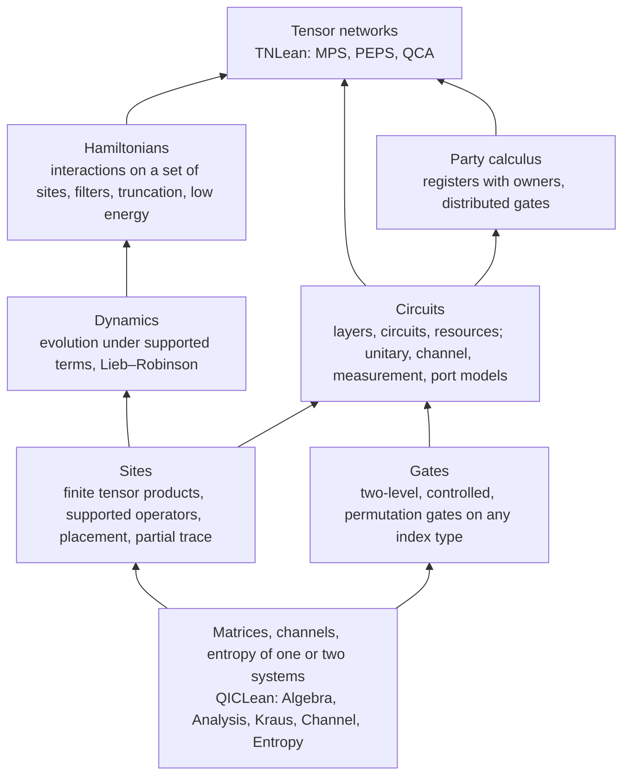

# Many-body layer and circuit library: architecture and migration

Status: adopted 2026-11-16. This document fixes the architecture of everything
between single-system channel theory (QICLean) and tensor networks (TNLean):
finite tensor products indexed by sites, local Hamiltonians, and circuits. It
supersedes the "Migration policy" section of `circuit_channel_architecture.md`.
The directories `TNLean/Circuit` and `TNLean/Lattice` were split along the
layers below, redesigned, and moved to QICLean; both are gone. `TNLean/Circuit`
and the top level of `TNLean/Lattice` left at the pin move to LionSR/QICLean#1185.
The party calculus (`Lattice/PartyCircuit`, `Lattice/Sheet`, `Lattice/Compression`)
was restated in `QICLean/Circuit/Party` (LionSR/QICLean#1196 to #1216) and deleted
from TNLean at the pin move to QICLean `3149c3445e`. The 44 modules of
`Lattice/Compression` that contract a network of tensors whose links carry their own
virtual alphabets (edge-dependent bond networks, party networks, the distributed
operator contraction and everything that imports it) are tensor networks; they had
moved earlier to `TNLean/Network`, the lowest tensor-network layer, which both `MPS`
and `PEPS` import. Three modules of `Lattice/Compression` that exist only to build or
count the distributed network (`DistributedLinks`, `SourceNetworkIncidence`,
`PhysicalFirstNetworkResources`) were merged into their consumers in `TNLean/Network`.

## Architecture

### Principles

1. **A layer is defined by the objects its statements mention**, not by the
   paper or proof a module was written for. A declaration lives in the lowest
   layer whose objects suffice to state it.
2. **Imports point downward.** Two layers at the same height do not import each
   other; what both need moves down.
3. **Each object has one definition** (see No dual systems). A second type for
   the same object, with lemmas translating between the two, is a defect, in
   one repository or across the two.
4. **A directory is a layer or a part of one, and its namespace says so.** A
   directory name states the objects, never a proof technique or a source.
5. **Statements are as general as their layer** (see Generality); special
   cases are instances.
6. **The rules are checked by a script**, with the existing violations listed
   and only allowed to shrink.

### No dual systems

This is the rule the others serve. Two systems for one object cost more than
twice one: every lemma is proved twice, every consumer chooses, and lemmas
translating between the two spread through the code.

- **Test.** Two things are a dual system if some lemma has to be proved for
  each of them. A named special case passes the test only if its facts follow
  by unfolding it to the general definition.
- **Pass-throughs are deleted.** A declaration whose whole body applies another
  declaration to its own arguments is the same statement under a second name;
  its callers use the target. `MPS/Tensor/Physical/Blocking`, where 16 of 31 declarations
  are `MPSTensor.x := Kraus.x`, is the model case.
- **Bridges are not repaired.** A lemma or module translating between two
  formulations of one object disappears when the formulations become one. A
  module named for a bridge that relates two different objects is a theorem
  and is renamed for what it proves.
- **No layer exists only to forward to the layer below.**
- **One definition per notion.** A source's formulation is honoured by a
  theorem whose statement is the source's, with exactly the source's
  hypotheses, not by a predicate per source. A second predicate that is an
  abbreviation of another, or equivalent to it with no hypothesis, is deleted
  and the equivalence becomes a characterization theorem. One that is
  equivalent only under a hypothesis becomes a clause of the source's
  proposition, stated as an equivalence under that hypothesis. One that is not
  equivalent is a different notion and keeps a name that says how it differs.
- **Temporary abbreviations** made while consumers are migrated are
  pass-throughs by design. Each is listed with the step that deletes it.

`System` in the circuit layer is not a second notion of system: it wraps a
basis family of the Sites layer so that a circuit can hide its intermediate
systems, and no Sites lemma is restated for it.

### Layers



| Layer | Objects | Defining types | Now | After the move | May import |
|---|---|---|---|---|---|
| Sites | a finite tensor product `⊗_v ℂ^{X_v}` and its regions | a system `X : V → Type` of finite basis types, its configurations and those of a region; `supportedOperators X D`; the placement `K ↦ K ⊗ 1`; the partial trace onto a region; product vectors | QICLean `Entropy`, `Representation`, `Analysis` (86 modules using `SiteConfig`); 25 modules of `TNLean/Circuit`, among them `RegionSplit` and `RegionalSwap`; `Lattice/RegionalSwapSupport` | `QICLean/ManyBody/Sites` | matrices, channels |
| Dynamics | a family of Hermitian terms with supports, and the evolution it generates | `Interaction X S` (terms `term i ∈ supportedOperators X (S i)`, supports a parameter) and its `hamiltonian`; the evolution is `Matrix.hermitianUnitaryPath`, with the Heisenberg picture, commutator bounds on a graph and `graphBall` | `QICLean/ManyBody/Dynamics` (moved, #10718); `TNLean/Circuit/SiteExpectationGraphLocalization` keeps the two site-expectation localization estimates until `siteExpectation` is replaced | `QICLean/ManyBody/Dynamics` | Sites |
| Hamiltonians | spectral properties of an interaction on a finite set of sites | `groundSpace` and the one gap predicate `IsGapped`, stated for any matrix; spectral and Gaussian filters, truncation, low-energy bases; the models as choices of sites and supports | `TNLean/Lattice` (root, `ClusterExpansion`); five separate structures | `QICLean/ManyBody/Hamiltonian` | Sites, Dynamics |
| Gates | unitaries on a finite basis, with no sites | two-level and Givens words, controlled elements, permutation matrices, dilations, amplification | parts of `TNLean/Circuit/Gates`, eight root modules of `TNLean/Circuit` | `QICLean/Circuit/Gate` | matrices |
| Circuits | a geometry of cells on a set of sites, and operations layered on it | `Layer`, `Circuit`, its Kraus family, depth and gate count | `TNLean/Circuit` (the rest) | `QICLean/Circuit` | Sites, Gates |
| Party calculus | registers with owners | one syntax of local maps, sources and gates | `TNLean/Lattice/PartyCircuit`, `Compression`, `Sheet` (deleted) | `QICLean/Circuit/Party`; the uses specific to tensor networks are in `TNLean/Network`, `MPS/AreaLaw`, `PEPS/Approximation` | Sites, Circuits |

Circuits and Hamiltonians are siblings. A circuit statement never needs an
interaction, and a Hamiltonian statement never needs a layer; the permutation
of sites and the site-supported projections that both use belong to Sites.

The structure `Interaction` lives in Dynamics, not in Hamiltonians, so that
every statement about the evolution and every statement about the spectrum
spells the Hamiltonian the same way, as `Φ.hamiltonian`. A lemma stated at
the bare sum `∑ i, h i` would be a second spelling that `rw` cannot match
against the first. Hermiticity, norm bounds, range and degree are hypotheses,
not fields. A gap is `IsGapped H E₀ Δ`, whose ground space is nonzero. The
eigenvalue dichotomy and the unique gapped ground state (the hypotheses
`‖Ω‖ = 1`, `IsGapped H E₀ Δ` and `groundSpace H E₀ = span {Ω}`, which replaced
TNLean's `Matrix.IsGappedGroundState` in step 4.0) are theorems about it, not
further predicates. An eigenvalue bound that does not assert a ground state is
a hypothesis, not a gap.

Quantum simulation and many-body theory are stated over these layers.

- Ground states, gaps, frustration-freeness, thermal states and the models
  (Heisenberg, transverse-field Ising, AKLT) go in Hamiltonians, as
  instances of `Interaction`.
- Time evolution, quasi-adiabatic continuation and the consequences of the
  Lieb–Robinson bound go in Dynamics.
- Product formulas, simulation error bounds and simulation by circuits go on
  the circuit side, which imports Hamiltonians and Dynamics, so that imports
  keep pointing one way.

### Generality

Each layer fixes how general its statements are. A definition or lemma is
stated at the generality of its layer; a chain, a ring, a square lattice, one
local dimension, a unitary gate are *instances*, obtained by definitional
unfolding, never separate definitions. A lemma whose proof does not use the
special structure is not stated with it.

| Axis | Required generality | What is hard-coded today |
|---|---|---|
| Sites | any finite type `V` | `Fin N` (389 of the 1,541 declarations of `TNLean/Circuit`, 1,304 of the 4,371 of `MPS/AreaLaw`), `Finset (ℤ × ℤ)` (1,024 of the 3,425 declarations of `PEPS/AreaLaw`, and `Lattice.LocalHamiltonian` itself), `Finset ℤ` |
| Local spaces | any finite basis type at each site, `X : V → Type` | one `Fin d` for all sites in TNLean; `Fin (n v)` in QICLean. Composite local spaces are then written `Fin (d * a)`, `Fin (d ^ k)`, `Fin (a + b)` and unpacked by index arithmetic: 170 declarations in `Circuit`, 226 in `MPS/Preparation`, 285 in `MPS/MPU`, 214 in `MPS/AreaLaw` |
| Regions | any finite set of sites, as one type `Finset V` | `Set` in one support notion, `Finset` in the other |
| Geometry | any family of cells, any graph | the ring: 130 declarations of `Circuit` and every channel, measurement and adaptive model; the open chain for gate counts |
| Operations | finite Kraus families between two systems, so rectangular and non-unitary | square unitaries in the depth and gate-count models; isometry trees, two-site layers of matrix product unitaries and Margolus gates are defined apart for that reason |
| Interactions | Hermitian terms indexed by any type, with any supports | terms indexed by admissible subsets of one lattice, with a range and a norm bound built into the structure |
| Resource bounds | upper bounds | exact depth in six of the models |
| Vectors | one representation per layer | functions `(ι → Fin d) → ℂ` in `Circuit`, `EuclideanSpace ℂ _` in the area laws and QICLean, abstract inner product spaces in `PartyCircuit` |

Three things are deliberately not generalized: the scalars are `ℂ`, every
space is finite-dimensional, and operators are matrices on basis types. The
abstract Hilbert spaces of `Lattice/PartyCircuit` are more general than any
use of them; its registers become finite basis types.

Taking basis *types* at the sites is the change with the widest effect. A site
with a qudit and an ancilla has basis `Fin d × Fin a`, a block of `k` sites has
basis `Fin k → Fin d`, a site holding several wires has the configurations of
its wires, and none of them is re-encoded as `Fin` of a product. The registers,
ports, encodings and blockings of the former `Circuit/Channel` existed largely
to carry that re-encoding; QICLean's restatement does without them. `SiteConfig n` in QICLean and `ι → Fin d` in TNLean are the
cases `X v = Fin (n v)` and `X v = Fin d`, by definition.

The specific theorems stay specific. An area law on the chain is a statement
about `Fin L`; the lemmas it uses about supports, filters and truncations are
stated for any sites, and are then the same lemmas the two-dimensional proof
uses.

### Where a declaration goes

Read the statement, not the proof, and take the first line that applies:

1. It mentions a tensor network (a tensor with bond indices, a transfer map of
   a tensor, a bond dimension) → TNLean, in the directory of that network.
2. It mentions a layer, a depth, a gate count, a measurement outcome or a
   register owner → Circuits, or the Party calculus if it has owners and no
   geometry.
3. It mentions an energy, a ground space or a gap → Hamiltonians; it
   mentions an interaction or a time evolution and needs only the terms and
   their supports → Dynamics. A statement comparing a circuit with an
   evolution → Circuits.
4. It mentions sites, regions or supports → Sites.
5. Otherwise it is about matrices on arbitrary finite index types → the
   existing QICLean directories (or Gates for unitary words).

A module written for one proof is split along these lines; its general lemmas
go down, and only the statements that carry the proof's own objects stay with
the proof. A proof-specific module that fits rule 2–4 but has no second use
stays in TNLean next to its consumer until it has one. One exception to these
rules: the area laws of `MPS/AreaLaw` and `PEPS/AreaLaw` stay in TNLean with
the modules of their own arguments although their statements mention no tensor
network (question 3 of "Questions for the maintainer" in `library_layers.md`).

### Repository boundary

QICLean owns every layer below tensor networks. TNLean owns tensor networks
and the proofs about them. A QICLean module never mentions a tensor network.
A TNLean module never defines a support predicate, a placement of a local
operator, a Hamiltonian structure or a circuit model; it instantiates the ones
in QICLean. Each QICLean change is followed by a TNLean pull request that moves
the pin and deletes what was replaced, with no copy and no alias left behind.

### Directories and namespaces

- Namespaces follow the layers: `ManyBody` for Sites, Dynamics and
  Hamiltonians, `QuantumCircuit` for Gates, Circuits and the Party calculus.
  The namespace `Entropy` keeps entropy; `SiteConfig`, `IsSupportedOn` and
  `localLift` leave it when the Sites layer is assembled (step 1.2).
- A directory holds at most about forty modules at its top level; beyond that
  it is divided by object, not by proof stage.
- A module holds one coherent interface. A module of one lemma is merged into
  the module that defines the object the lemma is about.

### Enforcement

`scripts/check_import_layers.py` assigns the modules of `TNLean/Algebra`,
`TNLean/Circuit` and `TNLean/QCA` to these layers (the party and Hamiltonian
layers have no TNLean modules since `TNLean/Lattice` was deleted) and rejects an import
that points upward or sideways. Imports are read with comments removed, and an
imported aggregator counts as everything it re-exports. It runs in the module-policy job of
`pr-ci.yml`. Its `UPWARD_IMPORTS` set lists recorded violations and may only shrink; CI
compares the set with its value at the base revision, so a new violation
cannot be admitted by recording it. The 17 imports recorded when the check was
introduced were repaired by step 0.3, and the set is empty:

- nine site and dynamics modules imported `Circuit/LocalCircuit` for
  `supportedOperators`, which was defined in `Circuit/SupportedOperators` and
  was replaced by QICLean's `ManyBody.supportedOperators` in follow-up F12;
- four modules of the Sites and Hamiltonian layers imported gate modules for
  `siteOp`, `ctrlProj` and local permutations, now QICLean's `ManyBody.placeAt`
  (`Sites/PlaceAlong`) and `QuantumCircuit.ctrlProj` (`Circuit/Core/SiteControlled`),
  and TNLean's `Circuit/SitePermutation`;
- `SupportedGroundSpace` imported `Channel/Layer` for one trace identity of
  product operators, now in `Circuit/SupportedOperators`;
- `SiteExpectationOrder` imported `LiebRobinson/CommutatorRecursion` for one
  lemma on the Heisenberg evolution, now stated beside its definition;
  `ProjectedRelativeEvolution`, `DisjointRelativeEvolution` and
  `SupportedGaussianIntegral`, which state results about that evolution, were
  dynamics modules; they and `Circuit/LiebRobinson` are now QICLean's
  `ManyBody/Dynamics` (tracker #10718); the one TNLean dynamics module left by
  that move, `Circuit/SiteExpectationGraphLocalization`, was deleted with
  `siteExpectation` in follow-up F12;
- two modules of `Lattice/Sheet` imported `RegionSplit` and `RegionalSwap`,
  site notions that were kept among the Hamiltonian modules and are now
  modules of `TNLean/Circuit`.

Inside a directory listed in `SUBDIRECTORY_ORDERS`, in the same script, the
subdirectories are ordered as well: a module imports only modules of its own or of an
earlier subdirectory, and an import of a later one counts as a violation in
`UPWARD_IMPORTS`. The orders of `QCA`, of `PEPS/AreaLaw` and of its seven parent
directories are described in `docs/library_layers.md`; a subdirectory missing from
its order fails. An entry recorded at the base revision whose modules Git reports as
moved is compared under their new names, so moving a module does not count as
adding an entry.

Three further ratchets of the same kind cover every module of TNLean, not only
the layers above. Each records what the tree has now in a set that may only
shrink, compared with the base revision in the same way: a new entry fails,
and an entry that no longer holds must be removed in the change that repairs
it.

- `MUTUAL_LAYER_DIRECTORIES`, in the same script, lists the pairs of directories
  that import each other, with directories taken at depth two below
  `TNLean/MPS` and `TNLean/PEPS` and at depth one elsewhere. It recorded 59
  pairs when introduced, such as `MPS/MPDO` and `MPS/ParentHamiltonian`. A
  new import that makes two directories depend on each other fails, so the
  directories that are layers today stay layers.
- `EXAMPLES_IMPORTS`, in the same script, lists the imports of a module inside
  an `Examples` directory by a module outside every such directory. It
  recorded 17 when introduced and is now empty under the checker's expanded
  dependency interpretation. Shared interfaces live in library modules;
  concrete demonstrations live under `Examples`. Seven historical import-only
  compatibility paths still literally import examples; the checker expands
  them when checking declaration-bearing callers. See
  `audits/2026-11-17_examples_import_extraction.md` for the inventory and scope.
- `PASS_THROUGH`, in `scripts/check_pass_through_declarations.py`, lists the
  declarations whose whole body applies the declaration of the same name in
  another namespace to their own explicit arguments in order, as in
  `lemma blockPhysDim_eq_pow (d L : ℕ) : … := Kraus.blockPhysDim_eq_pow d L`.
  It recorded 25 when introduced. The rule is lexical and narrow, and is
  stated in full at the head of that script; a forwarding declaration of
  another shape is not detected and is removed by review.

Both scripts run in the same step of the module-policy job.

The layer check is added to QICLean when the layers arrive there, where
directories are not layers today: every pair among `Algebra`, `Analysis`,
`Channel`, `Entropy` and `Representation` that is related at all is related in
both directions, and `Analysis` holds 530 modules at its top level.
Reorganizing those directories is outside this document; the new layers are
not built on that pattern.

## What is wrong now

Counts are from the seventh pin move (the blocking and port-output modules of
`TNLean/Circuit` moved to QICLean deleted), re-measured with the
script of the first audit (TNLean `3d3507f`, QICLean
`c62f178`); where a figure of that audit is kept for comparison, it says so.

### The directory holds two libraries

`TNLean/Circuit` has 99 modules and 18,974 lines (125 and 25,197 at the
first audit). More than twenty root-level modules of `TNLean/Circuit` (`SiteEmbedding*`,
`SiteExpectation*`, `Supported*`, `EntropySupport`, `ProductVector`,
`ExpectationBounds`, ...) and all of `Circuit/LiebRobinson` mention no layer,
gate or depth. Until step 0.3 they imported `Circuit/LocalCircuit`, only
because the definition of `supportedOperators` sat in that file above
`BondLayer`. Outside
`TNLean/Circuit`, 280 modules mention `QuantumCircuit` and 249 open the
namespace (356 and 279 at the first audit); these counts now include uses of
QICLean's circuit core, which shares the namespace. Nearly all of them (`Lattice`, `MPS/AreaLaw`, `PEPS`) use only
these lemmas on supported operators. The circuit models proper are consumed by
`MPS/Preparation` (ring depth circuits, measurement rounds, teleportation,
gate counts) and `MPS/MPU` (gate counts with a clean workspace), and by nothing
else.

### The Sites layer exists in parallel copies

- Two support predicates, `QuantumCircuit.supportedOperators d S` (a span of
  product operators, one local dimension) and `Entropy.IsSupportedOn X D` (a
  condition on matrix entries, site-dependent dimensions), with two bridge
  lemmas in `Circuit/EntropySupport`. Follow-up F12 removed the first
  predicate and the bridges: supports are now `ManyBody.supportedOperators`,
  whose carrier is the entry condition. The module counts of the first audit
  for this item no longer apply and are dropped.
- The algebra of `Entropy.IsSupportedOn` (`add`, `neg`, `sub`, `smul`,
  `conjTranspose`, finite sums, `exp`) is proved in TNLean area-law modules
  under the QICLean namespace, not in QICLean. Its product and commutation
  lemmas carry a reference configuration `σ₀` that the statements do not need.
- At least nine constructions place a local matrix as `K ⊗ 1`:
  `QuantumCircuit.embedOp`, `Entropy.localLift`, `TNLean.Lattice.localLift`
  (same name, different definition), `Lattice.siteLift` (the same definition
  again), `MPOTensor.embedLocalOperator`, `PEPS.regionLocalTerm`,
  `dependentRegionOperatorLift`, `Pinned.liftLocal` (a hand copy of
  `embedOp`), and `localInclusion` in `QCA`. Each has its own product,
  adjoint, norm and positivity lemmas.
- Five Hamiltonian structures, three stated with one predicate and two with the
  other.

This contradicts the rule in `project_conventions.md` for Mathlib notions (no
parallel type, no bridge lemmas), which applies equally across the
QICLean–TNLean boundary.

### The circuit models do not share a definition

| Model | Semantics | Depth convention | Sites |
|---|---|---|---|
| `UnitaryCircuit`, `IsUnitaryCircuit`, `IsGateProduct`, `IsUnitaryCircuitOn` (QICLean; TNLean's `BondLayer`, `IsBondCircuitOn`, `IsPairProduct`, `IsWindowProduct` are deleted) | unitary matrix | at most `T` layers or `K` gates | any geometry |
| `BondChannelLayer`, `channelCircuitMap` | map on matrices | exactly `T` | any bond family |
| `OnsiteChannel`, `IsLocalChannelProtocol` | map, dimension-changing | exactly `T` | ring only |
| `IsDimensionBoundedLocalChannelProtocol` | the same, bounded dimensions | exactly `T` | ring only |
| `FixedRegisterOperation` words | map, fixed alphabet | sum over the word | ring only |
| `IsPhysicalPortUnitary`, `IsPhysicalPortProtocol` | unitary; map | at most `T` (`mono` constructor) | ring ports, wires `Fin W` |
| `Circuit` with `IsMeasurementConversion`, `IsOneRoundConversion`, `Circuit.IsImplementationOn`, `IsAdaptiveProtocol` (QICLean; TNLean's `MeasurementProtocol`, `MeasurementRound` lists and `IsAdaptiveChannelProtocol` are deleted) | Kraus family by branch; average map | at most `T` | any geometry |
| `PartyCircuit.Word`, `OriginalCircuit`, `EffectCircuit`, `SourceCircuit` | contraction between tensor products of Hilbert spaces | participation counts | parties, no geometry |

Identity, composition, monotonicity in the depth, complete positivity and the
light cone are proved separately for each row, and several are missing (no
identity or append for channel circuits, no monotonicity for the exact-depth
predicates). Bridges are missing between gate count and depth, between unitary
and channel preparation at the level of states, and from measurement rounds to
adaptive conversions of states. Statements whose proofs use no geometry are
ring-only because the definitions hard-code `Layer d N`. The four inductive
types of `Lattice/PartyCircuit` repeat the constructors `id`, `comp`, local
map, `swap`, `frame` and their evaluation, and differ only in the gate
constructor.

The whole channel stack (`Circuit/Channel`, about 40 modules, and
`Measurement/AdaptiveConversion`) has no Lean consumer outside `TNLean/Circuit`;
only blueprint chapter 33 refers to it. It can be restated without touching
other directories. It has since been restated in QICLean
(`QICLean/Circuit/Model`, `QICLean/Circuit/Compile`) and `Circuit/Channel` is
deleted; the five channel rows of the table describe the deleted modules. The
measurement modules (`Measurement/*` except `Measurement/Asymptotic`),
`Teleportation/*`, `GHZState`, the zero-register modules and
`ProductBasisPenalty` are deleted as well, for `QICLean/Circuit/Model/Measurement`,
`QICLean/Circuit/Protocol` and `QICLean/ManyBody/Hamiltonian/ProductBasisPenalty`;
`WeightedGHZ` keeps only the normalization `norm_ghzState_two`.

## The Sites layer

- A system assigns a finite basis type to every site, `X : V → Type`; its
  configurations are `(v : V) → X v`. `SiteConfig n` with site-dependent
  dimensions is the case `X v = Fin (n v)`, and one local dimension is
  `ι → Fin d`, both by definition, so no existing statement changes its types.
- One support notion: the `*`-subalgebra `supportedOperators n D` of the matrix
  algebra, with membership unfolding to the matrix-entry condition. Closure
  under sums, products, adjoints, powers and functional calculus comes from the
  subalgebra, with no reference configuration. The span of product operators
  becomes a theorem about this subalgebra, not a second definition.
- One placement of a regional matrix as `K ⊗ 1`, along a region or along an
  injection of sites; the nine constructions above become this one or
  specializations of it by definition.
- One partial trace onto a region (`ManyBody.regionExpectation`), one product vector, one
  expectation.
- Lieb–Robinson bounds for a family of supported Hermitian terms on a graph,
  moved unchanged.

Regions are `Finset V` everywhere: supports, placements, cells and light cones
use one type, and no statement converts between two.

## The circuit core

Nothing of the core is in a library yet. The definitions below, the Kraus
family and depth of a circuit, composition, and subadditivity of the depth
under composition have been type-checked against QICLean in a scratch file;
the signatures are fixed in step 3C.1.

A *system* on the sites `S` assigns a finite basis type to each site. A
*geometry* is a family of cells `cell : β → Finset S` on which one gate may act
(the bonds of a ring, the edges of a graph, the windows of a chain, the wires
owned by one site). One layer acts by a finite Kraus family on each of a set of
pairwise disjoint cells, and by a Kraus family at every remaining site:

```lean
structure System (S : Type) where
  basis : S → Type
  [fintype : ∀ s, Fintype (basis s)]
  [decEq : ∀ s, DecidableEq (basis s)]

structure Layer (cell : β → Finset S) (X Y : System S) where
  cells : Finset β
  pairwiseDisjoint : (cells : Set β).PairwiseDisjoint cell
  gate : ∀ b ∈ cells, KrausFamily (X.RegionConfig (cell b)) (Y.RegionConfig (cell b))
  onsite : ∀ s, (∀ b ∈ cells, s ∉ cell b) → KrausFamily (X.basis s) (Y.basis s)
```

Its Kraus operators are indexed by a choice of one Kraus index per cell and
per remaining site, and are products of the local entries. A circuit is a
sequence of layers in which later layers may depend on earlier Kraus indices:

```lean
inductive Circuit (cell : β → Finset S) : System S → System S → Type 1
  | done (X) : Circuit cell X X
  | step (L : Layer cell X Y) (next : L.Index → Circuit cell Y Z) : Circuit cell X Z
```

A circuit is data. Its Kraus family, its map on matrices, its depth (layers
that use at least one cell of positive cost), its gate count, a bound on the
intermediate dimensions, and the number of gates meeting a given site are
functions on it, defined once. Every statement "of depth `T`" means
`depth ≤ T`, so monotonicity is free; layers are listed in the order applied.
Identity, composition, trace preservation and the backward light cone are
proved once, for Kraus families.

The present models are restrictions of this one definition:

| Present model | In the core |
|---|---|
| unitary depth circuits | every Kraus family has one unitary member; `X = Y` |
| channel circuits | no branching (`next` constant) |
| local channel protocols | no branching; onsite families change the dimension, free of cost |
| bounded-dimension protocols | the same with a bound on the size of every intermediate basis |
| fixed-register words | the same with the system constant in time |
| physical ports | sites are wires; cells are the wires of one site (cost 0) and pairs of neighbouring ports (cost 1) |
| measurement rounds, adaptive protocols | onsite families `|j⟩⟨j|`, with `next` depending on the outcome |
| pair and window products | unitary circuits on the open-chain geometry, measured by gate count |

The theorems relating models stay theorems: compiling a bounded protocol to
physical ports, removing measurements, and trading gate count for depth are
statements about two restrictions of `Circuit`, not about unrelated inductive
predicates.

Inside `QICLean/Circuit` the directories follow the same rule, imports
pointing down the list:

| Directory | Content | Present modules |
|---|---|---|
| `Gate` | unitary words on a finite basis: two-level and Givens words, controlled elements, permutations, dilations, amplification | `Gates/TwoLevel`, `Givens`; `PartialIsometryDilation`, `ExactSubspaceAmplification`, `UniformPostselection`, `UniformSuccessAttenuation`, `ExactAmplificationBudget` |
| `Geometry` | cells on a set of sites: ring, open chain, graph edges, wires of a site; neighbourhoods and light cones | `Channel/PhysicalPort` (the layout); `Geometry` and `RingSeparation` deleted for QICLean's |
| `Core` | `Layer`, `Circuit`, Kraus family and map, depth and gate count, identity, composition, trace preservation, light cone | replaces `LocalCircuit`, `Composition`, `Channel/Layer`, `Channel/Conversion` |
| `Model` | the restrictions: unitary, channel, bounded dimension, fixed register, measurement and adaptive, ports, gate count with clean workspace | `Measurement/Rounds`, `Channel/DimensionBoundedConversion`, ... |
| `Compile` | theorems between two models: universality, routing, register encoding, compilation to ports, dilation, removal of measurements | `Channel/Port*`, `Channel/PhysicalPort*`, `Channel/Regrouped*` |
| `Protocol` | named constructions: teleportation, long-range and register gates, GHZ preparation, zero-register reflections | `Teleportation`, `Measurement/GHZ`, `WeightedGHZ`, `ZeroRegister*`, `SelectedZeroRegister*` |
| `Party` | the reusable party calculus | part of `Lattice/PartyCircuit` |

Isometry trees, the rectangular two-site layers of matrix product unitaries and
the Margolus gates of `QCA` are rectangular layers of this kind once sites may
be grouped: a map `S → S'` of site sets turns a system on `S` into the system
on `S'` whose basis at a site is the configurations of its fibre. This
blocking map between systems is added after step 3C.3.
`Lattice/PartyCircuit` is treated last. Its four inductive types first become
one type parametrized by the gate constructor. Its registers, which are
finite-dimensional in every use, then become basis types, and party circuits
become a restriction of `Circuit`: parties are sites, a private map is an
onsite operation, a gate between parties is a gate on a cell, and participation
is the count of gates meeting a site. Its gates are contractions and weighted
sums of circuits, not trace-preserving families, so `Layer` must allow them;
this is checked against the party calculus before the core is fixed (step
3C.0). A second calculus with a comparison theorem is not an acceptable
outcome.

## `TNLean/Lattice` (deleted)

This section records the directory as it was before it left TNLean; it no longer
exists. `TNLean/Lattice` (363 modules, 55,609 lines; 371 and 58,208 before pin move 6, 469 and
77,689 before pin move 5)
has the same shape as `TNLean/Circuit`: its transitive imports inside TNLean
are itself, 15 modules of `Algebra` and 9 modules of `Circuit`, and nothing
from `MPS` or `PEPS`. It can leave TNLean once the
Sites layer has. It holds three unrelated things:

- Local Hamiltonians and their analysis on finite sets of sites (the root
  directory, 17 modules, 2,360 lines; 25 modules and 4,959 lines before pin
  move 6; with `ClusterExpansion`, 124 modules and 24,532 lines before step
  3H.1). Gaussian filtering and truncation, low-energy
  bases, translations, the variational bound, product forms and Trotter index
  counts, and the whole cluster expansion moved to QICLean in step 3H.1. What
  stays is regional entropy, the regional swap and reset, and the finite
  domains and buffers of the area laws.

  Kept until step 4.0, by decision at pin move 6: `RegionEntropyInequalities`,
  `StateSpace`, `RegionalEntropy`, `RegionalEntropyBridge`, `EntropyDimension`,
  the relabelling half of `SiteRelabelEntropy` and the cut-budget part of
  `MarginalTails`. Their statements were QICLean's mathematics written with a
  second spelling of the regional state and entropy. Step 4.0 (LionSR/QICLean#1156,
  #1159) unified the spellings on `ManyBody.regionState` and `ManyBody.regionEntropy`:
  `RegionalEntropy`, `RegionalEntropyBridge` and `EntropyDimension` are deleted, the
  cut-marginal lemma of `MarginalTails` is QICLean's
  `ManyBody.regionState_eq_partialTraceRight_cutVector`, and `RegionEntropyInequalities`
  keeps only the two statements QICLean does not have (`one_le_supportDim_const`,
  `regionEntropy_eq_zero_of_localDimension_one`). Pin move 6 deleted the modules whose
  statements moved (`ZeroEntropy`, `EntropyComparison`,
  `SupportedUnitaryEntropy`, `SupportedPolarUnitary`, the sum-of-sites half of
  `SiteRelabelEntropy`, the typical-mass part of `MarginalTails`, and the
  imaginary-time, hard-truncation, disjoint-ground and product-ground modules).
- A calculus of distributed circuits and operator networks on a set of parties
  (`PartyCircuit`, `Compression`, `Sheet`, 343 modules, 52,901 lines).
  This is not lattice theory, and it is the second circuit library described
  above. `Compression` had 254 modules, 123 of them with at most two
  declarations; its 44 network modules have since moved to `TNLean/Network`,
  and 210 remain.
- `TreeBasisCounterexample`.

The pin move to LionSR/QICLean#1185 deletes the root directory (14 modules) and
`TreeBasisCounterexample` (3 modules); their statements are QICLean's
`QICLean/ManyBody` (the hard-core sector certificate in the namespace
`ManyBody.HardCore`). Only the party calculus remains in `TNLean/Lattice`.

The structure `Lattice.LocalHamiltonian`, described as shared by the one- and
two-dimensional area laws, is defined on `Λ : Finset (ℤ × ℤ)`. The chain uses
`ChainHamiltonian` and `DomainHamiltonian` in `MPS/AreaLaw`, and the squares
and rectangles of `PEPS` use two more structures. (Item 3H.2 replaced all five by
instances of QICLean's `ManyBody.Interaction`.) Namespaces vary inside the
directory (`TNLean.Lattice`, `TNLean.Lattice.PartyCircuit`,
`Lattice.PartyCircuit`, and bare `Word`, `EffectCircuit`).

Target: the Hamiltonian part joins the Sites layer in QICLean, with one
structure for a family of bounded Hermitian terms with given supports on a
finite set of sites; the chain, the integer domains, the plane, squares and
rectangles are choices of the sites and supports. The party calculus follows
the circuit plan (steps 5.1 and 5.2): the reusable calculus moves with the circuit
layer, and the modules that exist only for one proof of the PEPS approximation
manuscript stay in TNLean, consolidated, under a name that does not say
"lattice".

## Method

The cost is not the new definitions; it is rewriting about 600 consumer modules
in a repository that merges continuously. Each layer goes through four steps.

1. **Build.** The new definitions land in QICLean. TNLean is untouched.
2. **Switch.** One small TNLean pull request moves the QICLean pin and turns
   each old definition into an abbreviation of the new one; the old proofs of
   facts now in QICLean are deleted. Every consumer compiles unchanged.
3. **Sweep.** A script kept in the repository rewrites the consumers to the
   new names, one directory per pull request.
4. **Delete.** When the last use is gone the abbreviation is deleted and its
   name is retired.

Rules of the method:

- A consumer directory is swept once, after every layer it uses has switched.
- The Sites layer changes once; its signatures are reviewed as a whole before
  proofs are ported, and it is piloted on Lieb–Robinson before the switch.
- Code with no consumer is rebuilt first: the channel stack tests the circuit
  core without touching another directory.
- QICLean work is batched so that the plan needs five moves of the pin.
- Old code is not moved and then fixed. Only the redesigned form enters
  QICLean; proofs are ported onto it.
- A sweep renames, removes applications of translating lemmas and drops
  reference configurations. It does not restate theorems more generally, and
  it does not replace index arithmetic by basis types.
- Every pull request builds, with no `sorry`.

## Steps

Wave 0, guard rails:

- **0.1** (TNLean, done). This document and `scripts/check_import_layers.py`.
- **0.2** (QICLean, done). `Entropy/SupportedOperatorAlgebra`:
  closure lemmas, products and commutation without a reference configuration,
  and the `*`-subalgebra `Entropy.supportedOperators`.
- **0.3** (TNLean, done). `supportedOperators`, `expect` and product vectors
  moved out of `Circuit/LocalCircuit`, and `siteOp`, `ctrlProj` and local
  permutations out of the gate modules; with `RegionSplit` and `RegionalSwap`
  placed among the site modules and the evolution modules among the dynamics
  modules, the 17 recorded imports are cleared.
- **0.4** (both). Extend the import check to every directory: record each pair
  of directories that import each other and fail on a new pair. TNLean has 59
  such pairs, QICLean 8. QICLean receives the script and the CI step.
- **0.5** (TNLean). No library module imports `Examples`; the 17 existing
  imports are recorded and removed.
- **0.6** (both). Pass-through declarations as a ratchet, removed one namespace
  per pull request, starting with the `MPSTensor` names that forward to
  `Kraus`.

Wave 1, foundations in QICLean:

- **1.1** The 22 modules of `TNLean/Algebra` that `Circuit` and `Lattice` need,
  and the Volterra bounds, moved as they are.
- **1.2** The Sites layer in final form, about 30 modules;
  `Entropy.SiteConfig`, `IsSupportedOn` and `localLift` become abbreviations
  of it.
- **1.3** (done) `Circuit/Gate`: two-level and Givens words, controlled
  elements, dilations, amplification.
- **1.4** Pilot: Lieb–Robinson as the Dynamics layer on the new Sites.

Wave 2, switch:

- **2.1** (TNLean, pin move 1). The old site definitions become abbreviations;
  moved modules, the duplicate lemmas (`Entropy.IsSupportedOn.add`, `neg`,
  `sub`, `smul`, `conjTranspose`, `isSupportedOn_sum`) and
  `Circuit/EntropySupport` are deleted.

Wave 3, two tracks that share no file:

- **3H.1** (QICLean, done; TNLean, pin move 5). `Interaction`; the Hamiltonian
  part of `Lattice` restated on it and moved (LionSR/QICLean#1138, #1141, #1144,
  #1145, #1146 and #1148). Pin move 5 deletes 98 modules of `Lattice`, among
  them all of `Lattice/ClusterExpansion`, and `Circuit/SitePermutationSupport`;
  pin move 6 (LionSR/QICLean#1150, #1151) deletes eight more and three of
  `Algebra`; what stays is described under `TNLean/Lattice` above.
- **3H.2** (TNLean, pin move 2; done in #10905 by F8 phase 2 and its follow-up
  #10910; `Lattice/RegionalEntropyBridge` was deleted at step 4.0). `ChainHamiltonian`,
  `DomainHamiltonian`, `Lattice.LocalHamiltonian`, `SquareHamiltonian` and
  `RectangularHamiltonian`
  become instances (`ManyBody.ChainInteraction`, `ManyBody.DomainInteraction`,
  `ManyBody.PlaneInteraction`, `ManyBody.SquareInteraction` and
  `ManyBody.RectangleInteraction`); `Lattice/RegionalEntropyBridge` is deleted.
- **3A** (both). The generic modules of `TNLean/Algebra` move to QICLean,
  merged into topical modules: 40 used by two or more directories, up to 131
  used by one; 44 used nowhere outside the directory are reviewed for deletion;
  19 mention a tensor network and stay. Done at the move onto QICLean's fourth
  batch: 237 modules of `TNLean/Algebra` were deleted for their QICLean
  counterparts. Eighteen stay: four that mention a tensor network and are
  imported, and fourteen that no module imports but the blueprint tags.
- **3C.0** (QICLean). Check the circuit core against the party calculus before
  its signatures are fixed.
- **3C.1** (QICLean, done). The core: `System`, `Layer`, `Circuit`, Kraus family and
  map, depth and gate count, identity and composition, trace preservation,
  light cone. Core I (LionSR/QICLean#1099) is pinned since the third pin move;
  cores II and III (through LionSR/QICLean#1120, blocking, substitution,
  light-cone factorization and dimension bounds) are on QICLean `main` for the
  fourth.
- **3C.2** (QICLean). The channel stack as restrictions, with its compilation
  theorems; it replaces about 45 modules that have no consumer.
- **3C.3** (QICLean). Unitary depth circuits, gate counts with a clean
  workspace, measurement rounds and adaptive protocols; then teleportation and
  the named protocols.
- **3C.4** (TNLean, pin move 3). The circuit names used by `MPS/Preparation`
  and `MPS/MPU` become abbreviations; the rest of `TNLean/Circuit` is deleted;
  blueprint chapter 33 moves to the QICLean blueprint.

  State after pin move 5: no module of `TNLean/Circuit` is deleted yet. Pin
  move 5 replaces `initializedBasisMatrix`, `registerEncoding` and
  `quditFourier` by QICLean's `Matrix.basisInclusion` and
  `QuantumCircuit.Qudit.fourier`, and deletes `SitePermutationSupport` (46
  lines) from the Sites group. The modules wait, by group (counted on `main`
  before pin move 5), for:

  | Group | Modules | Lines | Waits for |
  |-------|--------:|------:|-----------|
  | Ring geometry: `Channel/{Conversion, Layer, ApproximateConversion, AsymptoticConversion, DimensionBoundedConversion, Feedforward}`, `Measurement/AdaptiveConversion` | 7 | 2,018 | the ring geometry of the QICLean core (3C.2) |
  | Blocking | 2 | 945 | blocking of ring circuits in the core (3C.2) |
  | Ports and routing | 30 | 4,893 | physical ports and routing (3C.3) |
  | Unitary model and measurement | 42 | 9,745 | the unitary depth model, measurement rounds and adaptive protocols (3C.3) |
  | Sites | 22 | 3,227 | the Sites renames, `embedOp` to `place` (4.2) |
  | Aggregators | 4 | 97 | their members |

  Pin move 6 (LionSR/QICLean#1149) deletes `Channel/AsymptoticConversion` (154
  lines) and reduces `Channel/ApproximateConversion` from 173 lines to the 55
  lines of the chain trace norm; the approximate and asymptotic conversion
  predicates are QICLean's `QICLean/Circuit/Model/Approximate`. The
  ring-geometry group is now 6 modules and 1,746 lines.

  Pin move 7 (LionSR/QICLean#1155, #1157) deletes the blocking group
  (`Channel/{SiteBlocking, RegroupedProtocol}`) and four port modules
  (`PortSimulation`, `PhysicalPortPureOutput`, `BoundedPortPureOutput`,
  `BoundedPortApproximateOutput`), 1,565 lines. The four physical-port dilation
  modules (`PhysicalPort{UnitaryCompilation, LocalDilation, Dilation,
  EnvironmentComposition}`) wait for the dilation with local environments
  (LionSR/QICLean#1162); through `PhysicalPortIO`, `PhysicalPortEmbedding` and
  `RegisterEnvironment` they keep 23 more port and register modules (3,661
  lines), which go with them.

  The second QICLean circuit batch deletes the rest of `Circuit/Channel`: 31
  modules and the aggregator, 5,839 lines. Their statements are QICLean's
  `QICLean/Circuit/Model/{Channel, Protocol, Conversion, Approximate}` and
  `QICLean/Circuit/Compile/{Encoding, FixedRegister, Port, PortProtocol, PortCode,
  Dilation, DilationOutput}`, except the identity of the compiled channel on an
  arbitrary state of the port and scratch wires carried along as a reference,
  which QICLean's construction does not give and which is dropped.

  The move onto QICLean's fourth batch deletes 14 more modules of
  `TNLean/Circuit` (`ProductVector`, `SupportedMatrixElements`,
  `ExpectationBounds`, `SiteEmbedding`, `EmbeddedProduct`,
  `ConfigurationLayers`, `Gates/Permutation`, `SupportedComplementProduct`,
  `SiteOscillation`, `SpectatorSiteExpectation`, `SpectatorOscillationSupport`,
  `SupportProjection`, `Measurement/Asymptotic` and
  `CleanImplementationPlacement`), together with `MPS/Preparation/FiniteRing*`
  and seven spectator modules of `MPS/ParentHamiltonian/Martingale`. `TNLean/Circuit`
  keeps eight modules: `SupportedOperators`, `SitePermutation`, `RegionSplit`,
  `RegionalSwap`, `SitewiseTensorSupport`, `SupportedGroundSpace`,
  `SupportedNormalizedGroundSpace` and `WeightedGHZ`.

  The pin move to LionSR/QICLean#1185 deletes these eight modules, so
  `TNLean/Circuit` no longer exists. The swap of two copies on a region is
  QICLean's `ManyBody.pairSwap` and `ManyBody.pairSwapOp` on the paired system
  `fun v ↦ X v × X v`; TNLean's two-sheet coordinates
  `(ι → Fin q) × (ι → Fin q)` are reached by `Equiv.arrowProdEquivProdArrow`.

  The directory was not smaller after pin move 5 for two reasons. The ring
  geometry (`ringBall`, ring separation, the ring as a circuit geometry) was
  not yet on QICLean `main`, so the ring-geometry group could not be
  restated. The channel modules that carry the system type are still used by
  13 port, blocking and adaptive-round modules, which wait for 3C.3.

Wave 4, sweeps:

- **4.0** (QICLean). Its own 86 site modules, onto the Sites names; the
  abbreviations of step 1.2 are deleted.
- **4.1** (TNLean). `MPS/AreaLaw`, `PEPS/AreaLaw`, `PEPS/Approximation`, the
  rest of `Lattice`, `QCA`, `MPS/Symmetry`; one pull request per directory.
  `Lattice.localLift`, `siteLift`, `Pinned.liftLocal`, `regionLocalTerm`,
  `dependentRegionOperatorLift` and `embedLocalOperator` are replaced by the
  one placement. Done for all of them; `embedLocalOperator` became
  `ManyBody.placeAlong` along `ManyBody.ringWindow` (F12c, in the third pin
  move, #10905), and the periodic Hamiltonian of one window term became
  `ManyBody.Interaction.translationInvariant` (#10948).
- **4.2** (TNLean). `MPS/Preparation`, `MPS/MPU`, `MPS/Examples`.
- **4.3** (TNLean). The abbreviations are deleted and their names retired.

Wave 5, parties:

- **5.1** (TNLean). `Lattice/PartyCircuit`: one syntax type parametrized by
  the gate constructor.
- **5.2** (both, pin move 4). Registers become basis types; party circuits
  become a restriction of `Circuit`; the reusable part moves.
- **5.3** (TNLean). The single-lemma modules of `Lattice/Compression` are
  merged; what stays leaves the `Lattice` directory. Done: the calculus is
  `QICLean/Circuit/Party`, and `TNLean/Lattice` is deleted.

Tensor types:

- **T.1** (both, pin move 5, after 2.1). One tensor type over a physical and a
  bond basis type. `MPSTensor d D` is its case at `Fin d` and `Fin D`;
  `MPOTensor d D` is its case at the product basis.
- **T.2** (TNLean, after 4.3). The `toMPSTensor` conversion, used in 251
  modules, and the nine definitions of `blockTensor` are swept; blocking
  becomes a change of basis type.

Follow-on projects, each started after wave 2 with its own audit:

- **F1** The top level of `PEPS`, 554 modules, split by object.
- **F2** `MPS/MPDO`, `MPS/ParentHamiltonian`, `MPS/MPU`, `MPS/AreaLaw`: split
  by object, single-lemma modules merged, one representation of vectors, one
  mutual information, one structure for the commuting form.
- **F3** `QICLean/Analysis` (530 top-level modules) and the mutual imports of
  QICLean's directories.
- **F4** One definition per notion, one glossary section at a time, starting
  with primitivity (done: `_root_.IsPrimitive`, `Kraus.IsNormal` and
  `Kraus.HasComplementaryFixedPointGap`); then the layering inside `MPS` and
  between `MPS`, `PEPS` and `QCA`.

A directory with both a sweep in wave 4 and a restructuring in a follow-on gets
them together, so its modules are rewritten once.

The circuit core is validated by 3C.2 and 3C.3: if porting a model needs a
change to `Layer` or `Circuit`, the change is made in the core before the next
model is ported.

## Modules named for a bridge

| Module | Verdict | Action |
|---|---|---|
| `Lattice/RegionalEntropyBridge` | two definitions of regional state and entropy | deleted at step 4.0 |
| `MPS/MPDO/Entropy/MutualInfoBridge` | `mutualInfoChain` beside QICLean's mutual information | deleted in F2 |
| QICLean `Channel/Wigner/ProjectiveCarrierBridge` | two representations of vectors | deleted with the single representation |
| QICLean `Channel/CompletelyPositiveBridge` | a local notion beside Mathlib's `CompletelyPositiveMap`; imported by no module | build on Mathlib's type or delete |
| `Wielandt/Primitivity/PrimitiveBridge` | several predicates for primitivity | F4 |
| `MPS/CanonicalForm/BNTPresentation/Bridge`, `MPS/CanonicalForm/BNTPresentation/CanonicalFormBridge` | several predicates for a basis of normal tensors and for a canonical form | F4 |
| `MPS/Operator/PhysicalSector/CommutingFormBridge` | three data structures for one commuting form | F2 |
| QICLean `Channel/Semigroup/LindbladForm/TraceBridge`, `MPS/CanonicalForm/Periodic/CyclicSectors/CornerBridge`, `MPS/MPDO/Purification/PureStateRFPEquivalence`, `MPS/Examples/Z3/Z3AnomalousCocycleBridge`, `PEPS/Approximation/Guides/AngularSeparationBridges` | theorems | renamed for what they prove |
| `PEPS/FundamentalTheorem/Normal/RegionInsertion/InsertedCoefficientExpansion`, `GaugeBridgeExpansion` | one computation in two modules | merged and renamed in F1 |
| `MPS/Examples/Weyl/ShortOverlapBridges`, `PEPS/Injectivity/Region/OverlapUnion` | "bridge" is the mathematical object or a proof step | none; the second is renamed with its family in F1 |

## Rules during the migration

- A new declaration goes where "Where a declaration goes" puts it. A module
  that mentions no layer, gate or depth is not added to `TNLean/Circuit`; until
  step 1.2 it goes in QICLean beside `Entropy.IsSupportedOn`.
- No entry is added to `UPWARD_IMPORTS`, `MUTUAL_LAYER_DIRECTORIES` or `EXAMPLES_IMPORTS` in
  `scripts/check_import_layers.py`, nor to `PASS_THROUGH` in
  `scripts/check_pass_through_declarations.py`.
- No new pass-through declaration, translating lemma between two formulations,
  or predicate for a notion that already has one. A new predicate states which
  existing notion it differs from and what separates them.
- A new lemma is not stated for `Fin N`, the ring, `ℤ × ℤ` or one local
  dimension unless its proof uses that structure.
- No new circuit predicate. A new model is a restriction of an existing one
  until C1 lands, and of `Circuit` afterwards.
- No new placement of a local matrix and no new support predicate.
