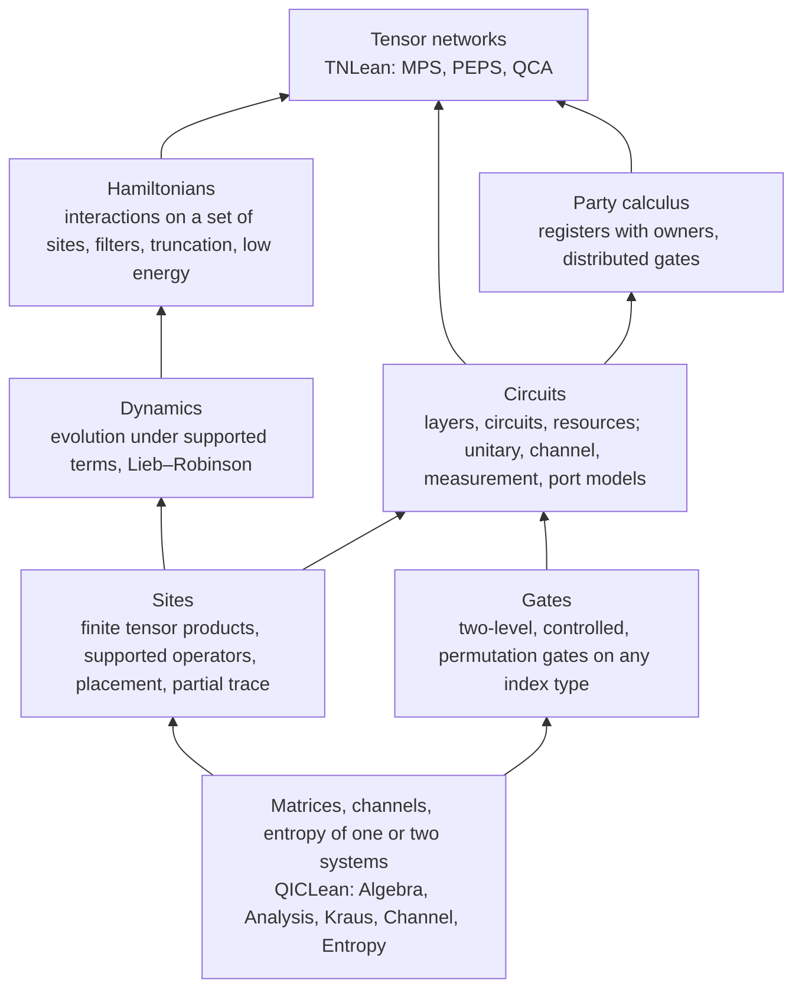

# Many-body layer and circuit library: architecture and migration

Status: adopted 2026-11-16. This document fixes the architecture of everything
between single-system channel theory (QICLean) and tensor networks (TNLean):
finite tensor products indexed by sites, local Hamiltonians, and circuits. It
supersedes the "Migration policy" section of `circuit_channel_architecture.md`.
The directories `TNLean/Circuit` and `TNLean/Lattice` are split along the
layers below, redesigned, and moved to QICLean.

## Architecture

### Principles

1. **A layer is defined by the objects its statements mention**, not by the
   paper or proof a module was written for. A declaration lives in the lowest
   layer whose objects suffice to state it.
2. **Imports point downward.** Two layers at the same height do not import each
   other; what both need moves down.
3. **Each layer has a small set of defining types** (below). A second type for
   the same object, with lemmas translating between the two, is a defect, in
   one repository or across the two.
4. **A directory is a layer or a part of one, and its namespace says so.** A
   directory name states the objects, never a proof technique or a source.
5. **Statements are as general as their layer** (see Generality); special
   cases are instances.
6. **The rules are checked by a script**, with the existing violations listed
   and only allowed to shrink.

### Layers



| Layer | Objects | Defining types | Now | After the move | May import |
|---|---|---|---|---|---|
| Sites | a finite tensor product `⊗_v ℂ^{X_v}` and its regions | a system `X : V → Type` of finite basis types, its configurations and those of a region; `supportedOperators X D`; the placement `K ↦ K ⊗ 1`; the partial trace onto a region; product vectors | QICLean `Entropy`, `Representation`, `Analysis` (86 modules using `SiteConfig`); 25 modules of `TNLean/Circuit`, among them `RegionSplit` and `RegionalSwap`; `Lattice/RegionalSwapSupport` | `QICLean/ManyBody/Sites` | matrices, channels |
| Dynamics | a family of Hermitian terms with supports, and the evolution it generates | Heisenberg evolution, commutator bounds on a graph | `TNLean/Circuit/LiebRobinson`; `Circuit/ProjectedRelativeEvolution`, `DisjointRelativeEvolution`, `SupportedGaussianIntegral` | `QICLean/ManyBody/Dynamics` | Sites |
| Hamiltonians | an interaction on a finite set of sites | one structure: bounded Hermitian terms with given supports; spectral and Gaussian filters, truncation, low-energy bases | `TNLean/Lattice` (root, `ClusterExpansion`); five separate structures | `QICLean/ManyBody/Hamiltonian` | Sites, Dynamics |
| Gates | unitaries on a finite basis, with no sites | two-level and Givens words, controlled elements, permutation matrices, dilations, amplification | parts of `TNLean/Circuit/Gates`, eight root modules of `TNLean/Circuit` | `QICLean/Circuit/Gate` | matrices |
| Circuits | a geometry of cells on a set of sites, and operations layered on it | `Layer`, `Circuit`, its Kraus family, depth and gate count | `TNLean/Circuit` (the rest) | `QICLean/Circuit` | Sites, Gates |
| Party calculus | registers with owners | one syntax of local maps, sources and gates | `TNLean/Lattice/PartyCircuit`, `Compression`, `Sheet` | reusable part: `QICLean/Circuit/Party`; proof-specific part stays in TNLean | Sites, Circuits |

Circuits and Hamiltonians are siblings. A circuit statement never needs an
interaction, and a Hamiltonian statement never needs a layer; the permutation
of sites and the site-supported projections that both use belong to Sites.

### Generality

Each layer fixes how general its statements are. A definition or lemma is
stated at the generality of its layer; a chain, a ring, a square lattice, one
local dimension, a unitary gate are *instances*, obtained by definitional
unfolding, never separate definitions. A lemma whose proof does not use the
special structure is not stated with it.

| Axis | Required generality | What is hard-coded today |
|---|---|---|
| Sites | any finite type `V` | `Fin N` (389 of the 1,541 declarations of `TNLean/Circuit`, 1,304 of the 4,371 of `MPS/AreaLaw`), `Finset (ℤ × ℤ)` (1,024 of the 3,425 declarations of `PEPS/AreaLaw`, and `Lattice.LocalHamiltonian` itself), `Finset ℤ` |
| Local spaces | any finite basis type at each site, `X : V → Type` | one `Fin d` for all sites in TNLean; `Fin (n v)` in QICLean. Composite local spaces are then written `Fin (d * a)`, `Fin (d ^ k)`, `Fin (a + b)` and unpacked by index arithmetic: 170 declarations in `Circuit`, 226 in `MPS/Preparation`, 285 in `MPS/MPU`, 214 in `MPS/AreaLaw` |
| Regions | any set of sites | `Set` in one support notion, `Finset` in the other |
| Geometry | any family of cells, any graph | the ring: 130 declarations of `Circuit` and every channel, measurement and adaptive model; the open chain for gate counts |
| Operations | finite Kraus families between two systems, so rectangular and non-unitary | square unitaries in the depth and gate-count models; isometry trees, two-site layers of matrix product unitaries and Margolus gates are defined apart for that reason |
| Interactions | Hermitian terms indexed by any type, with any supports | terms indexed by admissible subsets of one lattice, with a range and a norm bound built into the structure |
| Resource bounds | upper bounds | exact depth in six of the models |
| Vectors | one representation per layer | functions `(ι → Fin d) → ℂ` in `Circuit`, `EuclideanSpace ℂ _` in the area laws and QICLean, abstract inner product spaces in `PartyCircuit` |

Three things are deliberately not generalized: the scalars are `ℂ`, every
space is finite-dimensional, and operators are matrices on basis types. The
abstract Hilbert spaces of `Lattice/PartyCircuit` are more general than any
use of them; its registers become finite basis types.

Taking basis *types* at the sites is the change with the widest effect. A site
with a qudit and an ancilla has basis `Fin d × Fin a`, a block of `k` sites has
basis `Fin k → Fin d`, a site holding several wires has the configurations of
its wires, and none of them is re-encoded as `Fin` of a product. The registers,
ports, encodings and blockings of `Circuit/Channel` exist largely to carry
that re-encoding. `SiteConfig n` in QICLean and `ι → Fin d` in TNLean are the
cases `X v = Fin (n v)` and `X v = Fin d`, by definition.

The specific theorems stay specific. An area law on the chain is a statement
about `Fin L`; the lemmas it uses about supports, filters and truncations are
stated for any sites, and are then the same lemmas the two-dimensional proof
uses.

### Where a declaration goes

Read the statement, not the proof, and take the first line that applies:

1. It mentions a tensor network (a tensor with bond indices, a transfer map of
   a tensor, a bond dimension) → TNLean, in the directory of that network.
2. It mentions a layer, a depth, a gate count, a measurement outcome or a
   register owner → Circuits, or the Party calculus if it has owners and no
   geometry.
3. It mentions an interaction, an energy, a gap or a time evolution →
   Hamiltonians, or Dynamics if it needs only the terms and their supports.
4. It mentions sites, regions or supports → Sites.
5. Otherwise it is about matrices on arbitrary finite index types → the
   existing QICLean directories (or Gates for unitary words).

A module written for one proof is split along these lines; its general lemmas
go down, and only the statements that carry the proof's own objects stay with
the proof. A proof-specific module that fits rule 2–4 but has no second use
stays in TNLean next to its consumer until it has one.

### Repository boundary

QICLean owns every layer below tensor networks. TNLean owns tensor networks
and the proofs about them. A QICLean module never mentions a tensor network.
A TNLean module never defines a support predicate, a placement of a local
operator, a Hamiltonian structure or a circuit model; it instantiates the ones
in QICLean. Each QICLean change is followed by a TNLean pull request that moves
the pin and deletes what was replaced, with no copy and no alias left behind.

### Directories and namespaces

- Namespaces follow the layers: `ManyBody` for Sites, Dynamics and
  Hamiltonians, `QuantumCircuit` for Gates, Circuits and the Party calculus.
  The namespace `Entropy` keeps entropy; `SiteConfig`, `IsSupportedOn` and
  `localLift` leave it when the Sites layer is assembled (step K4).
- A directory holds at most about forty modules at its top level; beyond that
  it is divided by object, not by proof stage.
- A module holds one coherent interface. A module of one lemma is merged into
  the module that defines the object the lemma is about.

### Enforcement

`scripts/check_import_layers.py` assigns the modules of `TNLean/Algebra`,
`TNLean/Circuit` and `TNLean/Lattice` to these layers and rejects an import
that points upward or sideways. Imports are read with comments removed, and an
imported aggregator counts as everything it re-exports. It runs in the module-policy job of
`pr-ci.yml`. Its `DEBT` set lists recorded violations and may only shrink; CI
compares the set with its value at the base revision, so a new violation
cannot be admitted by recording it. The 17 imports recorded when the check was
introduced were repaired by step K0′, and the set is empty:

- nine site and dynamics modules imported `Circuit/LocalCircuit` for
  `supportedOperators`, now defined in `Circuit/SupportedOperators`;
- four modules of the Sites and Hamiltonian layers imported gate modules for
  `siteOp`, `ctrlProj` and local permutations, now in `Circuit/SiteOperators`
  and `Circuit/SitePermutation`;
- `SupportedGroundSpace` imported `Channel/Layer` for one trace identity of
  product operators, now in `Circuit/SupportedOperators`;
- `SiteExpectationOrder` imported `LiebRobinson/CommutatorRecursion` for one
  lemma on the Heisenberg evolution, now stated beside its definition;
  `ProjectedRelativeEvolution`, `DisjointRelativeEvolution` and
  `SupportedGaussianIntegral`, which state results about that evolution, are
  dynamics modules and are listed as such in the checker;
- two modules of `Lattice/Sheet` imported `RegionSplit` and `RegionalSwap`,
  site notions that were kept among the Hamiltonian modules and are now
  modules of `TNLean/Circuit`.

Three further ratchets of the same kind cover every module of TNLean, not only
the layers above. Each records what the tree has now in a set that may only
shrink, compared with the base revision in the same way: a new entry fails,
and an entry that no longer holds must be removed in the change that repairs
it.

- `MUTUAL_DIRECTORIES`, in the same script, lists the pairs of directories
  that import each other, with directories taken at depth two below
  `TNLean/MPS` and `TNLean/PEPS` and at depth one elsewhere. It recorded 59
  pairs when introduced, such as `MPS/MPDO` and `MPS/ParentHamiltonian`. A
  new import that makes two directories depend on each other fails, so the
  directories that are layers today stay layers.
- `EXAMPLES_IMPORTS`, in the same script, lists the imports of a module inside
  an `Examples` directory by a module outside every such directory. It
  recorded 17 when introduced. A worked example is not a prerequisite of the
  theory it illustrates: the declaration the library needs moves out of the
  example.
- `PASS_THROUGH`, in `scripts/check_pass_through_declarations.py`, lists the
  declarations whose whole body applies the declaration of the same name in
  another namespace to their own explicit arguments in order, as in
  `lemma blockPhysDim_eq_pow (d L : ℕ) : … := Kraus.blockPhysDim_eq_pow d L`.
  It recorded 25 when introduced. The rule is lexical and narrow, and is
  stated in full at the head of that script; a forwarding declaration of
  another shape is not detected and is removed by review.

Both scripts run in the same step of the module-policy job.

The layer check is added to QICLean when the layers arrive there, where
directories are not layers today: every pair among `Algebra`, `Analysis`,
`Channel`, `Entropy` and `Representation` that is related at all is related in
both directions, and `Analysis` holds 530 modules at its top level.
Reorganizing those directories is outside this document; the new layers are
not built on that pattern.

## What is wrong now

Counts are from an audit of `main` at `3d3507f` (TNLean) and `c62f178`
(QICLean).

### The directory holds two libraries

More than twenty root-level modules of `TNLean/Circuit` (`SiteEmbedding*`,
`SiteExpectation*`, `Supported*`, `EntropySupport`, `ProductVector`,
`ExpectationBounds`, ...) and all of `Circuit/LiebRobinson` mention no layer,
gate or depth. Until step K0′ they imported `Circuit/LocalCircuit`, only
because the definition of `supportedOperators` sat in that file above
`BondLayer`. Outside
`TNLean/Circuit`, 356 modules mention `QuantumCircuit` and 279 open the
namespace; nearly all of them (`Lattice`, `MPS/AreaLaw`, `PEPS`) use only
these lemmas on supported operators. The circuit models proper are consumed by
`MPS/Preparation` (ring depth circuits, measurement rounds, teleportation,
gate counts) and `MPS/MPU` (gate counts with a clean workspace), and by nothing
else.

### The Sites layer exists in parallel copies

- Two support predicates. `QuantumCircuit.supportedOperators d S` is a span of
  product operators, with one local dimension `d` and `S : Set ι` (279
  modules). `Entropy.IsSupportedOn X D` in QICLean is a condition on matrix
  entries, with site-dependent dimensions `n : V → ℕ` and `D : Finset V` (311
  TNLean modules, 29 QICLean modules). 61 modules use both. The two bridge
  lemmas in `Circuit/EntropySupport` are each applied in about 50 modules and
  exist only for one local dimension.
- The algebra of `Entropy.IsSupportedOn` (`add`, `neg`, `sub`, `smul`,
  `conjTranspose`, finite sums, `exp`) is proved in TNLean area-law modules
  under the QICLean namespace, not in QICLean. Its product and commutation
  lemmas carry a reference configuration `σ₀` that the statements do not need.
- At least nine constructions place a local matrix as `K ⊗ 1`:
  `QuantumCircuit.embedOp`, `Entropy.localLift`, `TNLean.Lattice.localLift`
  (same name, different definition), `Lattice.siteLift` (the same definition
  again), `MPOTensor.embedLocalOperator`, `PEPS.regionLocalTerm`,
  `dependentRegionOperatorLift`, `Pinned.liftLocal` (a hand copy of
  `embedOp`), and `localInclusion` in `QCA`. Each has its own product,
  adjoint, norm and positivity lemmas.
- Five Hamiltonian structures, three stated with one predicate and two with the
  other.

This contradicts the rule in `project_conventions.md` for Mathlib notions (no
parallel type, no bridge lemmas), which applies equally across the
QICLean–TNLean boundary.

### The circuit models do not share a definition

| Model | Semantics | Depth convention | Sites |
|---|---|---|---|
| `BondLayer`, `circuitOp`, `IsBondCircuitOfDepth` | unitary matrix | exactly `T` layers | any bond family |
| `IsBondCircuitOn` | unitary matrix | exactly `T`, inside a region | any bond family |
| `IsPairProduct`, `IsWindowProduct` | unitary matrix | at most `K` gates | open chain `Fin n` |
| `BondChannelLayer`, `channelCircuitMap` | map on matrices | exactly `T` | any bond family |
| `OnsiteChannel`, `IsLocalChannelProtocol` | map, dimension-changing | exactly `T` | ring only |
| `IsDimensionBoundedLocalChannelProtocol` | the same, bounded dimensions | exactly `T` | ring only |
| `FixedRegisterOperation` words | map, fixed alphabet | sum over the word | ring only |
| `IsPhysicalPortUnitary`, `IsPhysicalPortProtocol` | unitary; map | at most `T` (`mono` constructor) | ring ports, wires `Fin W` |
| `MeasurementProtocol` | set of output vectors | at most `T` | ring only |
| `MeasurementRound` lists | Kraus family by outcome | sum of round depths | ring only |
| `IsAdaptiveChannelProtocol` | map with outcome branches | at most `T`; layers prepended | ring only |
| `PartyCircuit.Word`, `OriginalCircuit`, `EffectCircuit`, `SourceCircuit` | contraction between tensor products of Hilbert spaces | participation counts | parties, no geometry |

Identity, composition, monotonicity in the depth, complete positivity and the
light cone are proved separately for each row, and several are missing (no
identity or append for channel circuits, no monotonicity for the exact-depth
predicates). Bridges are missing between gate count and depth, between unitary
and channel preparation at the level of states, and from measurement rounds to
adaptive conversions of states. Statements whose proofs use no geometry are
ring-only because the definitions hard-code `Layer d N`. The four inductive
types of `Lattice/PartyCircuit` repeat the constructors `id`, `comp`, local
map, `swap`, `frame` and their evaluation, and differ only in the gate
constructor.

The whole channel stack (`Circuit/Channel`, about 40 modules, and
`Measurement/AdaptiveConversion`) has no Lean consumer outside `TNLean/Circuit`;
only blueprint chapter 33 refers to it. It can be restated without touching
other directories.

## The Sites layer

- A system assigns a finite basis type to every site, `X : V → Type`; its
  configurations are `(v : V) → X v`. `SiteConfig n` with site-dependent
  dimensions is the case `X v = Fin (n v)`, and one local dimension is
  `ι → Fin d`, both by definition, so no existing statement changes its types.
- One support notion: the `*`-subalgebra `supportedOperators n D` of the matrix
  algebra, with membership unfolding to the matrix-entry condition. Closure
  under sums, products, adjoints, powers and functional calculus comes from the
  subalgebra, with no reference configuration. The span of product operators
  becomes a theorem about this subalgebra, not a second definition.
- One placement of a regional matrix as `K ⊗ 1`, along a region or along an
  injection of sites; the nine constructions above become this one or
  specializations of it by definition.
- One partial trace onto a region (`siteExpectation`), one product vector, one
  expectation.
- Lieb–Robinson bounds for a family of supported Hermitian terms on a graph,
  moved unchanged.

Whether regions are `Set V` or `Finset V` is settled at step K3. The predicate
is likely to take `Set V` (finite sets coerce, and light cones are sets) while
placements keep `Finset V`.

## The circuit core

Nothing of the core is in a library yet. The definitions below, the Kraus
family and depth of a circuit, composition, and subadditivity of the depth
under composition have been type-checked against QICLean in a scratch file;
the signatures are fixed in step C1.

A *system* on the sites `S` assigns a finite basis type to each site. A
*geometry* is a family of cells `cell : β → Finset S` on which one gate may act
(the bonds of a ring, the edges of a graph, the windows of a chain, the wires
owned by one site). One layer acts by a finite Kraus family on each of a set of
pairwise disjoint cells, and by a Kraus family at every remaining site:

```lean
structure System (S : Type) where
  basis : S → Type
  [fintype : ∀ s, Fintype (basis s)]
  [decEq : ∀ s, DecidableEq (basis s)]

structure Layer (cell : β → Finset S) (X Y : System S) where
  cells : Finset β
  pairwiseDisjoint : (cells : Set β).PairwiseDisjoint cell
  gate : ∀ b ∈ cells, KrausFamily (X.RegionConfig (cell b)) (Y.RegionConfig (cell b))
  onsite : ∀ s, (∀ b ∈ cells, s ∉ cell b) → KrausFamily (X.basis s) (Y.basis s)
```

Its Kraus operators are indexed by a choice of one Kraus index per cell and
per remaining site, and are products of the local entries. A circuit is a
sequence of layers in which later layers may depend on earlier Kraus indices:

```lean
inductive Circuit (cell : β → Finset S) : System S → System S → Type 1
  | done (X) : Circuit cell X X
  | step (L : Layer cell X Y) (next : L.Index → Circuit cell Y Z) : Circuit cell X Z
```

A circuit is data. Its Kraus family, its map on matrices, its depth (layers
that use at least one cell of positive cost), its gate count, a bound on the
intermediate dimensions, and the number of gates meeting a given site are
functions on it, defined once. Every statement "of depth `T`" means
`depth ≤ T`, so monotonicity is free; layers are listed in the order applied.
Identity, composition, trace preservation and the backward light cone are
proved once, for Kraus families.

The present models are restrictions of this one definition:

| Present model | In the core |
|---|---|
| unitary depth circuits | every Kraus family has one unitary member; `X = Y` |
| channel circuits | no branching (`next` constant) |
| local channel protocols | no branching; onsite families change the dimension, free of cost |
| bounded-dimension protocols | the same with a bound on the size of every intermediate basis |
| fixed-register words | the same with the system constant in time |
| physical ports | sites are wires; cells are the wires of one site (cost 0) and pairs of neighbouring ports (cost 1) |
| measurement rounds, adaptive protocols | onsite families `|j⟩⟨j|`, with `next` depending on the outcome |
| pair and window products | unitary circuits on the open-chain geometry, measured by gate count |

The theorems relating models stay theorems: compiling a bounded protocol to
physical ports, removing measurements, and trading gate count for depth are
statements about two restrictions of `Circuit`, not about unrelated inductive
predicates.

Inside `QICLean/Circuit` the directories follow the same rule, imports
pointing down the list:

| Directory | Content | Present modules |
|---|---|---|
| `Gate` | unitary words on a finite basis: two-level and Givens words, controlled elements, permutations, dilations, amplification | `Gates/TwoLevel`, `Givens`, ring part of `Controlled`; `PartialIsometryDilation`, `ExactSubspaceAmplification`, `UniformPostselection`, `UniformSuccessAttenuation`, `ExactAmplificationBudget` |
| `Geometry` | cells on a set of sites: ring, open chain, graph edges, wires of a site; neighbourhoods and light cones | `Geometry`, `RingSeparation`, `Channel/PhysicalPort` (the layout) |
| `Core` | `Layer`, `Circuit`, Kraus family and map, depth and gate count, identity, composition, trace preservation, light cone | replaces `LocalCircuit`, `Composition`, `Channel/Layer`, `Channel/Conversion` |
| `Model` | the restrictions: unitary, channel, bounded dimension, fixed register, measurement and adaptive, ports, gate count with clean workspace | `PairProduct`, `WindowProduct`, `CleanUnitaryImplementation`, `Measurement/Rounds`, `Channel/DimensionBoundedConversion`, ... |
| `Compile` | theorems between two models: universality, routing, register encoding, compilation to ports, dilation, removal of measurements | `Gates/TwoSiteUniversality`, `Quantitative*`, `Channel/Port*`, `Channel/PhysicalPort*`, `Channel/Regrouped*` |
| `Protocol` | named constructions: teleportation, long-range and register gates, GHZ preparation, zero-register reflections | `Teleportation`, `Measurement/GHZ`, `WeightedGHZ`, `ZeroRegister*`, `SelectedZeroRegister*` |
| `Party` | the reusable party calculus | part of `Lattice/PartyCircuit` |

Isometry trees, the rectangular two-site layers of matrix product unitaries and
the Margolus gates of `QCA` are rectangular layers of this kind once sites may
be grouped: a map `S → S'` of site sets turns a system on `S` into the system
on `S'` whose basis at a site is the configurations of its fibre. This
blocking map between systems is added after step C4.
`Lattice/PartyCircuit` is treated last: its four inductive types first become
one type parametrized by the gate constructor (step P1), then its registers,
which are finite-dimensional in every use, are compared with the core (step
P2). Whether it then becomes a restriction of `Circuit` or stays a second
calculus with a comparison theorem is decided at P2.

## `TNLean/Lattice`

`TNLean/Lattice` (472 modules, about 78,000 lines) has the same shape as
`TNLean/Circuit`: its transitive imports inside TNLean are itself, 17 modules
of `Algebra` and 20 modules of `Circuit` (the site modules and two gate
modules), and nothing from `MPS` or `PEPS`. It can leave TNLean once the
Sites layer has. It holds three unrelated things:

- Local Hamiltonians and their analysis on finite sets of sites (the root
  directory and `ClusterExpansion`, 127 modules, about 25,000 lines): Gaussian
  filtering and truncation, low-energy bases, regional entropy, the regional
  swap and reset. Half of this theory is already in QICLean (`Analysis`,
  `Entropy`), which `Lattice` imports about 100 times; the split between the
  two repositories follows no mathematical line.
- A calculus of distributed circuits and operator networks on a set of parties
  (`PartyCircuit`, `Compression`, `Sheet`, 342 modules, about 52,000 lines).
  This is not lattice theory, and it is the second circuit library described
  above. `Compression` has 254 modules, 123 of them with at most two
  declarations.
- `TreeBasisCounterexample`.

The structure `Lattice.LocalHamiltonian`, described as shared by the one- and
two-dimensional area laws, is defined on `Λ : Finset (ℤ × ℤ)`. The chain uses
`ChainHamiltonian` and `DomainHamiltonian` in `MPS/AreaLaw`, and the squares
and rectangles of `PEPS` use two more structures. Namespaces vary inside the
directory (`TNLean.Lattice`, `TNLean.Lattice.PartyCircuit`,
`Lattice.PartyCircuit`, and bare `Word`, `EffectCircuit`).

Target: the Hamiltonian part joins the Sites layer in QICLean, with one
structure for a family of bounded Hermitian terms with given supports on a
finite set of sites; the chain, the integer domains, the plane, squares and
rectangles are choices of the sites and supports. The party calculus follows
the circuit plan (steps P1, P2): the reusable calculus moves with the circuit
layer, and the modules that exist only for one proof of the PEPS approximation
manuscript stay in TNLean, consolidated, under a name that does not say
"lattice".

## Steps

Each step is one pull request per repository, or a few. A QICLean step is
followed by a TNLean pull request that moves the QICLean pin and deletes what
was replaced; TNLean keeps no copy and no compatibility alias.

Sites and Dynamics:

- **K0** (QICLean). `Entropy/SupportedOperatorAlgebra`: the closure lemmas of
  `IsSupportedOn`, products and commutation without a reference configuration,
  and the `*`-subalgebra `Entropy.supportedOperators`.
- **K0′** (TNLean). Move the definition and algebra of `supportedOperators`,
  `expect` and product vectors out of `Circuit/LocalCircuit` into a site
  module, and `siteOp`, `ctrlProj` and local permutations out of the gate
  modules; with `RegionSplit` and `RegionalSwap` placed among the site modules
  this clears the 17 recorded imports. Done.
- **K1** (TNLean, with the pin). Delete the copies now in QICLean:
  `Entropy.IsSupportedOn.add`, `neg`, `sub` (`MPS/AreaLaw/Hastings/PartCommutators`),
  `smul` (`Hastings/ProjectorFactorizationScaling`), `conjTranspose`
  (`Hastings/PositiveFactorization`), `isSupportedOn_sum`
  (`Lattice/ZeroEntropy`); replace `σ₀` arguments by the new lemmas.
- **K2** (QICLean, then TNLean). Move the index-generic prerequisites:
  `Algebra/FinKronecker`, `ListProduct`, `ComplexSqrt`,
  `IsometryUnitaryExtension`, `UnitaryMulVecInner`, `MatrixHermitianSum`,
  `FinSumPermutation`, `PureStateTraceNorm`; `Circuit/LiebRobinson/Volterra`;
  the gate algebra `Circuit/Gates/TwoLevel`, `Givens` and the ring part of
  `Controlled`; `PartialIsometryDilation` and the amplification modules; the
  first section of `Channel/RegisterEncoding`, merged with
  `initializedBasisMatrix`, which is the same definition.
- **K3** (QICLean, then TNLean). Systems of basis types, with `SiteConfig n`
  as an instance; one placement and one support notion on them: `embedOp`
  for any system, the span-of-products description as
  a theorem, drop `σ₀` from the remaining lemmas. In TNLean,
  `QuantumCircuit.supportedOperators` becomes the QICLean subalgebra and
  `Circuit/EntropySupport` is deleted with its uses.
- **K4** (QICLean, then TNLean). Move the support, site-expectation and
  Lieb–Robinson modules to `QICLean/ManyBody` under the namespace `ManyBody`; rewrite the
  `open QuantumCircuit` lines of the modules that only use sites and supports.
- **K5** (TNLean). Replace `Lattice.localLift`, `siteLift`, `Pinned.liftLocal`,
  `regionLocalTerm`, `dependentRegionOperatorLift` and `embedLocalOperator` by
  the one placement, one directory per pull request.

Circuits:

- **C1** (QICLean). The core: `Layer`, `Circuit`, Kraus family and map, depth
  and gate count, identity and composition, trace preservation, light cone.
- **C2**. Unitary depth circuits as a restriction; `MPS/Preparation` switches;
  `BondLayer`, `circuitOp`, `IsBondCircuitOfDepth`, `IsBondCircuitOn` and the
  ring abbreviations are deleted.
- **C3**. Channel circuits and protocols as restrictions; `BondChannelLayer`,
  `OnsiteChannel`, `IsLocalChannelProtocol`, the bounded variant and
  `FixedRegisterOperation` are deleted; blueprint chapter 33 moves to the
  QICLean blueprint.
- **C4**. Measurement rounds and adaptive protocols as branching circuits;
  `MeasurementProtocol` and `IsAdaptiveChannelProtocol` are deleted.
- **C5**. Physical ports as the wire geometry; the compilation theorems
  restated between two restrictions.
- **C6**. Gate counts (`IsPairProduct`, `IsWindowProduct`, clean
  implementations) on the open-chain geometry; the bridge from depth to gate
  count.
- **C7**. Teleportation, long-range and register gates, the quantitative gate
  constructions.
- **P1**, **P2**. `Lattice/PartyCircuit` as above.

Lattice (after K4):

- **L1** (TNLean). One Hamiltonian structure: Hermitian terms indexed by any
  type, with given supports in any finite set of sites; range, degree and norm
  bounds are hypotheses on it, not fields; `ChainHamiltonian`, `DomainHamiltonian`,
  `Lattice.LocalHamiltonian`, `SquareHamiltonian` and `RectangularHamiltonian`
  become instances of it.
- **L2** (QICLean, then TNLean). Move the Hamiltonian part of `Lattice` (root
  directory and `ClusterExpansion`) to `QICLean/ManyBody/Hamiltonian`.
- **L3** (TNLean). Merge the single-lemma modules of `Lattice/Compression`
  along the interfaces of its proof; separate the reusable party calculus from
  the proof-specific modules, in step with P1.

C1 is validated by C2–C4: if porting a model needs a change to `Layer` or
`Circuit`, the change is made in the core before the next model is ported.

## Rules during the migration

- A new declaration goes where "Where a declaration goes" puts it. A module
  that mentions no layer, gate or depth is not added to `TNLean/Circuit`; until
  step K4 it goes in QICLean beside `Entropy.IsSupportedOn`.
- No entry is added to `DEBT`, `MUTUAL_DIRECTORIES` or `EXAMPLES_IMPORTS` in
  `scripts/check_import_layers.py`, nor to `PASS_THROUGH` in
  `scripts/check_pass_through_declarations.py`.
- A new lemma is not stated for `Fin N`, the ring, `ℤ × ℤ` or one local
  dimension unless its proof uses that structure.
- No new circuit predicate. A new model is a restriction of an existing one
  until C1 lands, and of `Circuit` afterwards.
- No new placement of a local matrix and no new support predicate.
